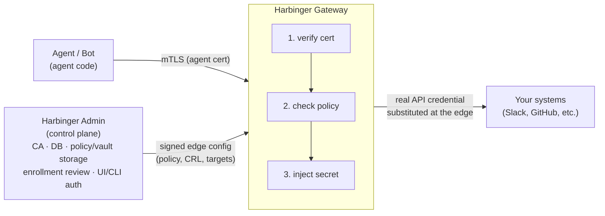

**Sane policies for insane agents.**

[Website: theharbinger.in](https://theharbinger.in)

Harbinger is a non-human identity (NHI) and agentic security platform. Every AI agent, bot, and service account gets a cryptographic identity (mTLS), every request it makes is checked against policy before it's allowed, and any real secret it needs is pulled from your own vault and swapped in at the edge, so the agent itself never holds a standing credential.

The category is non-human identity security in general (API keys, service accounts, bot tokens), with AI agents as the sharpest and fastest-growing example of it, not an AI-only tool.

## Why Harbinger

Most "AI agent security" platforms today are either an SDK you have to rewrite your agent against, a discovery/governance dashboard that tells you what credentials exist without changing how they're used, or something that just shifts responsibility from one API key to another. Harbinger takes a different approach:

1. **No code change required:** Harbinger is a transparent mTLS MITM proxy. Point an agent's traffic at the gateway and it's covered, including third-party agent frameworks you don't control, which is most agent code today.
2. **Secret access is structurally, not just procedurally, gated.** Each request with credentials gets checked against two questions: is the agent allowed to access this website, and is the agent allowed to use this credential against this website? Only when both are true does the agent get to use the credential.

## Quick Start

### Docker compose

1. Configure admin credentials:

```bash
cd deploy/docker
cp .env.example .env
# edit .env and set a real ADMIN_PASSWORD
```

2. Run the docker compose file:

```bash
./up.sh up --build
```

Once the build finishes, `pki-init` automatically drops `hbg_cli`, `harbinger_agentd`, and `root_ca.crt` into `deploy/docker/client-bundle/` on the host. If the agent will run on a different machine, copy that whole directory there first. 

#### Note: Only `root_ca.crt` is specific to this deployment; `hbg_cli` and `harbinger_agentd` aren't, so they could come from anywhere else (e.g. a GitHub release) as long as it matches your OS and architecture.

3. Enroll an agent.
```bash
cd deploy/docker/client-bundle
./hbg_cli cert install --cert root_ca.crt
./hbg_cli agent install --agent my-agent --ip 10.0.0.5 --user admin
```
This submits the enrollment request and waits for approval. Approve it from the web UI (`http://localhost:8446`, under Agent Enrollment) or use the CLI, then re-run the same command to complete enrollment:

```bash
./hbg_cli agent install --agent my-agent
```
This writes `my-agent.crt`/`.key`, caches the root CA, and generates `agentd.yml`, all under `~/.config/harbinger_agentd/` by default. Then run the agent under `harbinger_agentd`, which proxies its traffic through the gateway:

```bash
harbinger_agentd run --agent my-agent -- <YOUR_AGENT_COMMAND>
# example
harbinger_agentd run --agent my-agent -- opencode
# or create an alias if it's not a workflow
alias opencode="harbinger_agentd run --agent my-agent -- opencode"
```

4. Inject a secret into the agent's traffic (optional).

In the web UI, go to Vault Integration → Local: add a secret under Secrets, then create a target in the section below it, this maps a name your policy can reference to where the real secret lives and which destination it's allowed to go to (the `local:` prefix is applied for you). CLI equivalent, if you'd rather script it:

```bash
hbg_cli admin target create --name slack-bot-token --secret-ref local:slack-bot-token --host slack.com
```

See [`docs/agent-secret-placeholders.md`](docs/agent-secret-placeholders.md) for the vault-side setup (including AWS instead of local).

Then wherever your agent currently reads its real token from, put the placeholder there instead:

```bash
export SLACK_BOT_TOKEN='hbg-secret:slack-bot-token:'
```

Harbinger swaps in the real value only for requests to `slack.com` from an agent whose policy explicitly allows this target.

## Components

Binary              | What it does
---                 | ---
`harbinger_admin`   | Control plane. Owns the database, the Admin CA, user/API-key auth, org/team/RBAC, policy/vault/target storage, enrollment review, traffic telemetry, and signed edge-config distribution to gateways.
`harbinger_gateway` | Data plane. The mTLS MITM proxy every agent's traffic goes through: verifies the agent's certificate, evaluates policy per request, and (if configured) substitutes real secrets from a vault. Also issues agent certs at enrollment time.
`hbg_cli`           | Command-line client. Does everything: PKI generation, enrollment, policy/vault/target management, admin user/org/team management. The only client that can do PKI operations.
`harbinger_ui`      | Browser-based alternative to `hbg_cli` for everything except PKI. It's a plain static-file server with no backend of its own; the browser calls the admin API directly, exactly like the CLI does.
`harbinger_agentd`  | Optional wrapper daemon: runs an existing agent process as a child, transparently routes its traffic through the gateway (via `HTTPS_PROXY`), and auto-renews its certificate before it expires. Useful for agents you can't otherwise point at a proxy.

Admin and gateway servers are deliberately separate processes, not just for hosting flexibility but for attack-surface asymmetry. The gateway faces adversarial agent traffic and live secret-fetching; admin holds CA/user-management authority and never touches agent traffic directly.

## How it works



Agents are never given a real credential to begin with. They're configured with a placeholder (`hbg-secret:secret-mapping:`), and the gateway swaps in the real value only after policy explicitly authorizes that agent for that target *and* confirms the request is actually headed to the registered destination, not just claiming to be. See [`docs/agent-secret-placeholders.md`](docs/agent-secret-placeholders.md) for the full mechanics, including why that second check matters (it's what stops a prompt-injected agent from exfiltrating a secret to an attacker-controlled host).

## Identity model

Every agent enrolls with a real mTLS certificate:

1. The agent generates its own keypair + CSR and submits it, naming the user account it belongs to.
2. That user (or any admin) reviews and approves the request.
3. The agent completes enrollment with the gateway, which verifies the CSR's own signature plus the admin's signed approval, then issues a real mTLS certificate.
4. Revocation pushes an updated CRL to all gateways via signed edge config, so access doesn't silently outlive its usefulness the way an un-rotated shared API key does.

Trust is split across a four-tier CA hierarchy (Root CA -> Admin CA / Gateway CA / Agent CA), so a compromise of one CA doesn't hand over the others. For example, a leaked Gateway CA can't forge agent certificates, and a leaked Agent CA can't register a fake gateway.

## Roadmap

- **`harbinger_agentd` as an agent sandbox:** today it wraps an agent's network traffic; next it'll also capture the commands the agent tries to run on the host and block risky ones before they execute, extending policy enforcement from "what it can call" to "what it can do."
- **More vault providers:** AWS and local secrets are supported today; GCP Secret Manager and Bitwarden are next.

## Documentation

Question                                               | Doc
---                                                    | ---
What's the full REST API surface (admin + gateway)?    | [`docs/api-reference.md`](docs/api-reference.md)
How is the codebase organized, and how do I add to it? | [`docs/architecture.md`](docs/architecture.md)
How do I configure an agent for secret injection?      | [`docs/agent-secret-placeholders.md`](docs/agent-secret-placeholders.md)
Docker deployment                                      | [`deploy/docker/README.md`](deploy/docker/README.md)

## License

Licensed under the [Apache License, Version 2.0](LICENSE).
