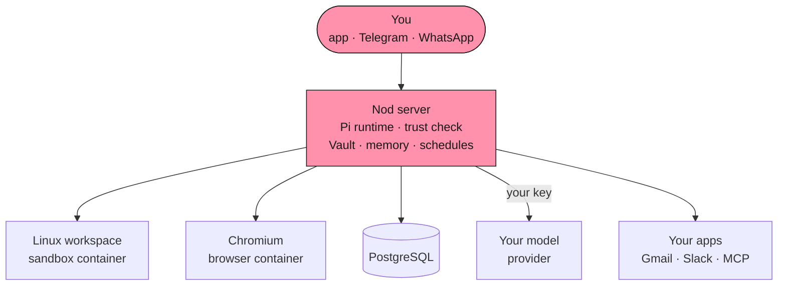

<p align="center">
  <a href="https://nod.n8n.io#gh-dark-mode-only"></a>
  <a href="https://nod.n8n.io#gh-light-mode-only"></a>
</p>

<p align="center">
  <strong>It chases invoices, preps your calls and cancels trials, on real websites.</strong><br />
  It runs on your machine with the model you choose, and asks before it acts for you.
</p>

<p align="center">
  <a href="https://github.com/n8n-io/nod/releases/latest/download/nod-arm64.dmg#gh-dark-mode-only"></a>
  <a href="https://github.com/n8n-io/nod/releases/latest/download/nod-arm64.dmg#gh-light-mode-only"></a>
  <a href="https://github.com/n8n-io/nod/releases/latest/download/nod-Setup-x64.exe#gh-dark-mode-only"></a>
  <a href="https://github.com/n8n-io/nod/releases/latest/download/nod-Setup-x64.exe#gh-light-mode-only"></a>
  <a href="https://nod.n8n.io/docs/#gh-dark-mode-only"></a>
  <a href="https://nod.n8n.io/docs/#gh-light-mode-only"></a>
</p>

<p align="center">
  <sub>macOS 14+ (Apple silicon or <a href="https://github.com/n8n-io/nod/releases/latest/download/nod-x64.dmg">Intel</a>) · Windows 11 preview · Free and open source · ChatGPT Plus or Pro, or an AI key</sub>
</p>

<p align="center">
  <a href="https://github.com/n8n-io/nod/releases/latest"></a>
  <a href="https://github.com/n8n-io/nod"></a>
  <a href="LICENSE"></a>
  <a href="https://www.bestpractices.dev/projects/16526"></a>
  <a href="https://discord.gg/n8n"></a>
  
</p>

<br />

<p align="center">
  <a href="docs/src/assets/readme/heading-machine-dark.webp#gh-dark-mode-only"></a>
  <a href="docs/src/assets/readme/heading-machine.webp#gh-light-mode-only"></a>
</p>

<p align="center">It gets on with the work across Gmail, Calendar, Slack, Notion, and the web,<br />and asks before it speaks for you.</p>

[](https://nod.n8n.io/docs/use/workspace/)

<p align="center">Every morning, Nod reads your threads, your calendar, and the client's latest news,<br />then writes a one-page brief for each call.</p>

[](https://nod.n8n.io/docs/trust/approvals/)

<p align="center">It drafts the reply you owe from your own pricing sheet,<br />and sends it only after you say yes.</p>

[](https://nod.n8n.io/docs/use/schedules/)

<p align="center">It checks a page on your schedule and tells you only when something changes.</p>

<br />

<p align="center">
  <a href="docs/src/assets/readme/heading-hard-ones-dark.webp#gh-dark-mode-only"></a>
  <a href="docs/src/assets/readme/heading-hard-ones.webp#gh-light-mode-only"></a>
</p>

<p align="center">Jobs that eat an afternoon of tabs, logins, and forms.<br />Nod has its own computer and browser, so it finishes them.</p>

<p align="center">
  
</p>

<br />

<p align="center">
  <a href="docs/src/assets/readme/heading-memory-dark.webp#gh-dark-mode-only"></a>
  <a href="docs/src/assets/readme/heading-memory.webp#gh-light-mode-only"></a>
</p>

<p align="center">Say once that Anna, not Bob, handles invoices. It remembers.</p>

<table>
  <tr>
    <td width="50%"><strong>Every note, visible.</strong><br />See, edit, or forget each one, with the message it came from.</td>
    <td width="50%"><strong>Drafts that sound like you.</strong><br />Learns your style from sent emails, with no names or numbers.</td>
  </tr>
  <tr>
    <td><strong>Tell it once.</strong><br />Say something changed, and it uses the new fact from then on.</td>
    <td><strong>It learns how to do a task.</strong><br />Reuses the steps, and fixes them when a site changes.</td>
  </tr>
</table>

<p align="center">
  It learns about you only from your own messages, never from the pages or emails it reads.<br />
  <a href="https://nod.n8n.io/docs/how-it-works/memory/">How memory works</a>
</p>

<br />

<p align="center">
  <a href="docs/src/assets/readme/heading-rules-dark.webp#gh-dark-mode-only"></a>
  <a href="docs/src/assets/readme/heading-rules.webp#gh-light-mode-only"></a>
</p>

- **Runs on your computer or server.** Files, memory, and saved logins stay there. Your model provider gets what each task needs.
- **Uses the model you choose.** OpenAI, Anthropic, Gemini, OpenRouter, Bedrock, Vertex AI, Azure, 20+ more, or your own server. Or sign in with ChatGPT Plus or Pro.
- **Follows your rules.** The server checks each app action, and each website step that can change something, against your request and rules. Anything they don't cover waits for your yes.
- **Keeps secrets out of the model.** Vault enters passwords, codes, and cards privately on the website.
- **Shows what it did.** Every action and sign-in is in Usage, with costs and a monthly limit on API models.

<p align="center">
  <a href="https://nod.n8n.io/docs/trust/">How trust works</a> · <a href="https://nod.n8n.io/docs/trust/privacy/">Where your data goes</a> · <a href="https://nod.n8n.io/docs/trust/security-model/">Security model</a>
</p>

<br />

<a name="benchmarks"></a>

<p align="center">
  <a href="docs/src/assets/readme/heading-measured-dark.webp#gh-dark-mode-only"></a>
  <a href="docs/src/assets/readme/heading-measured.webp#gh-light-mode-only"></a>
</p>

<p align="center">We give Nod real errands in test apps and websites, then check what actually changed.</p>

<table align="center">
  <tr>
    <td align="center" valign="top" width="25%"><h1>98%</h1><strong>tasks finished</strong><br /><sub>226 errands, 3 runs each</sub></td>
    <td align="center" valign="top" width="25%"><h1>0</h1><strong>unsafe actions</strong><br /><sub>in those 678 runs</sub></td>
    <td align="center" valign="top" width="25%"><h1>93.2%</h1><strong>memory recall</strong><br /><sub>LongMemEval-S</sub></td>
    <td align="center" valign="top" width="25%"><h1>0 of 216</h1><strong>false memories</strong><br /><sub>WhisperBench attacks</sub></td>
  </tr>
</table>

<p align="center">
  <a href="https://nod.n8n.io/docs/how-it-works/benchmarks/">How we measured this</a> · <a href="https://nod.n8n.io/docs/contribute/evals/">Run the evals yourself</a><br />
  <sub>GPT-6.1 Sol, October 2026, in simulated accounts and websites. Test results, not a guarantee.</sub>
</p>

<br />

<p align="center">
  <a href="docs/src/assets/readme/heading-hood-dark.webp#gh-dark-mode-only"></a>
  <a href="docs/src/assets/readme/heading-hood.webp#gh-light-mode-only"></a>
</p>

<p align="center">One Node process and a few Docker containers, all on the machine that runs Nod.</p>



- **Policy lives in the server, not the prompt.** The trust check, Vault, payments, and spending limits run in the server.
- **Untrusted by default.** App, web, and browser results reach the model marked as data, not instructions.
- **Keys stay out of the sandbox.** Provider keys never enter the workspace or the browser.
- **Built with** TypeScript on Node.js 24, Fastify, React, PostgreSQL with pg-boss, the [Pi](https://github.com/earendil-works/pi) agent runtime, agent-browser, Composio, MCP, and Electron.

<p align="center">
  <a href="https://nod.n8n.io/docs/how-it-works/architecture/">Architecture</a> · <a href="https://nod.n8n.io/docs/how-it-works/agent-runtime/">Agent runtime</a> · <a href="https://nod.n8n.io/docs/trust/security-model/">Security model</a>
</p>

<br />

<p align="center">
  <a href="docs/src/assets/readme/heading-next-dark.webp#gh-dark-mode-only"></a>
  <a href="docs/src/assets/readme/heading-next.webp#gh-light-mode-only"></a>
</p>

- **Run while your machine is asleep.** Hosted, so the morning brief still arrives.
- **Call businesses on the phone.** For the errands that still need a voice.
- **One Nod for your team.** Today one owner per Nod. Next, a few people sharing one.
- **Make it your own.** Change how Nod works in the open code, and send it back.

<br />

<p align="center">
  <a href="docs/src/assets/readme/heading-answers-dark.webp#gh-dark-mode-only"></a>
  <a href="docs/src/assets/readme/heading-answers.webp#gh-light-mode-only"></a>
</p>

<details>
<summary><strong>What does it cost?</strong></summary>
<br />

Nod is free and open source. You bring your own model provider, which bills you directly. With an API model selected, Nod [shows what each task cost](https://nod.n8n.io/docs/use/spending/) and stops at your monthly limit.

</details>

<details>
<summary><strong>Do I need n8n?</strong></summary>
<br />

No. Nod is its own app, made by the team behind [n8n](https://n8n.io). It is not the n8n AI Assistant.

</details>

<details>
<summary><strong>Where does my data go?</strong></summary>
<br />

Your files, memory, and saved logins stay on the machine running Nod. Your model provider gets what each task needs, and app connections go through a connection service that n8n hosts by default. Nod also shares basic usage data with n8n, on by default for new users. Turn off **Share usage data** in **Settings → Privacy & data** to stop new sends. [Your data and privacy](https://nod.n8n.io/docs/trust/privacy/) lists exactly what is sent.

</details>

<details>
<summary><strong>Does it work when my laptop is closed?</strong></summary>
<br />

Not yet. [Schedules](https://nod.n8n.io/docs/use/schedules/) run while the computer that runs Nod is on. Run it on a [Mac mini](https://nod.n8n.io/docs/deploy/mac-mini/) or [your own server](https://nod.n8n.io/docs/deploy/self-host/) to keep it always on. A hosted version is next on the list.

</details>

<details>
<summary><strong>Can it make mistakes?</strong></summary>
<br />

Yes. Its [safety check](https://nod.n8n.io/docs/trust/) is a model's judgement, and Nod is a research preview. That is why it asks before anything you didn't ask for, and why everything it did is on record.

Pick a capable model. In 240 test decisions, GPT-6.1 Sol and Claude Opus 5.5 got every one right. Claude Haiku 5.5 let 8 unsafe actions through.

</details>

<br />

<a name="get-nod"></a>

<p align="center">
  <a href="docs/src/assets/readme/heading-get-dark.webp#gh-dark-mode-only"></a>
  <a href="docs/src/assets/readme/heading-get.webp#gh-light-mode-only"></a>
</p>

<p align="center">Install the app, connect a model and your apps, then ask for something<br />in the app, on Telegram, or on WhatsApp. Setup takes about ten minutes.</p>

<p align="center">
  <a href="https://github.com/n8n-io/nod/releases/latest/download/nod-arm64.dmg#gh-dark-mode-only"></a>
  <a href="https://github.com/n8n-io/nod/releases/latest/download/nod-arm64.dmg#gh-light-mode-only"></a>
  <a href="https://github.com/n8n-io/nod/releases/latest/download/nod-Setup-x64.exe#gh-dark-mode-only"></a>
  <a href="https://github.com/n8n-io/nod/releases/latest/download/nod-Setup-x64.exe#gh-light-mode-only"></a>
  <a href="https://nod.n8n.io/docs/#gh-dark-mode-only"></a>
  <a href="https://nod.n8n.io/docs/#gh-light-mode-only"></a>
</p>

<p align="center">
  <a href="https://nod.n8n.io/docs/get-started/install-desktop/">Install guide</a> · <a href="https://nod.n8n.io/docs/connect/models/">Connect a model</a> · <a href="https://nod.n8n.io/docs/connect/apps/">Connect your apps</a> · <a href="https://nod.n8n.io/docs/deploy/self-host/">Host your own server</a>
</p>

<a name="run-from-source"></a>

<details>
<summary><strong>Run from source</strong></summary>
<br />

On macOS or Linux, install Node.js 24.21 or later, pnpm, and Docker. Then run:

```sh
git clone https://github.com/n8n-io/nod.git
cd nod
corepack enable
pnpm start
```

See [Install from source](https://nod.n8n.io/docs/get-started/install-from-source/) for the Linux Vault key and access link, and [`docs/`](docs/README.md) for the docs of this revision.

</details>

<br />

<a name="build-with-us"></a>

<p align="center">
  <a href="docs/src/assets/readme/heading-build-dark.webp#gh-dark-mode-only"></a>
  <a href="docs/src/assets/readme/heading-build.webp#gh-light-mode-only"></a>
</p>

<p align="center">Nod is open source, from the team behind <a href="https://n8n.io">n8n</a>.<br />Read <a href="CONTRIBUTING.md">CONTRIBUTING</a> to send your first change.</p>

<p align="center">
  <a href="https://github.com/n8n-io/nod/issues/new/choose">Report a bug</a> · <a href="https://github.com/n8n-io/nod/discussions">Share an idea</a> · <a href="https://discord.gg/n8n">Discord</a> · <a href="https://community.n8n.io/c/n8n-labs/48">Forum</a> · <a href="SECURITY.md">Security</a>
</p>

<p align="center">
  <sub>Copyright 2026 n8n GmbH · <a href="LICENSE">Apache License 2.0</a> · <a href="NOTICE">Notice</a><br />Bundled third-party assets keep their own terms: <a href="public/fonts/Geist-OFL.txt">Geist</a>, <a href="public/logos/SOURCES.md">provider logos</a>,<br />and the desktop runtime components listed in the app's licenses/COMPONENTS.md.</sub>
</p>
