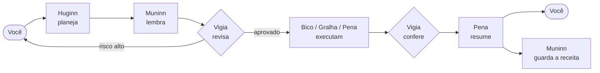

<p align="center">
  <picture>
    <source media="(prefers-color-scheme: dark)" srcset="assets/brand/dotcrow-logo-dark.svg">
    
  </picture>
</p>

<p align="center">
  <strong>Agentes open source que trabalham no seu computador.</strong><br>
  Você delega a tarefa inteira. Os corvos planejam, executam, conferem e aprendem.
</p>

<p align="center">
  <a href="https://github.com/napoleaomp4/dotcrow/actions/workflows/ci.yml"></a>
  <a href="LICENSE"></a>
  
  
</p>

<p align="center">
  <a href="#comece-agora">Comece agora</a> ·
  <a href="docs/arquitetura.md">Arquitetura</a> ·
  <a href="docs/agentes.md">Os agentes</a> ·
  <a href="docs/seguranca.md">Segurança</a> ·
  <a href="ROADMAP.md">Roadmap</a> ·
  <a href="CONTRIBUTING.md">Contribuir</a> ·
  <a href="README.en.md">English</a>
</p>

> [!WARNING]
> **Pré-alfa.** Os corvos já pensam com LLMs de verdade (Claude, GPT, Gemini e outras), mas ainda não controlam o computador, e a criptografia não passou por auditoria externa. Não use com dados ou chaves de produção. Estamos construindo isso em público, e você pode ajudar.

---

## O que é

O **DotCrow** ([dotcrow.si](https://dotcrow.si)) é um agente open source que roda no seu computador. Em vez de pedir uma resposta, você entrega uma tarefa completa ("organize minha pasta de downloads por cliente e me mande um resumo") e um bando de agentes resolve: um planeja, outro lembra como já foi feito antes, outro confere os riscos, outro executa e outro escreve o relatório.

O que torna o DotCrow diferente:

- **Vários agentes, cada um pensando de um jeito.** São seis corvos com personalidades e formas de organizar diferentes. Eles se revisam entre si antes de qualquer ação.
- **Qualquer LLM com API.** Claude, GPT, Gemini, OpenRouter, modelos locais via Ollama. Quando a API de um acaba a cota ou cai, o DotCrow **troca para o próximo sozinho**, sem parar a tarefa.
- **Chaves de API invisíveis.** Só o dono do computador adiciona chaves, e nem ele consegue vê-las depois. Dá para listar, apagar e criar outra. Não existe comando para exibir uma chave.
- **Modo aprendizagem coletivo.** Quando um DotCrow aprende a fazer uma tarefa, a *receita* (os passos, sem nenhum dado pessoal) pode ser compartilhada na **Revoada**, a memória coletiva. O que um corvo aprende serve para todo o bando. É opcional e desligado por padrão.
- **Criptografia pós-quântica.** Mensagens são cifradas com um esquema híbrido: ML-KEM-768 (resistente a computadores quânticos) combinado com X25519. Para ler, um atacante precisa quebrar os dois. Cada instalação tem uma identidade criptográfica própria, que será certificada digitalmente.
- **Nada irreversível sem você.** Apagar, enviar, pagar, instalar: tudo que não dá para desfazer pede sua confirmação. Instruções que aparecem dentro de páginas, e-mails ou arquivos nunca contam como ordem sua.

## Por que um corvo?

Corvos estão entre os animais mais inteligentes que existem: usam ferramentas, resolvem problemas em etapas e **ensinam uns aos outros**. Pesquisadores da Universidade de Washington mostraram que, quando um corvo aprende que certa pessoa é perigosa, o bando inteiro passa a reconhecê-la, incluindo corvos que nunca a viram. É a ideia da Revoada.

Na mitologia nórdica, Odin tinha dois corvos, **Huginn** (pensamento) e **Muninn** (memória), que voavam pelo mundo e voltavam contando o que viram. No DotCrow, você é o Odin.

## Os corvos

| Agente | Papel | Como pensa | Como organiza |
|---|---|---|---|
| **Huginn** | Estrategista | De cima para baixo: entende o objetivo e o que significa "pronto" antes de qualquer passo | Em árvore de dependências |
| **Muninn** | Memória | Por precedentes: "já vi algo parecido, funcionou assim" | Por semelhança e linha do tempo |
| **Gralha** | Organizadora | Por categorias: faz o inventário antes de mover qualquer coisa | Em hierarquia de pastas e etiquetas |
| **Bico** | Executor | Passo a passo: faz, confere o resultado real, segue | Em fila de checklist, sabendo como desfazer |
| **Pena** | Escritora | Pelo ponto de vista de quem vai ler | Em narrativa: contexto → o que aconteceu → o que fazer |
| **Vigia** | Guardião | Como um adversário: "o que pode dar errado aqui?" | Por nível de risco |

Fluxo de uma tarefa típica:



Mais detalhes em [docs/agentes.md](docs/agentes.md).

## O que já funciona

| Parte | Estado | Onde |
|---|---|---|
| Painel visual no navegador e no celular, com API para apps | ✅ funcionando | `crates/dotcrow-cli/src/painel`, [docs/painel.md](docs/painel.md) |
| Provedores reais: Claude, GPT, Gemini, OpenRouter, DeepSeek, Groq e Ollama | ✅ funcionando | `crates/dotcrow-providers` |
| Roteador com troca automática entre LLMs | ✅ funcionando | `crates/dotcrow-providers` |
| Corvos planejando, revisando e escrevendo com LLM real | ✅ funcionando (ainda sem mexer no computador) | `crates/dotcrow-agents` |
| Cofre de chaves somente-escrita, cifrado em disco | ✅ funcionando | `crates/dotcrow-vault` |
| Envelope híbrido ML-KEM-768 + X25519 | ✅ funcionando, **não auditado** | `crates/dotcrow-crypto` |
| Política de permissões e confirmação | ✅ funcionando | `crates/dotcrow-core` |
| CLI `dotcrow` | ✅ painel, chaves, testar, perguntar, tarefa, provedores | `crates/dotcrow-cli` |
| WhatsApp e ver a tela do computador ao vivo | 🟡 próximos passos | [ROADMAP](ROADMAP.md) |
| Ninho (serviço local que fica rodando) | 🟡 fase 1 | [ROADMAP](ROADMAP.md) |
| Controle do computador (arquivos, programas, navegador) | ⚪ fase 2 | |
| Memória local e modo aprendizagem | ⚪ fase 3 | |
| Revoada (memória coletiva) e certificados | ⚪ fase 4 | |

## Comece agora

### Pacotes prontos (sem compilar)

Baixe na página de [**Releases**](https://github.com/napoleaomp4/dotcrow/releases):

- **Windows:** `dotcrow-setup.exe` (instalador de clicar) ou o `dotcrow.exe` portátil. Pelo PowerShell: `irm https://raw.githubusercontent.com/napoleaomp4/dotcrow/main/packaging/windows/instalar.ps1 | iex`
- **Linux (Debian/Ubuntu/Mint):** `sudo apt install ./dotcrow_0.1.0_amd64.deb`

Os instaladores são gerados pelo [workflow de release](.github/workflows/release.yml) a cada versão (`git tag v0.1.0 && git push origin v0.1.0`).

### Do código-fonte

No Linux ou no macOS, um comando instala tudo (Rust, compilador e o próprio DotCrow) e coloca o comando `dotcrow` no seu PATH:

```bash
curl -fsSL https://raw.githubusercontent.com/napoleaomp4/dotcrow/main/instalar.sh | bash
```

Ou, se já clonou o repositório:

```bash
git clone https://github.com/napoleaomp4/dotcrow.git
cd dotcrow
./instalar.sh
```

No Linux, o instalador também cria o ícone do DotCrow no menu de aplicativos: é só clicar nele. Ou abra um terminal novo e abra o painel:

```bash
dotcrow painel
```

No painel, vá em **Chaves**, cole a chave de API de um provedor (Claude, GPT, Gemini...) e clique em **Testar**. Depois, em **Tarefas**, peça algo aos corvos e acompanhe cada etapa ao vivo. Para abrir no celular, use `dotcrow painel --rede` e aponte a câmera para o QR code. Tudo sobre o painel e a API está em [docs/painel.md](docs/painel.md).

Prefere o terminal?

```bash
# Guarde uma chave de API (ela é lida sem aparecer na tela)
dotcrow chaves adicionar anthropic --rotulo "conta pessoal"

# Teste as chaves: cada provedor recebe um pedido mínimo
dotcrow testar

# Entregue uma tarefa aos corvos e veja cada etapa
dotcrow tarefa "escreva um e-mail para um cliente explicando que a entrega atrasou dois dias"

# Pergunta direta, sem passar pelos corvos
dotcrow perguntar "o que é um corvo, em uma frase?"

# Ordem e modelos dos provedores
dotcrow provedores
dotcrow provedores ordem anthropic,gemini,openai

# Os corvos, o fluxo e a troca automática simulada
dotcrow agentes
dotcrow demo troca

# Liste e apague chaves: aparece o provedor e a impressão digital, nunca a chave
dotcrow chaves listar
dotcrow chaves apagar 1a2b3c4d
```

Para compilar na mão, você precisa do [Rust](https://rustup.rs) 1.88 ou mais novo (o `cargo` do `apt` é antigo demais) e de um compilador C (`build-essential` no Ubuntu):

```bash
cargo build --release
./target/release/dotcrow painel
```

Rodando os testes:

```bash
cargo test
cargo clippy --all-targets -- -D warnings
cargo fmt --all -- --check
```

## Estrutura do repositório

```
crates/
  dotcrow-core/        permissões, riscos, ações e política de confirmação
  dotcrow-crypto/      envelope híbrido pós-quântico e cifra simétrica
  dotcrow-vault/       cofre de chaves de API somente-escrita
  dotcrow-providers/   adaptadores de LLM (Claude, GPT, Gemini...) e roteador com troca automática
  dotcrow-agents/      os seis corvos, o fluxo entre eles e o orquestrador
  dotcrow-cli/         o comando `dotcrow` e o painel visual (src/painel)
docs/                  arquitetura, segurança, agentes, provedores, painel e API, Revoada e decisões (ADRs)
assets/brand/          logo e identidade visual
scripts/github/        script que prepara labels, marcos e as primeiras issues
packaging/             .deb (Linux) e instalador .exe/NSIS (Windows)
instalar.sh            instalador de um comando (compila do código)
```

## Como ajudar

Toda ajuda conta: código, testes, documentação, tradução, revisão de segurança ou só testar e abrir issues.

1. Leia o [guia de contribuição](CONTRIBUTING.md).
2. Escolha uma issue com o rótulo [`boa-primeira-issue`](https://github.com/napoleaomp4/dotcrow/labels/boa-primeira-issue) ou [`ajuda-bem-vinda`](https://github.com/napoleaomp4/dotcrow/labels/ajuda-bem-vinda).
3. Comente na issue que vai pegar, para ninguém fazer em dobro.

Bons lugares para começar: um provedor novo compatível com a API da OpenAI (Mistral, xAI...), a ponte com o WhatsApp usando a [API do painel](docs/painel.md#api), o filtro de privacidade das receitas, ou testes de ataque de prompt injection para o Vigia.

## Segurança

Achou uma falha? **Não abra issue pública.** Siga o [SECURITY.md](SECURITY.md). O modelo de ameaças e os detalhes da criptografia estão em [docs/seguranca.md](docs/seguranca.md).

## Licença

Código sob a [Licença Apache 2.0](LICENSE). O nome DotCrow e o logo identificam o projeto oficial; veja [assets/brand/README.md](assets/brand/README.md).

---

<p align="center">
  Criado por <a href="https://github.com/napoleaomp4">Napoleão Junior</a> em Buriticupu, Maranhão 🇧🇷<br>
  <a href="https://x.com/napoleaomp4">@napoleaomp4</a> · <a href="https://dotcrow.si">dotcrow.si</a>
</p>
