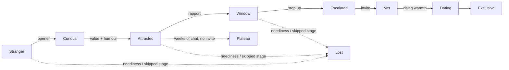

<div align="center">

# 💬 dating-coach

### Your rizz, peer-reviewed.

**A Claude Code skill that tells you exactly what to text, when to ask, and when to let go, with the research behind every rule.**

**🌐 English · [中文](README.zh-CN.md)**

[](https://docs.claude.com/en/docs/claude-code/skills)
[](benchmark/README.md)
[](references/evidence.md)
[](#-the-evidence-table)
[](#-what-it-wont-do)
[](LICENSE)


</div>

---

Most dating advice is either **vibes** ("just be confident bro") or **manipulation** ("neg her, then go cold for three days"). This is neither.

**16+ hours of transcribed real-world coaching** (street approaches, date breakdowns, chat-log teardowns) distilled into one method, then checked against the research: **20 popular dating claims graded against 26 published studies**. Keep what holds up, drop what doesn't, and replace every manipulative tactic with an honest move that does the same job.

Every answer has the same shape: **verdict → plan → copy-paste messages in your own voice → what to do depending on their reply**.

## 🚀 Install

**Claude Code** (one line):

```bash
git clone https://github.com/nelonmelons/dating-coach-skill.git ~/.claude/skills/dating-coach
```

**claude.ai / Claude desktop:** download `dating-coach.zip` from [Releases](https://github.com/nelonmelons/dating-coach-skill/releases/latest) and upload it in Claude's **Skills** settings.

Then just ask a dating question; it triggers automatically (or type `/dating-coach`). Ask in **中文** and you get WeChat-native scripts.

## 🧪 Does it actually help? A blind test

8 realistic dating questions, answered twice by fresh Claude agents: once **with** this skill and once **without**. Two independent judges (Claude Opus and Sonnet) scored each anonymised, randomly ordered pair without knowing which was which.

| | dating-coach | plain Claude |
|---|---|---|
| **Blind wins** | **15 / 16** | 1 / 16 |
| Actionable (avg /10) | **9.0** | 7.7 |
| Sounds natural | **8.4** | 7.8 |
| Fits the situation | **8.5** | 8.1 |
| Accurate | 8.75 | 8.5 |
| Ethical & safe | 9.0 | 9.1 |

The difference is mostly **actionability**: plain Claude gives sensible advice; dating-coach tells you what to send, when, and what to do depending on how they reply. Small sample, LLM judges. Prompts, both answer sets, the blinding key and the judges' scores are all in [`benchmark/`](benchmark/README.md), including the one case it lost and what was fixed.

## 🧠 Why it's different

| | Typical "rizz" bots | **dating-coach** |
|---|---|---|
| Basis | Vibes, one guru's opinion | Field method **+ 26 published studies**, every claim graded |
| Proof | "Trust me bro" | **Blind-tested** against plain Claude, all data published |
| Output | 5 generic pickup lines | Diagnosis, the plan, **messages in your voice**, next steps for each kind of reply |
| Handles "she went quiet" | "Send another text!" | A **three-step exit plan** with clear triggers and graceful-close scripts |
| Hard-to-get / hot-and-cold | Taught as gospel | Modelled formally: works **only at the start** and only as one cool-to-warm arc |
| "No" | Often treated as a "test" | **Treated as information.** Shown that reading every no as interest means you've stopped listening |
| Manipulation | Negging, cold reading, alcohol | **None.** Every tactic is replaced with an honest version that works better |

## 🗺️ The stage model

Every situation is placed on one pipeline, so the coach can tell you **which stage you're stuck at**. It doesn't just give generic tips.



- **Weakest link:** your overall odds are the *product* of each stage's pass rate, so fixing your worst stage pays more than polishing your best.
- **"Creepy" is timing:** the right words at the wrong stage get punished. The model says why skipping a stage rarely pays.
- **Stalling costs you:** interest fades over time, so weeks of pleasant chat with no plan is a failure mode with a name: *the plateau*.

## 📐 The evidence table

<details>
<summary><b>20 popular dating claims, graded</b> (click to expand)</summary>

| Claim | Verdict |
|---|---|
| Ask follow-ups and disclose back | ✅ Strongly supported (Aron et al., 1997) |
| Varied, exciting dates | ✅ Supported (Aron et al., 2000; Dutton & Aron, 1974) |
| Humour is a core attractor | ✅ Supported (Bressler et al., 2006) |
| Be selective, not available to everyone | ✅ Supported (Walster et al., 1973; Eastwick et al., 2007) |
| Cold first, warm later | ✅ Supported (Aronson & Linder, 1965) |
| Give a reason and requests succeed | ✅ Supported (Langer et al., 1978) |
| Small ask first, bigger later | ✅ Supported (Freedman & Fraser, 1966) |
| Flashy cars signal short-term interest | ✅ Supported (Sundie et al., 2011) |
| Unpredictability makes them think about you | ⚠️ Raises *wanting*, not *liking* (Dai et al., 2014) |
| Women mainly want status and money | ⚠️ True in surveys, weak in real face-to-face choices (Eastwick & Finkel, 2008) |
| Nice guys finish last | ⚠️ Mostly false long-term (Urbaniak & Kilmann, 2003) |
| Specific compliments beat generic | ⚠️ Indirect support (Reis & Shaver, 1988) |
| People value what they work for | ⚠️ Effort justification; untested in courtship |
| "Ten men compete for every woman" | ⚠️ Exaggerated |
| Never show interest; stay aloof | ❌ Contradicted: liking is reciprocal (Montoya & Insko, 2008) |
| Never apologise | ❌ Contradicted (Gottman, 1994) |
| Be a little feared | ❌ Contradicted (Cheng et al., 2013) |
| The shorter the acquaintance, the better | ❌ Contradicted (Zajonc, 1968) |
| Hesitation means yes; refusals are tests | ❌ Contradicted and dangerous (Muehlenhard & Hollabaugh, 1988) |
| A bad chat is forgotten in a week | ❔ Untested rule of thumb |

**The pattern:** advice about *process* (pacing, humour, curiosity, leading, varied dates, not being needy) holds up. The *adversarial worldview* (refusals as games, aloofness, dominance) doesn't.

</details>

## 🧮 The models behind the rules

<details>
<summary><b>Six simple models that say <i>when</i> each rule is optimal</b> (click to expand)</summary>

- **Reply timing has a sweet spot.** Delay signals that you have a life; responsiveness builds closeness. The trade-off `U(τ) = v(1−e^{−τ/a}) + r·e^{−τ/b}` has an interior optimum, so "match their pace" is the practical rule, not "wait 3 hours".
- **Soft invite first.** If a refused direct invite makes later yeses less likely, a cheap soft probe ("we should… sometime") is the optimal first move once refusals are sticky enough.
- **Hot-and-cold.** Under gain–loss dynamics, only the *first and last* signals matter. Endless oscillation adds nothing, and one measured-to-warm arc wins.
- **Scripted comebacks stop working.** Once everyone memorises the same answers, the answers stop signalling confidence. Only real composure survives repeated challenges.
- **80/20/0 money rule.** When early gifts raise someone's other options more than their satisfaction, the best spend on gifts is zero. Spend on yourself and shared experiences instead.
- **Why "no" must count.** If every answer is read as interest, the reading carries zero information. Basic probability says treat "no" as evidence, and consent says treat it as final.

</details>

## 📦 What's inside

<details>
<summary><b>8 reference files + Chinese edition</b> (click to expand)</summary>

| File | What it covers |
|---|---|
| [`SKILL.md`](SKILL.md) | Coaching workflow, stage model, 15 core principles, non-negotiables, routing |
| [`texting.md`](references/texting.md) | Reply timing, between dates, re-opening dead chats, a **set format for analysing a chat** |
| [`dates.md`](references/dates.md) | 3–5-stop date plans, escalation and consent, dates 2–3, going exclusive, flakes |
| [`conversation.md`](references/conversation.md) | Openers (in person and apps), profiles, hook → display → release, handling teases and tests |
| [`recovery.md`](references/recovery.md) | **Three-step exit plan**, graceful-failure scripts, talking you through sunk cost |
| [`relationship.md`](references/relationship.md) | Conflict repair, "you never make time for me", long-term milestones |
| [`evidence.md`](references/evidence.md) | The graded claims and the models above |
| [`catalog.md`](references/catalog.md) | **470 lines** covering every technique, signal, script and rule of thumb, each tagged by evidence and ethics |
| [`benchmark/`](benchmark/README.md) | The blind test: prompts, both answer sets, judges' scores |

Every reference file also exists in Chinese under `references/zh/`.

</details>

## 💬 Things to ask it

- *"here's our chat [paste]. she's replying slower. what do i send?"*
- *"how do i ask her out without it being weird? we've talked for 4 days on hinge"*
- *"she cancelled our 2nd date with no reschedule. do i text back?"*
- *"plan a first date in [city] that isn't dinner and a movie"*
- *"she said 'you must say that to every girl'. how do i reply?"*
- *"my girlfriend says i never make time for her. i work 60h weeks"*

## 🛡️ What it won't do

Negging. Cold reading. Fake personas. "Accidentally" escalating. Making her jealous through her friend. Getting someone drunk. Treating "not sure" as shyness. Re-adding someone who blocked you.

It's not squeamish. **These tactics don't hold up**: they collapse once she knows you, or they get a "yes" she didn't freely give. Ask for one and the coach gives you the honest move that does the same job, plus a one-line explanation of why it works better.

## ⚠️ Honest limitations

Most of the research uses Western, often student samples in lab or speed-dating settings, and effect sizes are modest. Specific timing numbers ("three dates", "a week to reset") are rules of thumb, and the skill labels them that way. The formal models show *when* a rule would be optimal, not that it always is. The default examples are written for men dating women, but the principles generalise and the coach adapts to whoever you are.

## 🤝 Contributing

PRs welcome, especially:
- new **graded claims** with citations
- **scenario scripts** for situations the coach handles poorly
- adaptations for other cultures, platforms and orientations

If this helped you get a second date, **⭐ star the repo**. That's how other people find it.
