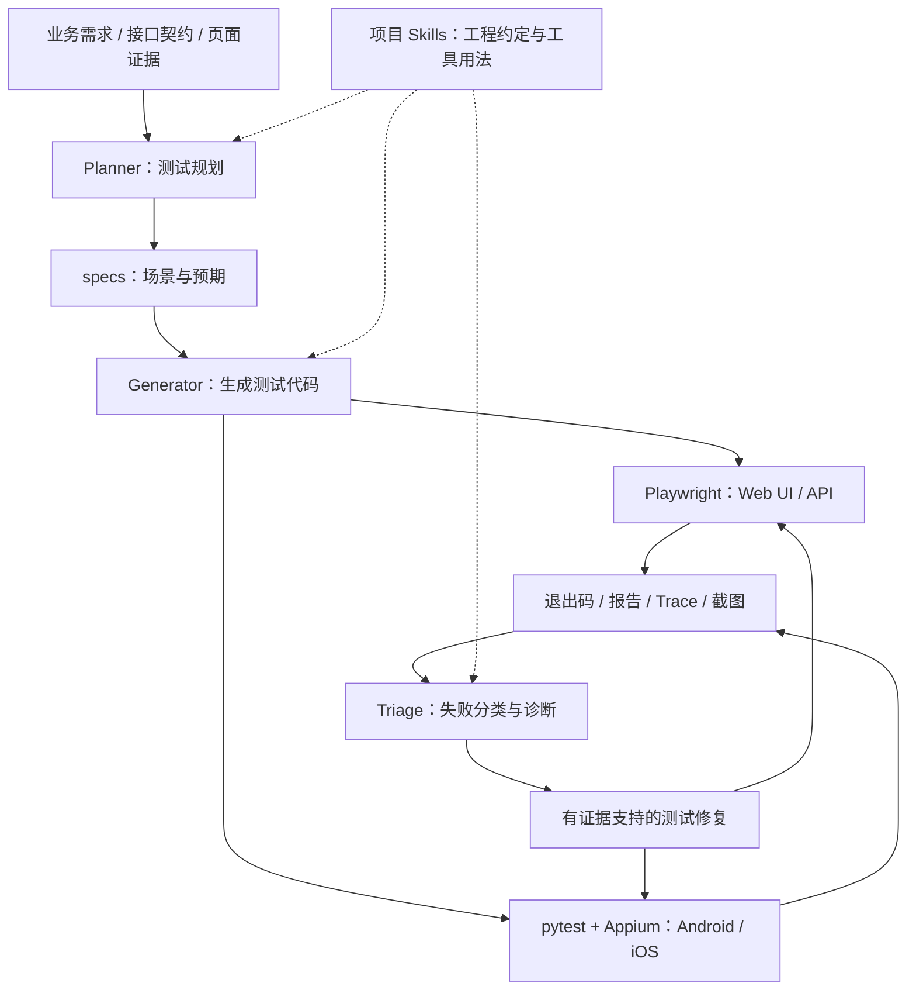

# QA Automation · Agent + Skill 自动化测试工程

面向 Web UI、HTTP API 与 Android/iOS App 的自动化测试工程。项目以 Playwright 和 Appium 为执行基础，通过仓库级 Skills 与编码 Agent 协作完成需求分析、测试生成、失败诊断和测试维护，保留可独立运行的测试代码与验证记录。

当前提供两套工程：Web/API 工程包含可直接运行的本地演示服务；App 工程提供跨平台驱动配置、设备启动烟测和业务登录接入示例。两个工程可分别运行测试；脚本化 Agent 调用共用根目录的 `tools/agent_runner.py`，复制子工程时需要同时保留该工具目录或调整调用路径。

| 阅读目标 | 文档入口 |
|---|---|
| 运行 Web UI 与接口测试 | [Web/API 工程指南](web-api-agent-tests/README.md) |
| 运行后端订单、库存与权限测试 | [后端 API 专项指南](web-api-agent-tests/docs/BACKEND-API.md) |
| 运行 App 框架检查与设备测试 | [App 工程指南](mobile-agent-tests/README.md) |
| 了解 Agent 分阶段执行与 Skills | [Agent 工作流](docs/AGENT-WORKFLOW.md) |
| 查看设计说明与扩展方向 | [架构与设计说明](docs/README.md) |
| 核实测试结果和当前限制 | [验证记录](docs/VALIDATION.md) |

<!-- BEGIN project-discovery -->
## 项目定位与实践入口

AI-assisted test automation with Playwright, Appium and pytest for Web, API, Android and iOS. Agent + Skills 自动化测试框架，含本地 Demo、测试报告与 CI。

适合从以下入口阅读实现与接入条件：

- [Web/API 自动化测试](web-api-agent-tests/README.md)
- [移动端测试框架](mobile-agent-tests/README.md)
<!-- END project-discovery -->

## 项目定位

本项目为测试团队提供可阅读、可修改、可迁移的工程基线，适合搭建新项目自动化、统一 UI/API 测试规范，以及验证 Agent 辅助测试的团队协作方式。

工程设计围绕以下目标展开：

- **执行可复现**：测试代码独立于模型运行，常规回归通过固定命令执行。
- **职责清晰**：测试计划、页面对象、接口客户端、运行配置和业务断言分别维护。
- **结果可核查**：保存执行退出码、HTML/JUnit 报告及失败证据。
- **维护有依据**：Agent 根据真实页面、接口契约和执行结果生成或修复测试。
- **接入渐进式**：先验证本地示例与框架，再接入测试环境和真实设备。

## 总体架构



| 层次 | 主要职责 | 对应实现 |
|---|---|---|
| 需求与计划 | 描述前置条件、操作步骤、预期结果和清理方式 | 各工程 `specs/` |
| Agent 协作 | 派发阶段任务、调用模型、记录过程、触发外部验证 | [agent_runner.py](tools/agent_runner.py) |
| Skills | 约定数据隔离、定位依据、断言规范与修复边界 | 各工程 `.agents/skills/` |
| 测试执行 | 操作浏览器、发送请求、控制设备、验证断言 | Playwright Test、pytest、Appium |
| 业务适配 | 封装页面交互、接口调用和设备配置 | `src/`、`pages/`、`framework/` |
| 结果与集成 | 输出报告、保存证据、执行 CI 回归 | 各工程报告目录、GitHub Actions |

Agent 角色按阶段调用；常规 CI 执行已提交的测试代码。生成或修复后，调用器使用独立命令验证结果，具体检查范围由工程与参数决定。

## 能力与实现范围

| 能力 | 当前实现 | 接入说明 |
|---|---|---|
| Web UI | Chromium、Page Object、自动等待、网络异常模拟 | 可直接运行本地待办示例 |
| HTTP API | 生命周期、边界输入、状态码、Zod 契约、数据隔离 | 真实业务需替换接口与鉴权 |
| 后端专项 | Token/角色/租户、订单库存、幂等、版本冲突、并发防超卖 | 50个本地业务用例，真实后端需替换契约与数据基线 |
| UI/API 联动 | API 准备数据、浏览器验证业务展示 | 复用 fixture 与租户清理 |
| Android / iOS | UiAutomator2 / XCUITest 配置与启动烟测 | 需安装驱动并连接设备 |
| App 业务流程 | 基于 accessibility ID 的登录实现示例 | 需提供真实 App、定位和账号 |
| Agent + Skill | 规划、生成、诊断、修复与任务包记录 | 真实调用需可用的 Codex 登录环境 |
| CI 与报告 | Web/API 回归、App 框架检查、HTML/JUnit、证据归档 | 当前 CI 不包含真实设备任务 |

Firefox/WebKit 执行矩阵、视觉回归、性能测试、设备云和多设备并发属于扩展方向，当前没有对应完整实现。

## 目录结构

```text
QA-Automation/
├── readme.md                     # 项目总览与统一入口
├── web-api-agent-tests/           # Web UI + API 测试工程
│   ├── .agents/skills/            # Web 规划、UI、API、诊断 Skills
│   ├── demo/                      # 本地演示页面与 HTTP 服务
│   ├── src/api/                   # 接口客户端与响应契约
│   ├── src/pages/                 # Web 页面对象
│   ├── tests/                     # API、UI 与共享 fixtures
│   ├── specs/                     # 测试计划
│   └── playwright.config.ts       # 项目、并发、报告与服务配置
├── mobile-agent-tests/            # Android / iOS 测试工程
│   ├── .agents/skills/            # App 规划、生成与诊断 Skills
│   ├── config/                    # 平台 capabilities 模板
│   ├── framework/                 # 配置加载与驱动工厂
│   ├── pages/                     # 显式等待与业务页面对象
│   ├── tests/unit/                # 无设备框架检查
│   ├── tests/device/              # 设备启动烟测
│   ├── tests/business/            # 业务登录接入示例
│   └── scripts/                   # 设备截图与页面树采集
├── tools/                        # Agent 调用器及其测试
├── docs/                         # 设计、流程与验证记录
└── .github/workflows/qa.yml       # 持续集成配置
```

## 环境要求

| 组件 | 要求 | 用途 |
|---|---|---|
| Node.js | >= 22.12.0 | Playwright 与本地 Appium 服务 |
| npm | Appium 工程要求 >= 10 | 安装锁定的 Node 依赖 |
| Python | 锁定依赖兼容 3.9；CI 使用 3.11 | pytest 与 Agent 调用器；推荐使用链接 OpenSSL 的环境 |
| 浏览器 | Playwright 安装的 Chromium | Web UI 回归 |
| Android 环境 | JDK、Android SDK、平台驱动及可用设备 | Android 设备测试 |
| iOS 环境 | macOS、Xcode、平台驱动及可用设备 | iOS 设备测试；真机需签名配置 |
| Codex | 可执行 CLI 与有效登录 | 仅实际 Agent 调用时需要 |

Node 依赖通过各工程的 `package-lock.json` 重现；Python 完整解析结果记录于 `requirements-lock.txt`。移动端平台驱动还需单独安装、记录版本并验证兼容性。

## 快速开始

以下命令使用 bash/zsh 语法，均以仓库根目录为起点。

### Web UI 与 API

```bash
cd web-api-agent-tests
npm ci
npx playwright install chromium
npm run typecheck
npm test
npm run report
```

默认自动启动并关闭 `http://127.0.0.1:3100` 的演示服务。单独执行待办接口、后端专项或页面测试可使用 `npm run test:api`、`npm run test:backend`、`npm run test:ui`；`npm run test:api:all` 执行全部接口。Linux 首次运行需安装浏览器系统依赖，具体见子工程指南。

### App 框架检查

```bash
cd mobile-agent-tests
python3 -m venv .venv
source .venv/bin/activate
python -m pip install -r requirements-lock.txt
python -m pytest tests/unit --html=artifacts/unit-report.html --self-contained-html
```

该步骤不需要 Appium 服务或设备，只验证框架配置、驱动参数及失败证据采集。运行真实设备和业务流程请继续阅读 [App 工程指南](mobile-agent-tests/README.md)。

## Agent 与 Skills 使用

项目共维护 7 份工程级 Skill 文件，其中 `qa-test-triage` 在两个工程分别提供，共有 6 个不同的 Skill 名称。

| Skill | 所在工程 | 职责 |
|---|---|---|
| `qa-web-plan` | Web/API | 需求拆解与测试计划 |
| `qa-web-ui` | Web/API | 页面定位、流程测试与 UI/API 联动 |
| `qa-web-api` | Web/API | 契约、边界与业务副作用验证 |
| `qa-mobile-plan` | App | 平台条件、设备矩阵与 App 场景规划 |
| `qa-mobile-ui` | App | 页面对象与设备用例生成 |
| `qa-test-triage` | 两个工程 | 失败分类与有依据的测试修复 |

从仓库根目录准备任务包：

```bash
python3 tools/agent_runner.py \
  --project web --role plan \
  --task '分析待办功能，规划标题边界与异常场景'
```

准备模式不调用模型。检查生成的 `task.md` 后，可在命令末尾添加 `--execute` 发起实际调用；这会使用当前 Codex 登录与相应额度。

根据已有计划生成接口测试：

```bash
python3 tools/agent_runner.py \
  --project web --role generate --kind api \
  --plan specs/todos.md \
  --task '按计划检查并补齐接口覆盖' \
  --execute
```

`--plan` 相对于所选子工程解析。Web 生成或修复后运行类型检查与完整回归；App 默认只运行框架检查，`--device-run` 才额外执行设备启动烟测，业务登录仍需单独运行。

每次任务保存提示词、执行清单、事件日志和最终回答。应以 `manifest.json` 的验证范围、命令与退出码判断结果。完整参数、诊断示例和权限边界见 [Agent 工作流](docs/AGENT-WORKFLOW.md)。

## 测试产物与持续集成

| 产物 | 位置 | 用途 |
|---|---|---|
| Web HTML 报告 | `web-api-agent-tests/playwright-report/` | 查看结果与失败详情 |
| Web JUnit 与失败附件 | `web-api-agent-tests/test-results/` | CI 解析、Trace 和截图定位 |
| App 框架及设备产物 | `mobile-agent-tests/artifacts/` | HTML/JUnit、失败截图与按需采集的页面树 |
| Agent 任务包 | 各子工程 `artifacts/agents/` | 追踪输入、事件与外部验证状态 |

[GitHub Actions 配置](.github/workflows/qa.yml) 在 push、pull request 和手动触发时运行 Web/API 与 App 框架检查，测试产物保留 7 天。工作流不调用模型，真实设备任务需要在具备设备环境的 Runner 中另行配置。

## 真实业务接入与维护规范

1. **接入环境**：提供测试地址、契约、App 构建与专用账号，明确数据清理和权限要求。
2. **替换适配层**：调整接口客户端、响应结构、页面定位、设备 capabilities 与 fixture。
3. **维护测试计划**：为需求建立稳定的用例 ID，说明前置条件、预期结果和覆盖边界。
4. **建立回归基线**：先验证少量核心流程，再扩展异常场景与运行矩阵。
5. **审查 Agent 变更**：检查需求覆盖、断言有效性、数据隔离和执行记录，再进入团队代码审查流程。

测试代码应复用现有页面对象与 fixture；优先使用已核实的语义定位和显式等待。修复失败时保留业务断言，区分产品缺陷、环境故障和测试实现问题。环境变量文件、登录状态、截图、网络 Trace 和模型日志应按实际内容管理，分享前脱敏。

## 验证状态与当前边界

2026-11-08 后端扩展后的完整 Web/API 回归为 **64 项通过**：后端专项50项、待办接口10项、浏览器4项。App 框架14项与 Agent 调用器7项属于此前验证记录，本次未重复执行。后续以实际报告与 CI 为准。

真实 App 设备与登录流程、真实模型任务及远端 CI 尚未验证。Appium 传递依赖审计告警与本机 Python 的 LibreSSL 兼容性提示已列入 [验证记录](docs/VALIDATION.md)，接入真实环境前应一并处理和复核。

## 文档索引

- [Web UI + API 工程指南](web-api-agent-tests/README.md)：运行、配置、契约和用例开发。
- [后端 API 专项指南](web-api-agent-tests/docs/BACKEND-API.md)：鉴权、权限、订单、库存、幂等和并发一致性。
- [App 工程指南](mobile-agent-tests/README.md)：Android/iOS 环境、设备、业务接入和故障排查。
- [架构与设计说明](docs/README.md)：设计动机、技术职责和扩展方向。
- [Agent 工作流](docs/AGENT-WORKFLOW.md)：分阶段任务、证据、验证与 Skill 扩展。
- [验证记录](docs/VALIDATION.md)：实际执行结果、已知风险和未验证范围。

<!-- BEGIN chovy-readme-review -->
## 多工程使用核对

本目录保留Web/API与App两套工程边界，安装、配置与执行均在对应子目录进行；根目录没有统一package.json。后端专项入口见[后端API指南](web-api-agent-tests/docs/BACKEND-API.md)，设备外检查不能替代App设备回归。

本轮针对chovy整体README做静态检查，没有重跑此前64项Web/API及其他历史测试。已有结果和限制见[验证记录](docs/VALIDATION.md)，按实际执行日期解读。
<!-- END chovy-readme-review -->
