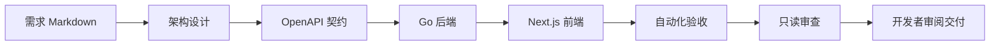

# AI Fullstack Labs
 
**基于 Next.js、Go 和 OpenAPI 的 AI 自动化全栈开发实践工程。**

本项目将需求设计、接口契约、前后端实现和自动化验收组织为一套可执行的 Agent 工作流。开发者通过 Markdown 描述需求，Agent 按职责推进实现，并以类型检查、后端测试、生产构建和浏览器联调结果作为交付依据。

工程以任务看板为业务载体，提供可运行的前后端代码、项目级 Skill、Agent 角色配置、CLI 编排脚本及实施文档，适合用于学习契约驱动开发、建立团队 AI 开发规范和验证业务原型。

> 当前实现采用 Next.js + Go。Rust 后端替换方案已记录在架构文档中，尚未提供第二套后端实现。

<!-- BEGIN project-discovery -->
## 项目定位与实践入口

AI Agent development workflows with Next.js, Go, OpenAPI and Codex, plus an EVM smart-money wallet flow monitor. AI 全栈开发实战与多链资金流监控、定时采集和本地日报。

适合从以下入口阅读实现与接入条件：

- [AI 全栈开发工程](ai-fullstack-lab/README.md)
- [Go 多链资金流监控](smart-money-agent/README.md)
<!-- END project-discovery -->

## 核心能力

- **完整业务链路**：任务创建、列表、状态更新、删除与本地文件持久化。
- **契约驱动对接**：OpenAPI 统一定义接口，自动生成 Go 服务端接口和 TypeScript 类型，检测生成结果漂移。
- **分阶段 AI 开发**：需求设计、API 契约、后端、前端、自动验收和只读审查分别承担明确职责。
- **可复用项目配置**：4 个 Skill，覆盖跨端功能、Go 后端开发、契约同步与交付验收；另有 5 个 Agent 角色、项目开发规则及结构化输出协议。
- **自动化质量门禁**：契约检查、TypeScript、ESLint、Go race 测试、go vet、Next.js 构建和 Playwright 联调。
- **可追踪执行过程**：记录设计、阶段状态、模型结果和执行日志；失败或超时即停止。

## 架构概览

业务运行与 AI 开发相互独立：任务看板可直接启动，业务请求不依赖模型服务；开发工作流在开发者显式执行后调用本机 Codex CLI。

| 层次 | 技术与职责 |
|---|---|
| 前端 | Next.js App Router、React、TypeScript，负责页面与交互 |
| 接口入口 | Next.js 同源 `/api/v1` 代理，转发至 Go 后端 |
| 后端 | Go `net/http`、生成的严格服务端接口、OpenAPI 请求校验 |
| 契约 | OpenAPI 3.0.3，生成双方类型与服务端接口 |
| 数据 | 单进程 JSON 存储、并发访问保护、文件原子替换 |
| Agent 编排 | Python 标准库、Codex CLI、JSON Schema 阶段结果 |
| 工程验证 | Go 测试、前端静态检查、生产构建、Playwright、GitHub Actions |



当前 CLI 按阶段串行执行；每个阶段达标后才进入下一阶段。自动检查通过后仍需开发者审查变更，再决定提交和发布。

## 快速开始

环境要求：Node.js 22+、Go 1.25+、Python 3.9+。执行 AI 开发时额外需要已登录的 Codex CLI。

从本仓库根目录执行：

```bash
cd ai-fullstack-lab
npm ci
npm run dev
```

访问前端：<http://127.0.0.1:3000>。后端默认监听 `127.0.0.1:8080`，业务数据保存在子项目 `.var/tasks.json`。首次安装依赖需要网络；使用 `Ctrl+C` 同时停止两端服务。

## 执行 AI 开发实践

内置需求为“任务优先级”：新增优先级字段、前端选择与展示、后端校验，以及旧数据兼容。该需求留作后续实践，尚未预先实现。

```bash
# 从agent目录执行；已进入ai-fullstack-lab时跳过cd
cd ai-fullstack-lab
npm run agent:plan  # 预览阶段，不调用模型、不修改代码
npm run agent:run   # 调用本机 Codex，按阶段实现并验收需求
```

真实执行会使用模型额度并修改工程。运行产物保存在 `.automation/runs/<run-id>/`；流程不会自动提交、推送或部署。具体参数、Skill 用法和失败恢复见[项目使用手册](ai-fullstack-lab/README.md)。

## 工程布局

```text
agent/
├── readme.md                 仓库总览
└── ai-fullstack-lab/         完整实践工程
    ├── apps/web/            Next.js 前端
    ├── apps/api/            Go 后端与测试
    ├── contracts/           OpenAPI 契约
    ├── scripts/             开发、生成与 Agent 编排脚本
    ├── .agents/skills/      项目级 Skills
    ├── .codex/agents/       交互式 Agent 配置
    ├── .automation/         阶段指令、输出协议与执行产物
    ├── specs/examples/      可执行的需求示例
    ├── tests/               浏览器联调与编排器测试
    └── docs/                架构、流程、实操与验证记录
```

## 文档导航

| 文档 | 内容 |
|---|---|
| [项目使用手册](ai-fullstack-lab/README.md) | 安装启动、常用命令、接口、配置、Agent 与 Skill 使用 |
| [架构与选型](ai-fullstack-lab/docs/architecture.md) | 契约对接机制、数据一致性、Go / Rust 取舍与数据库演进 |
| [Agent 工作流](ai-fullstack-lab/docs/agent-workflow.md) | 阶段职责、输入输出、执行日志、权限与失败恢复 |
| [实施与实操](ai-fullstack-lab/docs/implementation.md) | API 调用、新功能实践、容器启动与 CI 接入 |
| [验证记录](ai-fullstack-lab/docs/validation.md) | 已执行的检查、问题修正及未验证内容 |

## 当前状态与适用边界

2026-11-08 的搭建验证已通过完整质量门禁、2 条浏览器用例、7 项编排器测试和 3 个 Skill 校验。真实模型开发链路与 Docker 构建尚未执行，详见验证记录。

当前定位为单进程本地开发与 AI 工程实践基线。认证、多租户、数据库、分页和生产部署需按实际业务补充；JSON 存储不支持多个后端进程共享写入。CI 配置保存在子项目中，作为独立仓库使用时可直接生效；保留当前目录结构时需接入仓库根目录的 workflow。

<!-- BEGIN chovy-readme-review -->
## 目录边界与维护入口

当前目录是导航层，实际npm工作区、Go模块和自动化入口均位于ai-fullstack-lab。不要在agent目录直接执行npm ci或把子工程的apps路径当作当前目录路径。

改动受[工程AGENTS.md](ai-fullstack-lab/AGENTS.md)约束；服务端和前端接入分别见[Go API](ai-fullstack-lab/apps/api/README.md)与[Web应用](ai-fullstack-lab/apps/web/README.md)。本轮只核对文档与配置，原有门禁数字属于历史记录，未重复执行模型或服务端流程。
<!-- END chovy-readme-review -->
