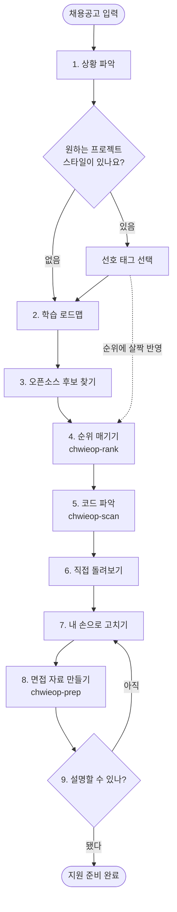

# 취업을하자 (chwieop-haja)

<p align="center">
  
</p>

<h2 align="center">취업을하자 — Korean Internship Tool</h2>

<p align="center">
  한국어 | <a href="README.en.md">English</a>
</p>

<p align="center">
  <a href="https://github.com/newrise0410/korean-internship-tool/actions/workflows/tests.yml"></a>
  
  
  
</p>

> 채용공고를 프로젝트로, 프로젝트를 이력서로, 이력서를 면접으로.

## 어떤 도구인가

채용공고 하나를 던지면, **지원서에 쓸 수 있고 면접에서 설명할 수 있는 프로젝트**까지 데려다주는 AI 어시스턴트용 스킬입니다.

프로젝트를 처음부터 만들지는 않습니다. 공고에 맞는 GitHub 오픈소스를 골라주고, 그 코드를 파악하는 법을 알려주고, 면접에서 이야기할 만한 부분을 직접 손보게 안내합니다. 마지막엔 이력서 문장과 예상 질문까지 정리해 줍니다.

백엔드, 프론트엔드, 풀스택, 모바일, 테스트, 데이터, 클라우드, 보안, AI 등 개발 직군 전반에 쓸 수 있습니다. 특히 **"공고는 봤는데 뭘 만들어야 할지 모르겠는"** 상황을 위해 만들었습니다.

> 혼자 쓰기보다 스터디나 오픈카톡에서 같이 돌려보면 더 좋습니다.

## 한국 취업시장에 맞췄습니다

- **공고 붙여넣기** — 사람인, 잡코리아, 원티드, 프로그래머스 등 어디서 복사해 와도 그대로 넣으면 됩니다.
- **우리 채용 문화** — 대기업 공채와 스타트업 수시채용, 코딩테스트, 자기소개서, 포트폴리오, 기술·인성 면접을 염두에 두고 결과물을 만듭니다.
- **용어는 그대로** — API, Docker, Kubernetes 같은 기술 용어와 명령어는 억지로 번역하지 않습니다.

## 무엇을 해주나

**1. 학습 로드맵을 먼저 보여줍니다**
공고를 역량별로 쪼개서, 무엇을 어떤 순서로 배우고 각 단계에서 뭐가 남는지 알려줍니다. 프로젝트 추천은 그다음입니다. 순서를 모르는 채로 저장소 목록만 받으면 아무 의미가 없으니까요.

**2. 공고에 맞는 오픈소스를 찾아 순위를 매깁니다**
후보 2~3개를 고른 뒤 공고 적합도, 시작하기 쉬운 정도, 면접에서 이야기할 거리, 돌리는 데 드는 비용, 손볼 여지를 따져 점수를 냅니다.

**3. 코드를 빠르게 파악하게 돕습니다**
저장소를 훑어서 구조, 진입점, 의존성, 데이터 흐름을 정리한 리포트(`audit.json`, `overview.md`, `overview.html`)를 만듭니다.

**4. 실행 계획을 세웁니다**
일단 내 노트북에서 최소한으로 돌려보는 걸 먼저 노립니다. 그걸로 부족할 때만 클라우드나 GPU를 씁니다.

**5. 직접 손볼 지점을 제안합니다**
API 하나 추가, 캐시 붙이기, 테스트 작성, 배포 설정 같은 것들. 크게 벌이는 대신 **면접에서 설명할 수 있는 크기**로 고릅니다.

**6. 면접 자료를 만들어 줍니다**
STAR 형식 이력서 문장, 핵심 코드 설명 대본, 면접관이 파고들 질문과 답변, 발표 자료 프롬프트, 지원 전 체크리스트.

## 전체 흐름



4·5·8단계는 스크립트가 대신 해줍니다. 9단계에서 막히면 7단계로 돌아가 보강합니다.

## 실제로 돌려본 결과

금융·보험 **AI 아키텍트 공고**로 처음부터 끝까지 돌려본 기록입니다. GitHub에서 실제 데이터를 받아 계산했습니다. 자세한 내용은 [`examples/example-run.md`](examples/example-run.md)에 있습니다.

| 순위 | 후보 | 점수 | 이유 |
| --- | --- | --- | --- |
| 1 | **docling** | 73.33 | MIT 라이선스, `pip install` 하나로 로컬 실행 — 이틀짜리 계획에 딱 맞음 |
| 2 | ragflow | 61.67 | 공고 내용은 가장 잘 덮지만 메모리 16GB에 컨테이너 여러 개가 필요 |
| 3 | dify | 51.67 | 별 14만 개로 가장 유명한데도 **라이선스 제약과 리스크** 때문에 꼴찌 |

별 개수가 많다고 1등이 되지 않습니다. **내 시간과 장비, 공고와의 거리, 위험 요소**로 순위가 갈립니다. 이후 1위 저장소를 훑어(1,454개 파일) 공고와 직결되는 코드를 찾아내고, 면접 자료까지 만들어 냅니다.

## 원하는 스타일이 있다면

"나는 백엔드가 하고 싶고 프론트는 별로다" 같은 취향이 있으면 반영됩니다.

공고를 읽은 다음 **취향이 있는지 한 번 물어봅니다.** 없다고 하면 공고만 보고 추천하고, 있다고 하면 세 가지 방향을 제시하거나 직접 적을 수 있게 합니다. "~는 하고 싶지 않다"고 쓴 내용은 피할 조건으로 처리합니다.

이 취향은 순위에 **살짝만** 반영됩니다. 취향에 맞아도 돌아가지 않거나 공고와 먼 프로젝트는 1순위가 되지 않습니다.

> Codex를 쓰면서 Plan 모드를 켜는 걸 권합니다. 그래야 선택지가 팝업으로 제대로 뜹니다. 다른 도구도 Plan이나 Ask 모드가 있으면 켜두세요. 없으면 그냥 텍스트로 묻고 답하는 형태가 됩니다.

## 어떻게 쓰나

공고와 본인 상황을 AI 어시스턴트에게 같이 넘기면 됩니다.

```text
취업을하자 도구로, 아래 채용공고에 맞는 인턴 프로젝트를 기획해 줘.

내 상황:
- 수준: 강의는 들었는데 프로젝트 경험은 적음
- 다룰 수 있는 것: Python, FastAPI, React 조금
- 쓸 수 있는 시간: 2일
- 장비: 노트북 + Docker, GPU 없음
- 어디까지: 일단 돌아가는지만 확인 (smoke-test)
- 하고 싶은 것: 백엔드나 AI 쪽. 로컬에서 돌아가고 면접에서 설명하기 쉬운 것.
  프론트엔드만 하는 건 피하고, GPU 여러 장이나 복잡한 클라우드는 부담스러움.

채용공고:
...
```

정해둔 취향이 없으면 그냥 공고만 넘기셔도 됩니다.

**어디까지 할지**는 네 가지 중에 고르면 됩니다.

| 옵션 | 뜻 |
| --- | --- |
| `interview-only` | 실행은 생략. 프로젝트 선정과 코드 읽기, 면접 준비만 |
| `smoke-test` | 최소한만 돌려서 일단 뜨는지 확인 |
| `local-full-run` | 내 컴퓨터에서 제대로 끝까지 돌려보기 |
| `remote-full-run` | 클라우드나 GPU까지 써서 완전히 돌려보기 |

## 설치

```bash
cd korean-internship-tool
python3 -m venv .venv
. .venv/bin/activate
python -m pip install -e ".[dev]"
```

## 스크립트 사용법

설치하면 명령어 세 개가 생깁니다.

```bash
# 저장소 훑어보기
chwieop-scan --repo /path/to/repo --out reports/audit --name my-project

# 후보 순위 매기기
chwieop-rank --jd jd.txt --candidates candidates.json --out reports/ranking

# 취향까지 반영해서 순위 매기기
chwieop-rank --jd jd.txt --candidates candidates.json --taste taste.json --out reports/ranking

# 면접 자료 만들기
chwieop-prep --project-notes reports/audit --out reports/interview-pack
```

`python -m chwieop_haja.scanner`, `python -m chwieop_haja.ranker`, `python -m chwieop_haja.prep_kit`로 실행해도 같습니다.

### 점수는 이렇게 계산합니다

먼저 항목별 점수를 더해 원점수를 내고, 만점으로 나눠 100점 기준으로 환산합니다. 취향이 없으면 만점이 120점, 취향이 있으면 관련 항목이 더해져 132점이 됩니다.

**스크립트는 문장을 읽고 알아서 판단하지 않습니다.** 라이선스가 좋은지, 실제로 돌아가는지, 내 장비로 감당되는지는 AI 어시스턴트가 판단해서 숫자로 적어줘야 합니다(`matched_jd_terms`, `license_score`, `runnable_score`, `resource_fit_score`). 취향도 마찬가지로 태그 형태여야 인식합니다. 자연어로 적은 문장은 무시합니다.

### 취향 파일 (`taste.json`)

```json
{
  "taste_text": "백엔드랑 AI 앱 쪽이 좋고, 프론트만 하는 건 싫다. Docker로 로컬에서 돌아가고 면접에서 설명하기 쉬운 것",
  "prefer_tags": ["backend", "ai-app", "local-docker", "interview-friendly"],
  "avoid_tags": ["pure-frontend", "multi-gpu", "cloud-heavy"]
}
```

### 후보 파일 (`candidates.json`)

```json
[
  {
    "name": "tiny-ticket-system",
    "repo_url": "https://github.com/example/tiny-ticket-system",
    "license": "MIT",
    "license_score": 5,
    "stars": 320,
    "last_commit": "2026-04-20",
    "tags": ["fastapi", "postgresql", "docker", "rest-api"],
    "matched_jd_terms": ["백엔드 개발", "API 설계", "데이터베이스", "컨테이너 배포"],
    "jd_match_score": 25,
    "runnable": true,
    "runnable_score": 25,
    "resources": "로컬 Docker로 최소 실행 가능",
    "resource_fit_score": 15,
    "mod_ideas": ["JWT 인증 추가", "Redis 캐시 추가", "통합 테스트 작성"],
    "risk_notes": ["DB 마이그레이션 설정이 따로 필요"],
    "taste_tags": ["backend", "local-docker", "interview-friendly", "api", "database"],
    "avoid_tags": ["cloud-heavy"]
  }
]
```

`taste_tags`, `avoid_tags`, `project_taste_notes`는 없어도 됩니다. 앞의 둘은 취향 매칭에 쓰이고, `project_taste_notes`는 사람이 읽는 설명일 뿐 점수에 영향을 주지 않습니다.

## 이 도구가 지키는 원칙

- **면접부터 잡는 게 우선입니다.** 공고와 맞는 프로젝트, 이력서 네다섯 줄, 예상 질문을 가장 먼저 만듭니다.
- **완벽한 재현에 시간을 쓰지 않습니다.** 논문 결과를 그대로 뽑아내거나 시스템을 전부 다시 쓰는 건 취업 준비에 도움이 안 됩니다.
- **작게 고치고 확실히 설명합니다.** 면접관이 알아듣고 내가 답할 수 있는 크기가 딱 좋습니다.
- **없는 숫자를 만들지 않습니다.** 성능 수치가 없으면 무엇을 만들었고 어떻게 이해했는지, 다음에 뭘 검증할지로 씁니다.
- **말할 수 있을 때까지 연습합니다.** AI에게 면접관을 시켜서 입출력, 선택 이유, 실패 원인을 막힘없이 말할 수 있을 때까지 물어보게 합니다.

## 개발

```bash
cd korean-internship-tool
. .venv/bin/activate
pytest
```

## 만든 사람

[newrise0410](https://github.com/newrise0410)

## 라이선스

**쓰는 건 자유롭게, 고쳐서 배포하는 건 허락을 받아 주세요.**

- 가능: 개인·상업적 사용, 열람, 원본 그대로 재배포(라이선스 파일 포함)
- 허락 필요: 수정·번역·2차 저작물 제작 및 배포

자세한 내용은 [`LICENSE`](LICENSE)를 확인하시고, 수정해서 쓰고 싶으시면 [연락](https://github.com/newrise0410) 주세요.
