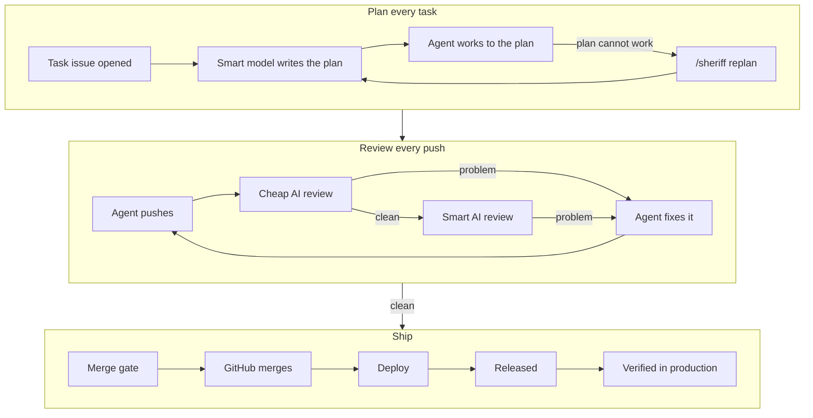

<p align="center">
  
</p>

<h1 align="center">Sheriff</h1>

<p align="center">
  A GitHub CLI extension that reviews every pull request with AI in CI,<br>
  and only lets it merge when the review passes.
</p>

<p align="center">
  <a href="https://github.com/nick-the-dev/gh-sheriff/actions/workflows/ci.yml"></a>
  <a href="LICENSE"></a>
  <a href="https://cli.github.com/manual/gh_extension"></a>
</p>

> [!WARNING]
> **Beta.** Sheriff is in active development. Behaviour, settings and messages can change with any update, and an update
> can break your setup. Pin a release if you need to decide when changes reach you ([Updates](#updates)).

Sheriff is for repositories where AI agents open pull requests. One command sets up:

- a smart model's plan on each task issue, before work starts ([Planning](#planning));
- an AI review on every push: an optional cheap model first, and a smart model only if that passes;
- a ruleset that blocks merging until the review passes, admins included;
- task tracking with Issues and a Projects board, where each task's status follows its pull request and your deploys.

It is built entirely on GitHub (Actions, a GitHub App, rulesets, Issues, Projects), so it works with any agent tool,
such as Claude Code, Codex or LobeHub, and with people.

```sh
gh extension install nick-the-dev/gh-sheriff
cd your-repo
gh sheriff install
```

## How a pull request gets merged



0. With planning on, Sheriff first posts a plan on the task issue ([Planning](#planning)). `Merge gate` waits for it,
   and the review checks the pull request against it.
1. An agent pushes to a pull request.
2. If you set a cheap reviewer (`SHERIFF_FIRST_PASS`), it reviews the diff first. A problem fails the `Review` check
   and the agent pushes a fix. A clean docs-only change stops here.
3. Otherwise the smart model reviews the same diff.
4. `Merge gate` passes when:
   - with planning on, the task issue has a current Sheriff plan and `Review` was made against that plan version;
   - no reviewer has requested changes;
   - every comment from a person has an agent reply (a comment that is only a Sheriff command, such as
     `/sheriff review`, needs none);
   - production is healthy, if you configured a health check;
   - the merge fits the merge mode: by default one pull request per deploy, the lowest-numbered one that would pass
     ([Merges](#merges)).

   An auto-merge pull request also stays pending ("waiting for its checks before merging") until its other required
   checks are green.
5. With `Review` and `Merge gate` green and auto-merge on for the pull request, GitHub merges it.
6. Your deploy runs. When production serves the merged commit, Sheriff marks the task Released.
7. Someone checks the change in production and records it with `gh sheriff task verify`: the task becomes Verified.

Docs-only means every changed file is added or modified `.md`, `.mdx` or `.rst`, none is an agent rules file
(`AGENTS.md`, `CLAUDE.md`, `GEMINI.md`, `copilot-instructions.md`) and none is under `.github/`, `.sheriff/`, `.claude/`
or `.cursor/`. Draft pull requests and pull requests into other branches than the default are not reviewed.

Each pull request gets 3 cheap and 3 smart reviews. After the cheap ones, the smart model reviews alone; after the smart
ones, `Review` blocks until an admin, a maintainer or a login in `SHERIFF_UNLOCK_AUTHORS` (never the pull request's
author) comments `/sheriff review`, which allows one more smart review. It runs on the next push, or at once with
`gh workflow run sheriff.yml -f pr=<n> -f review=true`. A review counts once it starts, so cancelling or re-running it
gives no free retry.

## Requirements

- Admin rights on the repository.
- [GitHub CLI](https://cli.github.com), logged in.
- Python 3.9 or newer.
- A Claude subscription, and optionally an OpenCode Go or Zen key ([Reviewers](#reviewers)).
- Runners: Sheriff runs on every pull request event, by default on GitHub-hosted runners, which bill Actions minutes on
  private repositories. Plan for self-hosted ones ([Runners and Actions minutes](#runners-and-actions-minutes)).

## Install

```sh
gh extension install nick-the-dev/gh-sheriff
gh sheriff install --repo owner/name
gh sheriff doctor --repo owner/name
```

`install` works for organisations and personal accounts and is safe to re-run: it adds what is missing, rewrites the
`Sheriff` ruleset to the current rules and closes older install pull requests. It:

1. Creates two environments only the default branch can use: `sheriff` (the GitHub App key) and `sheriff-review`
   (the reviewer keys).
2. Creates a GitHub App for your account (one click in the browser). Only this App can post `Review` and `Merge gate`.
3. Asks which reviewers to use and stores their keys. A new install also turns planning on (`--plan off` skips it) and
   sets `SHERIFF_PLAN_SINCE`; if the App cannot post plans yet, planning stays off and `install` prints how to grant
   the permission. A new install merges one pull request per deploy; `--merges bundle` batches them ([Merges](#merges)).
4. Opens a pull request adding `.github/workflows/sheriff.yml` and `sheriff-relay.yml`, which Sheriff reviews and which
   merges itself. `sheriff.yml` lists your workflows that run on pull requests, so the merge gate re-runs when one
   finishes (those runs never start a review); run `install` again after adding or renaming one.
5. Turns on auto-merge and creates a ruleset named `Sheriff` on the default branch. It requires a pull request,
   `Review` and `Merge gate`, and every review thread resolved, and it blocks deletion and force-pushes. Your existing
   required checks are kept.
6. Adds three issue fields to your account and a Projects board named `<repo> work` (skip with `--no-work-state`).

## Updates

Sheriff is released as versions (`v1.0.0`, `v1.1.0`, ...), each an immutable tag with
[release notes](https://github.com/nick-the-dev/gh-sheriff/releases) that flag anything breaking. `v1` is a tag that
always points at the latest `v1.x` release. While Sheriff is in beta, a breaking change can still ship within `v1`;
a change that needs `gh sheriff install` to run again ships as `v2`.

`gh sheriff install --updates` chooses how your repository takes releases. Running `install` without it keeps the current
mode; in pinned mode it pins the release of your `gh sheriff`, so upgrading the CLI and running `install` moves the pin:

| Mode | Your `sheriff.yml` runs | Updates arrive |
|---|---|---|
| `auto` (the default) | `@v1` | At once, with every release |
| `pinned` | `@v1.0.0`, the release your `gh sheriff` is | As a Dependabot pull request per release, which Sheriff reviews and you merge when ready. Dependabot waits out its cooldown first (3 days after a release by default; `cooldown: default-days: 0` in `.github/dependabot.yml` removes it). `install` adds `.github/dependabot.yml` for GitHub Actions if you have none; if you have one without a `github-actions` entry, it tells you to add one |

`gh sheriff doctor` reports the mode, the release your workflow runs and the latest release. Update the CLI with
`gh extension upgrade sheriff`; when `doctor` says the trigger files differ, run `gh sheriff install` again.

## Planning

With `SHERIFF_PLAN=on`, a smart model writes a plan on each task issue before work starts. The plan is a comment from
Sheriff's App with seven sections:

- **Priority**: how urgent the task is, with one sentence why (scale below).
- **Problem**: what is wrong or missing, and why it matters.
- **Solution space**: the options, with web research where it changes the answer, and why the others were rejected.
- **Chosen approach**: the design, the files to change, edge cases and risks. It is the minimal readable change: the
  smallest diff that solves the problem and still reads clearly, with no clever compression, drive-by refactors or
  speculative options.
- **Tests**: the tests that prove the change, failing before and passing after.
- **Production check**: how to verify it after release.
- **Out of scope**: what the task must not touch.

Plans and reviews use plain language for someone who knows the project but not that part of the code: short sentences,
everyday words, each section or finding led by one sentence stating its point, and terms or internal names explained
on first use.

**Priority.** Sheriff labels the issue with the planner's judgement:

| Label | Meaning |
|---|---|
| `priority:P0` | Production is broken or unsafe now: users cannot use a core feature, data is lost or wrong, a security hole is open, or trading figures shown to users are wrong. |
| `priority:P1` | A real problem with a workaround, or work that blocks other work. This week. |
| `priority:P2` | A normal fix or improvement. The default. |
| `priority:P3` | Nice to have, cleanup, someday. |

Change the label to override. Sheriff never changes or removes a priority label a person set; a replan re-judges only
Sheriff's own label. Your agents can pick work by these labels.

**Which issues.** Only task issues, whose title starts with a task ID (`<ID>: ...` or `<ID> #n: ...`; task tracking
reads only the first form); never Decision issues or pull requests. An issue a person opens without an ID is renamed first, when it would be planned:
`<WORDS>-<number>: <title>`: three title words (short words such as "a", "the" or "on" dropped, each word cut to 12
characters) plus the issue number, so `Login page broken on mobile` (#57) becomes
`LOGIN-PAGE-BROKEN-57: Login page broken on mobile`, and the start comment says so. Within a minute of opening it
carries its ID and "Sheriff is writing plan v1". Issues opened by bots are not renamed.

**Who triggers planning.** A task issue opened by a bot, an admin, a maintainer or a login in `SHERIFF_ACK_AUTHORS` is
planned at once; for anyone else's, one of them comments `/sheriff plan`. A planned issue is not planned again, and open
issues are never planned in bulk. Only those trusted authors' comments reach the planner.

**The plan binds the pull request.** `Merge gate` stays pending ("needs a Sheriff plan on #N") until the task issue has
a current plan, and the review checks the pull request against it: a different approach, files outside the plan or
missing planned tests, without a replan, block. Only a plan comment by Sheriff's App counts, so nobody can paste one in.
A pull request's task issue is the one it closes, else the open issue whose title starts with the ID in the pull
request title (`(LOGIN-FIX)`). Pull requests with neither are not gated.

**Changing a plan.** Comment `/sheriff replan <reason>`. The planner checks the reason against the code instead of
obeying it, and writes the next version. The gate and the review use the latest version, and a new version allows one
more review of an unchanged pull request head.

**Budget.** An issue gets at most `SHERIFF_PLAN_ROUNDS` plans (default 3). Then Sheriff posts a budget notice, and an
admin, a maintainer or a login in `SHERIFF_UNLOCK_AUTHORS` comments `/sheriff plan` to allow one more; whoever asked
for the replan can't unlock it. Two planner failures in a row (a crash, a timeout or a plan that fails the format check)
also post the notice, and a maintainer's `/sheriff plan` allows another try.

**Web access** is set by `SHERIFF_PLAN_WEB`, for a `claude:` planner; an `opencode:` planner gets no web access:

| Value | Planner can | Risk |
|---|---|---|
| `search` (default) | Search the web | Low: it never fetches a URL |
| `allowlist` | Search, and fetch pages on the domains in `SHERIFF_PLAN_FETCH_DOMAINS` | Text in an issue can make it fetch from those domains only |
| `any` | Search, and fetch any URL | Text in an issue could make it send what it has read to an outside URL |

Use `any` only if you trust everyone who can open issues: the planner is read-only with no shell, but a fetch is an
outbound request.

**Exemptions.** Pull requests opened before `SHERIFF_PLAN_SINCE` are not gated; `install` sets it when planning is
switched on, and switching on again after off restarts it. In an emergency an admin labels a pull request
`sheriff:no-plan`, and the gate says so in its description.

**App permission.** Posting plans and naming issues need the App's repository permission Issues: Read and write; Apps
created by an earlier Sheriff only have read. Set it in the App's settings (Permissions > Repository permissions >
Issues), save, then accept the permission request on the installation (an organization owner has to). Until then a new
install leaves planning off and `--plan on` stops with these steps. `gh sheriff doctor` checks it, and
`gh sheriff stats` lists plans next to reviews, outside the smart-model share.

## Merges

`SHERIFF_MERGE_MODE` sets how many pull requests merge per deploy; a new install sets `serial`.
`gh sheriff install --merges bundle` (or `--merges serial`) switches it, and `install` without `--merges` keeps it.
Bundles need the `sheriff.yml` from this Sheriff version; an older one stays serial.

**Serial (the default).** One pull request per deploy: only the lowest-numbered auto-merge pull request that would pass
gets a green `Merge gate`, and with production checks configured only once the last merge is deployed. The others wait
with "one merge per deploy: waiting for #N".

**Bundle.** Up to `SHERIFF_BUNDLE_MAX` (default 5) merged pull requests wait for one deploy. Sheriff counts the commits
merged since the commit production serves: the `sha` from `SHERIFF_VERSION_URL`, else the newest successful run of
`SHERIFF_DEPLOY_WORKFLOW` on the default branch. Prefer `SHERIFF_VERSION_URL`: if your deploy workflow lets a replaced
run conclude success, that run can name a newer commit than production serves, so Sheriff counts too few merges and a
bundle can pass the cap. Free slots go to the lowest-numbered auto-merge pull requests that would pass; the others wait
with "waiting for a bundle slot behind #N", or "bundle full: K merged pull requests wait for the deploy".

A deploy in progress doesn't hold a bundle back (production may serve an older commit while a run is still going). A
failed deploy does: if the newest finished run of `SHERIFF_DEPLOY_WORKFLOW` on the default branch (skipped and
cancelled runs aside) did not succeed, every pull request waits until a deploy succeeds, and a failed deploy of the
default branch's head fails them all. A version or health endpoint that doesn't return 200, or a count Sheriff can't
read, also blocks every pull request. `SHERIFF_OVERRIDE` lets one pull request, such as a revert, merge past a full
bundle or a failed deploy.

Nothing caps a bundle when Sheriff has nothing to count from: neither `SHERIFF_VERSION_URL` nor
`SHERIFF_DEPLOY_WORKFLOW` is set (`gh sheriff doctor` warns about it), or only the deploy workflow is set and has no
successful run on the default branch yet. With squash merges one pull request is one commit; merge commits or rebase
merges fill a bundle sooner.

**The trade-off.** Each pull request in a bundle is still planned, reviewed and tested on its own, and the rest of the
gate is unchanged. The combination is tested only after it merges, by the default branch's CI and the deploy's health
check; if that fails, you bisect or revert up to `SHERIFF_BUNDLE_MAX` pull requests instead of one.

Set `cancel-in-progress: true` in the `concurrency` of the workflow that builds what you deploy, so a bundle builds and
ships once, at its newest commit, instead of once per merge.

## What your agents need

Sheriff reports through check runs, commit statuses and pull request reviews. To work that loop on their own, the
identity your agents push with (a GitHub App, a bot account or a fine-grained token) needs these repository
permissions:

| Permission | Why |
|---|---|
| Contents: read and write | Push branches |
| Pull requests: read and write | Open pull requests, turn on auto-merge, read Sheriff's review |
| Issues: read and write | Comment on task issues and reply to people |
| Checks: read | Read the `Review` check run and why it failed; without it an agent can't see Sheriff's verdict |
| Commit statuses: read | Read `Merge gate` and why it is pending |
| Actions: read and write | Read CI logs, and re-run a flaky job instead of pushing an empty commit |
| Workflows: read and write | Push changes under `.github/workflows/`, which GitHub refuses without it |
| Projects: read and write | Only if your agents move items on an organisation's work board themselves |

None of these lets an agent merge on its own: the `Sheriff` ruleset still requires `Review` and `Merge gate`, which
only Sheriff's App can post.

## Reviewers

Sheriff uses two kinds of model. An optional cheap model does the first review of every push; a smart model writes the
plans and does the final review, by default Claude Opus (`claude:claude-opus-5-5`). Both are settings you can swap.
Claude models run on a Claude subscription, not an Anthropic API key:

| Subscription | Use it for | Model setting | Key |
|---|---|---|---|
| Claude (any plan that includes Claude Code) | The smart review and the plan, or a cheap review with a small model | `claude:claude-opus-5-5`, `claude:claude-haiku-5-5` | `CLAUDE_CODE_OAUTH_TOKEN`, from `claude setup-token` |
| [OpenCode](https://opencode.ai) Go or Zen | The cheap review | `opencode:opencode-go/deepseek-v4.1-flash`, or another `opencode:` model | `OPENCODE_API_KEY` |

Not supported yet: Anthropic API keys, OpenAI or Codex.

`gh sheriff models` changes reviewers. `gh sheriff stats` shows the smart model's share of the review work and its
cost, and exits with an error when the share of tokens without cache reads is above `SHERIFF_SMART_SHARE_LIMIT` (or
`--limit`, default 10%), judged from 10 reviews on.

## Commands

| Command | Description |
|---|---|
| `gh sheriff install` | Set up a repository. Flags: `--repo`, `--first-pass`, `--review-model`, `--plan on\|off`, `--merges serial\|bundle`, `--no-work-state`, `--project-name`, `--no-files`, `--no-browser`, `--new-key` (store a fresh App key), `--rotate-secrets` (replace reviewer keys), `--updates auto\|pinned`, `--yes` |
| `gh sheriff doctor` | Check the setup and print what to fix. Flags: `--repo`, `--no-work-state`, `--project-name` |
| `gh sheriff models` | Choose the cheap and the smart reviewer. Flags: `--repo`, `--first-pass`, `--review-model`, `--rotate-secrets` |
| `gh sheriff stats` | Show review and plan usage and cost. Flags: `--repo`, `--prs` (default 50), `--limit` (default 10) |
| `gh sheriff task new "<title>"` | Create a task issue at Stage Candidate and add it to the board. Flags: `--id`, `--type`, `--verify` (default Live check), `--body-file`, `--project` |
| `gh sheriff task set <ID>` | Set fields Sheriff can't infer: `--stage Parked`, `--next "..."`, `--verify` |
| `gh sheriff task verify <ID> --evidence-file F` | Record what was checked in production; sets Verified and closes the issue |
| `gh sheriff task status` | List open tasks by stage, blocked tasks, and comments waiting for a reply |
| `gh sheriff task sync [--apply]` | Move each task's `Stage` from pull request and release facts, which CI runs (a dry run without `--apply`; `--task`, `--pages`) |
| `gh sheriff task board-status [--apply]` | Set the board's built-in `Status` to each item's `Stage` where they differ (a dry run without `--apply`; `--project`) |
| `gh sheriff task reply <ID> --body-file F` | Reply to a person's comment on an issue |

## Configuration

All settings are optional repository variables.

| Variable | Default | Description |
|---|---|---|
| `SHERIFF_FIRST_PASS` | none | Cheap reviewer, e.g. `opencode:opencode-go/deepseek-v4.1-flash` |
| `SHERIFF_REVIEW_MODEL` | `claude:claude-opus-5-5` | Smart model for the final review |
| `SHERIFF_FIRST_PASS_ROUNDS`, `SHERIFF_REVIEW_ROUNDS` | `3`, `3` | Reviews allowed per pull request |
| `SHERIFF_PLAN` | `on` for a new install whose App can post plans, else off | `on` turns planning on; anything else is off |
| `SHERIFF_PLAN_SINCE` | set by `install` | Pull requests opened before this time (UTC, `2026-11-22T00:00:00Z`) need no plan |
| `SHERIFF_PLAN_MODEL` | `claude:claude-opus-5-5` | Smart model for plans |
| `SHERIFF_PLAN_ROUNDS` | `3` | Plans allowed per issue |
| `SHERIFF_PLAN_TURNS` | `40` | Turns the planner may take per plan |
| `SHERIFF_PLAN_WEB` | `search` | `search`, `allowlist` or `any` ([Planning](#planning)) |
| `SHERIFF_PLAN_FETCH_DOMAINS` | none | Comma-separated domains the planner may fetch, with `allowlist` |
| `SHERIFF_VERSION_URL` | none | A URL returning JSON with the deployed commit as `sha`, used for `Merge gate` and Released |
| `SHERIFF_HEALTH_URL` | none | `Merge gate` fails unless this URL returns 200 |
| `SHERIFF_DEPLOY_WORKFLOW` | none | Deploy workflow file. Serial: `Merge gate` waits for its run on the default branch's head and fails if that run did not succeed. Bundle: see [Merges](#merges) |
| `SHERIFF_OVERRIDE` | none | A pull request number that may merge despite failing production checks or a full bundle |
| `SHERIFF_MERGE_MODE` | `serial` | `bundle` lets up to `SHERIFF_BUNDLE_MAX` merged pull requests wait for one deploy; anything else is serial ([Merges](#merges)) |
| `SHERIFF_BUNDLE_MAX` | `5` | Merged pull requests one deploy may carry in bundle mode; anything but a whole number of at least 1 means 5 |
| `SHERIFF_ACK_AUTHORS` | none | Logins, besides bots, that count as agents when replying to comments and as trusted authors for planning |
| `SHERIFF_UNLOCK_AUTHORS` | none | Logins, besides admins and maintainers, who may grant an extra review (`/sheriff review`) or plan (`/sheriff plan`) |
| `SHERIFF_RUNS_ON` | `ubuntu-latest` | Runner label for the gate, reviews, plans and work state ([Runners and Actions minutes](#runners-and-actions-minutes)) |
| `SHERIFF_SMART_SHARE_LIMIT` | `10` | Target smart-model share in percent for `gh sheriff stats` |
| `SHERIFF_RELAY_RUNS_ON` | `ubuntu-latest` | Runner label for the relay |

`install` also sets `SHERIFF_APP_ID`, `SHERIFF_APP_SLUG` and `SHERIFF_WORK_STATE`.

Add this step at the end of your deploy workflow so Sheriff knows a deploy finished (the job needs `actions: write`;
use your default branch for `--ref`):

```yaml
- run: gh workflow run sheriff.yml --ref main -f after_run="$GITHUB_RUN_ID"
  env:
    GH_TOKEN: ${{ github.token }}
```

A comment from a person blocks `Merge gate` until an agent replies: a bot or a login in `SHERIFF_ACK_AUTHORS`, with
`<!-- sheriff-ack -->` as the reply's last line.

## Runners and Actions minutes

**On a private repository, GitHub-hosted runners can use up your Actions minutes fast.** Sheriff runs a job on every
pull request event: the relay on each push, edit or review; the gate on each of those, on comments, after CI and
deploys, and every 30 minutes; a review on each new head. Each job bills at least one minute, and a model review several. One busy repository with about 20
agent pull requests a day used about 940 GitHub-hosted minutes in a day, roughly a third of a Team plan's monthly
allowance. Use self-hosted runners unless the repository is public or quiet.

| Variable | Runs | What it needs |
|---|---|---|
| `SHERIFF_RUNS_ON` | Gate, reviews, verdicts, plans, work state | A runner label. All but work state hold the gate App key or the reviewer keys, so give them runners that never run pull request code: one job per runner, and no Docker socket shared with CI jobs |
| `SHERIFF_RELAY_RUNS_ON` | The relay on pull request events | A runner label. The relay holds no secrets and runs the pull request's own copy of its workflow, so your normal CI runners are fine |

Both default to `ubuntu-latest`. Self-hosted runners for Sheriff should be ephemeral (one job each): the planner and the
reviewer read the job's workspace, which a persistent runner shares with the repository's other jobs. Sheriff's secrets
stay in the `sheriff` and `sheriff-review` environments, which only the default branch can use, so a job from a pull
request branch cannot read them on any runner.

## Tracking work with Issues and Projects

Each task is an issue whose title starts with an ID, like `LOGIN-FIX: fix the login page`. A pull request belongs to the
task when its title ends with `(LOGIN-FIX)` or its branch is named like `ai/LOGIN-FIX`.

Sheriff stores the task state in three issue fields, which also appear as board columns:

| Field | Values |
|---|---|
| `Stage` | Candidate, In progress, Merged, Released, Verified, Parked |
| `Verify by` | Release only, Live check, Awaits event |
| `Next action` | Free text: who does what next |

Sheriff updates `Stage` on its own:

| Event | New stage |
|---|---|
| A pull request for the task is opened | In progress |
| The pull request is merged | Merged |
| Production serves the merged commit, or the deploy succeeds (with no deploy configured: on merge) | Released |
| `gh sheriff task verify` records evidence, or the task is "Release only" and was released | Verified |

Stages only move forward, with two exceptions: a Parked task moves to In progress when a pull request opens (merges
don't advance it), and Verified without recorded evidence moves back on the next sync, which reopens the issue.
`task verify` works only from Released, and `task set` can't set Verified. Pull requests from forks are ignored.

The board's built-in `Status` mirrors `Stage` only when a `gh` login with Projects access writes it (`task set`,
`task verify`, `task board-status --apply`). CI's sync runs with the job token, which can't write Projects, so run
`task board-status --apply` to catch up. The board's Auto-add has to be switched on in the browser, because GitHub has no API for it; `install` opens the
page for you.

Board views: Needs human, Blocked, Ready, In flight, Awaiting verification, All open by stage.

## Security

- The App key and the reviewer keys are in separate environments. No job that reads pull request content has the App
  key.
- The planner runs in `sheriff-review`, read-only with no shell, and sees only comments from trusted authors. The App
  needs Issues: Read and write to post plans; with `SHERIFF_PLAN_WEB=any`, text in an issue could make the planner
  fetch an outside URL ([Planning](#planning)).
- Pull request code is never executed: every trigger runs the default branch's copy of `sheriff.yml`, and the reviewer
  gets only read-only file tools, with no shell.
- The `Review` result is a check run that only your Sheriff App can write, tied to one commit and its merge base, so
  every new push needs a new review.
- A review is counted before the model runs. Re-running part of a workflow doesn't review again, and an edited review
  blocks until a maintainer allows another.
- The installer only merges the single commit it created, after checking its sha and files.
- Secrets reach only the Sheriff steps that need them, by name; no workflow inherits all of a repository's secrets.
- Sheriff's own CI runs its tests, actionlint and zizmor on every change.

## Known limitations

- **Prompt injection.** The reviewer reads text the pull request author wrote. It is told to treat that text as data,
  but a crafted change could still try to talk it into passing.
- **Trusting Sheriff's releases.** Your `sheriff.yml` runs Sheriff's actions at `@v1` (or at the pinned release), and
  the steps that need them get your Sheriff secrets by name, never your other secrets. Release tags are protected: only
  Sheriff's admins can change them. To review every update first, use `--updates pinned`, or pin a commit sha.
- **One App per account.** One GitHub App serves all of an account's repositories; repositories with different admins
  should use separate Apps.
- **Forks.** Pull requests from forks aren't reviewed automatically. Start a review with
  `gh workflow run sheriff.yml -f pr=<n> -f review=true`.
- **Commands during a plan.** A `/sheriff plan` or `/sheriff replan` posted while a plan is being written is answered by
  a follow-up run after the plan is posted, so its reply comes a little later.
- **Per-PR limits.** The review limit counts per pull request; a new pull request starts with a fresh limit.

## Development

```sh
for t in tests/*.test.py; do python3 "$t"; done
actionlint .github/workflows/*.yml templates/*.yml
zizmor --offline .github/workflows/ templates/ actions/
```

Sheriff is standard-library Python and `gh`.

| Path | Contents |
|---|---|
| `.github/workflows/` | Reusable workflows |
| `actions/` | Their steps |
| `scripts/` | The logic |
| `templates/` | The two files `install` adds to a repository |

Releasing: set `VERSION` in `gh-sheriff`, commit to `main`, then
`gh release create vX.Y.Z --target main --notes-file NOTES.md` and move `v1` to the same commit
(`git tag -f v1 vX.Y.Z && git push -f origin v1`). The `v*` tags are protected; only admins can move `v1`. A new
permission asked for only by jobs or inputs that a new template adds ships in `v1`, because old templates never run
those jobs; a changed permission on a job an old template already runs ships as `v2`.

Issues and pull requests are welcome.

## License

[MIT](LICENSE)
