<div align="center">
  
</div>

<div align="center">

**HAL** :: *Heuristic Agentic Loop :: a natural-language pseudo-code interpreter*

[](Cargo.toml)
[](https://www.rust-lang.org)
[](https://github.com/0xPlaygrounds/rig)
[](#license)

[Install](#install) · [Quick start](#quick-start) · [Examples](#examples) · [Commands](#commands) · [Agents](#agents) · [Configuration](#configuration)

</div>

HAL is a fast interpreter for code written in natural language. It is meant to be embedded in apps and used for coding and research, because you can experiment and bootstrap quickly without ever having to look at code, while everything stays contained in one project directory and a Docker container.

> [!NOTE]
> HAL is a research project partly coded with AI. The software is provided as is. Development is slow, so expect rough edges.

---

`hal` takes a plain-English `.hal` file, runs it through a four-agent
pipeline (Interpreter → Architect → Conductor → Reflector). The first two
turn the text into a program, the Conductor executes it inside a Docker
container, and the Reflector then reads the run and writes what it learned
into shared memory for the next build.

```mermaid
%%{init: {"theme": "base", "flowchart": {"curve": "basis", "padding": 16, "nodeSpacing": 36, "rankSpacing": 48, "diagramPadding": 16}, "themeVariables": {"fontFamily": "ui-monospace, SFMono-Regular, Menlo, Consolas, monospace", "fontSize": "15px", "primaryColor": "#12161a", "primaryTextColor": "#eef0f3", "primaryBorderColor": "#3a3f47", "lineColor": "#7b828f", "textColor": "#bcc1cc", "edgeLabelBackground": "#0b0d0f", "clusterBkg": "#0b0d0f", "clusterBorder": "#2a2e35", "titleColor": "#7b828f"}}}%%
flowchart TB
  subgraph term ["$ hal run fizzbuzz.hal"]
    direction TB
    subgraph loop [" "]
      direction LR
      I["INTERPRETER<br/><i>what?</i>"]
      A["ARCHITECT<br/><i>how?</i>"]
      C["CONDUCTOR<br/><i>docker run</i>"]
      R["REFLECTOR<br/><i>observe</i>"]
      I -->|logic.md| A
      A -->|"artifacts/<br/>runtime.yaml"| C
      C -->|run logs| R
    end
    M[("shared memory<br/>vector embeddings")]
    TUI[["TUI"]]
    M -.->|"recall"| loop
    loop -.->|"run facts ·<br/>observations · fixes"| M
    loop -->|broadcast| TUI
  end

  classDef interp fill:#0f2524,stroke:#65c6c4,stroke-width:2px,color:#67e8e3
  classDef arch fill:#2a1328,stroke:#f287e4,stroke-width:2px,color:#ee76da
  classDef cond fill:#26210f,stroke:#ccb978,stroke-width:2px,color:#eed07b
  classDef refl fill:#10241b,stroke:#83e1b2,stroke-width:2px,color:#83e1b2
  classDef mem fill:#14171c,stroke:#7b828f,stroke-width:1.5px,stroke-dasharray:4 3,color:#bcc1cc
  classDef io fill:#0b0d0f,stroke:#3a3f47,stroke-width:1px,color:#eef0f3
  class I interp
  class A arch
  class C cond
  class R refl
  class M mem
  class TUI io
  style term fill:#0b0d0f,stroke:#2a2e35,stroke-width:1px,color:#7b828f
  style loop fill:#0b0d0f,stroke:#2a2e35,stroke-width:1px,stroke-dasharray:3 3

  linkStyle 0 stroke:#65c6c4,stroke-width:2px
  linkStyle 1 stroke:#f287e4,stroke-width:2px
  linkStyle 2 stroke:#ccb978,stroke-width:2px
  linkStyle 3,4 stroke:#83e1b2,stroke-width:1.5px
  linkStyle 5 stroke:#ccb978,stroke-width:1.5px
```



## Install

`hal` is a single Rust binary. `./install.sh` builds a release binary in this
repo's `target/` and copies it onto your `PATH`, so a later install reuses
the incremental cache. `just install` is that same script.

```sh
# User install → ~/.cargo/bin
./install.sh
# or: just install

# System install → /usr/local/bin (needs sudo)
./install.sh --system
# or: just install-system
```

Build through `./install.sh`. `cargo install --path .` compiles in a
throwaway target directory and rebuilds the native dependencies (bundled
sqlite, blake3, OpenSSL) on every run.

Requirements:

- Rust 1.75+ stable (`curl https://sh.rustup.rs -sSf | sh`)
- A C toolchain, `pkg-config`, and OpenSSL headers (`libssl-dev`). The crate links OpenSSL through `native-tls`.
- Docker daemon running on the host (only needed for `hal run`, not for `hal build`)
- An API key for your model provider in `HAL_API_TOKEN`: in the environment, in `.env` at the repo root, or in `HAL/.env`. An already-exported variable wins, then `.env`, then `HAL/.env`.

Verify:

```sh
hal --version
hal examples/fizzbuzz.hal         # TUI
hal -d examples/fizzbuzz.hal      # detached, pipes the container output straight to your terminal
```

## Quick start

```sh
export HAL_API_TOKEN=<your-api-key>
hal -d examples/fizzbuzz.hal
```

`-d` (detached) behaves like running the script directly — only the
container's stdout/stderr reach your terminal. Drop the flag to get the
tabbed ratatui dashboard (**Compiler** tab = full agentic flow,
**[Conductor] Output** tab = live container log). Put flags before the
file: everything after it is passed to the script.

## What a `.hal` file looks like

This is the whole of [`examples/fizzbuzz.hal`](examples/fizzbuzz.hal):

```markdown
# fizzbuzz.hal — a canonical smoke test.

Print the numbers 1 through 30, one per line, except:

- multiples of 3 print `Fizz`
- multiples of 5 print `Buzz`
- multiples of both print `FizzBuzz`

Exit 0. No arguments, no input, no network.
```

No language, no libraries, no build files. HAL picks those.

## Examples

| script | what it does | try |
|---|---|---|
| [`aquarium.hal`](examples/aquarium.hal) | full-screen, colorful terminal aquarium | `hal -d examples/aquarium.hal` |
| [`quakes.hal`](examples/quakes.hal) | live 3D globe of the world's earthquakes, served at `localhost:8080` | `hal -d examples/quakes.hal` |
| [`pet.hal`](examples/pet.hal) | a terminal creature that keeps living between runs | `hal -d examples/pet.hal feed` |
| [`git-story.hal`](examples/git-story.hal) | the life of a git repo as an animation and a poster | `hal -d examples/git-story.hal ../some-repo` |
| [`synth.hal`](examples/synth.hal) | write a song in plain words, get a `.wav` | `hal -d examples/synth.hal song` |
| [`vague.hal`](examples/vague.hal) | almost no spec; a new interpretation on every `-f` | `hal -d -f examples/vague.hal` |
| [`chron.hal`](examples/chron.hal) | a small cron-like scheduler for jobs written in English | `hal -d examples/chron.hal examples/jobs.txt` |
| [`http_ping.hal`](examples/http_ping.hal) | HTTP liveness check for one URL | `hal -d examples/http_ping.hal https://example.com` |

## Commands

| invocation                          | does                                                                     |
|-------------------------------------|--------------------------------------------------------------------------|
| `hal build <file.hal>`              | Interpreter + Architect only. Needs `HAL_API_TOKEN`.                    |
| `hal run <file.hal> [args...]`      | build if the source hash changed, then Conductor + Reflector. Needs Docker. |
| `hal <file.hal> [args...]`          | shorthand for `hal run`. Tokens after the file are the script's own arguments. |
| `-d` / `--direct`                   | detached: container stdout/stderr only, no TUI and no pipeline chatter  |
| `-f` / `--force`                    | rebuild even when `build.lock` matches the source                       |
| `-v` / `--verbose`                  | also log to stderr. `~/.hal/logs/hal.log` is always written.            |

A run whose source hash matches `build.lock`, and whose `logic.md` and
`runtime.yaml` are still on disk, skips Interpreter and Architect.

## Project layout

Building `foo.hal` produces a sibling `.hal/<project-id>/` directory:

```
foo.hal
.hal/
  config.toml           # optional; applies to every source in this directory
  5ab082921eb75950/
    logic.md            # Interpreter output
    artifacts/          # Architect output (mounted at /work; read-write unless runtime.yaml sets artifacts_rw: false)
    runtime.yaml        # Architect output — image + entrypoint
    build.lock          # source hash, image, entrypoint, timestamp
    memory/hal.sqlite   # vector-embedded per-agent notes (namespaces: interpreter, architect, conductor, reflector)
    runs/<ts>/          # stdout.log, stderr.log, meta.json
    logs/               # per-project event log
```

`project-id` is `blake3(canonicalize(source_path))[..16]`, so the same
`.hal` file always resolves to the same project even across `cd`s.

## Agents

| agent       | role                | tools                                                          |
|-------------|---------------------|----------------------------------------------------------------|
| Interpreter | source → `logic.md` | `files_read` (source only), `files_write`, `memory_*`, `web_search` |
| Architect   | logic → artifacts   | all of the above + `spawn_agent` (cap 4), `run_cmd`            |
| Conductor   | artifacts → running | **deterministic** Rust (bollard) — runs the container          |
| Reflector   | run → memory notes  | LLM agent after the container exits: read-only `files_read`, `memory_*`, `web_search`, `run_cmd` (no `files_write`, no `spawn_agent`) |

The Conductor stays deterministic on purpose — Docker orchestration is
not something we want an LLM to improvise. The **Reflector** is the
fourth agent, with its own identity and logo. It runs *after* the
container exits (unless the run was interrupted or reflection is
disabled): it reads the run's stdout/stderr tails, `meta.json`,
`logic.md`, `runtime.yaml` and the artifacts, may probe with one-shot
`run_cmd` containers (it cannot re-run the program), and writes durable
observations and concrete fixes into the `reflector` memory namespace so
the next Interpreter and Architect can learn from what actually
happened at runtime. This is what closes the memory loop.

The Interpreter, Architect, Conductor and Reflector identities, tool
reference, and flow diagram all live in [`HAL/`](./HAL/) and are
baked into the binary via `include_str!`.

## Memory

Per-project SQLite file. Each note is embedded with the configured
embedding model on write; `memory_search` embeds the query and ranks
notes by cosine similarity inside the calling agent's namespace. When no
`HAL_API_TOKEN` is configured the
store falls back to recency + substring lookup so offline tests still
work.

There are four namespaces: `interpreter`, `architect`, `conductor` and
`reflector`. `conductor` holds bare facts written by the deterministic
runner after each run (image, command, exit code, log tails);
`reflector` holds the Reflector's LLM-generated observations and
concrete fixes. Every build starts with a digest of recent notes from
all four, and agents can `memory_search` any of them by `namespace`.

## Configuration

Everything model-facing can be set via `<source_parent>/.hal/config.toml`:

```toml
model = "<chat-model-id>"
embedding_model = "<embedding-model-id>"
embedding_dims = 1024              # must match the embedding model
default_image = "debian:stable"
base_url = "https://<provider>/v1" # any OpenAI-compatible endpoint
reflector = true               # run the Reflector after each run
reflector_max_turns = 6
memory_search_k = 5
```

Every key is optional. A missing key, or a missing file, falls back to
the built-in default in [`src/config.rs`](src/config.rs). `debian:stable` (not the slim variant) is the default image so
the container has bash, apt, coreutils, and curl. Unknown keys are
rejected.

Environment variables override the TOML: `HAL_MODEL`,
`HAL_EMBEDDING_MODEL`, `HAL_EMBEDDING_DIMS`, `HAL_DEFAULT_IMAGE`,
`HAL_REFLECTOR`, `HAL_REFLECTOR_MAX_TURNS`,
`HAL_MEMORY_SEARCH_K`, `HAL_BASE_URL`, and `HAL_API_TOKEN`.

## Contributing

Build, test, and development setup are in [CONTRIBUTING.md](CONTRIBUTING.md).

## License

Licensed under either of

- Apache License, Version 2.0 ([LICENSE-APACHE](LICENSE-APACHE))
- MIT license ([LICENSE-MIT](LICENSE-MIT))

at your option.
