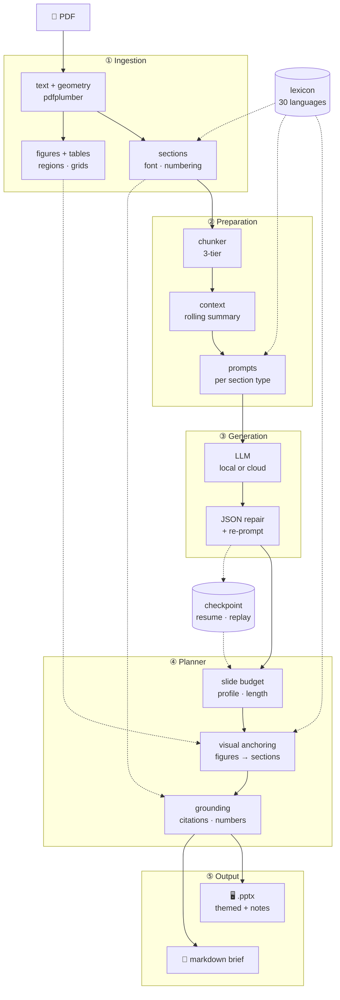

<h1 align="center">AcademiSlide 🎓</h1>

<p align="center">
  <b>Read or present any academic paper — without the paper ever leaving your machine.</b>
</p>

<p align="center">
  <a href="LICENSE"></a>
  
  
  
  
  
</p>


<p align="center"><sub>
  Real output, reproducible from this repository: <code>scripts/make_demo.sh</code>
</sub></p>

---

## Who this is for

**You have a paper you cannot upload anywhere.** It is unpublished, under review,
covered by an NDA, or contains patient or subject data. Every browser-based deck
generator is closed to you, because using one means handing the document to a
third party. AcademiSlide runs against a local model on your own hardware — no
account, no upload, no network. A 4B model on a laptop GPU is enough.

**Your paper is not in English.** Detection covers 30 languages and the deck comes
out in the paper's own language by default. One flag translates it into another.

**You just want to read it.** A deck is one way out; `--format md` is the other,
and `--format both` gets you both from a single run — the deck and the brief are
two serialisations of one planned analysis, so the second costs no extra model
call. The same analysis, written to be read instead of presented — the argument
section by section, tables rebuilt, and with `-L` the whole thing translated. That
is the case the constraint actually bites on: a long paper does not fit in a small
model's context, so "just ask a local LLM to summarise it" is not available to
you. Splitting the paper along its own structure and carrying a running summary
between the pieces is exactly what makes it available.

Put together with the two points above, this covers a case the slides were never
the point of: a paper you cannot upload anywhere and cannot read in its own
language still gets summarised, translated if you ask, end to end on your own
machine — nothing leaves it.

```bash
python main.py paper.pdf --format md -L English    # → outputs/paper.md
python main.py paper.pdf --format both              # → outputs/paper.pptx + outputs/paper.md
```

**You just want the tedious part done.** Point it at a PDF, get a themed `.pptx`
with figures placed, tables rebuilt and speaker notes written — then edit it like
any other deck. Nothing is locked in a proprietary format.

---

## The hard part is not the LLM

Asking a model to summarise a paper is easy. Getting the paper *out of the PDF*
is where decks go wrong, and it is where most of this project lives.

A PDF has no notion of a section, a figure or a table. It has glyphs at
coordinates. Everything above them — that this run of text is a heading and that
one is a footnote, that these two columns are read separately, that this caption
belongs to that image, that these whitespace-aligned numbers are a table with
five columns — has to be *inferred* from geometry, and it has to be inferred for
a journal template nobody has seen before.

So the parser is built under one rule, applied without exception:

> **No heuristic may recognise a specific paper.** Not its title, its section
> names, its vocabulary, its field. A paper that parses wrong is a symptom; the
> fix is the general rule behind it, or it is not a fix.

In practice every rule is one of three kinds — **structural** (font size,
bounding boxes, column geometry, digit density, whitespace gaps), **lexical but
centralised** (words that genuinely carry signal live in `pipeline/lexicon/` as
data, keyed by language, never as a regex inlined in a pipeline stage), or
**delegated to the model** (translation, summarisation, and other unbounded
linguistic work). A rule that fits none of the three is an overfit and does not
ship.

Rules are validated by regression over a corpus of open-access papers spanning
fields, journals, layouts, scripts and languages. **No paper is redistributed
with this project and no model is trained on one** — the corpus is fetched by
identifier at test time (`scripts/fetch_*.py`), read locally, and that is all.

---

## How well it reads a paper

That rule is a claim about generality, so it is measured — against a truth this
project does not get to write.

**Section detection, English: recall 0.803, precision 0.794** across 351 arXiv
preprints. The expectations come from each paper's own LaTeX source: `\section{…}`
is not an approximation of the heading, it *is* the heading, so nobody decides
after the fact what the right answer was, and the whole thing reproduces from a
clean checkout:

```bash
python scripts/fetch_arxiv_eval.py    # sample papers; keep their sources
python scripts/gt_score.py --tex      # score the parse against them
```

Two readings, because they answer different questions:

| | recall | precision |
|---|---|---|
| as shipped (the PDF's own outline + geometry) | **0.803** | **0.794** |
| geometry alone | 0.772 | 0.787 |

70–80% of modern papers carry a bookmark tree, which the parser reads as a
second opinion — never as authority, since running text quotes a section's own
words. The geometry-only figure is what a scan, a typescript or most
word-processor output gets, and those are the documents that are hard.

Separately, and this one is a guarantee rather than a score: **every number,
citation and figure reference in the deck is checked against the paper's text,
and the ones that do not anchor are removed** (110/110 citations, 101/101
figure references, 143/149 numbers over 12 measured decks). The deck cannot
cite a paper that is not there.

What the numbers do **not** cover: whether the deck is any *good*. That needs a
measure of how much of the paper it represents, and publishing one honestly is
what the next version is for. See [CHANGELOG.md](CHANGELOG.md) for the method,
the sample, and what each figure can and cannot support.

---

## What comes out

|   |   |
|---|---|
| 🗂 **Structure** | Sections and subsections, abstract, metadata, reference list — recovered from font weight, numbering and geometry rather than assumed |
| 📊 **Real tables** | A table ruled only with whitespace becomes a *native, editable* PowerPoint table — not a screenshot |
| 🖼 **Figures in context** | Figure regions cropped from the page and placed on the slide that discusses them, caption and all |
| 🎨 **5 themes** | `signature` · `linen` · `carbon` · `journal` · `console` |
| 📝 **Speaker notes** | Written per slide, from the section the slide came from |
| 📄 **Or a written brief** | `--format md` (or `both`, alongside the deck) renders the same analysis as Markdown — prose, bullets and rebuilt tables — for reading, translating or archiving instead of presenting |
| 🎚 **Density you choose** | Five detail profiles scale slide count with paper length, from ultra-concise to very-detailed |
| 🌍 **30 languages** | Auto-detected, script-aware; `-L <lang>` translates the whole deck with a validated enforcement pass |
| 🔁 **Never dies mid-run** | Malformed model output is repaired and re-prompted; checkpoints let a long run resume where it stopped |

---

## Quick start

```bash
pip install -r requirements.txt        # torch-free, installs in seconds
```

### Fully local (the default)

Start any OpenAI-compatible server — [LM Studio](https://lmstudio.ai) or
`llama.cpp` — load a model, and run:

```bash
python main.py paper.pdf
# → outputs/paper.pptx
```

The default endpoint is `http://localhost:1234/v1`. Nothing else to configure,
and nothing leaves the machine.

### Cloud, if you prefer

```bash
export LLM_BASE_URL="https://openrouter.ai/api/v1"
export LLM_MODEL="deepseek/deepseek-v3.1"
export LLM_API_KEY="sk-…"             # or --api-key … / --safe-key (hidden prompt)
python main.py paper.pdf
```

Any OpenAI-compatible endpoint works — OpenRouter, Gemini, Groq, or your own.
See [Cloud providers](#cloud-providers).

### See it work first

```bash
scripts/make_demo.sh
```

Builds a synthetic paper, turns it into a deck, and renders every slide to PNG
under `docs/demo/`. The images at the top of this page come from that command,
so you can reproduce them exactly — no paper to download, no licence to worry
about. Details in [`docs/demo/`](docs/demo/).

---

## Choosing a model

The parser does the structural work, but the *prose* is only as good as the
model behind it. From our testing:

| Size | What to expect |
|---|---|
| **Under 4B** | Bullets drift from the source and the narrative loses its thread. Not recommended. |
| **≈4B** | The practical floor for a coherent deck. Qwen 3.5 4B is the smallest model we would put in front of an audience — and it fits on a modest laptop GPU. |
| **7–14B** | Noticeably better synthesis and tighter bullets, if you have the VRAM. |
| **Cloud** | Best prose, at the cost of sending the paper to someone else. Worth it for published work; the whole point of the local path is that it is not always an option. |

Reasoning-heavy models need `--reasoning off` or `low`: left unbounded they can
spend the entire token budget thinking and return nothing.

Methodology and full results: [`docs/BENCHMARK.md`](docs/BENCHMARK.md).

---

## Language and translation

The pipeline is language-agnostic by construction. Every language-dependent word
list lives in one data layer (`pipeline/lexicon/`), so supporting a language
means adding rows — never editing a pipeline stage.

| Capability | Coverage |
|---|---|
| **Source-language detection** | 30 languages. Function-word fingerprints for Latin-script languages, Unicode script detection for Chinese, Japanese, Korean, Russian/Ukrainian, Arabic, Hebrew, Greek, Hindi, Thai |
| **Figure/table caption parsing** | "Figure", "Figura", "Abbildung", "Şekil", "図", "Таблица", "Quadro"… each kept in the paper's own canonical form |
| **Section markers** | Abstract, references, and section-name markers across the covered set |
| **Deck chrome** | Outline, labels and closing slide localised; English fallback beyond the localised set |
| **Translation** | Any detected source → any covered target |

```bash
python main.py paper_en.pdf                 # English paper → English deck (auto)
python main.py paper_pt.pdf -L Spanish      # Portuguese   → Spanish deck
python main.py paper_es.pdf -L English      # Spanish      → English deck
```

On a translation run the cover carries the translated title with the original
underneath, and a final enforcement pass catches sentences the model left
untranslated — including between sibling languages like Spanish and Portuguese,
which share most of their function words and defeat naive detection. Caption
label heads are rebuilt from the localisation layer ("Figure 3" → "Figura 3") so
the number always survives.

---

## Common options

```bash
python main.py paper.pdf --profile 3 --theme carbon     # more detail, dark theme
python main.py paper.pdf --slides 12                    # hard ceiling
python main.py paper.pdf -L French                      # translate the deck
python main.py --batch inputs/                          # every PDF in a folder
python main.py paper.pdf --polish                       # whole-deck editorial pass
```

| Flag | Purpose |
|---|---|
| `--profile 0…4` | Detail: ultra-concise → very-detailed. Scales slide count with paper length and sets bullet density |
| `--slides N` | Absolute slide ceiling, overriding the profile |
| `--theme T` | `signature` · `linen` · `carbon` · `journal` · `console` |
| `-L, --language L` | Output language — omit to auto-detect, set to translate |
| `--endpoint` / `--model` / `--api-key` | LLM overrides (`--safe-key` prompts hidden, never hits shell history) |
| `--polish` | Post-assembly pass over the whole deck: reorder, de-silo, dedupe — reverts on hallucination or figure loss |
| `--judge` | Score the deck with the evaluation harness and a judge model |
| `--resume` / `--resume-at` | Continue an interrupted run from a checkpoint |

Full reference: [`docs/CLI.md`](docs/CLI.md). Everything else — the model
benchmark, the reproducible demo, rendering your own decks — is indexed in
[`docs/`](docs/).

---

## How it works



The dotted edges are what makes it work on *any* paper. The **lexicon** is the one
place language-dependent words live, so adding a language is adding rows to a
table rather than touching a pipeline stage. **Grounding** reads back against the
paper's own text, so a number or citation the model produced but the paper does
not contain is removed rather than rendered. And the **checkpoint** stores the
model's output, so the planner can be re-run over a finished paper with no API
calls at all — which is how the planner is regression-tested.

| Stage | What it does |
|---|---|
| **Ingestion** | Text and geometry via `pdfplumber`, rendering via `pypdfium2`. Headings from font weight, size and numbering; footnotes stripped structurally; figure and table regions detected and cropped |
| **Chunker** | Tier 1 follows the detected structure; Tier 2 falls back to semantic splitting (ONNX embeddings, no PyTorch) when a paper has none; Tier 3 is a hard token split |
| **Context manager** | A rolling summary and key-term tracker injected into every prompt, so slide 9 knows what slide 2 established |
| **Planner** | Allocates a slide budget, anchors tables and figures to the sections that discuss them, deduplicates, grounds every claim against the source, and builds the outline |
| **Builder** | `python-pptx` → themed deck with speaker notes, or `--format md` for a written brief |

Semantic chunking downloads `all-MiniLM-L6-v2` (~90 MB ONNX) on first use;
`--offline` pins it to the local cache afterwards.

---

## Cloud providers

| Provider | `LLM_BASE_URL` | Key env |
|---|---|---|
| LM Studio / llama.cpp | `http://localhost:1234/v1` | *(none)* |
| OpenRouter | `https://openrouter.ai/api/v1` | `OPENROUTER_API_KEY` |
| Google (Gemini/Gemma) | `https://generativelanguage.googleapis.com/v1beta/openai/` | `GEMINI_API_KEY` |
| Groq | `https://api.groq.com/openai/v1` | `GROQ_API_KEY` |

---

## Limitations

Stated plainly, because a tool that claims to work on *any* paper owes you the
edges:

- **Scanned PDFs are not supported.** No text layer, nothing to parse. OCR first:
  `ocrmypdf in.pdf out.pdf`.
- **Themes are tuned for Latin scripts.** CJK and right-to-left decks are
  generated but the typography is not yet designed for them.
- **Very long captions can be truncated** in the slide footer.
- **A visual can land in the section next to its own.** Figures and tables bind
  to slides by position, so a section with more visuals than slides spills the
  surplus onto the adjacent section.
- **Slide order follows a canonical structure, not the paper's.** Sections are
  ordered by their resolved type, so a paper that does not follow
  introduction → methods → results → discussion can have its argument
  reordered.
- **A mandatory topic can appear twice**, when the paper covers it inside a
  section whose name does not announce it.
- **A tight slide budget leaves figures out.** The deck ceiling scales with the
  paper's length, so a figure-heavy paper has more visuals than slots; which
  ones were left out is named in the run log rather than passed over in
  silence. `--profile 3` or `4` raises the ceiling when you want them all.
- **Heavily non-standard layouts** — magazine-style spreads, rotated pages,
  figures split across columns — degrade gracefully rather than perfectly.
- **The deck is a first draft**, not a finished talk. It is meant to save you the
  hour of extracting and arranging, not to replace your judgement about what
  matters in your own paper.
- **The parser misses about a fifth of what it reads.** Recall 0.803 means one
  heading in five does not become a section; precision 0.794 means one section
  in five was not a heading. Both are measured and published rather than
  estimated — see [CHANGELOG.md](CHANGELOG.md) — and `0.9` is the version
  number saying exactly this: usable, and not finished.

---

## What's next

`0.9` is the version number saying *usable, and not finished*. The deck it
produces is a good first draft — the hour of extracting, cropping and arranging
is done for you, and the judgement about what matters in your own paper is still
yours. What follows is what is being worked on, roughly in order, and how each
one will be known to have improved. Nothing here is a promise about a date; it
is a statement about what the current numbers say is worth fixing next.

**1 · A published measure of deck quality.** This one gates the rest. Grounding
saturates by construction, so it cannot rank two decks; the measure that
discriminates is semantic coverage — how much of the paper the deck actually
represents — and it currently ranges 0.39–0.92 across documents. Publishing it
takes thirty decks built by one version. Until that exists, every improvement
below is an opinion rather than a result.

**2 · Narrative order.** Slides are ordered by a section's canonical *type*
(introduction → methods → results → discussion). A paper whose own structure
does not map onto that skeleton gets its argument reshuffled: two distinct
sections can both resolve to "methods", and one section's slides can end up
split apart with another section's between them. Following the paper's own
order, and keeping a section's slides contiguous, is the fix.

**3 · Topic coverage without duplication.** A short list of topics is treated as
mandatory (objectives, participants, limitations…). Whether one is already
covered is judged from the slide's *section label*, not from what the slide
says, so a paper that discusses participants inside a differently-named section
gets a second, near-identical slide inserted.

**4 · Visual placement.** Figures and tables bind to slides by position within a
section, so a section holding more visuals than slides spills the surplus onto
the section next to it. Binding by what a slide's text is about, rather than by
where it sits, is the change — and it needs (1) to be measurable at all.

**5 · Recall and precision on section detection.** 0.803 / 0.794 in English, and
materially lower across the other twenty-nine languages — that gap is the single
largest known weakness. The named failure modes are theorem-like environments
read as headings, run-in heads that cannot be told from bold emphasis, and
headings typeset from macros or mathematics that print a symbol the source never
spells out.

**6 · Figures and tables.** Captions that continue past a column break can still
be truncated; composite figures with lettered panels are not always split; a
table ruled only by whitespace is recovered as a grid more often than not, but
not always.

**7 · A small model that is good enough on its own.** The privacy claim only
means something if the local path is genuinely usable, which means a 4B-class
model on a laptop GPU producing decks close to what a large cloud model
produces. The route is distillation from a strong open model onto a small one,
reliability first — a model that always returns parseable, faithful output beats
a model that is occasionally brilliant. Early results are encouraging and are
deliberately not published as a number yet: ten papers cannot carry a
percentage.

The thread through all seven: **publish what is measured, and say plainly what
is not.** A version is cut when a benchmark moves further than the noise between
samples — see [CHANGELOG.md](CHANGELOG.md) for what each figure can and cannot
support.

---

## Development

Tests are plain scripts with no runner to install — each one exits non-zero on
the first broken invariant:

```bash
for t in tests/*.py; do python "$t" || break; done
```

`tests/test_language_agnostic.py` is the multilingual and agnosticism suite: it
asserts both the behaviour a rule was written for *and* a control that must keep
working.

Corpus-wide totals are not enough to catch regressions, though. Summed over
three hundred papers, a document that loses three real sections and gains six
spurious ones reads as **+3** — indistinguishable from an improvement, and every
rule that adds headings is flattered by that arithmetic. So `scripts/golden.py`
pins individual parses a human has read and called correct, and fails the run
when a section disappears or changes type. Aggregate gains still have to be
gains, but they can no longer hide a loss.

Measuring is cheap enough to do every time. `scripts/gt_score.py --tex` scores
the whole set in about forty minutes; three disjoint samples of thirty papers
take eight, and — being disjoint — they also report the dispersion between
themselves. That last figure is the useful one: **a gain smaller than the spread
between samples is the sample, not the change.**

Main is what has been measured. Work on a branch, and merge only when the tests
and `golden.py` are green *and* the corpus says the change is an improvement
larger than that spread. Versions are cut the same way — by a benchmark moving,
not by a calendar — which is why [CHANGELOG.md](CHANGELOG.md) records a number
beside every release.

Contributions are welcome — the one hard requirement is the rule at the top of
this page. A fix that recognises a particular paper will not be merged, however
well it works on that paper.

---

## License

MIT — see [LICENSE](LICENSE).
