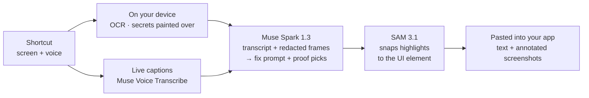

<div align="center">

<picture>
  <source media="(prefers-color-scheme: dark)" srcset="logo/social/readme-banner-dark.png">
  
</picture>

<p>
  <a href="https://github.com/nikylogic/ivibe/releases/latest"></a>
  <a href="https://github.com/nikylogic/ivibe/actions/workflows/ci.yml"></a>
  <a href="LICENSE"></a>
</p>

<p>
  <a href="https://github.com/nikylogic/ivibe/releases/latest"><b>Download</b></a> ·
  <a href="#how-it-works"><b>How it works</b></a> ·
  <a href="docs/architecture.md"><b>Architecture</b></a> ·
  <a href="CONTRIBUTING.md"><b>Contributing</b></a>
</p>

</div>

**Show the bug and talk it through. iVibe writes the fix prompt, with annotated screenshots as proof, and pastes it straight into Claude Code, Cursor or ChatGPT.**

Press a shortcut, show what's wrong while you explain it, and press it again. iVibe hides secrets on your device, works out what you meant, and pastes the result into the app you were typing in. No report window, no copy-paste.

## Download

iVibe 0.1 is out for Windows, macOS and Linux. Get it from the [latest release](https://github.com/nikylogic/ivibe/releases/latest):

| Your computer                         | File                                    |
| ------------------------------------- | --------------------------------------- |
| Windows 10 or 11                      | `iVibe-Setup-<version>.exe`             |
| Mac with Apple silicon (M1 and later) | `iVibe-<version>-mac-arm64.dmg`         |
| Mac with Intel                        | `iVibe-<version>-mac-x64.dmg`           |
| Linux (Ubuntu, Debian)                | `iVibe-<version>-linux-amd64.deb`       |
| Linux (any)                           | `iVibe-<version>-linux-x86_64.AppImage` |

The installers aren't code-signed yet, so your computer asks once before opening iVibe:

- **Windows:** if SmartScreen says "Windows protected your PC", click **More info**, then **Run anyway**.
- **macOS:** drag iVibe to Applications. If macOS says it can't verify iVibe, open **System Settings → Privacy & Security** and click **Open Anyway**.
- **Linux:** `sudo apt install ./iVibe-<version>-linux-amd64.deb`, or `chmod +x` the AppImage and run it.

iVibe keeps itself up to date. On Windows and Linux it downloads updates in the background and installs them when you restart; on macOS it tells you when a new version is out.

## Three modes

| Mode        | You give it              | It pastes                                                                         | Windows              | macOS and Linux      |
| ----------- | ------------------------ | --------------------------------------------------------------------------------- | -------------------- | -------------------- |
| **Fix**     | Your screen + your voice | A fix prompt for your coding agent, with annotated screenshots that prove the bug | `Ctrl` + `Caps Lock` | `Ctrl` + `Alt` + `F` |
| **Prompt**  | Your voice               | A clear, structured prompt from what you rambled                                  | `Alt` + `Caps Lock`  | `Ctrl` + `Alt` + `P` |
| **Dictate** | Your voice               | Your own words, cleaned up: no "um", no false starts                              | Hold `Caps Lock`     | `Ctrl` + `Alt` + `D` |

Every shortcut can be changed in Settings. On Windows, hold `Caps Lock` to talk, or double-press it for hands-free. Results land where you were typing: screenshots are pasted as images into chat apps and Claude Code, and as file paths into other terminal agents. If you switched apps meanwhile, the result waits on the clipboard and pastes into the next text field you click, or with `Ctrl` + `Alt` + `V`.

## Plans

| Plan                  | What you get                                                                                                          | Price      |
| --------------------- | --------------------------------------------------------------------------------------------------------------------- | ---------- |
| **Your own Meta key** | Everything. Recordings go from your device straight to Meta, billed to your Meta account.                             | Free       |
| **iVibe Cloud trial** | Sign in with GitHub and get 50 free credits, no key needed.                                                           | Free       |
| **iVibe Pro**         | 400 credits a month, no key needed, plus end-to-end encrypted backups of your history. Credits reset at each renewal. | $8 / month |

A credit is one cent of Meta usage. A dictation costs a fraction of a credit and a Fix report a few credits.

## How it works



1. **Record.** A shortcut captures the screen under your cursor and your microphone. Captions appear as you talk.
2. **Protect.** Every keyframe is read with on-device OCR (PP-OCRv5). API keys, tokens, `.env` lines and password managers are painted over before a frame can leave the recorder.
3. **Write.** One Muse Spark call reads your narration, the redacted keyframes and their text, and returns the prompt and which frames prove the bug. Prompts are built from layers: fixed rules, the mode, the app you're pasting into, and what you told iVibe about yourself.
4. **Prove.** SAM 3.1 snaps each highlight to the exact button or error; the screenshots are annotated on your device.
5. **Paste.** iVibe pastes into the app you were in, each screenshot after the sentence about it, and keeps a copy in History.

## Built on Meta's models

| Job                                                             | Model                 |
| --------------------------------------------------------------- | --------------------- |
| Write the fix prompt, structured prompt or cleaned-up dictation | Muse Spark 1.3        |
| Live captions and the narration transcript                      | Muse Voice Transcribe |
| Snap proof highlights to the UI element                         | SAM 3.1               |

All calls use the Meta Model API with `store: false`. Muse Spark Open (an open-weight engine for iVibe Cloud) and Muse Wonder (optional deep analysis) are planned.

## Privacy

- **Secrets are hidden on your device.** Only redacted frames and your narration are sent for analysis. The app's self-test plants a GitHub token on screen and fails if it isn't painted over.
- **Your key stays yours.** A Meta API key is encrypted with your system keychain and used only by the app's main process.
- **History stays on your device.** The last 200 results and their screenshots are kept locally, can be turned off, and can be cleared in Settings.
- **Backups are end-to-end encrypted.** Pro backups are encrypted on your device with a recovery key that only you hold; iVibe can't read them.

## Status

Updated **Oct 29, 2026**, when 0.1 was released. iVibe is being built in public for the [Meta Global AI Developer Hackathon](https://cerebralvalley.ai/e/meta-ai-developer-hackathon) (Oct 27 – Nov 4, 2026). The full breakdown is in [docs/architecture.md](docs/architecture.md).

**Shipped**

- [x] Fix, Prompt and Dictate, with live captions, personal settings and per-mode shortcuts
- [x] On-device OCR and secret redaction, annotated proof screenshots with SAM 3.1
- [x] Paste into the app you were in, click-to-paste and History
- [x] Installers for Windows, macOS and Linux, with automatic updates
- [x] iVibe Cloud: GitHub sign-in, free trial credits, iVibe Pro and encrypted backups

**Being verified by hand**

- [ ] macOS and Linux on real machines (they build and pass tests in CI)
- [ ] Image paste into Claude Code and ChatGPT (text paste is confirmed)

**Next**

- [ ] Evaluation suite: voice cases and a set of 20 recorded bugs
- [ ] Code signing for Windows and macOS
- [ ] After the hackathon: Vibes (your own modes) and community plugins ([plan](docs/vibes-and-prompts.md))

## Development

**Prerequisites:** Node.js 24+ and pnpm 12+.

```bash
git clone https://github.com/nikylogic/ivibe.git
cd ivibe
pnpm install
pnpm ocr:fetch    # download the on-device OCR models (13 MB, hash-checked)
pnpm check        # lint, format check, typecheck, tests and the dependency license check
pnpm --filter @ivibe/desktop dev   # run the desktop app
```

Add your Meta Model API key in the app under **Settings → Meta API key**. The experiments in [`spikes/`](spikes/) read it from `.env` instead: copy `.env.example` to `.env`, set `META_API_KEY`, then for example:

```bash
pnpm spike spikes/meta/s10-models.ts
```

**Releasing:** set the version in `apps/desktop/package.json`, commit, and push a matching tag (`git tag -a v0.1.1 -m "iVibe 0.1.1" && git push origin v0.1.1`). GitHub Actions builds every installer into a draft release; publishing the draft is what the app's updater sees.

### Repository layout

```text
apps/desktop   Electron app: recorder, pill, app window, tray, updater, OS helpers
apps/api       iVibe Cloud on Cloudflare Workers: sign-in, credits, Pro billing, backups
apps/demo-bug  A small React app with a planted bug, for demos
packages/      capture · vision · ocr · redact · encode · engine (Meta API, prompts, proof)
logo/          every logo file, generated from one mascot drawing (logo/README.md)
spikes/        experiments that verify API and platform facts before building on them
docs/          architecture, spike results, the Vibes and prompts plan
scripts/       repository tooling (OCR model download, dependency license check)
```

Every package's role and the decisions behind it are in [docs/architecture.md](docs/architecture.md); spike results are in [docs/spikes.md](docs/spikes.md).

## Contributing

Contributions are welcome. Please read [CONTRIBUTING.md](CONTRIBUTING.md) and the [Code of Conduct](CODE_OF_CONDUCT.md). Contributors sign a [Contributor License Agreement](CLA.md) once, on their first pull request.

Found a security issue? Please report it privately; see [SECURITY.md](SECURITY.md).

## License

iVibe is free and open-source software, licensed under the [GNU Affero General Public License v3.0](LICENSE).

Want to modify iVibe or embed it in a product without the AGPL's obligations? [Commercial licenses](COMMERCIAL.md) are available.

The iVibe name and logo are not covered by the code license; see [TRADEMARKS.md](TRADEMARKS.md).

---

<div align="center">
<sub>Built for the Meta Global AI Developer Hackathon. iVibe is an independent project and is not affiliated with or endorsed by Meta.</sub>
</div>
