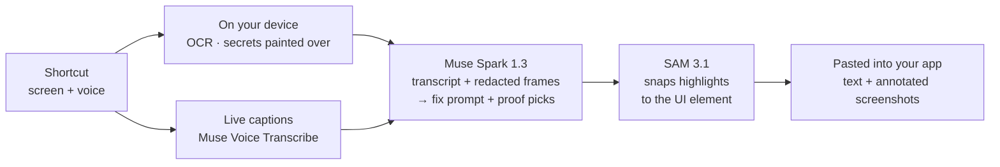

<div align="center">


<p>
  <a href="https://github.com/nikylogic/ivibe/actions/workflows/ci.yml"></a>
  <a href="LICENSE"></a>
  
  
  
</p>

<p>
  <a href="#status"><b>Status</b></a> ·
  <a href="docs/architecture.md"><b>Architecture</b></a> ·
  <a href="CONTRIBUTING.md"><b>Contributing</b></a>
</p>

</div>

**Show the bug and talk it through. iVibe writes the fix prompt, with annotated screenshots as proof, and pastes it straight into Claude Code, Cursor or ChatGPT.**

Press a shortcut, show what's wrong while you explain it, press it again. iVibe hides secrets on your device, works out what you meant, and pastes the result into the app you were typing in. No report window, no copy-paste.

> [!NOTE]
> iVibe is being built in public for the [Meta Global AI Developer Hackathon](https://cerebralvalley.ai/e/meta-ai-developer-hackathon) (Oct 27 – Nov 4, 2026). It runs from source on Windows today; the first installers are planned for **Nov 4, 2026**. See [Status](#status) for exactly what works.

## Three modes

| Mode        | You give it              | It pastes                                                                         | Shortcut on Windows                                      |
| ----------- | ------------------------ | --------------------------------------------------------------------------------- | -------------------------------------------------------- |
| **Fix**     | Your screen + your voice | A fix prompt for your coding agent, with annotated screenshots that prove the bug | `Ctrl` + `Caps Lock`                                     |
| **Prompt**  | Your voice               | A clear, structured prompt from what you rambled                                  | `Alt` + `Caps Lock`                                      |
| **Dictate** | Your voice               | Your own words, cleaned up: no "um", no false starts                              | Hold `Caps Lock` to talk, or double-press for hands-free |

Every shortcut can be changed in Settings. Results land where you were typing: screenshots are pasted as images into chat apps and Claude Code, and as file paths into other terminal agents. If you switched apps meanwhile, the result waits on the clipboard and pastes into the next text field you click, or with `Ctrl` + `Alt` + `V`.

## How it works



1. **Record.** A shortcut captures the screen under your cursor and your microphone. Captions appear as you talk.
2. **Protect.** Every keyframe is read with on-device OCR (PP-OCRv5). API keys, tokens, `.env` lines and password managers are painted over before a frame can leave the recorder.
3. **Write.** One Muse Spark call reads your narration, the redacted keyframes and their text, and returns the prompt and which frames prove the bug. Prompts are built from layers: fixed rules, the mode, the app you're pasting into, and what you told iVibe about yourself.
4. **Prove.** SAM 3.1 snaps each highlight to the exact button or error; the screenshots are annotated on your device.
5. **Paste.** iVibe pastes into the app you were in, each screenshot after the sentence about it, and keeps a copy in History.

## Built on Meta's models

| Job                                                             | Model                 | Status  |
| --------------------------------------------------------------- | --------------------- | ------- |
| Write the fix prompt, structured prompt or cleaned-up dictation | Muse Spark 1.3        | In use  |
| Live captions and the narration transcript                      | Muse Voice Transcribe | In use  |
| Snap proof highlights to the UI element                         | SAM 3.1               | In use  |
| Open-weight engine for iVibe Cloud                              | Muse Spark Open       | Planned |
| Optional deep analysis                                          | Muse Wonder           | Planned |

All calls use the Meta Model API with `store: false`.

## Privacy

- **Secrets are hidden on your device.** Only redacted frames and your narration are sent for analysis. The app's self-test plants a GitHub token on screen and fails if it isn't painted over.
- **Bring your own key, free forever.** Your Meta Model API key is encrypted with your system keychain and used only by the app's main process. Recordings go from your device straight to Meta.
- **History stays on your device.** The last 200 results and their screenshots are kept locally, can be turned off, and can be cleared in Settings.

## Status

Updated **Oct 28, 2026**. The full breakdown is in [docs/architecture.md §16.0](docs/architecture.md#160-build-status--oct-28-2026).

**Works today (Windows, from source)**

- [x] Screen and microphone capture, microphone picker and level test
- [x] On-device OCR and secret redaction
- [x] Live captions while you record
- [x] Fix, Prompt and Dictate, with a layered prompt stack and personal settings (your name, context, dictionary, standing instructions)
- [x] Annotated proof screenshots with SAM 3.1
- [x] Paste into the app you were in, copy fallback, click-to-paste, `Ctrl` + `Alt` + `V`
- [x] Per-mode shortcuts with click-to-change; Dictate hold-to-talk and double-press hands-free
- [x] History by mode, with search and Paste again
- [x] CI on Windows, macOS and Linux: lint, typecheck, 104 unit tests, dependency license check

**Built, still being verified by hand**

- [ ] Image paste into Claude Code and ChatGPT (text paste is confirmed)
- [ ] Click-to-paste with a real click
- [ ] Caps Lock gestures on a physical keyboard
- [ ] macOS and Linux: they build and pass tests in CI, but the app hasn't been run on a real Mac or Linux desktop yet

**Not started yet**

- [ ] Installers and releases (unsigned Windows, macOS and Linux builds)
- [ ] Evaluation suite: voice cases and a set of 20 recorded bugs
- [ ] iVibe Cloud: sign-in, credits and payments
- [ ] Web app and judge access
- [ ] After the hackathon: Vibes (your own modes) and community plugins ([plan](docs/vibes-and-prompts.md))

## Development

**Prerequisites:** Node.js 24+ and pnpm 12+.

```bash
git clone https://github.com/nikylogic/ivibe.git
cd ivibe
pnpm install
pnpm ocr:fetch    # download the on-device OCR models (13 MB, hash-checked)
pnpm check        # lint, format check, typecheck, tests and the dependency license check
pnpm --filter @ivibe/desktop dev   # run the desktop app
```

Add your Meta Model API key in the app under **Settings → Meta API key**. The experiments in [`spikes/`](spikes/) read it from `.env` instead: copy `.env.example` to `.env`, set `META_API_KEY`, then for example:

```bash
pnpm spike spikes/meta/s10-models.ts
```

### Repository layout

```text
apps/desktop   Electron app: recorder, pill, app window, OS helpers (paste, shortcuts)
packages/      capture · vision · ocr · redact · encode · engine (Meta API, prompts, proof)
               agent · bundle · imageops · types · ui are placeholders for later phases
spikes/        experiments that verify API and platform facts before building on them
docs/          architecture, spike results, the Vibes and prompts plan, Muse Code log
scripts/       repository tooling (OCR model download, dependency license check)
```

Every package's role and the decisions behind it are in [docs/architecture.md](docs/architecture.md); spike results are in [docs/spikes.md](docs/spikes.md).

## Contributing

Contributions are welcome. Please read [CONTRIBUTING.md](CONTRIBUTING.md) and the [Code of Conduct](CODE_OF_CONDUCT.md). Contributors sign a [Contributor License Agreement](CLA.md) once, on their first pull request.

Found a security issue? Please report it privately; see [SECURITY.md](SECURITY.md).

## License

iVibe is free and open-source software, licensed under the [GNU Affero General Public License v3.0](LICENSE).

Want to modify iVibe or embed it in a product without the AGPL's obligations? [Commercial licenses](COMMERCIAL.md) are available.

The iVibe name and logo are not covered by the code license; see [TRADEMARKS.md](TRADEMARKS.md).

---

<div align="center">
<sub>Built for the Meta Global AI Developer Hackathon. iVibe is an independent project and is not affiliated with or endorsed by Meta.</sub>
</div>
