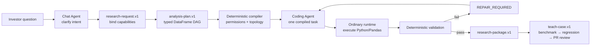

# Bridgewater PAT Investment Research

[简体中文](README.zh-CN.md) · English


A compiler-style AI Skill for permission-bound, typed, diagnosable investment investigation.

It turns an ambiguous research question into a versioned request, a typed DataFrame DAG, task-scoped code generation, deterministic validation, incremental recomputation, an auditable research package, and a Teach-to-regression loop.

> **Independent and unofficial.** This project is inspired by the public LangChain presentation about Bridgewater's Pocket Analyst Tool. It is not affiliated with, endorsed by, or equivalent to Bridgewater Associates, LangChain, or their private systems. It is for research investigation only—not investment advice, portfolio construction, broker access, orders, or trading.

## Why this project exists

General-purpose agents can produce persuasive analysis while silently changing the question, widening data access, mixing units, skipping validation, or hiding missing evidence. This Skill moves those decisions into explicit contracts that ordinary code can validate.

The central idea is simple:

> **The plan is the analysis, and the workflow is compiled before it is executed.**

## Architecture



The Chat Agent owns research intent and presentation. The Coding Agent receives exactly one compiled transformation and cannot reinterpret the question, widen permissions, or talk to the user. Validation runs outside the model and cannot be skipped by generated code.

Read the full [architecture guide](docs/ARCHITECTURE.md).

## Five versioned contracts

| Contract | Responsibility |
| --- | --- |
| `research-request.v1` | Question, user/role context, read-only capability manifest, resource versions, `as_of`, and output intent |
| `analysis-plan.v1` | Natural-language Python project, typed DataFrame outputs, dependencies, validators, and cache bindings |
| `task-result.v1` | Code, input receipts, materialized rows, diagnostics, validation receipts, hashes, and lineage |
| `research-package.v1` | Conclusions, DataFrames, charts, sources, diagnostics, execution trace, and decision boundary |
| `teach-case.v1` | Minimal failure benchmark, reproduction, narrow fix, focused/full regression, and review-only PR proposal |

Every planned column declares `name`, `dtype`, `unit`, `frequency`, `currency`, `semantic`, and `nullable`. Every task also declares grain, primary key, upstream dependencies, transformation semantics, and seven validation classes: schema, missingness, range, frequency, currency, dimension, and prior consistency.

## Key properties

- **Capabilities before planning** — unlisted datasets, documents, tools, and fields cannot enter the plan, code context, lineage, or cache.
- **Plan-as-analysis** — checklist-only plans are rejected; every task produces exactly one typed DataFrame.
- **Compiler and DAG** — cycles, orphans, unknown nodes, undeclared fields, version mismatches, and ambiguous semantics fail closed.
- **Narrow code generation** — the Coding Agent receives one compiled task and an allowed capability slice.
- **Deterministic validation** — failed required checks can never become `RESEARCH_READY`.
- **Content-addressed incremental work** — reuse binds task plan, `as_of`, data version, code, permissions, dependency outputs, and cached output.
- **Traceable delivery** — every material conclusion resolves to a table, chart, diagnostic, lineage item, or source.
- **Teach loop** — feedback becomes a reproducible benchmark, repair, full regression, and human-reviewed PR proposal.
- **Research-only boundary** — trading, portfolio, broker, account, credential, and autonomous merge semantics are rejected.

## Quick start

Clone the Skill:

```bash
git clone https://github.com/noahnan-max/bridgewater-pat-research.git
cd bridgewater-pat-research
```

Run the deterministic regression suite:

```bash
PYTHONDONTWRITEBYTECODE=1 python3 scripts/self_test.py
PYTHONDONTWRITEBYTECODE=1 python3 scripts/verify_sources.py
PYTHONDONTWRITEBYTECODE=1 python3 scripts/check_purity.py .
```

Validate all five Draft 2020-12 JSON Schema fixtures:

```bash
uv run --with jsonschema python3 scripts/validate_schemas.py
```

Run the complete public-release check:

```bash
uv run --with jsonschema python3 scripts/validate_public_release.py
```

See [Usage](docs/USAGE.md) for installation, design-only and executed workflows, CLI examples, and troubleshooting.

## Validated example

`examples/validated-oil-investigation/` contains a fictional, public-safe example based on historical oil-supply-disruption research. It demonstrates:

- structured time series and unstructured document capabilities;
- parallel source tasks;
- a typed historical-analogy node;
- downstream chart preparation;
- task-result and package receipts;
- incremental impact analysis;
- a Teach regression case.

The example is a contract fixture. It does not contain real market data or an investment conclusion.

## Source provenance and copyright boundary

Architecture is grounded in:

- [LangChain: How Bridgewater Built an AI Analyst That Does Hours of Expert Research in Minutes](https://www.youtube.com/watch?v=lXZb21CfeIY)
- [Bridgewater: Risks Associated with Use of AI Tools](https://www.bridgewater.com/risks-associated-with-use-of-ai-tools)

The original local build verified the English subtitle track and recorded source hashes. This public repository does **not** redistribute the full subtitles, a full transcript, a full translation, captured HTML, or raw acquisition metadata. See the [public source boundary](references/source-boundary.md), [source manifest](references/source-manifest.json), and [timestamp-to-mechanism trace](references/pat-architecture-trace.md).

## What is and is not validated

`PAT_SKILL_VALIDATED` means the contracts, deterministic validators, fault injections, public-source references, and Skill-level blind tests passed.

It does **not** prove:

- access to or correctness of real investment data;
- correctness of model-generated analysis;
- a production sandbox or persistent orchestrator;
- real cache replay across production infrastructure;
- real pull-request integration;
- equivalence to Bridgewater's private implementation;
- authority to make investment, portfolio, broker, order, or trading decisions.

## Documentation

- [Architecture](docs/ARCHITECTURE.md)
- [Usage](docs/USAGE.md)
- [Contract reference](references/contracts.md)
- [Investment-research patterns](references/investment-research-patterns.md)
- [Source boundary](references/source-boundary.md)
- [Contributing](CONTRIBUTING.md)
- [Security](SECURITY.md)
- [Notice and attribution](NOTICE.md)

## License

Project-authored code and documentation are released under the [MIT License](LICENSE). Third-party names, source videos, web pages, captions, and other referenced materials remain the property of their respective owners and are not relicensed by this repository.
