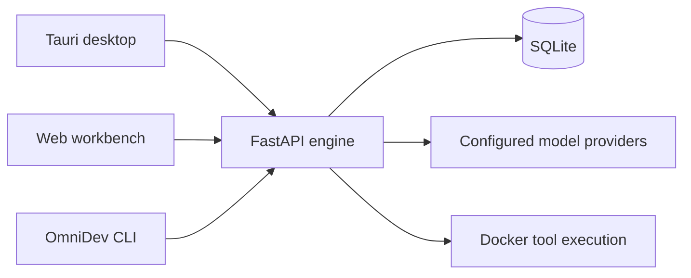
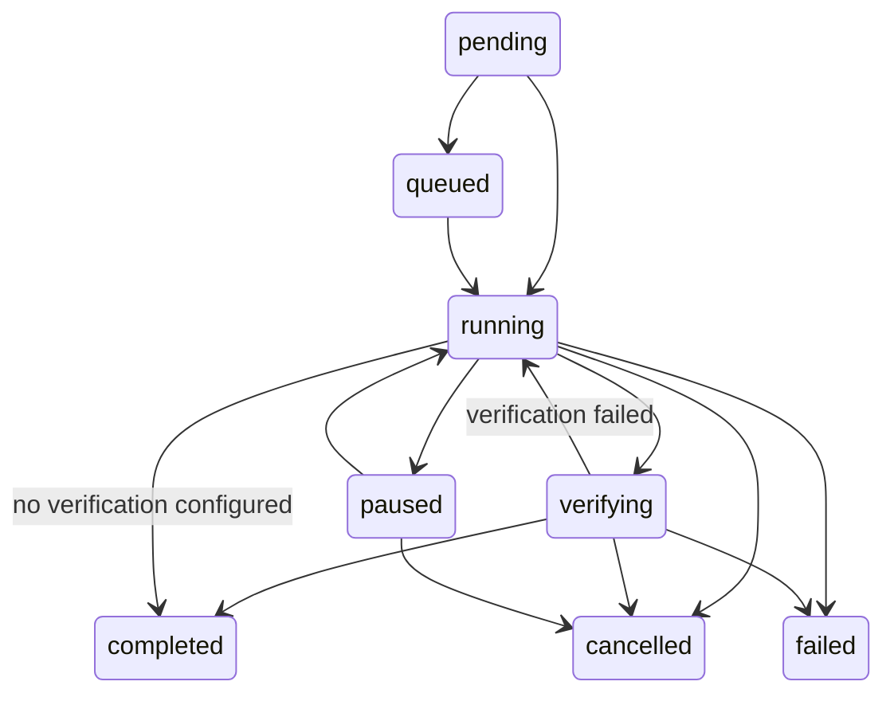

<!-- coderabbit-ai-generated:v1 -->

<!-- coderabbit-ai-generated-section:v1:0b4b622c185880f3bb7059bb7fe2f15834fb389b7e26ddb8e11af5f34d5544a2 -->

# OmniDev

A local workspace for AI-assisted software development. Chat with your chosen model, run agents with scoped tools, edit project files, and inspect execution history from a desktop app, browser, or the `omnidev` CLI.

[](https://github.com/notgamermx/OmniDev/actions/workflows/ci.yml)

[Download OmniDev 1.0.4 for Windows](https://github.com/notgamermx/OmniDev/releases/download/v1.0.4/OmniDev_1.0.4_x64_en-US.msi) ·[Download OmniDev v1.0.4 for Windows](https://github.com/notgamermx/OmniDev/actions/runs/42628671730/artifacts/13680028463) [All official releases](https://github.com/notgamermx/OmniDev/releases) · [Windows installation guide](docs/WINDOWS.md)

Tagged releases publish the MSI, portable CLI ZIP, Python wheel, Linux desktop package and checksums after required CI jobs pass. A download is available only once that release is published. GitHub Releases is the official distribution source.

## The workspace

<!-- coderabbit-ai-generated:v1 -->

<!-- coderabbit-ai-generated-section:v1:06011db929d2238c8c5d3887a7e2f0487196830b05e09bb84ec539e5d7b84f03 -->


<!-- coderabbit-ai-generated:v1 -->

<!-- coderabbit-ai-generated-section:v1:ecd4c579d4ae4912e2341a6cbec617d3c744e451ba9e9df9bb8f62e4ad54cea6 -->

Conversation history and model controls share one workspace.

<!-- /coderabbit-ai-generated:v1 -->

<!-- /coderabbit-ai-generated:v1 -->

## Core features

- **Your models:** configured providers appear in Chat; manage encrypted keys and optional fallback routing in Models & keys.
- **Development tools:** project files, editor, bounded Docker terminal, and agent tools controlled by the engine.
- **Activity:** persisted state changes, tool calls, results, verification progress, conservative token-budget reservations, cancellation, and pause after the current operation.
- **Continuity:** conversations, project memory and preferences stored locally in SQLite.
- **Three entry points:** web, Tauri desktop, and CLI use the same engine and project data.

## Architecture



## Installation

On Windows, install the MSI from GitHub Releases, then search **OmniDev** in Start. <!-- coderabbit-ai-generated:v1 -->

<!-- coderabbit-ai-generated-section:v1:3064195923422cda6ddfd15e1da4fcfb76b3ffe607aaa1a0722c77db2f359673 -->

No separate Python, Node or Rust installation is required for normal app use.

<!-- /coderabbit-ai-generated:v1 --> WebView2 may require an internet download during installation. Shell execution additionally requires Docker Desktop running Linux containers. Packages are currently unsigned; code signing remains a release requirement.

For a Python installation, download the wheel from Releases:

```powershell
py -3.12 -m pip install .\omnidev-1.0.4-py3-none-any.whl
omnidev serve
```

Open `http://127.0.0.1:8000/app/`. Install the wheel with Python 3.12. Back up your engine home and project root before upgrades. Older `personal-ai-dev` installations should be uninstalled before installing `omnidev` because they use the same CLI command.

## Quick start

1. Open **Models & keys**, choose a provider and save your key. Blank key fields preserve saved credentials.
2. Choose one of that provider's available models in Chat. Unconfigured cloud providers stay in the setup screen.
3. Create a project and explore files. Use **Activity** for development tasks with an agent and an explicit verification command.
4. Inspect execution history and resulting source changes. Existing verification inputs remain protected from agent writes.

If the connection fails, open **Connection**. Use **Use default engine** to remove a saved remote address, or enter the engine URL and API token. Copied `/api/v1` and `/app` addresses are normalized. Requests explain network, token and proxy failures without replaying writes.

## Supported models

Built-in adapters include Google Gemini, Groq, OpenRouter, Ollama, Mistral, Cloudflare Workers AI, Cohere, NVIDIA NIM, Cerebras, Hugging Face, DeepInfra, Together AI, SambaNova and OpenAI. Custom OpenAI-compatible gateways and trusted external harnesses are optional. Provider accounts, quotas and credentials remain subject to their own terms; OmniDev does not include a universal free API key.

See [model setup and harnesses](docs/CONNECTORS.md). Ollama is local and does not require an API key; its service and selected model must be installed separately.

## Agent execution and security



Task claims use a conditional database update. State updates are validated and persisted, terminal states cannot be reopened, and interrupted queued/running/verifying/paused work is marked failed on engine restart for human review. Actions are not automatically replayed. Pause takes effect after the current operation; the task time budget continues while paused. Cancellation interrupts active planning and tool awaits, allowing process cleanup to run.

Enable execution only for your selected workspace. Build the execution image first:

```bash
docker build -t omnidev-executor:1 -f containers/executor.Dockerfile containers
```

Task containers have no network, a read-only system filesystem, dropped capabilities, and CPU, memory, process, time and output limits. Existing tests/configuration and Git metadata are protected. File tools enforce original verification-file restrictions too. New tests can be created. Custom dependency images can be selected with `EXECUTION_IMAGE`.

The permission panel shows the selected agent's tools and execution boundary. External harnesses are privileged host commands and require explicit approval for each run or install; CLI users pass `--approve-host-execution`. Manual editor saves are trusted human actions. Files and tool output are untrusted reference data. Keep secrets outside the selected project. A passing verification command depends on the checks you choose and does not replace reviewing the diff.

An engine API token grants trusted access to the whole workspace. Remote use requires a token, TLS reverse proxy, and explicit CORS origins; there is no per-user isolation within one engine. See [security policy](SECURITY.md).

## CLI

```bash
omnidev --version
omnidev serve
omnidev health
omnidev models list --provider groq
omnidev projects list
omnidev tasks list
omnidev files .
omnidev read src/main.py
```

Run `omnidev --help` for all commands. The Windows CLI can discover the engine started by the desktop app. Configure `OMNIDEV_URL` and `OMNIDEV_TOKEN` for remote engines. See [CLI reference](cli/README.md) and [API reference](docs/api.md).

## Development

```bash
python3.12 scripts/setup.py
source .venv/bin/activate
cp .env.example .env
python scripts/release.py
omnidev serve
```

On Windows, activate `.venv\Scripts\Activate.ps1`. Native desktop development also requires the [Tauri prerequisites](https://v2.tauri.app/start/prerequisites/) and the commands in [Windows guide](docs/WINDOWS.md).

`pyproject.toml` is the version authority. After changing its version, run `python scripts/version.py --write`. CI and release builds run `python scripts/version.py` to reject mismatched runtime, desktop and lockfile versions. `APP_VERSION` is not an environment override. Current source version: **1.0.4**.

Read [Contributing](CONTRIBUTING.md), [Changelog](CHANGELOG.md), and [Code of Conduct](CODE_OF_CONDUCT.md).

## Validation and release status

CI covers backend/provider/API tests, Docker isolation on Linux, frontend component/transport tests, coverage artifacts, dependency audits, desktop builds, and Windows MSI installation/startup/shutdown. A separate manual Windows Docker workflow tests the actual installed MSI on a runner with Docker Desktop; see [the Windows guide](docs/WINDOWS.md). Defining that workflow does not establish that the Windows Docker check passed.

Native Windows results for 1.0.4 and installer signing remain release gates. Do not publish a verified-release claim until the relevant checks pass. Tagged builds generate release notes automatically. See [releases](https://github.com/notgamermx/OmniDev/releases) for published packages.

## Roadmap

The next work focuses on dependable execution and developer review. Isolated working copies with approval before applying changes, task diffs, workspace snapshots, wider search, model performance/cost reporting, and advanced multi-agent planning remain future work. [Architecture](docs/architecture.md) describes current boundaries.

## License

[MIT](LICENSE).


<!-- /coderabbit-ai-generated:v1 -->
