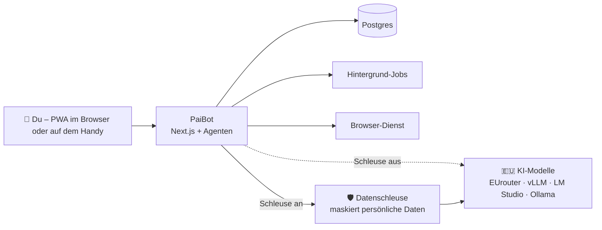

<!--
PaiBot – Startseite des Projekts: was PaiBot ist, Status, Schnellstart und Lizenz.

Autor:     Oliver Hees
Website:   https://paibot.de
Copyright: 2026 Oliver Hees. Alle Urheberrechte liegen beim Autor.
Lizenz:    PaiBot Fair-Code-Lizenz 1.1 – siehe Datei LICENSE im Projektstamm
Seit:      2026-11-07
-->

<p align="center">
  
</p>

<p align="center">
  <a href="https://github.com/oliverhees/paibot/actions/workflows/ci.yml"></a>
  
  
  
  
</p>

<p align="center">
  <b>Dein persönliches KI-Team – auf deinem Server oder Rechner, mit EU-Modellen und zuschaltbarer Datenschleuse.</b><br>
  Der Code ist öffentlich. Und du entscheidest mit, was als Nächstes kommt.
</p>

<p align="center">
  <b>Entwickelt von <a href="https://hr-codelabs.de">HR CodeLabs</a></b><br>
  Du willst so etwas für dein Unternehmen? <a href="https://hr-codelabs.de">HR CodeLabs</a> baut Projekte im Auftrag: KI-Integration für Selbstständige und KMU.
</p>

---

## So sieht PaiBot aus

<p align="center">
  
  
</p>

<p align="center">
  <sub><b>Vorschau mit Beispiel-Daten – die App ist im Bau.</b> Die Bilder zeigen den App-Rahmen mit erfundenen Inhalten; Chat und Seiten werden gerade angeschlossen (siehe <a href="#stand">Stand</a>).</sub>
</p>

<details>
<summary><b>Weitere Bilder: helles Design und Handy</b></summary>

<p align="center">
  
  
</p>

</details>

Alle Bilder entstehen per Skript aus der App, nicht von Hand (`pnpm doku:screenshots`, siehe [Doku](docs/README.md#screenshots)).

## Inhalt

- [So sieht PaiBot aus](#so-sieht-paibot-aus)
- [Was ist PaiBot?](#was-ist-paibot)
- [Warum PaiBot?](#warum-paibot)
- [Funktionen](#funktionen)
- [So funktioniert es](#so-funktioniert-es)
- [Stand](#stand)
- [Roadmap](#roadmap)
- [Schnellstart](#schnellstart)
- [Projektaufbau](#projektaufbau)
- [Lizenz: Fair-Code, für eine Person](#lizenz-fair-code-für-eine-person)
- [FAQ](#faq)
- [Mitmachen und Community](#mitmachen-und-community)
- [Wer steckt dahinter](#wer-steckt-dahinter)

## Was ist PaiBot?

**PaiBot** (Personal AI Bot) ist ein persönlicher KI-Agent für eine Person – nicht ein einzelner Chatbot, sondern ein ganzes Team: Bots mit eigenen Rollen, die miteinander reden, sich Aufgaben übergeben, selbst im Browser surfen und für dich in deinen Apps arbeiten.

PaiBot läuft **bei dir** – auf deinem eigenen Server oder direkt auf deinem Rechner –, nutzt **Modelle aus der EU oder dein eigenes lokales Modell**, und eine **Datenschleuse** ersetzt persönliche Daten durch Platzhalter, bevor sie eine KI erreichen.

<p align="center">
  
</p>

## Warum PaiBot?

Die neuesten KI-Agenten kommen oft gar nicht oder nur eingeschränkt nach Europa, laufen in fremden Clouds oder bekommen weitreichende Rechte auf deinem System. PaiBot geht einen anderen Weg:

|                  | PaiBot                                                                                                                       |
| ---------------- | ---------------------------------------------------------------------------------------------------------------------------- |
| **Wo läuft es?** | auf deinem eigenen Server oder lokal auf deinem Rechner                                                                      |
| **Welche KI?**   | EU-Modelle über EUrouter, eigene Modelle über vLLM, lokal über LM Studio oder Ollama – alles OpenAI-kompatibel               |
| **Deine Daten**  | zuschaltbare Datenschleuse: Namen, E-Mails, IBANs werden vor dem Modell maskiert und in der Antwort zurückgetauscht          |
| **Rechte**       | Spezialisten statt Generalschlüssel: jeder Bot bekommt nur die Rechte, die er braucht; riskante Aktionen laufen abgeschottet |
| **Kontrolle**    | alles, was etwas nach außen schickt oder verändert, wartet auf deine Freigabe                                                |
| **Transparenz**  | Code öffentlich einsehbar, jede Folge als nachbaubarer Stand                                                                 |

## Funktionen

|     | Funktion                                                       | Status                                                                                                                               |
| --- | -------------------------------------------------------------- | ------------------------------------------------------------------------------------------------------------------------------------ |
| 🖥️  | Läuft auf eigenem Server (Coolify) oder lokal                  | Server: vorhanden (Docker Compose, Coolify, siehe [`docs/installation.md`](docs/installation.md)); lokal mit lokalem Modell: geplant |
| 🛡️  | Datenschleuse für persönliche Daten, zuschaltbar               | im Bau · Basisversion                                                                                                                |
| 🤖  | Eigene Bots mit Rollen, Gedächtnis und Live-Antworten          | geplant                                                                                                                              |
| 🔌  | Apps per MCP verbinden, Freigabe vor jeder schreibenden Aktion | geplant                                                                                                                              |
| 🌐  | Browser-Agent: der Bot surft selbst, du schaust live zu        | geplant                                                                                                                              |
| 🤝  | Bots im Team: Delegieren, Übergeben, Chief of Staff            | geplant                                                                                                                              |
| ⏰  | Routinen, die im Hintergrund laufen                            | geplant                                                                                                                              |
| 📱  | App fürs Handy (PWA) mit Push, Deutsch und Englisch            | geplant                                                                                                                              |

## So funktioniert es



Mit eingeschalteter Datenschleuse sieht das Modell zum Beispiel nur `<PERSON_0>` statt „Max Mustermann“. Die Antwort enthält trotzdem wieder den echten Namen.

## Stand

> 🚧 **PaiBot ist im Bau.** Die Grundlage im Hintergrund steht und ist getestet. Die Oberfläche zum Benutzen (Einrichtung, Chat, Seiten) wird gerade angeschlossen. **Wer heute installiert, sieht die Startseite mit dem Status** („PaiBot läuft“, Datenbank ok) – noch keinen Chat.

| Was                                                                                      | Stand                  |
| ---------------------------------------------------------------------------------------- | ---------------------- |
| Server-Grundlage mit Docker Compose und Datenbank ([Installation](docs/installation.md)) | ✅ fertig und getestet |
| Das [Tor](docs/funktion-tor.md): jede Aktion läuft durch feste Regeln ohne KI            | ✅ fertig und getestet |
| Das [Beleg-Protokoll](docs/funktion-belege.md) mit Prüfer                                | ✅ fertig und getestet |
| Verschlüsselung der gespeicherten Schlüssel ([Sicherheit](docs/sicherheit.md))           | ✅ fertig und getestet |
| [Anbieter und Modelle](docs/funktion-anbieter-und-modelle.md) mit Ausgangs-Liste         | ✅ fertig und getestet |
| KI-Laufzeit, die die Antworten der Bots erzeugt                                          | ✅ fertig und getestet |
| Design und Bausteine der Oberfläche (siehe Bilder oben)                                  | ✅ fertig und getestet |
| Einrichtung und Anmeldung                                                                | 🔨 im Bau              |
| Chat mit deinem Bot                                                                      | 🔨 im Bau              |
| Seiten für Belege, Modelle, Datenschleuse und Einstellungen                              | 🔨 im Bau              |
| Release zum Installieren                                                                 | 🔨 im Bau              |
| Apps anbinden                                                                            | 🗓️ geplant danach      |
| Bots im Team                                                                             | 🗓️ geplant danach      |

- 🛠️ **Was gerade gebaut wird:** jede Aufgabe ist ein Issue, sortiert nach [Meilensteinen](https://github.com/oliverhees/paibot/milestones).
- 📖 **Wie es funktioniert:** die [Doku](docs/README.md) beschreibt jede fertige Funktion; Abschnitte, die erst mit der Oberfläche kommen, sind dort so gekennzeichnet.

## Roadmap

Gebaut wird zwischen den Folgen der YouTube-Serie, in Coding-Sessions der Community auf [aiianer.de](https://aiianer.de) und im Livestream. Die Folgen zeigen, wie man PaiBot installiert, benutzt und ausbaut. Jede Folge bekommt einen eigenen Git-Tag (`folge-00`, `folge-01`, …), so kannst du jeden Stand nachbauen. Die Reihenfolge kann sich ändern, und die Community stimmt ab, welche Funktion als Nächstes kommt.

- 🗺️ [Bauplan](https://paibot.de/bauplan): der aktuelle Stand
- 🗳️ [Mitentscheiden](https://paibot.de/mitentscheiden): welche Funktion kommt als Nächstes?
- 📖 [Doku](https://paibot.de/doku): installieren und benutzen

- [x] **Folge 0** – Gerüst, Lizenz, CI
- [ ] **Folge 1** – Die Idee
- [ ] **Folge 2** – Der Server: PaiBot geht online
- [ ] **Folge 3** – Die Datenschleuse
- [ ] PaiBot auf deinem Rechner mit lokaler KI
- [ ] Der erste Bot
- [ ] Apps anbinden per MCP
- [ ] Der Browser-Agent
- [ ] Bots im Team
- [ ] Routinen
- [ ] Die App fürs Handy
- [ ] … und was die Community sich wünscht

## Schnellstart

> PaiBot ist im Bau. Der Schnellstart zeigt heute die Startseite mit dem Status, noch keinen Chat. Für einen Server mit Datenbank: [Installation mit Docker Compose](docs/installation.md).

**Voraussetzungen:** Node.js 22 und pnpm 10

```bash
git clone https://github.com/oliverhees/paibot.git
cd paibot
pnpm install
pnpm dev          # startet PaiBot auf http://localhost:3000
```

| Befehl                | Zweck                              |
| --------------------- | ---------------------------------- |
| `pnpm dev`            | PaiBot lokal starten               |
| `pnpm build`          | alles bauen                        |
| `pnpm test`           | Tests ausführen                    |
| `pnpm lint`           | Lint und Format prüfen (Biome)     |
| `pnpm typecheck`      | Typen prüfen                       |
| `pnpm licenses:check` | Lizenzen der Abhängigkeiten prüfen |

## Projektaufbau

```
apps/web/          PaiBot-App (Next.js: Oberfläche, API)
packages/shared/   gemeinsame Typen, Texte und Konstanten
packages/db/       Datenbank: Schema, Migrationen, Zugriff
packages/gate/     das Tor: feste Regelprüfung für jede Aktion
packages/receipts/ Beleg-Protokoll: verketten, signieren, prüfen, exportieren
packages/crypto/   Verschlüsselung, Passwörter, Tokens, Signaturen
packages/llm/      Anbieter und Modelle, Ausgangs-Liste, Anbindung der Datenschleuse
packages/agents/   KI-Laufzeit (Motor) für die Bots
packages/jobs/     Warteschlange für Läufe im Hintergrund
packages/ui/       Design und Bausteine der Oberfläche
packages/mcp/      App-Anbindungen per MCP (geplant)
services/browser/  Browser-Dienst (Python)
deploy/            Docker Compose und Coolify
docs/              Dokumentation
```

## Lizenz: Fair-Code, für eine Person

PaiBot ist **Fair-Code** („Source Available“), nicht Open Source. Es gilt die PaiBot Fair-Code-Lizenz, Version 1.1. Kurz gesagt:

**Du darfst**

- PaiBot für dich herunterladen, installieren und nutzen: privat **und für deine eigene Arbeit**, auch als Selbstständiger oder Freiberufler
- als Angestellter für deine eigenen Aufgaben nutzen, solange nicht dein Arbeitgeber PaiBot bereitstellt oder vorgibt
- den Code für dich anpassen und erweitern
- ihn kostenlos weitergeben, z. B. als Fork, solange die Lizenz dabei bleibt, der Fork kostenlos bleibt, einen eigenen Namen trägt und „Powered by PaiBot“ mit Verweis auf [paibot.de](https://paibot.de) zeigt
- Kurse, Bücher, Videos und Beratung dazu machen, die zeigen, wie man PaiBot selbst nutzt

**Du darfst nicht**

- PaiBot mit mehreren Personen nutzen – nicht im Team, nicht in einer Firma, auch nicht intern
- PaiBot oder eine angepasste Fassung verkaufen oder vermieten
- ihn als gehosteten Dienst für andere anbieten oder gegen Entgelt für andere einrichten, betreiben oder supporten
- eine angepasste Fassung unter dem Namen „PaiBot“ oder ohne Herkunftshinweis als eigenes Produkt ausgeben
- Lizenz- und Markenhinweise oder „Powered by PaiBot“ entfernen

> **PaiBot ist für eine Person: für dich und deine eigene Arbeit.** Sobald mehrere Personen damit arbeiten sollen, im Team oder im Unternehmen, brauchst du **PaiBot Enterprise** mit Support (in Vorbereitung). Mehr dazu: [paibot.de/enterprise](https://paibot.de/enterprise).

Rechtlich gilt nur der Text in [`LICENSE`](LICENSE). Wer einen Beitrag einreichen will, findet die [Beitragsvereinbarung](docs/BEITRAGSVEREINBARUNG.md). Bausteine Dritter behalten ihre eigenen Lizenzen, siehe [`THIRD_PARTY_NOTICES.md`](THIRD_PARTY_NOTICES.md).

## FAQ

<details>
<summary><b>Ist PaiBot Open Source?</b></summary>

Nein. Der Code ist öffentlich einsehbar und für eine Person kostenlos („Fair-Code“), aber die Nutzung mit mehreren Personen, Verkauf sowie bezahlter Betrieb oder Support für andere sind nicht erlaubt.
</details>

<details>
<summary><b>Darf ich PaiBot für meine Arbeit nutzen?</b></summary>

Ja, wenn du es allein nutzt: als Selbstständiger, als Freiberufler oder für deine eigenen Aufgaben. Nicht erlaubt ist, dass mehrere Personen damit arbeiten oder dass eine Firma PaiBot für ihre Mitarbeiter bereitstellt. Dafür ist PaiBot Enterprise mit Support gedacht (in Vorbereitung): [paibot.de/enterprise](https://paibot.de/enterprise).
</details>

<details>
<summary><b>Was unterscheidet PaiBot?</b></summary>

PaiBot setzt diese Schwerpunkte: KI-Modelle aus der EU oder lokal als Standard, eine Datenschleuse, die persönliche Daten vor dem Modell maskiert, eine eigene MCP-Verwaltung ohne fremden Dienst dazwischen, ein Beleg für jede Aktion, und jeder Schritt wird auf Deutsch erklärt, damit du verstehst, was dein Agent tut.
</details>

<details>
<summary><b>Brauche ich einen eigenen Server?</b></summary>

Nein. PaiBot läuft auf einem Server (z. B. mit Coolify) oder lokal auf deinem Rechner. Lokal kannst du sogar ein Modell aus LM Studio oder Ollama anbinden, dann verlässt keine Anfrage deinen Rechner.
</details>

<details>
<summary><b>Ist PaiBot damit DSGVO-konform?</b></summary>

PaiBot und die Datenschleuse sind technische Schutzmaßnahmen, keine Rechtsberatung und keine Garantie. Für die rechtliche Bewertung deines Einsatzes bist du selbst verantwortlich.
</details>

<details>
<summary><b>Wie oft kommen neue Folgen?</b></summary>

Regelmäßig, mehrmals pro Woche. Abonniere den Kanal und gib dem Repo einen Stern ⭐, dann siehst du sofort, wenn es weitergeht.
</details>

## Mitmachen und Community

- ⭐ **Gib dem Repo einen Stern**, wenn dir das Projekt gefällt – das hilft enorm.
- 🗳️ **Entscheide mit:** auf [paibot.de/mitentscheiden](https://paibot.de/mitentscheiden) stimmst du ab, was als Nächstes kommt. Den Stand siehst du im [Bauplan](https://paibot.de/bauplan), die Anleitungen in der [Doku](https://paibot.de/doku).
- 💬 **Community auf [aiianer.de](https://aiianer.de):** Deep Dives zu jeder Folge, gemeinsame Coding-Sessions zum Mitbauen und Hilfe, wenn es hakt.
- 🐛 **Fehler oder Ideen?** Eröffne ein [Issue](https://github.com/oliverhees/paibot/issues/new/choose).
- 🛠️ **Selbst beitragen?** Lies zuerst [`CONTRIBUTING.md`](CONTRIBUTING.md) (Beitragsvereinbarung nötig).
- 🔒 **Sicherheitslücke gefunden?** Bitte nicht öffentlich melden, sondern wie in [`SECURITY.md`](SECURITY.md) beschrieben.

## Wer steckt dahinter

PaiBot wird von [HR CodeLabs](https://hr-codelabs.de) entwickelt. Die Agentur bietet KI-Integration für Selbstständige und KMU und setzt Projekte im Auftrag um.

PaiBot selbst ist für eine Person gedacht. Für Teams gibt es [PaiBot Enterprise](https://paibot.de/enterprise) (in Vorbereitung). Für ein eigenes Projekt: [Projekt anfragen](https://hr-codelabs.de).

---

<p align="center">
  Gebaut in Deutschland von <a href="https://github.com/oliverhees">Oliver Hees</a> · „PaiBot“, Logo und Maskottchen sind Kennzeichen von Oliver Hees.<br>
  Entwickelt von <a href="https://hr-codelabs.de">HR CodeLabs</a> · Projekte im Auftrag: <a href="https://hr-codelabs.de">hr-codelabs.de</a><br>
  Für Teams und Firmen: <a href="https://paibot.de/enterprise">PaiBot Enterprise</a> · Community: <a href="https://aiianer.de">aiianer.de</a>
</p>
