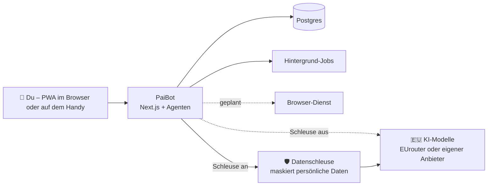

<!--
PaiBot – Startseite des Projekts: was PaiBot ist, Status, Schnellstart und Lizenz.

Autor:     Oliver Hees
Website:   https://paibot.de
Copyright: 2026 Oliver Hees. Alle Urheberrechte liegen beim Autor.
Lizenz:    PaiBot Fair-Code-Lizenz 1.1 – siehe Datei LICENSE im Projektstamm
Seit:      2026-11-07
-->

<p align="center">
  
</p>

<p align="center">
  <a href="https://github.com/oliverhees/paibot/actions/workflows/ci.yml"></a>
  
  
  
  
</p>

<p align="center">
  <b>Dein persönliches KI-Team – auf deinem Server oder Rechner, mit dem Anbieter deiner Wahl und zuschaltbarer Datenschleuse.</b><br>
  Der Code ist öffentlich. Und du entscheidest mit, was als Nächstes kommt.
</p>

<p align="center">
  <b>Entwickelt von <a href="https://hr-codelabs.de">HR CodeLabs</a></b><br>
  Du willst so etwas für dein Unternehmen? <a href="https://hr-codelabs.de">HR CodeLabs</a> baut Projekte im Auftrag: KI-Integration für Selbstständige und KMU.
</p>

---

## So sieht PaiBot aus

<p align="center">
  
  
</p>

<p align="center">
  <sub><b>Vorschau, im Bau:</b> aufgenommen aus der laufenden App mit Beispiel-Daten (Bot „Pai“, erfundene Unterhaltungen, Test-Anbieter). Eine veröffentlichte Version gibt es noch nicht (siehe <a href="#stand">Stand</a>).</sub>
</p>

<p align="center">
  
  
</p>

<p align="center">
  <sub><b>Vorschau, im Bau:</b> Belege prüfen und die Datenschleuse (in der Doku-Umgebung mit einer Attrappe der Datenschleuse aufgenommen). Alle Schritte mit Bildern stehen in der <a href="docs/README.md">Doku</a>.</sub>
</p>

<details>
<summary><b>Weitere Bilder: helles Design und Einrichtung</b></summary>

<p align="center">
  
  
</p>

<p align="center">
  
  
</p>

</details>

Alle Bilder entstehen per Skript aus der App, nicht von Hand (`pnpm doku:app -- pnpm doku:screenshots`, siehe [Doku](docs/README.md#screenshots)).

## Inhalt

- [So sieht PaiBot aus](#so-sieht-paibot-aus)
- [Was ist PaiBot?](#was-ist-paibot)
- [Warum PaiBot?](#warum-paibot)
- [Funktionen](#funktionen)
- [So funktioniert es](#so-funktioniert-es)
- [Stand](#stand)
- [Bevor du echte Daten einträgst](#bevor-du-echte-daten-einträgst)
- [Roadmap](#roadmap)
- [Schnellstart](#schnellstart)
- [Projektaufbau](#projektaufbau)
- [Lizenz: Fair-Code, für eine Person](#lizenz-fair-code-für-eine-person)
- [FAQ](#faq)
- [Mitmachen und Community](#mitmachen-und-community)
- [Wer steckt dahinter](#wer-steckt-dahinter)

## Was ist PaiBot?

**PaiBot** (Personal AI Bot) ist ein persönlicher KI-Agent für eine Person. Heute chattest du mit deinem Bot, und jede seiner Aktionen läuft durch ein Tor mit festen Regeln und bekommt einen Beleg. Das Ziel ist mehr als ein einzelner Chatbot: ein ganzes Team aus Bots mit eigenen Rollen, die miteinander reden, sich Aufgaben übergeben, selbst im Browser surfen und für dich in deinen Apps arbeiten (geplant, siehe [Roadmap](#roadmap)).

PaiBot läuft **bei dir** auf deinem eigenen Server (mit Docker Compose, auch auf dem eigenen Rechner), verbindet sich mit dem **Anbieter deiner Wahl** (Mistral AI über dessen EU-Endpunkt, EUrouter mit deinen Routing-Regeln oder ein eigener bzw. lokaler Dienst) und zeigt an jeder Antwort, wer laut Anbieter geantwortet hat; dazu eine zuschaltbare **Datenschleuse** ersetzt persönliche Daten durch Platzhalter, bevor sie eine KI erreichen.

<p align="center">
  
</p>

## Warum PaiBot?

Die neuesten KI-Agenten kommen oft gar nicht oder nur eingeschränkt nach Europa, laufen in fremden Clouds oder bekommen weitreichende Rechte auf deinem System. PaiBot geht einen anderen Weg:

|                  | PaiBot                                                                                                                                                                                                            |
| ---------------- | ----------------------------------------------------------------------------------------------------------------------------------------------------------------------------------------------------------------- |
| **Wo läuft es?** | auf deinem eigenen Server oder lokal auf deinem Rechner                                                                                                                                                           |
| **Welche KI?**   | Mistral AI (EU-Endpunkt laut Mistral), EUrouter mit deinen Routing-Regeln oder ein eigener, OpenAI-kompatibler Anbieter (auch auf dem eigenen Rechner); an jeder Antwort steht, wer laut Anbieter geantwortet hat |
| **Deine Daten**  | zuschaltbare Datenschleuse: Namen, E-Mails, IBANs werden vor dem Modell maskiert und in der Antwort zurückgetauscht                                                                                               |
| **Rechte**       | jede Aktion läuft durch ein Tor mit festen Regeln ohne KI und bekommt einen Beleg; Werkzeuge mit eigenen Rechten je Bot sind geplant                                                                              |
| **Kontrolle**    | Belege zu jeder Aktion, im Browser prüfbar; eine Freigabe vor Aktionen, die etwas nach außen schicken, ist geplant                                                                                                |
| **Transparenz**  | Code öffentlich einsehbar, jede Folge als nachbaubarer Stand                                                                                                                                                      |

## Funktionen

|     | Funktion                                                       | Status                                                                                                                                                |
| --- | -------------------------------------------------------------- | ----------------------------------------------------------------------------------------------------------------------------------------------------- |
| 🖥️  | Läuft auf eigenem Server (Docker Compose, Coolify)             | vorhanden, siehe [`docs/installation.md`](docs/installation.md); ein veröffentlichtes Image gibt es noch nicht                                        |
| 💬  | Chat mit deinem Bot, vorläufiger Text beim Schreiben, Stopp    | vorhanden ([Chat](docs/funktion-chat.md)); Anhänge, Spracheingabe, Merken und Web-Zugriff geplant                                                     |
| 📚  | Pai schlägt in der Doku seiner Version nach, mit Quellen       | vorhanden als erstes Werkzeug ([Chat](docs/funktion-chat.md#so-benutzt-du-es)); es liest nur die mitgelieferte Doku, weitere Werkzeuge geplant        |
| 🧾  | Tor und Belege: feste Regeln ohne KI, Beleg zu jeder Aktion    | vorhanden ([Belege](docs/funktion-belege.md), [Das Tor](docs/funktion-tor.md))                                                                        |
| 🛡️  | Datenschleuse für persönliche Daten, zuschaltbar               | vorhanden als zuschaltbarer Dienst, Schalter je Unterhaltung ([Datenschleuse](docs/funktion-datenschleuse.md)); Standard: aus                         |
| 🤖  | Dein Bot mit Name, Anweisung und Aussehen                      | vorhanden ([Bot](docs/funktion-bot.md)); weitere Bots mit Rollen und Gedächtnis: geplant                                                              |
| 🔌  | Apps per MCP verbinden, Freigabe vor jeder schreibenden Aktion | geplant                                                                                                                                               |
| 🌐  | Browser-Agent: der Bot surft selbst, du schaust live zu        | geplant                                                                                                                                               |
| 🤝  | Bots im Team: Delegieren, Übergeben, Chief of Staff            | geplant                                                                                                                                               |
| ⏰  | Routinen, die im Hintergrund laufen                            | geplant                                                                                                                                               |
| 📱  | App fürs Handy (PWA) mit Push, Deutsch und Englisch            | Oberfläche fürs Handy und „Als Web-App installieren“ vorhanden; Push und Englisch geplant                                                             |
| 💻  | Modell auf deinem eigenen Rechner oder in deinem Netz          | vorhanden als eigener Anbieter mit Ort „lokal“ ([Anbieter und Modelle](docs/funktion-anbieter-und-modelle.md)); eine mitgelieferte lokale KI: geplant |

## So funktioniert es



Mit eingeschalteter Datenschleuse sieht das Modell zum Beispiel nur `<PERSON_0>` statt „Max Mustermann“. Die Antwort enthält trotzdem wieder den echten Namen.

## Stand

> 🚧 **PaiBot ist im Bau.** Die Basisversion lässt sich schon einrichten und benutzen: Einrichtung und Anmeldung, Chat mit deinem Bot, Belege und Regeln, Modell und Anbieter, Datenschleuse, Bot sowie Einstellungen und Info. Eine veröffentlichte Version (Release mit fertigem Image) gibt es noch nicht; installiert wird aus dem Quellcode.
>
> **Die erste Version ist zum Ausprobieren gedacht.** Diese Fassung hat noch **keinen Notfall-Zugang**: Ein vergessenes Passwort lässt sich nicht zurücksetzen, dann bleibt nur eine neue Installation (mit neuen, leeren Daten). Es gibt noch **keinen zweiten Faktor** beim Anmelden und **keine erneute Bestätigung heikler Aktionen**. Bevor du ihr echte Daten anvertraust, lies [Bevor du echte Daten einträgst](#bevor-du-echte-daten-einträgst).

| Was                                                                                                                                                             | Stand                  |
| --------------------------------------------------------------------------------------------------------------------------------------------------------------- | ---------------------- |
| Server-Grundlage mit Docker Compose und Datenbank ([Installation](docs/installation.md))                                                                        | ✅ fertig und getestet |
| Getrennte Datenbank-Rollen und gehärtetes Docker Compose                                                                                                        | ✅ fertig und getestet |
| [Einrichtung und Anmeldung](docs/funktion-einrichtung-und-zugang.md) mit Schutz vor zu vielen Versuchen                                                         | ✅ fertig und getestet |
| [Chat](docs/funktion-chat.md): Antwort live, Stopp, neu erzeugen, Suche, als Datei sichern, Belege                                                              | ✅ fertig und getestet |
| Das [Tor](docs/funktion-tor.md): jede Aktion läuft durch feste Regeln ohne KI                                                                                   | ✅ fertig und getestet |
| [Belege](docs/funktion-belege.md): Protokoll mit Prüfer im Browser und mit `pnpm belege:pruefen`, Export                                                        | ✅ fertig und getestet |
| [Modell und Anbieter](docs/funktion-anbieter-und-modelle.md): Auswahl (EUrouter mit Routing-Regeln, Mistral AI), Herkunft je Antwort, Ausgangs-Liste            | ✅ fertig und getestet |
| [Bot](docs/funktion-bot.md): Name, Anweisung, Aussehen                                                                                                          | ✅ fertig und getestet |
| [Datenschleuse](docs/funktion-datenschleuse.md) als zuschaltbarer Dienst (Standard: aus)                                                                        | ✅ fertig und getestet |
| [Einstellungen und Info](docs/funktion-einstellungen.md): Passwort, Sitzungen, Grenzen                                                                          | ✅ fertig und getestet |
| Verschlüsselung der gespeicherten Schlüssel ([Sicherheit](docs/sicherheit.md))                                                                                  | ✅ fertig und getestet |
| [Sicherung und Wiederherstellung](docs/sicherung.md): ein Befehl je Richtung, mit Prüfung danach                                                                | ✅ fertig und getestet |
| Doku mit Bildern aus der laufenden App und [Entwickler-Doku](docs/entwickler/README.md) je Funktion                                                             | ✅ fertig              |
| Oberfläche am Rechner und am Handy, helles und dunkles Design                                                                                                   | ✅ fertig und getestet |
| Release zum Installieren (fertiges Image)                                                                                                                       | 🔨 im Bau              |
| [Eigener Anbieter](docs/funktion-anbieter-und-modelle.md) in der Oberfläche, auch auf deinem Rechner                                                            | ✅ fertig und getestet |
| [Not-Aus als Schalter](docs/funktion-tor.md#not-aus-alle-bots-anhalten): alle Bots anhalten, mit Passwort fortsetzen                                            | ✅ fertig und getestet |
| [Selbsttest](docs/funktion-selbsttest.md): Ist meine Installation richtig eingestellt?                                                                          | ✅ fertig und getestet |
| [Bekannte Geräte](docs/funktion-einstellungen.md) und Hinweis bei Anmeldung von einem neuen Gerät                                                               | ✅ fertig und getestet |
| [Startbereich](docs/funktion-chat.md#so-benutzt-du-es) einer leeren Unterhaltung in drei Fassungen, wählbar unter [Darstellung](docs/funktion-einstellungen.md) | ✅ fertig und getestet |
| Lebendiger Avatar im Chat: zeigt mit dem Gesicht, ob dein Bot zuhört, nachdenkt, schreibt oder angehalten ist ([Chat](docs/funktion-chat.md))                   | ✅ fertig und getestet |
| „Zugang abriegeln“ (alle Geräte auf einen Schlag sperren)                                                                                                       | 🗓️ geplant             |
| Zweiter Faktor beim Anmelden                                                                                                                                    | 🗓️ geplant             |
| Notfall-Zugang                                                                                                                                                  | 🗓️ geplant             |
| Erneute Bestätigung heikler Aktionen                                                                                                                            | 🗓️ geplant             |
| Apps anbinden per MCP                                                                                                                                           | 🗓️ geplant danach      |
| Bots im Team                                                                                                                                                    | 🗓️ geplant danach      |

- 🛠️ **Was gerade gebaut wird:** jede Aufgabe ist ein Issue, sortiert nach [Meilensteinen](https://github.com/oliverhees/paibot/milestones).
- 📖 **Wie es funktioniert:** die [Doku](docs/README.md) beschreibt jede fertige Funktion Schritt für Schritt mit Bildern.

## Bevor du echte Daten einträgst

Diese Version ist zum Ausprobieren gedacht. Nutze sie mit Beispiel-Daten und einem Anbieter-Schlüssel mit niedrigem Ausgabe-Limit, noch nicht für vertrauliche Unterhaltungen oder wichtige Schlüssel.

- **Anmeldung:** Ein zweiter Faktor, ein Notfall-Zugang ohne Passwort und eine erneute Bestätigung für heikle Einstellungen fehlen noch; sie sind für die nächste Version geplant. Ein vergessenes Passwort lässt sich nicht zurücksetzen: Dann bleibt nur eine neue Installation mit leeren Daten. Bis dahin schützt dich vor allem ein langes, zufälliges Passwort aus einem Passwort-Manager, das du sicher aufbewahrst.
- **Erreichbarkeit:** Betreibe PaiBot nur hinter einem Proxy mit HTTPS (zum Beispiel Coolify) und gib den Port der App nicht direkt frei. Am besten erreichst du PaiBot nur über dein eigenes Netz oder einen Tunnel.
- **Geräte:** Melde dich nur auf deinen eigenen Geräten an. Unter Einstellungen → Zugang siehst du alle Geräte und kannst jedes einzeln entfernen.
- **Sicherungen:** Spiel nur Sicherungen zurück, die du selbst angelegt hast. Sicherungen sind nicht verschlüsselt und enthalten deine Unterhaltungen lesbar ([Sicherung](docs/sicherung.md)).
- **Coolify:** Lass die Geheimnisse (`PAIBOT_SECRET`, die Passwörter der Datenbank, die Schlüssel der Datenschleuse) nicht zur Bauzeit zu; wie du das prüfst, steht in [PaiBot mit Coolify betreiben](docs/deploy-coolify.md#geheimnisse-nicht-im-image-so-prüfst-du-es). Sobald es ein fertiges Image von PaiBot gibt, nimm das statt des Baus auf dem Server.
- **Mehr dazu:** Was PaiBot schützt und was nicht, steht in [Sicherheit](docs/sicherheit.md). Sicherheitslücken bitte nicht öffentlich melden, sondern wie in [SECURITY.md](SECURITY.md) beschrieben.

## Roadmap

PaiBot wird laufend gebaut. Den Stand zeigen die [Issues und Meilensteine](https://github.com/oliverhees/paibot/milestones) dieses Repos und der [Bauplan](https://paibot.de/bauplan). Termine gibt es nicht.

**Fertig** (mit Anleitung in der [Doku](docs/README.md)):

- [Einrichtung und Zugang](docs/funktion-einrichtung-und-zugang.md)
- [Chat](docs/funktion-chat.md), mit dem ersten Werkzeug: [Pai schlägt in der Doku nach](docs/funktion-chat.md#so-benutzt-du-es)
- [Bot](docs/funktion-bot.md)
- [Anbieter und Modelle](docs/funktion-anbieter-und-modelle.md)
- [Datenschleuse](docs/funktion-datenschleuse.md) (zuschaltbar)
- [Belege](docs/funktion-belege.md)
- [Das Tor und die Regeln](docs/funktion-tor.md)
- [Einstellungen und Info](docs/funktion-einstellungen.md)
- [Selbsttest](docs/funktion-selbsttest.md)

**Im Bau** (noch nicht nutzbar):

- Teamchat: Es gibt erst Bausteine der Oberfläche und Regeln, noch keine Funktion in der App ([Teamchat](docs/entwickler/teamchat.md)).

**Geplant:**

- Apps anbinden über MCP
- Bots im Team
- Zweiter Faktor und Notfall-Zugang
- „Pai lernt dazu“
- Automationen
- Desktop-App als Begleit-App
- Browser-Agent

**Mitentscheiden:** Auf [paibot.de/mitentscheiden](https://paibot.de/mitentscheiden) schlägst du Funktionen vor und stimmst für Vorschläge anderer. Dafür brauchst du eine bestätigte E-Mail-Adresse; neue Vorschläge erscheinen nach Freigabe. Je mehr Stimmen ein Vorschlag hat, desto eher kommt er dran.

## Schnellstart

> PaiBot ist im Bau. Zum Ausprobieren mit Datenbank, Einrichtung und Chat: [Installation mit Docker Compose](docs/installation.md). Der Schnellstart unten ist für die Entwicklung.

**Voraussetzungen:** Node.js 26 und pnpm 10 Node 26 bringt corepack nicht mehr mit. pnpm 10.28.0 bekommst du zum Beispiel so (selbst ausprobiert mit Node v26.13.1; geprüft wird dabei nur die Prüfsumme der npm-Registry, nicht die sha512 aus `packageManager`): `npm install --prefix ~/.pnpm-10.28.0 pnpm@10.28.0 --ignore-scripts` und dann `~/.pnpm-10.28.0/node_modules/.bin` in den `PATH` aufnehmen.

```bash
git clone https://github.com/oliverhees/paibot.git
cd paibot
pnpm install
pnpm dev          # startet PaiBot auf http://localhost:3000
```

| Befehl                | Zweck                              |
| --------------------- | ---------------------------------- |
| `pnpm dev`            | PaiBot lokal starten               |
| `pnpm build`          | alles bauen                        |
| `pnpm test`           | Tests ausführen                    |
| `pnpm lint`           | Lint und Format prüfen (Biome)     |
| `pnpm typecheck`      | Typen prüfen                       |
| `pnpm licenses:check` | Lizenzen der Abhängigkeiten prüfen |

## Projektaufbau

```
apps/web/          PaiBot-App (Next.js: Oberfläche, API)
packages/shared/   gemeinsame Typen, Texte und Konstanten
packages/db/       Datenbank: Schema, Migrationen, Zugriff
packages/gate/     das Tor: feste Regelprüfung für jede Aktion
packages/receipts/ Beleg-Protokoll: verketten, signieren, prüfen, exportieren
packages/crypto/   Verschlüsselung, Passwörter, Tokens, Signaturen
packages/llm/      Anbieter und Modelle, Ausgangs-Liste, Anbindung der Datenschleuse
packages/agents/   KI-Laufzeit (Motor) für die Bots
packages/jobs/     Warteschlange für Läufe im Hintergrund
packages/ui/       Design und Bausteine der Oberfläche
packages/mcp/      App-Anbindungen per MCP (geplant)
services/browser/  Browser-Dienst (Python)
deploy/            Docker Compose und Coolify
docs/              Dokumentation
```

## Lizenz: Fair-Code, für eine Person

PaiBot ist **Fair-Code** („Source Available“), nicht Open Source. Es gilt die PaiBot Fair-Code-Lizenz, Version 1.1. Kurz gesagt:

**Du darfst**

- PaiBot für dich herunterladen, installieren und nutzen: privat **und für deine eigene Arbeit**, auch als Selbstständiger oder Freiberufler
- als Angestellter für deine eigenen Aufgaben nutzen, solange nicht dein Arbeitgeber PaiBot bereitstellt oder vorgibt
- den Code für dich anpassen und erweitern
- ihn kostenlos weitergeben, z. B. als Fork, solange die Lizenz dabei bleibt, der Fork kostenlos bleibt, einen eigenen Namen trägt und „Powered by PaiBot“ mit Verweis auf [paibot.de](https://paibot.de) zeigt
- Kurse, Bücher, Videos und Beratung dazu machen, die zeigen, wie man PaiBot selbst nutzt

**Du darfst nicht**

- PaiBot mit mehreren Personen nutzen – nicht im Team, nicht in einer Firma, auch nicht intern
- PaiBot oder eine angepasste Fassung verkaufen oder vermieten
- ihn als gehosteten Dienst für andere anbieten oder gegen Entgelt für andere einrichten, betreiben oder supporten
- eine angepasste Fassung unter dem Namen „PaiBot“ oder ohne Herkunftshinweis als eigenes Produkt ausgeben
- Lizenz- und Markenhinweise oder „Powered by PaiBot“ entfernen

> **PaiBot ist für eine Person: für dich und deine eigene Arbeit.** Sobald mehrere Personen damit arbeiten sollen, im Team oder im Unternehmen, brauchst du **PaiBot Enterprise** mit Support (in Vorbereitung). Mehr dazu: [paibot.de/enterprise](https://paibot.de/enterprise).

Rechtlich gilt nur der Text in [`LICENSE`](LICENSE). Wer einen Beitrag einreichen will, findet die [Beitragsvereinbarung](docs/BEITRAGSVEREINBARUNG.md). Bausteine Dritter behalten ihre eigenen Lizenzen, siehe [`THIRD_PARTY_NOTICES.md`](THIRD_PARTY_NOTICES.md).

## FAQ

<details>
<summary><b>Ist PaiBot Open Source?</b></summary>

Nein. Der Code ist öffentlich einsehbar und für eine Person kostenlos („Fair-Code“), aber die Nutzung mit mehreren Personen, Verkauf sowie bezahlter Betrieb oder Support für andere sind nicht erlaubt.

</details>

<details>
<summary><b>Darf ich PaiBot für meine Arbeit nutzen?</b></summary>

Ja, wenn du es allein nutzt: als Selbstständiger, als Freiberufler oder für deine eigenen Aufgaben. Nicht erlaubt ist, dass mehrere Personen damit arbeiten oder dass eine Firma PaiBot für ihre Mitarbeiter bereitstellt. Dafür ist PaiBot Enterprise mit Support gedacht (in Vorbereitung): [paibot.de/enterprise](https://paibot.de/enterprise).

</details>

<details>
<summary><b>Was unterscheidet PaiBot?</b></summary>

PaiBot setzt diese Schwerpunkte: Anbieter mit Sitz oder Endpunkt in Europa zur Auswahl und eine ehrliche Angabe, wer eine Antwort geliefert hat (nur, was der Anbieter selbst meldet), eine Datenschleuse, die persönliche Daten vor dem Modell maskiert, ein Tor mit festen Regeln und ein Beleg für jede Aktion, und jeder Schritt wird auf Deutsch erklärt, damit du verstehst, was dein Agent tut. Ein Modell auf deinem eigenen Rechner trägst du als eigenen Anbieter ein; geplant sind eine mitgelieferte lokale KI und eine eigene Anbindung von Apps per MCP.

</details>

<details>
<summary><b>Brauche ich einen eigenen Server?</b></summary>

Heute läuft PaiBot mit Docker Compose auf einem Server (z. B. mit Coolify) oder auf deinem eigenen Rechner. Ein Modell auf deinem eigenen Rechner kannst du in der Oberfläche als eigenen Anbieter eintragen (Ort „lokal“); eine mitgelieferte lokale KI ist geplant.

</details>

<details>
<summary><b>Ist PaiBot damit DSGVO-konform?</b></summary>

PaiBot und die Datenschleuse sind technische Schutzmaßnahmen, keine Rechtsberatung und keine Garantie. Für die rechtliche Bewertung deines Einsatzes bist du selbst verantwortlich.

</details>

<details>
<summary><b>Wie oft kommen neue Folgen?</b></summary>

Regelmäßig, mehrmals pro Woche. Abonniere den Kanal und gib dem Repo einen Stern ⭐, dann siehst du sofort, wenn es weitergeht.

</details>

## Mitmachen und Community

- ⭐ **Gib dem Repo einen Stern**, wenn dir das Projekt gefällt – das hilft enorm.
- 🗳️ **Entscheide mit:** auf [paibot.de/mitentscheiden](https://paibot.de/mitentscheiden) schlägst du Funktionen vor und stimmst für Vorschläge anderer (bestätigte E-Mail-Adresse nötig). Den Stand siehst du im [Bauplan](https://paibot.de/bauplan), die Anleitungen in der [Doku](docs/README.md).
- 💬 **Community auf [aiianer.de](https://aiianer.de):** Deep Dives zu jeder Folge, gemeinsame Coding-Sessions zum Mitbauen und Hilfe, wenn es hakt.
- 🐛 **Fehler oder Ideen?** Eröffne ein [Issue](https://github.com/oliverhees/paibot/issues/new/choose).
- 🛠️ **Selbst beitragen?** Lies zuerst [`CONTRIBUTING.md`](CONTRIBUTING.md) (Beitragsvereinbarung nötig).
- 🔒 **Sicherheitslücke gefunden?** Bitte nicht öffentlich melden, sondern wie in [`SECURITY.md`](SECURITY.md) beschrieben.

## Wer steckt dahinter

PaiBot wird von [HR CodeLabs](https://hr-codelabs.de) entwickelt. Die Agentur bietet KI-Integration für Selbstständige und KMU und setzt Projekte im Auftrag um.

PaiBot selbst ist für eine Person gedacht. Für Teams gibt es [PaiBot Enterprise](https://paibot.de/enterprise) (in Vorbereitung). Für ein eigenes Projekt: [Projekt anfragen](https://hr-codelabs.de).

---

<p align="center">
  Gebaut in Deutschland von <a href="https://github.com/oliverhees">Oliver Hees</a> · „PaiBot“, Logo und Maskottchen sind Kennzeichen von Oliver Hees.<br>
  Entwickelt von <a href="https://hr-codelabs.de">HR CodeLabs</a> · Projekte im Auftrag: <a href="https://hr-codelabs.de">hr-codelabs.de</a><br>
  Für Teams und Firmen: <a href="https://paibot.de/enterprise">PaiBot Enterprise</a> · Community: <a href="https://aiianer.de">aiianer.de</a>
</p>
