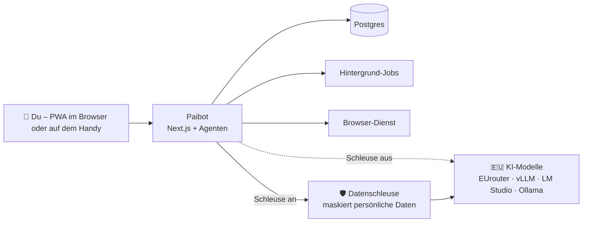

<p align="center">
  
</p>

<p align="center">
  <a href="https://github.com/oliverhees/paibot/actions/workflows/ci.yml"></a>
  
  
  
  
</p>

<p align="center">
  <b>Dein persönliches KI-Team – auf deinem Server oder Rechner, mit EU-Modellen und zuschaltbarer Datenschleuse.</b><br>
  Wir bauen es öffentlich, Folge für Folge. Und du baust mit.
</p>

---

## Inhalt

- [Was ist Paibot?](#was-ist-paibot)
- [Warum Paibot?](#warum-paibot)
- [Funktionen](#funktionen)
- [So funktioniert es](#so-funktioniert-es)
- [Status und Roadmap](#status-und-roadmap)
- [Schnellstart](#schnellstart)
- [Projektaufbau](#projektaufbau)
- [Lizenz: Fair-Code, nur privat](#lizenz-fair-code-nur-privat)
- [FAQ](#faq)
- [Mitmachen und Community](#mitmachen-und-community)

## Was ist Paibot?

**Paibot** (Personal AI Bot) ist ein persönlicher KI-Agent für die private Nutzung – nicht ein einzelner Chatbot, sondern ein ganzes Team: Bots mit eigenen Rollen, die miteinander reden, sich Aufgaben übergeben, selbst im Browser surfen und für dich in deinen Apps arbeiten.

Das Vorbild sind KI-Teammates wie Grok Bot. Der Unterschied: Paibot läuft **bei dir** – auf deinem eigenen Server oder direkt auf deinem Rechner –, nutzt **Modelle aus der EU oder dein eigenes lokales Modell**, und eine **Datenschleuse** ersetzt persönliche Daten durch Platzhalter, bevor sie eine KI erreichen.

<p align="center">
  
</p>

## Warum Paibot?

Die neuesten KI-Agenten kommen oft gar nicht oder nur eingeschränkt nach Europa, laufen in fremden Clouds oder bekommen weitreichende Rechte auf deinem System. Paibot geht einen anderen Weg:

|                  | Paibot                                                                                                                       |
| ---------------- | ---------------------------------------------------------------------------------------------------------------------------- |
| **Wo läuft es?** | auf deinem eigenen Server oder lokal auf deinem Rechner                                                                      |
| **Welche KI?**   | EU-Modelle über EUrouter, eigene Modelle über vLLM, lokal über LM Studio oder Ollama – alles OpenAI-kompatibel               |
| **Deine Daten**  | zuschaltbare Datenschleuse: Namen, E-Mails, IBANs werden vor dem Modell maskiert und in der Antwort zurückgetauscht          |
| **Rechte**       | Spezialisten statt Generalschlüssel: jeder Bot bekommt nur die Rechte, die er braucht; riskante Aktionen laufen abgeschottet |
| **Kontrolle**    | alles, was etwas nach außen schickt oder verändert, wartet auf deine Freigabe                                                |
| **Transparenz**  | Code öffentlich einsehbar, jede Folge als nachbaubarer Stand                                                                 |

## Funktionen

|     | Funktion                                                       | Status            |
| --- | -------------------------------------------------------------- | ----------------- |
| 🖥️  | Läuft auf eigenem Server (Coolify) oder lokal                  | geplant · Folge 2 |
| 🛡️  | Datenschleuse für persönliche Daten, zuschaltbar               | geplant · Folge 3 |
| 🤖  | Eigene Bots mit Rollen, Gedächtnis und Live-Antworten          | geplant           |
| 🔌  | Apps per MCP verbinden, Freigabe vor jeder schreibenden Aktion | geplant           |
| 🌐  | Browser-Agent: der Bot surft selbst, du schaust live zu        | geplant           |
| 🤝  | Bots im Team: Delegieren, Übergeben, Chief of Staff            | geplant           |
| ⏰  | Routinen, die im Hintergrund laufen                            | geplant           |
| 📱  | App fürs Handy (PWA) mit Push, Deutsch und Englisch            | geplant           |

## So funktioniert es



Mit eingeschalteter Datenschleuse sieht das Modell zum Beispiel nur `<PERSON_0>` statt „Max Mustermann“. Die Antwort enthält trotzdem wieder den echten Namen.

## Status und Roadmap

> 🚧 **Aktueller Stand: Folge 0 – das Gerüst steht.** Ab Folge 2 wird daraus Schritt für Schritt der echte Agent.

Jede Folge der YouTube-Serie endet mit etwas, das wirklich läuft, und bekommt einen eigenen Git-Tag (`folge-00`, `folge-01`, …). So kannst du jeden Stand genau nachbauen. Die Reihenfolge kann sich ändern, und die Community entscheidet mit.

- [x] **Folge 0** – Gerüst, Lizenz, CI
- [ ] **Folge 1** – Die Idee
- [ ] **Folge 2** – Der Server: Paibot geht online
- [ ] **Folge 3** – Die Datenschleuse
- [ ] Paibot auf deinem Rechner mit lokaler KI
- [ ] Der erste Bot
- [ ] Apps anbinden per MCP
- [ ] Der Browser-Agent
- [ ] Bots im Team
- [ ] Routinen
- [ ] Die App fürs Handy
- [ ] … und was die Community sich wünscht

## Schnellstart

> Paibot ist noch in früher Entwicklung. Der Schnellstart startet aktuell das Gerüst.

**Voraussetzungen:** Node.js 22 und pnpm 10

```bash
git clone https://github.com/oliverhees/paibot.git
cd paibot
pnpm install
pnpm dev          # startet Paibot auf http://localhost:3000
```

| Befehl                | Zweck                              |
| --------------------- | ---------------------------------- |
| `pnpm dev`            | Paibot lokal starten               |
| `pnpm build`          | alles bauen                        |
| `pnpm test`           | Tests ausführen                    |
| `pnpm lint`           | Lint und Format prüfen (Biome)     |
| `pnpm typecheck`      | Typen prüfen                       |
| `pnpm licenses:check` | Lizenzen der Abhängigkeiten prüfen |

## Projektaufbau

```
apps/web/          Paibot-App (Next.js: Oberfläche, API, Agenten)
packages/shared/   gemeinsame Typen, Konstanten, Sprachen
packages/db/       Datenbank (ab Folge 2)
packages/llm/      KI-Modelle und Datenschleuse (ab Folge 3)
packages/agents/   Bots, Router, Team-Werkzeuge
packages/mcp/      App-Anbindungen per MCP
packages/jobs/     Hintergrund-Jobs und Routinen
packages/ui/       UI-Komponenten
services/browser/  Browser-Dienst (Python)
deploy/            Docker Compose und Coolify
docs/              Dokumentation
```

## Lizenz: Fair-Code, nur privat

Paibot ist **Fair-Code** („Source Available“), nicht Open Source. Kurz gesagt:

**Du darfst**

- Paibot für dich privat herunterladen, installieren und nutzen
- den Code für dich anpassen und erweitern
- ihn kostenlos weitergeben, z. B. als Fork, solange die Lizenz dabei bleibt

**Du darfst nicht**

- Paibot beruflich nutzen – weder in einer Firma noch als Selbstständiger oder Freiberufler, auch nicht intern
- Paibot oder eine angepasste Fassung verkaufen oder vermieten
- ihn als gehosteten Dienst für andere anbieten oder für Kunden einrichten
- ihn umbenennen und als eigenes Produkt ausgeben
- Lizenz- und Markenhinweise oder „Powered by Paibot“ entfernen

> **Paibot ist für dich privat. Für alles Berufliche – im Team, mit Rollen und Rechten – gibt es [Lokyy](https://lokyy.de):** dein KI-Arbeitsplatz auf eigenem Server, betrieben in Deutschland oder bei dir im Haus.

Rechtlich gilt nur der Text in [`LICENSE`](LICENSE) (derzeit Entwurf). Bausteine Dritter behalten ihre eigenen Lizenzen, siehe [`THIRD_PARTY_NOTICES.md`](THIRD_PARTY_NOTICES.md).

## FAQ

<details>
<summary><b>Ist Paibot Open Source?</b></summary>

Nein. Der Code ist öffentlich einsehbar und für die private Nutzung kostenlos („Fair-Code“), aber berufliche Nutzung, Verkauf und Hosting für andere sind nicht erlaubt.
</details>

<details>
<summary><b>Darf ich Paibot in meiner Firma oder als Selbstständiger nutzen?</b></summary>

Nein. Paibot ist ausschließlich für die private Nutzung gedacht. Für Firmen, Selbstständige und Teams gibt es [Lokyy](https://lokyy.de) – mit mehreren Nutzern, Rollen und Rechten.
</details>

<details>
<summary><b>Warum nicht einfach OpenMausBot?</b></summary>

[OpenMausBot](https://github.com/milind-soni/OpenMausBot) ist ein starkes offenes Projekt mit einer ähnlichen Idee. Paibot setzt andere Schwerpunkte: KI-Modelle aus der EU oder lokal als Standard statt US-Abos, eine Datenschleuse, die persönliche Daten vor dem Modell maskiert, eine eigene MCP-Verwaltung ohne fremden Dienst dazwischen, und jeder Schritt wird auf Deutsch erklärt, damit du verstehst, was dein Agent tut.
</details>

<details>
<summary><b>Brauche ich einen eigenen Server?</b></summary>

Nein. Paibot läuft auf einem Server (z. B. mit Coolify) oder lokal auf deinem Rechner. Lokal kannst du sogar ein Modell aus LM Studio oder Ollama anbinden, dann verlässt keine Anfrage deinen Rechner.
</details>

<details>
<summary><b>Ist Paibot damit DSGVO-konform?</b></summary>

Paibot und die Datenschleuse sind technische Schutzmaßnahmen, keine Rechtsberatung und keine Garantie. Für die rechtliche Bewertung deines Einsatzes bist du selbst verantwortlich.
</details>

<details>
<summary><b>Wie oft kommen neue Folgen?</b></summary>

Regelmäßig, mehrmals pro Woche. Abonniere den Kanal und gib dem Repo einen Stern ⭐, dann siehst du sofort, wenn es weitergeht.
</details>

## Mitmachen und Community

- ⭐ **Gib dem Repo einen Stern**, wenn dir das Projekt gefällt – das hilft enorm.
- 💬 **Community auf [aiianer.de](https://aiianer.de):** Deep Dives zu jeder Folge, gemeinsame Coding-Sessions zum Mitbauen und Hilfe, wenn es hakt.
- 🐛 **Fehler oder Ideen?** Eröffne ein [Issue](https://github.com/oliverhees/paibot/issues/new/choose).
- 🛠️ **Selbst beitragen?** Lies zuerst [`CONTRIBUTING.md`](CONTRIBUTING.md) (Beitragsvereinbarung nötig).
- 🔒 **Sicherheitslücke gefunden?** Bitte nicht öffentlich melden, sondern wie in [`SECURITY.md`](SECURITY.md) beschrieben.

---

<p align="center">
  Gebaut in Deutschland von <a href="https://github.com/oliverhees">Oliver Hees</a> · „Paibot“, Logo und Maskottchen sind Kennzeichen von Oliver Hees.<br>
  Für Teams und Firmen: <a href="https://lokyy.de">Lokyy</a> · Community: <a href="https://aiianer.de">aiianer.de</a>
</p>
