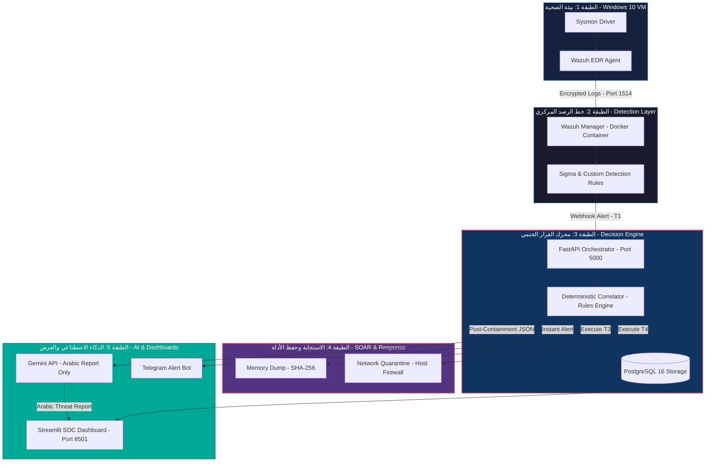
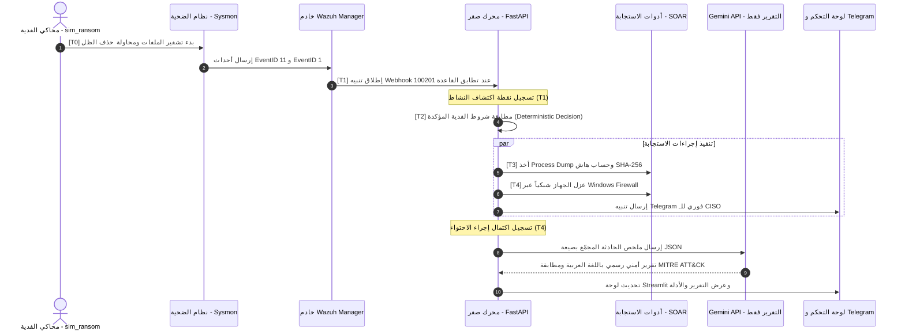

<p align="center">
  <a href="#-متطلبات-البيئة-والموارد-المقترحة">
    
  </a>
</p>

<p align="center">
  <a href="#-تشغيل-المنظومة"></a>
  <a href="#-tech-stack"></a>
  <a href="#-gemini-api-only-التقارير-الذكية"></a>
  <a href="#-القرارات-المعتمدة-وتاريخ-التحديث"></a>
</p>

<p align="center">
  <b>منصة ذكية متكاملة للاستجابة الآلية للحوادث الأمنية بمركز عمليات مصغّر (Mini-SOC) ونواة استجابة حتمية (SOAR) مع طبقة تقارير ذكية تعتمد على Gemini API بعد تنفيذ الاستجابة الحتمية.</b>
</p>
<p align="center">
  <i>EDR-Grade Network Isolation · Volatile Memory Forensics (SHA-256) · Gemini API Reporting Only · MITRE ATT&CK Mapping · Arabic Threat Reports</i>
</p>
<p align="center">
  <code>DETECT</code> &nbsp;•&nbsp; <code>CONTAIN</code> &nbsp;•&nbsp; <code>EXPLAIN</code>
</p>

---

## 📑 فهرس المحتويات (Table of Contents)

1. [نظرة عامة والمشكلة التي نحلها](#-نظرة-عامة-والمشكلة-التي-نحلها)
2. [مصفوفة المقارنة](#-لماذا-صقر--مصفوفة-المقارنة)
3. [المعمارية خماسية الطبقات](#-المعمارية-خماسية-الطبقات)
4. [تسلسل الاستجابة](#-تسلسل-الاستجابة-الحتمي)
5. [Gemini API حصرياً للتقارير الذكية](#-gemini-api-only-التقارير-الذكية)
6. [التقنيات المعتمدة](#-التقنيات-المعتمدة-tech-stack)
7. [السيناريوهات الدفاعية](#-السيناريوهات-الدفاعية-المدعومة)
8. [متطلبات البيئة والموارد المقترحة](#-متطلبات-البيئة-والموارد-المقترحة)
9. [التقييم والتجارب الـ20](#-بروتوكول-التجارب-الـ-20-والتقييم-العلمي)
10. [هيكل المستودع](#-هيكل-المستودع-monorepo)
11. [الوثائق والمرفقات](#-وثائق-المشروع-والمرفقات)
12. [فريق العمل](#-فريق-العمل-والأدوار-الهندسية)
13. [القرارات المعتمدة](#-القرارات-المعتمدة-وتاريخ-التحديث)

---

## 📌 نظرة عامة والمشكلة التي نحلها

تعاني معظم المؤسسات المتوسطة والحكومية والقطاعات الحساسة (كالمصارف والمستشفيات) محلياً وإقليمياً من:
1. **شُح الكوادر الأمنية المتخصصة:** غياب فرق SOC و Incident Response مكرسة تعمل على مدار الساعة.
2. **الانتشار الكارثي للهجمات:** هجمات الفدية (Ransomware) قد تنتشر أفقياً عبر بروتوكولات الشبكة (مثل SMB) قبل اكتشافها.
3. **فقدان الأدلة الجنائية:** عند حدوث الاختراق، يتم فصل الأجهزة أو إعادة تشغيلها عشوائياً، مما يمحو الذاكرة المؤقتة (Volatile Memory) وآثار الجريمة.
4. **عزلة الحلول التجارية:** منصات SIEM و SOAR العالمية (مثل Splunk Phantom أو Cortex XSOAR) باهظة التكاليف، سحابية بالكامل وتتعارض مع قوانين سرية البيانات المحلية، ولا تدعم اللغة العربية.

### 💡 حل منصة صَقْر (SAQR Solution):
منصة دفاعية متكاملة مغلقة المصدر تجمع بين قدرات الـ **Mini-SOC** والمحاكاة والاستجابة الآلية **SOAR**:
* ⚡ **استجابة آلية بقواعد محددة:** عزل الجهاز على مستوى جدار الحماية عند تحقق شروط الكشف المعتمدة، دون انتظار تدخل المحلل.
* 🛡️ **حفظ الأدلة الجنائية لحظياً:** التقاط تفريغ للذاكرة (Process Dump) وتوقيعه بهاش `SHA-256` قبل إنهاء العملية الخبيثة.
* 🤖 **تقارير Gemini API:** استخدام Gemini API لصياغة تحليل وتقرير عربي بعد انتهاء الاحتواء؛ لا يملك النموذج صلاحية اتخاذ قرار العزل أو تنفيذ أوامر.
* 🎯 **تكلفة واضحة:** تعتمد المنظومة على أدوات وتقنيات متاحة للاستخدام الأكاديمي، مع احتمال وجود تكلفة لاستخدام Gemini API حسب الخطة المتاحة وقت التنفيذ.

---

## ⚡ لماذا صَقْر؟ — مصفوفة المقارنة

يعرض الجدول التالي أهداف التصميم المراد قياسها، وليس نتائج تجارب مكتملة:

| وجه المقارنة | الاستجابة التقليدية اليدوية | حلول SOAR التجارية | هدف SAQR في المختبر |
| :--- | :---: | :---: | :---: |
| **زمن الكشف (MTTD)** | يعتمد على المحلل | يعتمد على التهيئة | **يسجل بعد تنفيذ التجارب** |
| **زمن الاحتواء (MTTC)** | يتطلب تدخلاً يدوياً | يعتمد على الـ Playbook | **يسجل بعد تنفيذ التجارب** |
| **الملفات المتأثرة** | يختلف باختلاف الهجوم | يختلف باختلاف التهيئة | **قياس العدد قبل اكتمال العزل** |
| **الأدلة الجنائية** | قد تضيع عند إعادة التشغيل | تتطلب تهيئة وتكاملات | **جمع أدلة موثق مع SHA-256** |
| **العمل عند انقطاع الإنترنت** | يختلف حسب الأدوات | قد يتأثر بالخدمات السحابية | **الكشف والاحتواء محليان؛ تقارير Gemini والإشعارات تتأجل** |
| **التقارير العربية** | غالباً يدوية | بحسب المنتج والتكامل | **تقرير عربي بمساعدة Gemini API** |
| **التكلفة** | موارد بشرية وتشغيلية | تراخيص وخدمات | **أدوات وتقنيات متاحة مع احتمال تكلفة API** |

---

## 🏛️ المعمارية خماسية الطبقات

تم تصميم النظام على شكل معمارية معيارية متعددة الطبقات (Layered Modular Architecture) تضمن استقلالية خط الرصد عن محرك القرار وعن طبقة الذكاء الاصطناعي:



### تفاصيل الطبقات المعمارية:
1. **الطبقة 1 — بيئة الضحية المعزولة (Victim Environment):** آلة افتراضية Windows 10 معزولة على محول شبكة داخلي (VMware Workstation isolated VMnet)، مثبت عليها Sysmon بمخطط متقدم لمراقبة سلوك العمليات والملفات.
2. **الطبقة 2 — خط الرصد والتحليل (Detection Engine):** حاوية `wazuh-manager` الخفيفة المخصصة، تطبق قواعد Sigma وقواعد كشف مخصصة لاصطياد سلوك الفدية (مثل تكرار إعادة تسمية عدد كبير من الملفات واستدعاء `vssadmin`).
3. **الطبقة 3 — محرك القرار الحتمي (FastAPI Core):** عقل المنظومة المسؤول عن استقبال تنبيهات الـ Webhook وربط الأحداث المتتالية (Correlation) وتسجيل الطوابع الزمنية الدقيقة (`T0` حتى `T4`).
4. **الطبقة 4 — الاستجابة المؤتمتة (Active Response & Forensics):** تشغيل متزامن لأخذ تفريغ الذاكرة للعملية وتجزئتها بـ `SHA-256` ثم تطبيق العزل الشبكي الكامل مع إبقاء الاتصال بخادم الإدارة فقط.
5. **الطبقة 5 — طبقة التحليل الذكي والتحكم (Intelligence & Dashboards):** توليد التقرير العربي بواسطة Gemini API بعد الاحتواء، وعرض الخط الزمني للحادثة على لوحة تحكم تفاعلية مع إرسال إشعار فوري لمدير الأمن عبر Telegram.

---

## 🔁 تسلسل الاستجابة الحتمي

> [!IMPORTANT]
> **القاعدة الذهبية لمنظومة صَقْر (The Golden Rule):**  
> **"الاستجابة تُنفذ بقواعد حتمية + الذكاء الاصطناعي للتحليل بعد الاحتواء."**  
> قرار عزل الجهاز وحفظ الأدلة لا ينتظر الـ LLM؛ ينفذ المحرك إجراءات الاستجابة وفق القواعد المحددة، بينما يتدخل الذكاء الاصطناعي **بعد انتهاء الاحتواء** للشرح والتوثيق.



---

## 🧠 Gemini API حصرياً للتقارير الذكية

اعتمدت الخطة الحالية **Gemini API فقط** لإنتاج التحليل والتقرير الأمني العربي. أُزيلت فكرة تشغيل نموذج محلي أو التبديل بين مزودين لتقليل استهلاك موارد الجهاز وتبسيط التنفيذ.

### حدود صلاحيات الذكاء الاصطناعي

- قرارات الكشف والارتباط وتحديد الخطورة والاحتواء تُنفذ بواسطة قواعد حتمية داخل SAQR.
- يُستدعى Gemini API بعد اكتمال الاستجابة، ويستقبل ملخصاً منظماً ومحدوداً للحادثة.
- يساهم Gemini في صياغة الملخص التنفيذي، والخط الزمني T0–T4، وشرح الأدلة، وربط المؤشرات بتقنيات MITRE ATT&CK، والتوصيات.
- لا يقرر Gemini عزل الجهاز، ولا ينفذ أوامر، ولا يغير قواعد الكشف أو سياسات الاستجابة.

### التعامل مع انقطاع الاتصال

الكشف والاحتواء وجمع الأدلة تستمر محلياً ولا تنتظر الإنترنت. عند تعذر Gemini API، تحفظ حالة التقرير بوصفها معلقة أو فاشلة مع تسجيل سبب الخطأ، ثم تعاد المحاولة عند عودة الاتصال. وبالمثل، لا يؤخر فشل Telegram الاستجابة؛ تحفظ الرسائل غير المرسلة لإعادة المحاولة.

**القيد المهم:** لا يمكن إنشاء تقرير Gemini جديد أثناء انقطاع الإنترنت. الاستمرار دون اتصال يشمل مسار الرصد والقرار والاستجابة المحلي، ولا يعني وجود نموذج AI محلي أو تقرير توليدي يعمل دون شبكة.

### الإعداد

المتغيرات المطلوبة هي مفتاح Gemini واسم نموذج متاح لحساب المشروع وقت التنفيذ. تحفظ المفاتيح في ملف محلي غير مرفوع إلى Git، ويوفر المستودع ملف إعداد نموذجي بقيم وهمية فقط.

---

## 🧰 التقنيات المعتمدة (Tech Stack)

| الطبقة | التقنية | الاستخدام |
|---|---|---|
| Virtualization | VMware Workstation | تشغيل Windows 10 VM في شبكة معزولة |
| Endpoint telemetry | Sysmon + Wazuh Agent | تسجيل أحداث النظام وإرسالها |
| Detection | Wazuh Manager + Rules | تصنيف التنبيهات وتوليدها |
| Runtime | Docker + WSL2 | تشغيل خدمات الخادم |
| Backend | Python + FastAPI | استقبال التنبيهات والتنسيق |
| Database | PostgreSQL | الحوادث والإجراءات والأدلة والتوقيتات |
| SOAR | Python Playbooks | جمع الأدلة والعزل |
| AI Reporting | Gemini API only | صياغة التقرير بعد الاحتواء |
| Dashboard | Streamlit RTL | متابعة الحوادث والمقاييس والتقارير |
| Notifications | Telegram Bot | التنبيه الفوري وإرسال التقارير |
| Framework | MITRE ATT&CK | تصنيف التقنيات والسلوكيات |

## 🛡️ السيناريوهات الدفاعية المدعومة

| السيناريو | المحاكاة | الرصد والتحليل | الاستجابة |
|---|---|---|---|
| 🔴 **هجوم برامج الفدية** (Ransomware Outbreak), نجم المشروع في الفصل الأول | تشفير الملفات داخل الآلة التجريبية واستدعاء أدوات مثل `vssadmin` | مراقبة تغييرات الملفات وربط الأحداث المشبوهة عبر Sysmon وWazuh | جمع الأدلة، Process Dump، عزل الجهاز عبر جدار الحماية، وإعداد تقرير عربي |
| 🟡 **التصيد الاحتيالي المستهدف** (Targeted Phishing), الفصل الثاني | محاكاة رسائل تصيد عبر GoPhish وصفحات دخول مشابهة للمواقع الأصلية | رصد الاتصال بالنطاق المشبوه وتحليل مؤشرات التصيد | حظر النطاق أو الرابط المشبوه، وإلغاء الجلسات وفق التكاملات المعتمدة |
| 🟠 **حجب الخدمة الموزع** (DDoS Flooding), الفصل الثاني | محاكاة ضغط مروري على خادم ويب تجريبي داخل المختبر | تحليل حركة المرور والتمييز بين الهجوم والارتفاع الطبيعي في الاستخدام | تطبيق Rate Limiting وحظر عناوين IP المهاجمة وفق قواعد الاستجابة |

---

## 🖥️ متطلبات البيئة والموارد المقترحة

هذا القسم يحدد الموارد اللازمة لتجهيز مختبر SAQR. الأرقام أدناه **توزيع تخطيطي مبدئي** وليست نتائج قياس أداء نهائية. تُراجع بعد تشغيل المكونات واختبار استهلاكها الفعلي.

### 1. جهاز التشغيل الرئيسي (Host)

| المورد | الحد الأدنى للتجربة المحدودة | الموصى به لتشغيل المكونات معاً |
|---|---:|---:|
| نظام التشغيل | Windows 10/11 64-bit | Windows 10/11 64-bit محدث |
| المعالج | 4 أنوية منطقية | 6 إلى 8 أنوية منطقية أو أكثر |
| الذاكرة RAM | 16GB | 32GB |
| مساحة SSD خالية | 100GB | 150GB أو أكثر |
| الافتراضية | Intel VT-x أو AMD-V مفعلة من BIOS | Intel VT-x أو AMD-V مفعلة من BIOS |

يحتاج الجهاز إلى VMware Workstation لتشغيل آلة الضحية، وإلى WSL2 وDocker Desktop لتشغيل خدمات الخادم والحاويات.

### 2. آلة الضحية الافتراضية (Windows Victim VM)

| المورد | التخصيص المقترح |
|---|---:|
| نظام التشغيل | Windows 10 64-bit |
| RAM | 4GB، ويفضل 6GB عند توفر الذاكرة |
| المعالج | 2 vCPU |
| مساحة القرص | 60GB، قرص افتراضي ديناميكي |
| الشبكة | VMware Host-only أو Custom VMnet معزولة |
| الأدوات | Sysmon وWazuh Agent وأدوات سيناريوهات الاختبار |

تُخصص هذه الآلة لمحاكاة الهجمات وجمع الأحداث فقط. لا تستخدم وضع Bridged Network في المختبر. يجب أن تسمح الشبكة المعزولة باتصال آلة الضحية بخادم Wazuh وخدمات الإدارة المطلوبة، مع منع وصول سيناريوهات الاختبار إلى الشبكة الحقيقية.

### 3. بيئة Docker وWSL2

تعمل خدمات Wazuh ومحرك FastAPI وقاعدة PostgreSQL ولوحة Streamlit ضمن بيئة Docker عبر WSL2.

| المورد | التخصيص المبدئي |
|---|---:|
| RAM المخصصة لـ WSL2 | 6 إلى 8GB |
| المعالجات | 4 vCPU |
| Swap | 2 إلى 4GB |
| مساحة Docker والبيانات | 40 إلى 60GB |
| خدمات الحاويات | Wazuh Manager، FastAPI Engine، PostgreSQL، Streamlit Dashboard |

توزيع الذاكرة داخل Docker يضبط بعد التحقق من إعدادات كل خدمة وقياس استهلاكها. يحتاج Wazuh إلى الحصة الأكبر، ثم قاعدة البيانات ومحرك FastAPI ولوحة التحكم. لا تعتبر هذه القيم حدوداً نهائية للحاويات قبل اختبار ملفات Compose الفعلية.

### 4. توزيع الذاكرة على جهاز بسعة 16GB

يمكن استخدام إعداد محدود للتطوير الأولي، مع تشغيل آلة الضحية والخدمات بالتتابع أو تقليل الموارد المخصصة لكل منها. تشغيل Windows المضيف وآلة الضحية وجميع خدمات Docker في الوقت نفسه قد يسبب ضغطاً على الذاكرة.

| المكون | تخصيص مبدئي |
|---|---:|
| Windows Host والبرامج الأساسية | 5 إلى 6GB |
| Windows Victim VM | 3 إلى 4GB |
| WSL2 وDocker | 5 إلى 6GB |
| هامش احتياطي | 1GB تقريباً |

هذا توزيع تقريبي وقد يحتاج إلى تخفيض عدد الخدمات المتزامنة. يفضل جهاز بذاكرة 32GB لتشغيل المختبر كاملاً براحة أكبر.

### 5. البرامج والمتطلبات المساندة

- VMware Workstation لتشغيل آلة Windows الافتراضية.
- WSL2 وDocker Desktop لتشغيل الحاويات.
- Git لاستنساخ وإدارة ملفات المشروع.
- اتصال إنترنت عند الحاجة إلى تنزيل الصور والحزم أو استخدام Gemini API وTelegram.
- مفاتيح وإعدادات Gemini API وTelegram Bot عند تفعيل خدماتهما، وتحفظ محلياً ولا ترفع إلى المستودع.
- مساحة تخزين كافية للاحتفاظ بلقطات الآلة الافتراضية وسجلات Wazuh وملفات الأدلة والتقارير.

> **ملاحظة هندسية:** لم تُثبت بعد حدود الموارد النهائية لكل حاوية في ملف Docker Compose داخل المستودع. لذلك تعرض الجداول تقديرات تخطيطية لتجهيز المختبر، ويجب اعتماد التخصيص النهائي بعد اختبار التشغيل وقياس الاستهلاك.

---

## 📊 بروتوكول التجارب الـ 20 والتقييم العلمي

تُنفذ **20 تجربة قياسية** مع استعادة لقطة Windows 10 النظيفة قبل كل تشغيل. لا تُعرض النتائج قبل تنفيذ التجارب وجمعها فعلياً.

| المقياس | طريقة التقييم والتوثيق |
|---|---|
| زمن الكشف MTTD | يسجل القياس الفعلي بعد كل تجربة |
| زمن الاحتواء MTTC | يسجل القياس الفعلي بعد كل تجربة |
| عدد الملفات المتأثرة قبل العزل | أقل ما يمكن | يسجل في كل تجربة |
| انتشار النشاط خارج الآلة التجريبية | صفر أجهزة | يتحقق ويثبت عملياً |
| نسبة الإنذارات الكاذبة | تقاس مع أنشطة سليمة | يملأ بعد التجارب |
| جودة التقرير العربي | تقييم بشري/معياري | يملأ بعد التقييم |

يجب حساب المتوسط والوسيط والانحراف المعياري والحدين الأدنى والأقصى، مع توثيق حالات الفشل والإنذارات الكاذبة. أرقام الأداء الواردة في الرسومات أو أمثلة لوحة التحكم هي قيم توضيحية وليست قياسات معتمدة.

---

## 📁 هيكل المستودع (Monorepo)

```
saqr/
├── README.md                       # الوثيقة التعريفية الرئيسية
├── .gitignore                      # استثناء ملفات النظام والبيئات المؤقتة
├── deploy/
│   └── docker-compose.yml          # حاويات Wazuh, Engine, DB, Dashboard
├── files/                          # الوثائق الرسمية والمقترحات المعتمدة
│   ├── SAQR-Project-Explainer.pdf  # العرض التقديمي الأولي للمشروع
│   └── Proposal/
│       └── Project_Proposal_SAQR (1).pdf # وثيقة مقترح التخرج المعتمدة
├── lab/                            # بيئة المختبر وسيناريوهات الهجوم
│   ├── vms/                        # إعدادات وسكريبتات الآلات الافتراضية
│   └── attack-engine/
│       └── ransomware-sim/
│           └── sim_ransom.py       # محاكي الفدية الآمن داخل بيئة الاختبار
├── detection/                      # إعدادات الرصد وقواعد الكشف
│   ├── sysmon/                     # تكوين Sysmon لمراقبة العمليات
│   └── wazuh/rules/                # قواعد الكشف السلوكي الخاصة بصقر
├── ai/\n│   └── gemini_client.py            # تكامل Gemini API حصرياً\n├── engine/                         # محرك القرار الحتمي (FastAPI Core)
│   ├── app/
│   │   ├── main.py                 # واجهات استقبال التنبيهات
│   │   ├── correlator.py           # خوارزميات ربط الأحداث المتتالية
│   │   └── services/
│   │       ├── soar.py             # تنسيق العزل وتفريغ الذاكرة
│   │       └── gemini.py           # عميل Gemini API للتقارير فقط
├── dashboard/                      # لوحة التحكم التفاعلية (Streamlit RTL)
└── metrics/                        # سكريبتات القياس وجداول الـ 20 تشغيلة
```

---

## 📄 وثائق المشروع والمرفقات

كافة وثائق المشروع الهندسية متاحة داخل مجلد `files/`:

* 📊 **[SAQR-Project-Explainer.pdf](files/SAQR-Project-Explainer.pdf):** العرض البصري التعريفي بالمنصة والقواعد الهندسية الذهبية.
* 📝 **[Project_Proposal_SAQR.pdf](files/Proposal/Project_Proposal_SAQR%20(1).pdf):** المقترح الأكاديمي المبدئي لمشروع التخرج.
* 🎨 **[Official Brand Assets](files/saqr-banner.png):** الهوية البصرية الرسمية للمنصة — [الشعار الكامل (Banner)](files/saqr-banner.png) | [أيقونة التطبيق (App Icon)](files/saqr-icon.png) | [رمز الشعار (Emblem)](files/saqr-logo.png).

---

## 👥 فريق العمل والأدوار الهندسية

مشروع تخرج لدرجة البكالوريوس في **هندسة الأمن السيبراني** — فريق مكون من 5 مهندسين:

| المهندس / المسؤول | الدور الوظيفي | نطاق المسؤولية التقنية |
| :--- | :--- | :--- |
| **مهندس المعمل والمحاكاة** | Lab & Simulation Engineer | إعداد VMware Workstation و Windows 10 VM، وبرمجة محاكي الفدية، وإدارة اللقطات النظيفة. |
| **مهندس الرصد واكتشاف التهديدات** | Detection Engineer | ضبط حاوية Wazuh Manager وتكوين Sysmon وصياغة قواعد Sigma لاصطياد الهجمات. |
| **مهندس محرك القرار وقواعد البيانات** | Core Engine & DB Dev | بناء محرك FastAPI وخوارزميات Correlation وتسجيل مراحل الحادثة T0..T4 على PostgreSQL. |
| **مهندس الاستجابة والذكاء الاصطناعي** | SOAR & AI Engineer | أتمتة سكريبتات العزل و Process Dump، وتكامل Gemini API للتقارير فقط بعد الاحتواء. |
| **مسؤول لوحة التحكم والتقييم العلمي** | Dashboard & Evaluation Lead | تطوير لوحة Streamlit العربية، وبوت Telegram، وإدارة جلسات قياس الـ 20 تجربة. |

---


---

## 🚀 سجل التنفيذ الفعلي (Implementation Log)

### المرحلة 1: تجهيز بيئة الضحية والرصد (25 نوفمبر 2026) — مكتملة ✅
تم تنفيذ وربط الطبقة الأولى والثانية من معمارية SAQR عملياً:
- **خادم Wazuh (Docker `v4.7.4`)**: تشغيل حاويات `wazuh.manager` و`wazuh.indexer` و`wazuh.dashboard` مع ضبط بيانات الدخول إلى لوحة التحكم (`https://localhost`).
- **ربط آلة الضحية (`win10-vm`)**: تثبيت **Wazuh Agent v4.7.4** على نظام `Windows 10 x64` في VMware Workstation (`192.168.126.141`) وربطه بـ Wazuh Manager عبر `192.168.126.1` (الحالة: **Active**، Agent ID `001`).
- **تثبيت وتكوين Sysmon (`v15.22`)**: اعتماد ملف [sysmonconfig-saqr.xml](detection/sysmon/sysmonconfig-saqr.xml) لرصد الأحداث الأساسية والحرجة:
  - `Event ID 1`: Process Creation (مع حساب هاش `SHA-256`).
  - `Event ID 11`: File Create / Overwrite لمسارات `C:\Users` والامتدادات التنفيذية.
  - `Event ID 23`: File Delete مع الأرشفة في `C:\SysmonArchive` (بصلاحيات `NT AUTHORITY\SYSTEM` فقط).
  - `Event ID 26`: File Delete بدون أرشفة.
- **تهيئة Wazuh Agent المركزية وFIM**: تحديث [agent.conf](detection/wazuh/agent.conf) لسحب قناة `Microsoft-Windows-Sysmon/Operational` وتفعيل مراقبة الملفات الفورية (**Wazuh FIM**) على مجلد المستخدمين `C:\Users`، مع التحقق من وصول تنبيهات Sysmon إلى `wazuh-alerts-*`.

---

## 🧾 القرارات المعتمدة وتاريخ التحديث

| العنصر | القرار الحالي |
|---|---|
| Virtualization | VMware Workstation بدلاً من Hyper-V |
| AI | Gemini API فقط؛ لا Ollama أو Qwen أو نموذج محلي أو Hybrid Provider |
| Notifications | Telegram Bot؛ لا Email أو SMTP في النطاق الحالي |
| Response authority | المحرك الحتمي المحلي يقرر وينفذ العزل وجمع الأدلة؛ Gemini للتفسير والتقرير فقط |
| Internet failure | تستمر الاستجابة المحلية؛ وتؤجل تقارير Gemini وإشعارات Telegram حتى عودة الاتصال |

تم تحديث الخطة بتاريخ **9 نوفمبر 2026**. تعتمد تسمية المشروع SAQR على **Security Automated Quick Response**.

---

<p align="center">
  <b>صُمم وطُوّر كمنصة سيبرانية دفاعية خاصة بمشروع SAQR 🦅</b>
  <br />
  <sub>مشروع أكاديمي مملوك بصورة مشتركة لأعضاء فريق SAQR الخمسة. جميع الحقوق محفوظة. راجع ملف LICENSE.</sub>
  <br />
  <sub>SAQR — Security Automated Quick Response © 2026</sub>
</p>
