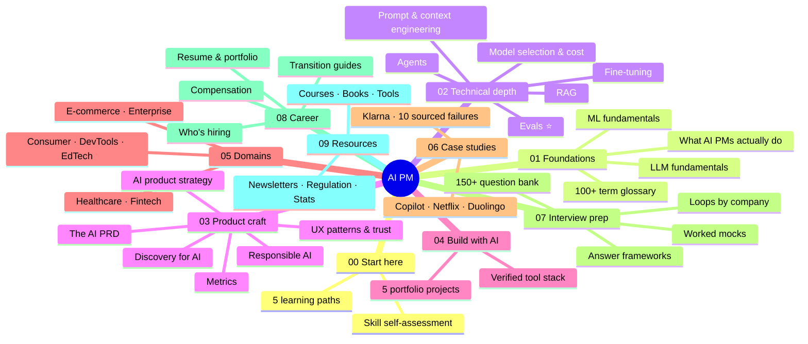

# 🧠 AI for Product Managers

### The complete, verified, no-hallucination guide to becoming an AI Product Manager, and passing the interviews.

**From "AI is magic" → to shipping eval-gated AI products → to offers at frontier labs.**

*Foundations · Technical depth · Product craft · Building with AI · 7 domains · Sourced case studies · 150+ interview questions · Career*

🗓️ **All facts verified July 2026** · every stat sourced · every myth flagged · [see our verification standard ↓](#-the-verification-standard)

---

## 🎯 Start here

**New to this repo?** → **[00-start-here](00-start-here/README.md)** picks your learning path in 60 seconds.

| If you are... | Your path | Time |
|---|---|---|
| 🌱 Aspiring PM / student | [Path A: Full Foundation](00-start-here/README.md#path-a-full-foundation-12-16-weeks) | 12-16 weeks |
| 🔄 PM moving into AI | [Path B: AI Upskill](00-start-here/README.md#path-b-ai-upskill-for-experienced-pms-6-8-weeks) | 6-8 weeks |
| 🧑‍💻 Engineer / Data Scientist → PM | [Path C: Product Craft](00-start-here/README.md#path-c-product-craft-for-technical-folks-6-8-weeks) | 6-8 weeks |
| 👔 Senior PM / Director leading AI | [Path D: AI Leadership](00-start-here/README.md#path-d-ai-leadership-4-6-weeks) | 4-6 weeks |
| 🎯 Interviewing in 30 days | [Path E: Interview Sprint](00-start-here/README.md#path-e-interview-sprint-2-4-weeks) | 2-4 weeks |

---

## 🗺️ The map

---

## 📚 Full contents

### [00 · Start Here](00-start-here/README.md)
Five learning paths, the AI PM skill map, and the three rules of this repo.

### [01 · Foundations](01-foundations/README.md)
| Page | What you get |
|---|---|
| [What AI PMs actually do](01-foundations/what-ai-pms-do.md) | The 4 archetypes, AI PM vs. classic PM, a week in the life, skills self-assessment, myths debunked |
| [ML fundamentals](01-foundations/ml-fundamentals.md) | Programming-with-examples, precision/recall as a *product* decision, the "should this be ML?" decision tree |
| [LLM fundamentals](01-foundations/llm-fundamentals.md) | Next-token prediction → every consequence that matters; the 3-stage training pipeline; explain-it-to-an-exec cheat sheet |
| [Glossary](01-foundations/glossary.md) | 100+ terms grouped by theme, with the ~30 you must speak fluently marked |

### [02 · Technical Depth](02-technical-depth/README.md) (*the interview differentiator*)
| Page | The question it answers |
|---|---|
| [Prompt & context engineering](02-technical-depth/prompt-engineering.md) | Why the prompt is product surface, and how to version + eval it |
| [RAG](02-technical-depth/rag.md) | How to ground AI in your data, and the retrieval-vs-generation debugging instinct |
| [Fine-tuning](02-technical-depth/fine-tuning.md) | When to climb the adaptation ladder, and why the answer is usually "not yet" |
| [AI agents](02-technical-depth/ai-agents.md) | The autonomy dial, compounding errors, why agent safety is permissions not prompts |
| [**Evals**](02-technical-depth/evals.md) ⭐ | *Evals are the new PRD*: the single most differentiating AI PM skill |
| [Model selection & cost](02-technical-depth/model-selection-and-cost.md) | The unit-economics math that gets you hired; verified July 2026 price map |

### [03 · Product Craft](03-product-craft/README.md)
| Page | What it gives you |
|---|---|
| [AI product strategy](03-product-craft/ai-product-strategy.md) | Moats, the wrapper question, the capability curve, business-model patterns with real anchors |
| [Discovery for AI](03-product-craft/discovery-for-ai.md) | The AI-fit screen, the data audit, the feasibility spike |
| [The AI PRD](03-product-craft/prd-template-ai-feature.md) | Copy-paste template + a fully worked example |
| [UX patterns for AI](03-product-craft/ux-patterns-for-ai.md) | Trust engineering: citations, confidence, failure UX, friction-as-a-feature |
| [Metrics](03-product-craft/metrics-for-ai-products.md) | The 3-layer stack, AI-specific traps, north star + guardrails |
| [Responsible AI](03-product-craft/responsible-ai.md) | Bias, privacy, prompt injection, governance: as product work, not legal review |

### [04 · Build With AI](04-build-with-ai/README.md)
The verified 2026 tool stack + **[5 portfolio projects](04-build-with-ai/projects.md)** that answer *"what have you built?"*, from a version-scored prompt to an agent you red-teamed yourself.

### [05 · Domains](05-domains/README.md)
Same craft, different physics. [Healthcare](05-domains/healthcare.md) · [Fintech](05-domains/fintech.md) · [E-commerce & Retail](05-domains/ecommerce-retail.md) · [Enterprise SaaS](05-domains/enterprise-saas.md) · [Consumer & Social](05-domains/consumer-social.md) · [Developer Tools](05-domains/developer-tools.md) · [EdTech](05-domains/edtech.md)

### [06 · Case Studies](06-case-studies/README.md)
[GitHub Copilot](06-case-studies/github-copilot.md) · [Netflix Recommendations](06-case-studies/netflix-recommendations.md) · [Duolingo](06-case-studies/duolingo.md) · [Klarna's AI Assistant](06-case-studies/klarna-ai-assistant.md) · [**The Failures Hall of Lessons**](06-case-studies/failures-hall-of-lessons.md): 10 sourced disasters, one transferable lesson each.

### [07 · Interview Prep](07-interview-prep/README.md)
| Page | What's inside |
|---|---|
| [Loops by company](07-interview-prep/interview-processes-by-company.md) | OpenAI, Anthropic, Google, Meta (incl. the new AI round), Amazon, Microsoft, Perplexity |
| [Answer frameworks](07-interview-prep/answer-frameworks.md) | AI-adapted structures for design, technical, metrics, strategy, behavioral + the live-prototyping round |
| [Question bank](07-interview-prep/question-bank/README.md) | [Design](07-interview-prep/question-bank/01-product-design.md) · [Technical](07-interview-prep/question-bank/02-technical.md) · [Strategy](07-interview-prep/question-bank/03-strategy.md) · [Execution](07-interview-prep/question-bank/04-execution-metrics.md) · [Behavioral](07-interview-prep/question-bank/05-behavioral.md). Sourced 🔵 vs. practice ⚪ |
| [Mock scenarios](07-interview-prep/mock-scenarios.md) | Three full interviews worked out loud, with commentary on why each move scores |

### [08 · Career](08-career/README.md)
[Who's hiring](08-career/companies-hiring.md) (verified postings, 4 tiers, incl. India) · [Compensation](08-career/compensation.md) (levels.fyi + posted ranges, US & India) · [Transition guides](08-career/transition-guides.md) (4 paths in) · [Resume & portfolio](08-career/resume-portfolio.md)

### [09 · Resources](09-resources/README.md)
[Courses](09-resources/courses.md) · [Books](09-resources/books.md) · [Tools](09-resources/tools.md) · [Newsletters, podcasts & communities](09-resources/newsletters-podcasts-communities.md) · [Regulation & governance](09-resources/regulation-and-governance.md) · [Stats & benchmarks](09-resources/stats-and-benchmarks.md)

---

## 🔬 The verification standard

> *"Research 1000s of places and make it the best. No hallucinations."* (the brief this repo was built to)

Most AI PM content on the internet is confidently wrong: invented statistics, dead tools, prices from two pricing models ago, interview questions someone made up. This repo took the opposite approach.

| What we did | Why it matters |
|---|---|
| **Every stat traced to a primary source**: papers, SEC filings, tribunal records, company announcements, official pricing pages | You can cite these in an interview without getting caught |
| **Every fact date-stamped** | AI facts have a half-life; you know exactly how fresh yours are |
| **Unverifiable claims omitted or flagged** ⚠️ | We deleted prices we couldn't confirm rather than guessing |
| **A dedicated [myths list](09-resources/stats-and-benchmarks.md)** of popular numbers that did *not* survive checking | So you don't repeat the internet's favorite fabrications |
| **Interview questions labeled by source**: 🔵 reported for a named company vs. ⚪ practice | No pretending invented questions are real ones |

**Examples of what that discipline caught:** the "Klarna fired 700 people and replaced them with AI" story is false as usually told · the Netflix "$1B / 80%" stats are self-reported and a decade old · Humanloop shut down in 2025 (still recommended by plenty of listicles) · "Copilot writes 46% of code" has no stable primary source. Details in [stats-and-benchmarks.md](09-resources/stats-and-benchmarks.md).

**Volatile by nature, re-verify before citing:** model names & API prices, tool pricing, M&A status, regulation timelines. The [tools directory](09-resources/tools.md) flags exactly which facts rot fastest.

---

## 💡 What this repo argues

Five opinions, defended throughout:

1. **Evals are the new PRD.** If you internalize one idea, make it [this one](02-technical-depth/evals.md). Most people calling themselves AI PMs have never written an eval; that gap is your opportunity.
2. **Build before you badge.** One shipped prototype beats three certificates. [Five projects](04-build-with-ai/projects.md), a weekend each.
3. **AI PM is a superset of PM, not a different species.** Discovery, prioritization, and storytelling still decide everything ([plus four new muscles](01-foundations/what-ai-pms-do.md)).
4. **The model is the engine, not the car.** Moats live in workflow, data flywheels, distribution, and trust ([strategy](03-product-craft/ai-product-strategy.md)).
5. **Failure literacy is a hiring signal.** The [failures section](06-case-studies/failures-hall-of-lessons.md) exists because "what could go wrong?" is where senior candidates separate.

---

## ⚡ Quick reference

<table>
<tr><td width="50%" valign="top">

**Explain it in one line**
- **LLM**: autocomplete trained on the internet, coached by humans into an assistant
- **RAG**: open-book exam instead of closed-book
- **Fine-tuning**: finishing school for style and skill, *not* facts
- **Agent**: an intern with software access. Powerful, needs guardrails
- **Eval**: a test suite for a product that answers differently every time

</td><td width="50%" valign="top">

**The five interview reflexes**
1. Structure out loud before you dive in
2. Name the baseline AI must beat
3. Design the failure, not just the happy path
4. Quote a golden set + eval gate
5. Pair every efficiency metric with a quality guardrail

</td></tr>
</table>

---

## 🤝 Contributing

Found a broken link, a stale price, a better resource, or a fact we got wrong? **[CONTRIBUTING.md](CONTRIBUTING.md)** explains the one rule: **claims need sources.** A PR that adds a great resource with a link and a date gets merged; a PR that adds an unsourced statistic does not.

Especially wanted: newer sourced interview questions (with attribution), domain pages we haven't written (gaming, logistics, legal, climate, agritech), and corrections to anything that aged badly.

## 📄 License

[CC BY 4.0](LICENSE). Use it, remix it, teach with it. Attribution appreciated.

---

**⭐ Star this repo if it helped you.** It's how other PMs find it.

*Built for everyone who wants to build AI products that actually work.*

