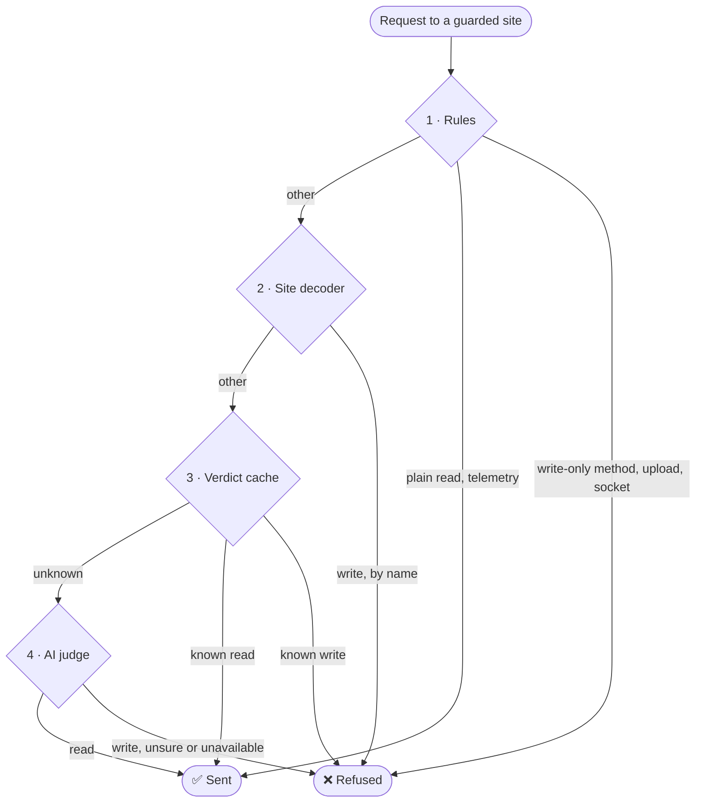

  

### Look all you want. Touch nothing.

The **read-only mode** for AI agents in the browser. Hand any agent that drives your
browser your real inbox, calendar and work tools: reads pass, and every send, post, like, edit, delete or
settings change is refused before it leaves the browser.

  

[Website](https://onlyread.ai) · [Quick start](#quick-start) · [How it works](#how-it-works) · [Works with](#works-with) · [Supported sites](#supported-sites) · [Roadmap](#roadmap) · [Limits](#limits) · [Contributing](#contributing)

## Why

Browser agents such as Claude in Chrome work inside your real, signed-in accounts. That is what makes
them useful, and it is also the risk: one misread instruction, or one prompt injection hidden in an email
or a web page, and the agent sends, posts, deletes or changes something in your name.

Asking the model to be careful is not a guarantee. **OnlyRead enforces it below the model**, at the
network layer: the agent can read everything it needs, and what it tries to change is refused before it leaves
the browser ([what isn't covered yet](#roadmap)).

## Quick start

1. **[Add OnlyRead to Chrome](https://chromewebstore.google.com/detail/onlyread/foajfkjhcigaillohhdbfadobkhpddij)**. It works in any Chromium browser that installs Chrome extensions.
   Or download `onlyread-<version>.zip` from the [latest release](https://github.com/onlyreadai/onlyread/releases/latest),
   unzip it, and load its `onlyread/` folder unpacked in `chrome://extensions` (Developer mode). Each release lists the
   SHA-256 of both zips, the same build as the store's.
2. In the window that opens, choose the AI judge: sign in to **OnlyRead Pro**, or paste your own **OpenRouter** or **Vercel AI Gateway** key.
3. In the settings, switch on the sites your agent may use.

By default OnlyRead guards while an AI agent is working in the browser and stays out of the way otherwise.
To guard all the time, choose **Always** under Security in the settings, and set a settings PIN.

| | 🔑 Your own key | ⭐ OnlyRead Pro |
|---|---|---|
| 💸 Cost | Free, you pay the gateway for what you use | 1,000 free judged requests |
| ⚙️ Setup | Paste an OpenRouter or Vercel AI Gateway key | Sign in |
| 📡 Where uncertain requests go | The gateway you chose, on your key | The OnlyRead Pro service |
| 🧠 Models | Jev decides, Claude reviews what Jev can't settle | The same two models and the same decision logic, run for you |

## How it works

1. **Rules.** Methods that only write, form posts that navigate, uploads and beacons are refused outright. Realtime sockets are decoded where OnlyRead knows the app's protocol, and refused when it can't. Plain reads and known telemetry pass.
2. **Per-site decoders.** Apps that send reads and writes through one endpoint (Google's sync channels, LinkedIn server actions, Facebook GraphQL) are decoded, so each operation is recognized by name.
3. **Verdict cache.** Every tested site ships with reviewed verdicts for the endpoints it uses, labeled from recorded test sessions.
4. **The AI judge** answers *"does this request change data on the server?"* for whatever is left. A second model reviews what the first can't settle. Unsure, or no judge reachable, means refused. The judge is tested on real requests recorded from the supported sites, but like any AI model it can still get one wrong. That is why rules, decoders and reviewed verdicts settle most requests before it is asked.

Most requests never reach a judge. The judge sees only the request in question (its address and a short
preview of its body, with passwords, tokens and card numbers removed), never cookies, headers, responses
or the page ([PRIVACY.md](PRIVACY.md)). While an agent works, it can't switch OnlyRead off or lower its
settings. OnlyRead sees requests through Chrome's debugger API, which is why Chrome shows its *"started
debugging this browser"* banner while it is attached. Details in [docs/ARCHITECTURE.md](docs/ARCHITECTURE.md).

## Works with

OnlyRead guards the browser, not a particular agent. Any agent that acts in a Chromium browser with OnlyRead
installed is covered: agent extensions, AI browsers and automation frameworks alike.

<table>
  <tr>
    <td align="center" width="25%"><a href="https://claude.com/claude-in-chrome"> <b>Claude in Chrome</b></a> Anthropic</td>
    <td align="center" width="25%"><a href="https://chatgpt.com"> <b>ChatGPT in Chrome</b></a> OpenAI · Codex</td>
    <td align="center" width="25%"><a href="https://gemini.google/overview/gemini-in-chrome/"> <b>Gemini in Chrome</b></a> Google</td>
    <td align="center" width="25%"><a href="https://www.perplexity.ai/comet"> <b>Comet</b></a> Perplexity</td>
  </tr>
  <tr>
    <td align="center" width="25%"><a href="https://docs.x.ai/grok-bot"> <b>Grok Bot</b></a> xAI · in the Bot's Chrome</td>
    <td align="center" width="25%"><a href="https://www.diabrowser.com"> <b>Dia</b></a> The Browser Company</td>
    <td align="center" width="25%"><a href="https://www.operaneon.com"> <b>Opera Neon</b></a> Opera</td>
    <td align="center" width="25%"><a href="https://www.microsoft.com/edge/copilot-mode"> <b>Edge Copilot Mode</b></a> Microsoft</td>
  </tr>
  <tr>
    <td align="center" width="25%"><a href="https://manus.im/features/manus-browser-operator"> <b>Browser Operator</b></a> Manus</td>
    <td align="center" width="25%"><a href="https://www.browseros.com"> <b>BrowserOS</b></a> Open source</td>
    <td align="center" width="25%"><a href="https://browser-use.com"> <b>Browser Use</b></a> Open source</td>
    <td align="center" width="25%"><a href="https://playwright.dev"> <b>Playwright</b></a> Microsoft</td>
  </tr>
</table>

Using another agent? If it drives a Chromium browser that installs Chrome extensions, it's covered.
[Tell us how it went](https://github.com/onlyreadai/onlyread/discussions).

## Supported sites

OnlyRead doesn't depend on per-site rules to work. Every request to a guarded site goes through the same
rules and AI judge, which ask one question: does this change data on the server? So a site we haven't
tested is very likely to work too. You can guard any site from the settings page or with **Guard this site**
in the popup.

**Tested on 100+ sites**, including the recordings of the [Mind2Web](https://osu-nlp-group.github.io/Mind2Web/) dataset (Deng et al., NeurIPS 2023, [CC BY 4.0](https://creativecommons.org/licenses/by/4.0/)):

…and many more. Gmail, Google Calendar, Linear, LinkedIn, Facebook, X, Telegram, WhatsApp and Reddit were also tested in depth, read by read
and write by write ([docs/SITES.md](docs/SITES.md)).

Want a site tested in depth?
[Request it](https://github.com/onlyreadai/onlyread/issues/new?template=site-request.yml), or add it yourself
([CONTRIBUTING.md](CONTRIBUTING.md)).

## Roadmap

What's next, and what to do in the meantime:

- [ ] **Guard by account, not only by site.** Today every tab of a guarded site in the profile is guarded,
  whichever account it is signed in to.
- [ ] **Detect agents that drive the screen from outside the browser.** Today they're covered in **Always** mode.
- [ ] **Judge what a site sends over a WebSocket.** Today most sockets are allowed or refused as a whole. Next, each
  text message is decided like a request, so live updates keep working while writes are refused.
- [ ] **Full role-based access control on every site.** Today a guarded site is read-only for the agent. Next, you
  give the agent a role per site, such as allowing comments while still refusing deletes, payments and settings changes.
- [ ] **Custom-tuned judge models.** Today the judge runs on off-the-shelf models. Next, models tuned for
  this one task: telling a read from a write.

Want one of these sooner, or something else? [Open a discussion](https://github.com/onlyreadai/onlyread/discussions).

## Limits

- **Chrome shows a "started debugging this browser" banner** while OnlyRead is guarding. It sees requests through
  Chrome's debugger API, and Chrome shows the banner whenever an extension uses it. By default that is only while
  an AI agent is working.
- **Switching Monitor mode on or off reloads the open tabs of guarded sites**, so no page keeps running with the
  old setting. Monitor mode exists only in development builds.

## FAQ

<b>Will guarded sites still work for me?</b>

 
Yes, by default: OnlyRead refuses writes only while an AI agent is working in the browser. In
<b>Always</b> mode it refuses them for you too. Switch a site off when you want to use it yourself.

<b>Does OnlyRead read my email or pages?</b>

 
No. It looks only at outgoing requests on the sites you guard, and sends a judge only the description of a
request nothing local could settle. See <a href="PRIVACY.md">PRIVACY.md</a>.

<b>Why not just tell the agent to only read?</b>

 
Because the instruction lives in the same place an attack does. A prompt injection hidden in an email or a page
can talk the model out of it. OnlyRead enforces read-only below the model, on the network requests themselves,
so nothing the agent is told can change what gets through.

<b>Isn't a read-only agent useless?</b>

 
Not for most of what people hand to browser agents: triaging an inbox, summarizing threads, finding an invoice,
researching on LinkedIn. Those are reading tasks, and they are also when a poisoned email or page is most
dangerous. When you want an agent to write somewhere, switch that site off.

<b>Why not give the agent read-only access with OAuth scopes?</b>

 
Browser agents don't use OAuth. They act in your signed-in session, with the same cookies you have, so there
are no scopes to narrow. The browser's network layer is the one place left to enforce read-only.

<b>Can the agent switch OnlyRead off?</b>

 
Not from the settings: while an agent is working, OnlyRead can't be switched off and its settings can't be
lowered. A settings PIN adds a second lock. Anyone at the keyboard can still disable an extension in
<code>chrome://extensions</code>. Only Chrome's enterprise policy can prevent that.

<b>What if OnlyRead refuses something that was only a read?</b>

 
The page shows a notice saying what was refused, and the agent can carry on with the rest of its task. If a
read on a site keeps being refused, <a href="https://github.com/onlyreadai/onlyread/issues/new?template=false-block.yml">tell us</a>:
labeling it is how sites get tested in depth. Refusing when unsure is deliberate: a missed read costs a retry,
a missed write can't be undone.

<b>Does it slow browsing down?</b>

 
Barely. Most requests are settled locally by the rules, the site decoders and the verdict cache. Only requests
nothing local can settle go to the AI judge, and verdicts are cached, so a repeated request is usually judged only once.

<b>Why does Chrome show a “started debugging this browser” banner?</b>

 
OnlyRead sees requests through Chrome's debugger API, and Chrome shows that banner whenever an extension uses it.
By default OnlyRead attaches only while an AI agent is working, so you see the banner only then.

<b>Do I need an AI key?</b>

 
No. Sign in to <b>OnlyRead Pro</b> and it runs the AI judge for you, with no key to manage. Pro starts with
1,000 free judged requests. You can also paste your own OpenRouter or Vercel AI Gateway key instead: the same judge, free from
OnlyRead, and you pay the gateway for what you use.

<b>Does it work in Firefox or Safari?</b>

 
Not today. OnlyRead needs Chrome's extension and debugger APIs, so it runs in Chrome and in Chromium browsers
that install Chrome extensions (Edge, Comet, Dia, Opera, BrowserOS and others).

## Contributing

Contributions are welcome, especially new tested sites. Setup, commands and the add-a-site workflow are
in [CONTRIBUTING.md](CONTRIBUTING.md). To build from source: `npm install && npm run bundle`, then unzip
`bundles/onlyread-<version>.zip` and load its `onlyread/` folder unpacked in `chrome://extensions` (Developer mode).
(`npm run build` makes the development build, which takes commands from a local test harness: use it only in a
dedicated profile, as CONTRIBUTING.md explains.) Contributors sign the
[Contributor License Agreement](CLA.md) once. Report security issues privately ([SECURITY.md](SECURITY.md)).

## License

OnlyRead is open source under the [GNU Affero General Public License v3.0](LICENSE). You may use, modify
and redistribute it, including commercially. Any modified version you distribute or run as a service for
others must be released under the same license, with its source. The OnlyRead name and logo are
trademarks: forks must use their own ([TRADEMARK.md](TRADEMARK.md)). [NOTICE](NOTICE) names the copyright holder,
the brand and third-party logo files the license does not cover, and the third-party software included.
