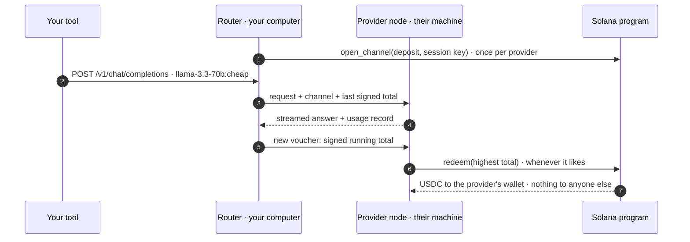
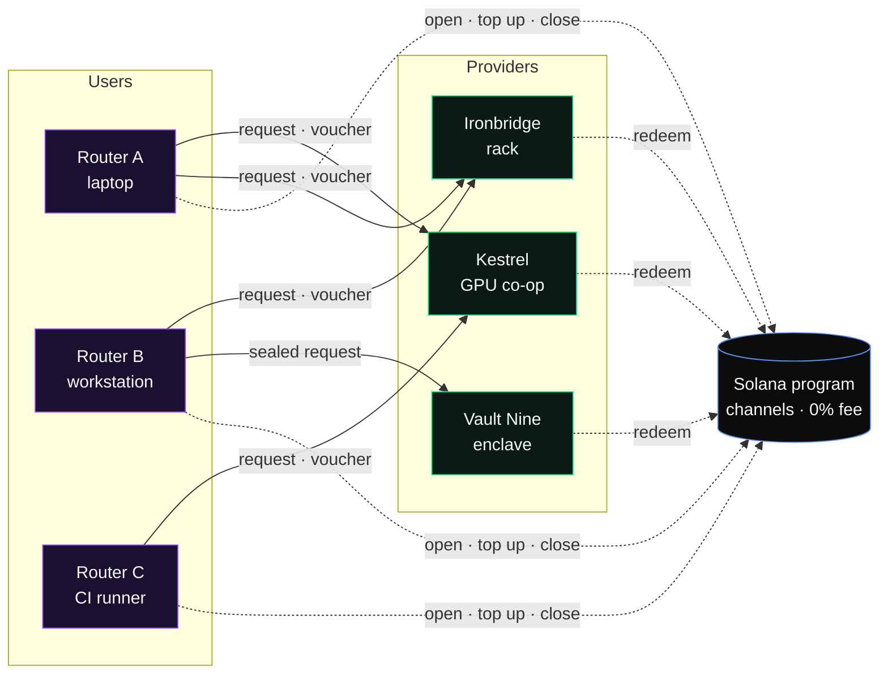

<p align="center">
  <a href="https://orrerynode.com"></a>
</p>

<h1 align="center">Orrery</h1>

<h3 align="center">AI inference, peer to peer. Zero cut in between.</h3>

<p align="center">
  Your computer sends each request straight to someone else's machine and pays it directly on Solana.<br>
  No server in the middle. No account. No API key to buy. The program takes nothing.
</p>

<p align="center">
  <a href="https://www.npmjs.com/package/orrery-node"></a>
  <a href="LICENSE"></a>
  <a href="docs/PROTOCOL.md"></a>
  
</p>
<p align="center">
  
  
  
  
  
</p>

<p align="center">
  <a href="https://orrerynode.com"><b>Website</b></a>&nbsp;&nbsp;·&nbsp;&nbsp;<a href="https://orrerynode.com/docs"><b>Docs</b></a>&nbsp;&nbsp;·&nbsp;&nbsp;<a href="docs/PROTOCOL.md"><b>Protocol</b></a>&nbsp;&nbsp;·&nbsp;&nbsp;<a href="https://www.npmjs.com/package/orrery-node"><b>npm</b></a>&nbsp;&nbsp;·&nbsp;&nbsp;<a href="https://x.com/OrreryNode"><b>X</b></a>&nbsp;&nbsp;·&nbsp;&nbsp;<a href="SECURITY.md"><b>Security</b></a>
</p>

<p align="center">
  
</p>

<p align="center"><sub>The landing page hero, live at <a href="https://orrerynode.com">orrerynode.com</a>: every point falls into place from the inside out, then requests leave the core as purple light and come back green as payment.</sub></p>

---

## Contents

- [What it is](#what-it-is)
- [Why peer to peer](#why-peer-to-peer)
- [Features](#features)
- [Quick start](#quick-start)
- [Routes](#routes)
- [How payment works](#how-payment-works)
- [The program takes 0%](#the-program-takes-0)
- [Holder pricing](#holder-pricing)
- [Run a provider](#run-a-provider)
- [Architecture](#architecture)
- [Security model](#security-model)
- [CLI](#cli)
- [Router console](#router-console)
- [Build from source](#build-from-source)
- [FAQ](#faq)
- [Roadmap](#roadmap)
- [Contributing](#contributing)

---

## What it is

Orrery has three parts, and none of them is a server we run.

| | Runs on | Does |
|---|---|---|
| **Router** | your computer, `127.0.0.1:7171` | serves the OpenAI API to your tools, picks a provider for every request, signs what you owe |
| **Provider node** | anyone's machine | sits in front of any OpenAI-compatible model server, checks each signature, answers, cashes the totals |
| **Program** | Solana | holds the payment channels. No fee field, no third account, nobody can delist a provider |

<p align="center">
  
</p>

Requests and answers go straight between your router and the provider's machine. The program only holds each channel's deposit: a provider redeems what you signed, and the rest comes back to you.

## Why peer to peer

|  | A hosted AI gateway | **Orrery** |
|---|---|---|
| Where your request goes | through the gateway's servers | **straight from your computer to the provider's machine** |
| What sits in between | a company that takes a cut | **a Solana program with no fee field** |
| How you pay | an account and prepaid credits | **your own wallet, a signed running total per answer** |
| Who can sell inference | whoever the gateway approves | **anyone with a model and a URL; nobody can delist them** |
| What a provider risks | chargebacks, unpaid usage | **at most one answer: the next one is served only once the last is paid** |
| What a user risks | the whole prepaid balance | **what is left in open channels, under a daily cap you set** |
| Private prompts | readable by whoever runs the box | **`:private` seals them to a verified hardware enclave** |
| If the company goes away | your tools stop working | **the program and every node keep running** |

## Features

<table>
  <tr>
    <td width="33%" valign="top">
      <b>OpenAI-compatible router</b><br>
      <sub>Chat Completions, streaming or not, and <code>/v1/models</code> on localhost. Cursor, Continue, Aider, Open WebUI, LangChain and the OpenAI SDKs work unchanged.</sub>
    </td>
    <td width="33%" valign="top">
      <b>Pay per answer</b><br>
      <sub>One wallet signature opens a channel. After that a session key signs an 88-byte running total per answer. No credits, no invoices.</sub>
    </td>
    <td width="33%" valign="top">
      <b>0% in the middle</b><br>
      <sub>The settlement program has no fee field and no third recipient. The rehearsal checks that user + providers + open deposits equal the starting balance.</sub>
    </td>
  </tr>
  <tr>
    <td width="33%" valign="top">
      <b>Anyone can provide</b><br>
      <sub>vLLM, SGLang, Ollama, llama.cpp or API capacity you hold. List with one command, set your own prices. No application, no stake.</sub>
    </td>
    <td width="33%" valign="top">
      <b>Routes in one word</b><br>
      <sub>Add <code>:cheap</code>, <code>:fast</code>, <code>:trusted</code> or <code>:private</code> to a model name. The router falls through to the next provider if one fails.</sub>
    </td>
    <td width="33%" valign="top">
      <b>Sealed when you ask</b><br>
      <sub>The private route encrypts the prompt (X25519, HKDF, AES-256-GCM) to a key inside a hardware enclave whose claim the router verified.</sub>
    </td>
  </tr>
  <tr>
    <td width="33%" valign="top">
      <b>Hold $OREY, pay less</b><br>
      <sub>Providers can publish holder prices by share of supply. Your router reads your balance from chain and pays the lower price; the provider checks the same numbers.</sub>
    </td>
    <td width="33%" valign="top">
      <b>Reputation from the chain</b><br>
      <sub>USDC settled, redemptions, age and bond, read from each provider's account, plus your own router's success rate. Nothing a provider can just claim.</sub>
    </td>
    <td width="33%" valign="top">
      <b>MIT, all of it</b><br>
      <sub>The program, the router, the provider node, the rehearsal and this site. Read why every request went where it went.</sub>
    </td>
  </tr>
</table>

## Quick start

**1. Install** (Node.js 22 or newer)

```bash
npm install -g orrery-node
orrery help
```

**2. Fund a wallet** with a few USDC (each channel locks a $2 deposit by default; unspent USDC comes back when it closes) and about 0.05 SOL for fees and channel rent.

```bash
solana-keygen new -o ~/.config/solana/orrery.json
solana address -k ~/.config/solana/orrery.json
```

**3. Run the router**

```bash
orrery router --wallet ~/.config/solana/orrery.json --rpc <your RPC URL> --daily-cap 5
```

```
Orrery router on http://127.0.0.1:7171/v1  ·  3 providers  ·  route auto  ·  wallet 7xKXtg…
session key 9WzDXw…AWWM signs vouchers; console at http://127.0.0.1:7171/
```

**4. Point your tools at it** — any API key works.

```python
from openai import OpenAI

client = OpenAI(base_url="http://127.0.0.1:7171/v1", api_key="unused")
reply = client.chat.completions.create(
    model="llama-3.3-70b:cheap",
    messages=[{"role": "user", "content": "Hello from the network"}],
)
print(reply.choices[0].message.content)
```

<details>
<summary><b>TypeScript, streaming</b></summary>

```ts
import OpenAI from 'openai';

const client = new OpenAI({ baseURL: 'http://127.0.0.1:7171/v1', apiKey: 'unused' });
const stream = await client.chat.completions.create({
  model: 'deepseek-v3:fast',
  stream: true,
  messages: [{ role: 'user', content: 'Explain payment channels in two lines' }],
});
for await (const chunk of stream) process.stdout.write(chunk.choices[0]?.delta?.content ?? '');
```
</details>

<details>
<summary><b>curl</b></summary>

```bash
curl http://127.0.0.1:7171/v1/chat/completions -i \
  -H 'content-type: application/json' \
  -d '{"model":"gpt-oss-120b:cheap","messages":[{"role":"user","content":"hi"}]}'
```

Every answer carries who served it and what you paid:

```
x-orrery-provider: 5Tq7…
x-orrery-route: price
x-orrery-cost: 0.000009
```
</details>

<details>
<summary><b>Cursor, Continue, Aider, Open WebUI, LangChain</b></summary>

| Tool | Setting |
|---|---|
| Cursor | Settings → Models → OpenAI API key: any string · Override OpenAI Base URL: `http://127.0.0.1:7171/v1` · add a model such as `llama-3.3-70b:cheap` |
| Continue | a model with `provider: openai`, `apiBase: http://127.0.0.1:7171/v1`, `model: deepseek-v3` |
| Aider | `OPENAI_API_BASE=http://127.0.0.1:7171/v1 aider --model openai/llama-3.3-70b:cheap` |
| Open WebUI | Admin → Connections → OpenAI API: URL `http://127.0.0.1:7171/v1`, any key |
| LangChain | `ChatOpenAI(base_url="http://127.0.0.1:7171/v1", api_key="unused", model="qwen3-235b")` |
</details>

The full guide, with every flag and a troubleshooting table, is at **[orrerynode.com/docs](https://orrerynode.com/docs)**.

## Routes

<p align="center">
  
</p>

| Suffix | Route | Picks |
|---|---|---|
| *(none)* | auto | `0.6 × relative cost + 0.25 × relative first-token time + 0.45 × (1 − reputation)`, among providers above your reputation floor |
| `:cheap` | price | lowest expected cost for this request |
| `:fast` | speed | fastest first token this router has measured (EWMA) |
| `:trusted` | reputation | settled volume 35% · redemptions 15% · age 15% · bonded $OREY 10% · this router's own success rate 25% |
| `:private` | privacy | only providers whose enclave this router verified; the request is sealed |

The router tries the top three providers in order and cools a failing one down for 15 seconds up to 5 minutes, so a slow or dead provider is skipped without your tool noticing. Pin one with `x-orrery-provider: <address prefix>`, or set the route with `x-orrery-route`.

## How payment works

<p align="center">
  
</p>



**The voucher** is 88 bytes, signed with ed25519 by a session key that never leaves your computer:

| Bytes | Field |
|---|---|
| 0–15 | `orrery/voucher/1` (domain separator) |
| 16–47 | channel address |
| 48–55 | cumulative amount, u64 little-endian, USDC base units |
| 56–87 | usage hash: `sha256(previous ‖ "requestId\|model\|in\|out\|cost")`, a chain over every answer |

The router prices each answer itself from the provider's published list and pays **the smaller** of its number and the provider's. A provider serves the next request only once the previous one is paid, so it is never owed more than one answer, and you never pay for one you did not get. To redeem, anyone submits `[Ed25519Program check, redeem]` in one transaction; the program reads the instructions sysvar to confirm the check covers exactly this key and these bytes.

## The program takes 0%

<p align="center">
  
</p>

There is no fee field in the program and no third account to send a fee to. In the local rehearsal, 100 USDC went in and 100 USDC is accounted for: back with the user, paid to the providers, or still in open channels. There is no fourth line.

## Holder pricing

A provider can publish holder prices next to its list prices: hold a share of the network token's supply, and that provider charges you less. The token is the mint the program's admin sets once as its bond mint ($OREY), so a tier means the same thing at every provider. That mint is set to `2nB8hRZcSGKbxpfazRd749nXbWRgG27q6yQcasWcThse` ([tx](https://solscan.io/tx/2pDwnjaSZCoZZuGYEYQP6tKr6QhCJdRhcU4urxEMybaQ6CtcDkNwnajwsSJCq1JeKYAd4gWhMtPEmA53rfyQMFir)), so holder prices are on.

| You hold | You pay at a provider with these tiers (the seed provider's) |
|---|---|
| less than 0.1% of $OREY supply | the list price |
| 0.1% or more | 20% less |
| 1% or more | 35% less |

- **Your router** reads your wallet's $OREY balance and the token's supply from chain, ranks providers by the price you will actually pay, and signs at that price.
- **The provider** reads the same two numbers for the wallet that opened the channel and charges the same. Both sides use one integer formula, so they agree without trusting each other.
- **The tiers are part of the price list**, whose sha-256 is on chain. A provider that lists holder prices and does not apply them still gets paid its own number, but every router that sees it counts the miss against its success rate.
- **Nothing is taken from anyone.** The settlement program does not change and still has no fee. A holder price is a discount a provider chooses to give.

Providers add tiers to `provider.json`, in basis points (`share` of supply, `off` the list price):

```jsonc
"holder": { "tiers": [{ "share": 10, "off": 2000 }, { "share": 100, "off": 3500 }] }
```

## Run a provider

<p align="center">
  
</p>

Every provider is someone's own machine. Put a node in front of any OpenAI-compatible server, set your prices, and list it; routers anywhere can then pay you per answer.

```bash
orrery provider register --config provider.json --wallet wallet.json   # list on chain; your wallet stays cold
orrery provider show     --config provider.json                         # what the chain says, including your node key
orrery provider start    --config provider.json                         # serve, check vouchers, redeem
```

```jsonc
{
  "name": "My GPU",
  "region": "eu-west",
  "publicUrl": "https://gpu.example.org",
  "rpcUrl": "https://your-rpc.example.com",
  "settleMint": "EPjFWdd5AufqSSqeM2qN1xzybapC8G4wEGGkZwyTDt1v",
  "wallet": "~/.config/solana/provider-wallet.json",
  "upstream": { "baseUrl": "http://127.0.0.1:8000/v1" },
  "models": [
    { "id": "llama-3.3-70b", "upstreamModel": "meta-llama/Llama-3.3-70B-Instruct",
      "context": 131072, "maxOutput": 8192,
      "price": { "input": 120000, "output": 300000 } }      // USDC base units per million tokens: $0.12 / $0.30
  ],
  "redeem": { "everySecs": 300, "minUnits": 50000 }
}
```

<details>
<summary><b>Upstreams</b></summary>

| Server | `upstream` |
|---|---|
| vLLM | `"baseUrl": "http://127.0.0.1:8000/v1"` |
| SGLang | `"baseUrl": "http://127.0.0.1:30000/v1"` |
| Ollama | `"baseUrl": "http://127.0.0.1:11434/v1"` |
| llama.cpp | `"baseUrl": "http://127.0.0.1:8080/v1"` |
| OpenRouter or any API | `"baseUrl": "https://openrouter.ai/api/v1", "apiKeyEnv": "OPENROUTER_API_KEY"` |
</details>

<details>
<summary><b>Keep it running with systemd</b></summary>

```ini
[Unit]
Description=Orrery provider node
After=network-online.target

[Service]
ExecStart=/usr/bin/env orrery provider start --config /etc/orrery/provider.json
Environment=OPENROUTER_API_KEY=...
Restart=always
User=orrery

[Install]
WantedBy=multi-user.target
```
</details>

- **Your wallet stays cold.** The node runs on its own key (`~/.orrery/provider/node.json`), which can redeem and post enclave claims but can never send what you earn anywhere except your wallet's USDC account. Give it ~0.01 SOL for redemption fees.
- **Your upstream key is safe.** Only standard chat fields reach your upstream; fallback model lists, plugins, provider routing and `n` are dropped, so a caller cannot spend your key on something your price list does not cover.
- **Holder prices (optional).** Add `holder.tiers` to give wallets that hold $OREY a lower price. See [Holder pricing](#holder-pricing).
- **Change anything** by editing the file and running `register` again: it updates the listing, and routers check the new price list against the hash on chain.

## Architecture



Every router talks to every provider directly. The program never sees a prompt or an answer; it only holds deposits and pays out signed totals. Byte layouts, every instruction and the threat table: **[docs/PROTOCOL.md](docs/PROTOCOL.md)**.

## Security model

| If | The most you lose |
|---|---|
| a provider stops answering | nothing: the router moves on, and it signs only after an answer arrives |
| a provider overstates token counts | at most the reservation for that one answer (its listed price for `maxOutput` tokens) |
| your session key leaks | what is left in your open channels, redeemable only by their providers; close them |
| your router misbehaves | at most `--daily-cap` per day |
| a provider's node key leaks | nothing of the provider's: redemptions only go to the listing wallet |
| the admin turns hostile | nothing: the admin cannot move deposits or bonds, list or delist, or add a fee |

The program has **not been audited yet**. Read [SECURITY.md](SECURITY.md) for what each key can do and how to report a vulnerability privately.

## CLI

| Command | Does |
|---|---|
| `orrery router --wallet <keypair> --rpc <url>` | run the router on `127.0.0.1:7171` |
| `orrery models` | every model on the network, cheapest price, provider count |
| `orrery providers` | every listing and what the chain says about it |
| `orrery channels` | your channels: deposit, what you signed, what was redeemed |
| `orrery close <channel> --wallet <keypair>` | start closing (the provider gets a grace period to redeem) |
| `orrery close <channel> --wallet <keypair> --finish` | after the grace period, the rest comes back to you |
| `orrery provider register \| show \| start \| attest \| redeem --config provider.json` | run a provider |

Router flags: `--route`, `--deposit` (2), `--top-up-below` (0.25), `--daily-cap` (5), `--min-reputation` (0.2), `--port` (7171), `--refresh` (60), `--enclave-images`. Environment: `ORRERY_WALLET`, `ORRERY_RPC_URL`, `ORRERY_HOME` (`~/.orrery`).

## Router console

The router serves a live console at `http://127.0.0.1:7171/`: every request, the provider that answered, tokens and cost, your providers and your channels.

<p align="center">
  
</p>

## Build from source

```
program/   Anchor program (Rust) · provider registry, payment channels, ed25519 vouchers, enclave claims, bonds
node/      router + provider node (TypeScript, Node 22) · published to npm as orrery-node
web/       orrerynode.com and its docs (Next.js, three.js)
docs/      protocol specification
assets/    brand and README media
```

```bash
cd program && anchor build --arch v2 && cargo test -p orrery   # 2 unit + 13 LiteSVM tests on the compiled program
cd node && pnpm install && pnpm test                            # 18 tests
pnpm e2e                                                        # full local rehearsal, 17 checks
cd web && pnpm install && pnpm dev                              # http://localhost:3870
```

**The rehearsal** (`node/devtools/e2e.ts`) starts a local validator with the program, creates a stand-in network token and sets it as the bond mint, lists four providers in front of mock models (one behind a development enclave, one with holder prices), runs a router whose wallet holds 2% of the token through fourteen requests on every route, switches the cheapest provider off mid-run, redeems on chain, has one provider release its channel, and checks every unit of USDC:

```
  ✓ /v1/models lists the network catalog
  ✓ price route picks the cheapest llama
  ✓ streaming works and only Ironbridge has deepseek
  ✓ privacy route seals the request to the only enclave
  ✓ route header works too
  ✓ speed route settles on the provider with the fastest first token
  ✓ a wallet holding 2% of the network token pays the 1% tier price
  ✓ when the cheapest provider goes dark the request falls through
  ✓ router logged every answered request
  ✓ Kestrel GPU Co-op redeemed exactly what the router signed
  ✓ Ironbridge Compute redeemed exactly what the router signed
  ✓ Vault Nine redeemed exactly what the router signed
  ✓ Halo Compute redeemed exactly what the router signed
  ✓ a provider releasing its channel sends the rest straight back to the user
  ✓ no fee in the program: user + providers + open deposits = 100 USDC
  ✓ program totals agree
  ✓ a provider with many channels redeems them in transactions that fit, skipping one that closed
17/17 checks passed
```

## FAQ

<details>
<summary><b>Do I need an account or an API key?</b></summary>

No. Your Solana wallet is the account. The router accepts any API key string from your tools and pays from your channels.
</details>

<details>
<summary><b>What does a request cost?</b></summary>

Whatever the provider lists, per million input and output tokens, in USDC. `orrery models` shows the cheapest price per model across the network. Nothing is added on top: the program has no fee.
</details>

<details>
<summary><b>What stops a provider from overcharging?</b></summary>

The router recomputes every cost from the provider's published price list (whose hash is on chain) and signs the smaller number, never more than it reserved for that request. Providers that misbehave lose reputation, and the router stops picking them.
</details>

<details>
<summary><b>What stops a user from not paying?</b></summary>

A provider serves the next request only after the previous one is paid by a signed voucher, and the deposit is already locked in the channel. The most a provider can be owed is one answer.
</details>

<details>
<summary><b>Can someone shut a provider down?</b></summary>

No. Anyone can list, and no instruction in the program lets anyone, including the admin, delist a provider.
</details>

<details>
<summary><b>What is $OREY for?</b></summary>

Two things. Holding it lowers your price at every provider that publishes holder prices (at the seed provider: 0.1% of supply for 20% off, 1% for 35% off; see [Holder pricing](#holder-pricing)). And providers can bond it behind their listing, which routers count as 10% of reputation. A bond is never slashed; unbonding returns it after seven days, only to the provider that posted it. It launches on Meteora.
</details>

<details>
<summary><b>Which API does the router speak?</b></summary>

OpenAI Chat Completions (`/v1/chat/completions`, streaming or not), `/v1/models`, and the Anthropic Messages API (`/v1/messages`, streaming or not, tool use included, plus `/v1/messages/count_tokens`). For an Anthropic client, set `ANTHROPIC_BASE_URL=http://127.0.0.1:7171` and use a network model id such as `llama-3.3-70b`.
</details>

## Roadmap

- [x] Settlement program: registry, channels, ed25519 vouchers, enclave claims, bonds
- [x] Router and provider node, OpenAI-compatible, streaming, fall-through
- [x] Local end-to-end rehearsal, 17 of 17 checks
- [x] Holder pricing: tiers by share of $OREY supply, checked by router and provider
- [x] npm package [`orrery-node`](https://www.npmjs.com/package/orrery-node)
- [x] Site and docs at [orrerynode.com](https://orrerynode.com)
- [x] Program deployed on Solana mainnet and initialized (USDC settlement, 1 h close grace, 7 day unbonding, $0.10 minimum deposit)
- [x] Reproducible build: the program on chain hashes to `0880750c…5451`, the same as `solana-verify build` of this repo
- [x] Seed provider live on mainnet (Orrery Seed: llama-3.3-70b, deepseek-v3, qwen3-235b, gpt-oss-120b; holder tiers published), first paid requests settled on chain
- [x] $OREY live on Meteora (`2nB8hRZcSGKbxpfazRd749nXbWRgG27q6yQcasWcThse`), set as the program's bond mint, holder prices on
- [ ] Buyback and burn: a share of what Orrery earns buys $OREY on the market and burns it. It runs outside the settlement program, which keeps no fee; a smaller supply moves every holder toward the next tier
- [ ] Independent audit
- [x] Anthropic Messages API (`/v1/messages`) on the router, tool use included (in main, ships in orrery-node 0.1.3)
- [ ] Built-in hardware attestation verifier
- [ ] $OREY bonds live on mainnet

## Contributing

Issues and pull requests are welcome. [CONTRIBUTING.md](CONTRIBUTING.md) lists good places to start. Before opening a pull request, run the program tests, `pnpm test` and `pnpm e2e` in `node/`, and keep the protocol document in step with any change to the program or the wire format. Security issues go through private reporting, not public issues: see [SECURITY.md](SECURITY.md).

## License

[MIT](LICENSE)

<p align="center"><br><br><sub>Peer to peer. Zero cut in between.</sub></p>
