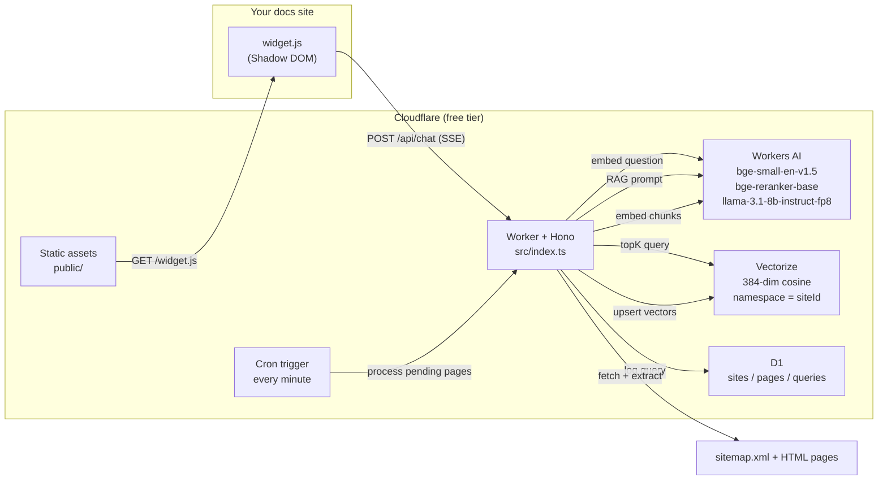

<div align="center">

# DocFlare AI

**Open-source, zero-cost AI site search & chatbot widget. 100% Cloudflare native.**

Drop one `<script>` tag on your docs site and get a streaming RAG chatbot that answers from *your* content, with sources.
No OpenAI key. No Pinecone. No servers. No bill.

[](https://deploy.workers.cloudflare.com/?url=https://github.com/p10node/docflare-ai)
[](LICENSE)
[](https://hono.dev)
[](https://workers.cloudflare.com)

</div>

---

## Screenshots

| Chat widget embedded in a docs site                                                 | Admin UI (`/admin`)                                                                           |
|-------------------------------------------------------------------------------------|-----------------------------------------------------------------------------------------------|
|  |  |

Streaming answers with source chips on the left; the built-in admin page for registering sitemaps, driving indexing and reviewing what users ask on the right.

## Why

Hosted "chat with your docs" widgets (Chatbase, CustomGPT, Mendable, ...) charge $20-$400/month for something that is, under the hood, a crawler, an embedding model, a vector store and an LLM. Cloudflare now ships every one of those pieces with a generous free tier:

| Piece               | Cloudflare service                                                                     | Free tier (at time of writing)         |
|---------------------|----------------------------------------------------------------------------------------|----------------------------------------|
| API / crawler       | **Workers** + Hono                                                                     | 100k requests/day                      |
| Embeddings + LLM    | **Workers AI** (`bge-small-en-v1.5`, `bge-reranker-base`, `llama-3.1-8b-instruct-fp8`) | 10k neurons/day                        |
| Vector search       | **Vectorize** (384-dim, cosine)                                                        | 5M stored dims, 30M queried dims/month |
| Metadata + chat log | **D1** (SQLite)                                                                        | 5 GB, 5M reads/day                     |
| Background indexing | **Cron Triggers**                                                                      | included                               |
| Widget hosting      | **Static Assets**                                                                      | included                               |

DocFlare AI wires them together into a single Worker you deploy with one command.

## Features

- **One-tag embed**: `<script src=".../widget.js" data-site-id="my-docs">`. Vanilla JS, Shadow DOM, < 10 KB, zero dependencies, no CSS leaks.
- **Streaming answers** over Server-Sent Events with source chips, in the language of the question.
- **Sitemap crawler**: sitemap index support, gzip sitemaps, boilerplate stripping (nav/header/footer/scripts) via the native `HTMLRewriter`.
- **Section-aware chunking**: headings start new chunks, so a landing page's "Open source" card is not buried in a chunk about pricing. Chunks are ~350 tokens with 40-token overlap, sized with a per-script token estimate so Vietnamese/CJK pages stay inside the embedding model's 512-token window.
- **Two-stage retrieval**: the 20 best vector matches are re-scored by the `bge-reranker-base` cross-encoder before the top-K go to the LLM. Questions that merely share vocabulary with the wrong page (the site name on legal pages, a product name) land on the paragraph that actually answers them.
- **Multi-site / multi-tenant**: one deployment can serve many documentation sites, each isolated in its own Vectorize namespace and locked to its own domain.
- **Free-tier safe by design**: indexing runs in small resumable batches (cron + on-demand), the LLM is skipped when nothing relevant is retrieved, and AI rate limits degrade gracefully.
- **Dark / light / auto theme**, custom accent colour, left/right position, keyboard friendly.
- **Chat history in D1** so you can see what users ask and where your docs have gaps.
- **Built-in admin UI** at `/admin`: register sitemaps, watch indexing progress, process batches, re-crawl, delete sites, copy the embed snippet and browse recent questions. Single static HTML file, no build step.
- TypeScript end-to-end, Hono router, strict types, no `any`. Bun for tooling and tests.

## How it works



**Indexing**: `POST /api/sites/index` reads the sitemap and queues every HTML URL in D1. A cron trigger (or repeated calls to `/process`) then crawls a few pages per invocation: extract text, chunk, embed, upsert to Vectorize, mark the page indexed.

**Chat**: the widget sends the question; the Worker embeds it, pulls the 20 closest chunks from the site's namespace, reranks them with a cross-encoder, keeps the top-K (max 2 per page), builds a grounded prompt, streams Llama 3.1's answer back as SSE and logs the exchange in D1.

See [docs/ARCHITECTURE.md](docs/ARCHITECTURE.md) for the full design and [docs/API_REFERENCE.md](docs/API_REFERENCE.md) for the endpoints.

## Quick start

### Prerequisites

- A free [Cloudflare account](https://dash.cloudflare.com/sign-up) with Workers enabled.
- [Bun](https://bun.sh) 1.1+ (used for installing, scripts, building the widget and running tests).

### 1. Clone and install

```bash
git clone https://github.com/p10node/docflare-ai.git
cd docflare-ai
bun install
bunx wrangler login
```

### 2. Create the D1 database

```bash
bunx wrangler d1 create docflare-db
```

Copy the `database_id` from the output. Either paste it into `wrangler.toml`:

```toml
[[d1_databases]]
binding = "DB"
database_name = "docflare-db"
database_id = "xxxxxxxx-xxxx-xxxx-xxxx-xxxxxxxxxxxx"   # <- paste here
```

…or, to keep it out of git, put it in a `.env` file instead (useful when you push your fork):

```bash
echo 'D1_DATABASE_ID=xxxxxxxx-xxxx-xxxx-xxxx-xxxxxxxxxxxx' > .env
```

With `.env` set, `bun run deploy` and `bun run db:migrate` generate `wrangler.local.toml` (gitignored) from `wrangler.toml` with the id filled in and use that. `wrangler.toml` keeps the placeholder.

Apply the schema:

```bash
bun run db:migrate
```

### 3. Create the Vectorize index

```bash
bunx wrangler vectorize create docflare-index --dimensions=384 --metric=cosine
```

(384 dimensions matches `@cf/baai/bge-small-en-v1.5`. The index name is already set in `wrangler.toml`.)

### 4. Set the admin token

The management endpoints are protected by a bearer token. Pick something long and random:

```bash
bunx wrangler secret put ADMIN_TOKEN
```

### 5. Deploy

```bash
bun run deploy
```

`bun run deploy` builds the widget and deploys (the schema was applied in step 2; re-run `bun run db:migrate` whenever `migrations/` gains a new file). Wrangler prints your Worker URL, e.g. `https://docflare-ai.<your-subdomain>.workers.dev`. Open it to see the demo page with the widget mounted.

> **Deploy to Cloudflare button**: the button at the top of this README clones the repo into your GitHub account, provisions the Worker, D1 database and Vectorize index from `wrangler.toml`, asks for `ADMIN_TOKEN` (from `.dev.vars.example`) and runs `bun run deploy`. Two values the wizard cannot read from `wrangler.toml`:
>
> - **Vectorize index**: enter **Dimensions = 384** and **Metric = cosine** (the form leaves them blank; any other shape breaks indexing).
> - **`ADMIN_TOKEN`**: replace the example value with something long and random, e.g. `openssl rand -hex 32`.
>
> The build does not apply the D1 schema (the build token has no D1 access), so run the migration once from your new repo after the first deploy. Cloudflare writes your `database_id` into that repo's `wrangler.toml` while provisioning, so no `.env` is needed (if it still shows the placeholder, do step 2):
>
> ```bash
> git clone https://github.com/<you>/docflare-ai.git && cd docflare-ai
> bun install && bunx wrangler login
> bun run db:migrate
> bunx wrangler vectorize get docflare-index   # expect dimensions: 384, metric: cosine
> ```
>
> If the index is missing or has a different shape, run step 3 (delete it first with `bunx wrangler vectorize delete docflare-index`) and redeploy. If the wizard did not ask for `ADMIN_TOKEN`, run step 4.

## Index your documentation

```bash
export WORKER_URL="https://docflare-ai.<your-subdomain>.workers.dev"
export ADMIN_TOKEN="the-token-you-set"

curl -X POST "$WORKER_URL/api/sites/index" \
  -H "Authorization: Bearer $ADMIN_TOKEN" \
  -H "Content-Type: application/json" \
  -d '{"siteId":"my-docs","sitemapUrl":"https://docs.example.com/sitemap.xml"}'
```

Response:

```json
{
  "siteId": "my-docs",
  "domain": "docs.example.com",
  "sitemapUrl": "https://docs.example.com/sitemap.xml",
  "queued": 142,
  "progress": { "siteId": "my-docs", "total": 142, "pending": 142, "indexed": 0, "failed": 0 },
  "next": "Pending pages are crawled 3 at a time by the cron trigger. Call POST /api/sites/my-docs/process repeatedly to finish faster."
}
```

Prefer a UI? Open `https://docflare-ai.<your-subdomain>.workers.dev/admin`, paste the admin token and use the **Register / re-index a site** form. The same page shows progress bars per site, an **Index all pending** button that loops over `/process` until the queue is empty, and the recent questions log.

Pages are now crawled automatically, a few per minute, by the cron trigger. To finish faster, drive the queue yourself from the CLI:

```bash
until curl -sf -X POST "$WORKER_URL/api/sites/my-docs/process" \
        -H "Authorization: Bearer $ADMIN_TOKEN" | grep -q '"pending":0'; do
  sleep 1
done
```

Check progress at any time:

```bash
curl "$WORKER_URL/api/sites/my-docs/status" -H "Authorization: Bearer $ADMIN_TOKEN"
```

Re-running `/api/sites/index` for the same `siteId` re-queues every page, so a cron job or CI step can keep the index fresh. Vectorize is eventually consistent: freshly upserted chunks become searchable within a few seconds.

> After upgrading DocFlare to a version that changes chunking (see the changelog in commit messages), re-index every site once (**Re-crawl sitemap** in the admin UI or `POST /api/sites/index`) so pages are re-chunked. Old vectors keep working until then.

## Embed the widget

Add one line before `</body>` on any page of the registered domain:

```html
<script src="https://docflare-ai.<your-subdomain>.workers.dev/widget.js"
        data-site-id="my-docs"
        defer></script>
```

### Widget options

| Attribute          | Default                            | Description                                                                   |
|--------------------|------------------------------------|-------------------------------------------------------------------------------|
| `data-site-id`     | required                           | The `siteId` you indexed.                                                     |
| `data-api`         | script origin                      | Base URL of the Worker, if you serve `widget.js` from elsewhere (e.g. a CDN). |
| `data-theme`       | `auto`                             | `light`, `dark` or `auto` (follows `prefers-color-scheme`).                   |
| `data-color`       | `#f6821f`                          | Accent colour for the bubble and buttons.                                     |
| `data-position`    | `right`                            | `right` or `left` corner.                                                     |
| `data-title`       | `Ask AI`                           | Panel header text.                                                            |
| `data-placeholder` | `Ask a question about these docs…` | Input placeholder.                                                            |
| `data-welcome`     | `Hi! Ask me anything…`             | First assistant message.                                                      |

A tiny JavaScript API is exposed as `window.DocFlare`:

```js
DocFlare.open();            // open the panel
DocFlare.close();
DocFlare.ask('How do I deploy?');   // open and submit a question
```

Only pages served from the site's registered `domain` (and anything in `ALLOWED_ORIGINS`) can call `/api/chat` for that `siteId`. Requests from other origins get a `403`.

## Configuration

Non-secret settings live in the `[vars]` section of `wrangler.toml`:

| Variable           | Default | Purpose                                                                                                                  |
|--------------------|---------|--------------------------------------------------------------------------------------------------------------------------|
| `MAX_PAGES`        | `200`   | Max URLs taken from a sitemap per indexing run.                                                                          |
| `INDEX_BATCH_SIZE` | `3`     | Pages crawled + embedded per cron tick or `/process` call. Raise to 10-20 on the Workers Paid plan.                      |
| `TOP_K`            | `4`     | Chunks handed to the LLM per question (max 20).                                                                          |
| `RERANK`           | `true`  | Rerank the 20 best vector matches with `@cf/baai/bge-reranker-base` before picking `TOP_K`. `false` = vector order only. |
| `ALLOWED_ORIGINS`  | `""`    | Comma-separated extra origins allowed to call `/api/chat` for any site. `*` allows everything.                           |

Secrets (set with `bunx wrangler secret put NAME`):

| Secret        | Purpose                                                                                    |
|---------------|--------------------------------------------------------------------------------------------|
| `ADMIN_TOKEN` | Bearer token for `/api/sites/*`. Required; management routes return `503` until it is set. |

Want a bigger model or a different embedding size? Change `CHAT_MODEL` / `EMBEDDING_MODEL` in `src/services/ai.ts` and create a Vectorize index with the matching dimensions.

## Local development

```bash
cp .dev.vars.example .dev.vars          # sets ADMIN_TOKEN for local runs
bunx wrangler d1 migrations apply docflare-db --local
bun run dev                             # http://localhost:8787
```

Notes:

- Workers AI and Vectorize have no local emulator; `wrangler dev` proxies those bindings to your Cloudflare account (you must be logged in). D1 runs locally.
- `wrangler dev` uses a local D1 and ignores `database_id`, so neither the real id in `wrangler.toml` nor `.env` is needed for local runs. Only `bun run deploy` and `bun run db:migrate` need it.
- The Vectorize index must exist remotely before `wrangler dev` can use it.
- Test the cron handler locally with `bun run dev:cron`, then `curl "http://localhost:8787/__scheduled?cron=*+*+*+*+*"`.
- `bun test` runs the unit tests (token estimate, section chunker, HTML extraction, sitemap filtering, CORS policy, reranker, prompt builder).
- `bun run build:check` type-checks and performs a dry-run bundle without deploying.
- `bun run build:widget` minifies `widget/widget.src.js` into `public/widget.js` with `bun build` (run after editing the widget).

## API overview

| Method   | Path                         | Auth         | Description                                      |
|----------|------------------------------|--------------|--------------------------------------------------|
| `GET`    | `/api/health`                | none         | Liveness + model names.                          |
| `POST`   | `/api/sites/index`           | admin        | Register a site and queue its sitemap URLs.      |
| `POST`   | `/api/sites/:siteId/process` | admin        | Crawl and embed the next batch of pending pages. |
| `GET`    | `/api/sites/:siteId/status`  | admin        | Indexing progress.                               |
| `DELETE` | `/api/sites/:siteId`         | admin        | Remove a site, its pages, chat log and vectors.  |
| `POST`   | `/api/chat`                  | origin check | Ask a question (JSON or SSE stream).             |
| `GET`    | `/widget.js`                 | none         | Embeddable widget.                               |

Full request/response shapes, the SSE protocol and an OpenAPI document are in [docs/API_REFERENCE.md](docs/API_REFERENCE.md).

## Staying inside the free tier

Rough budget for a typical documentation site, based on Cloudflare pricing as of 2026-10-01 (check the [Workers AI](https://developers.cloudflare.com/workers-ai/platform/pricing/), [Vectorize](https://developers.cloudflare.com/vectorize/platform/pricing/), [D1](https://developers.cloudflare.com/d1/platform/pricing/) and [Workers](https://developers.cloudflare.com/workers/platform/pricing/) pricing pages for up-to-date numbers):

- **Indexing**: `bge-small` costs 1,841 neurons per million input tokens, i.e. roughly 1 neuron per page. A 1,000-page site fits comfortably in a day's free quota.
- **Chat**: one answered question costs roughly **30-70 neurons**: the prompt is 1.5k-3.5k tokens (system prompt + `TOP_K=4` chunks of ~350 tokens + conversation history) at 13,778 neurons/M, the answer is 300-768 tokens at 26,128 neurons/M, the query embedding is negligible and reranking 20 candidates (~6k tokens at 283 neurons/M) costs about 2 neurons. With 10k free neurons/day that is on the order of **120-280 answered questions per day** for free. Questions with no relevant context never hit the LLM and cost ~0.
- **Vectorize**: 5M free stored dimensions / 384 ≈ 13,000 chunks ≈ 1,000-2,500 pages across all sites (section-aware chunks are smaller and more numerous than fixed 500-token blocks). Each query reads 384 dimensions, so even 2,500 questions/day stay under the 30M queried dimensions/month allowance.
- **D1 and Workers requests**: one chat is 1 row read + 1 row written; the per-minute cron adds ~1.4k reads/day. Both are orders of magnitude below the free limits.
- **CPU time**: the Workers Free plan allows 10 ms CPU per invocation. Crawling is I/O bound and `HTMLRewriter` is native, so a batch of 3 pages stays under the limit; on the Paid plan raise `INDEX_BATCH_SIZE`.

### Beyond the free tier

Workers AI is the only piece you will outgrow. Past the daily neuron allowance the `AI` binding fails and `/api/chat` returns `429 rate_limited` until the quota resets. To go further, move to the **Workers Paid plan ($5/month)**: it keeps the 10k free neurons/day and bills $0.011 per 1,000 neurons beyond that. No code changes are needed.

| Questions / day | Plan | Workers AI | Total / month (approx.) |
|-----------------|------|------------|-------------------------|
| up to ~280      | Free | $0         | **$0**                  |
| 1,000           | Paid | $9-24      | **$14-29**              |
| 5,000           | Paid | $56-132    | **$61-137**             |

That is about $0.0004-0.0009 per question beyond the free allowance. The spread comes from how long the retrieved chunks, the history and the answers are.

To cut the cost per question:

- Lower `TOP_K` from 4 to 3 (about 25% fewer prompt tokens, slightly less context for the model).
- Lower `MAX_OUTPUT_TOKENS` in `src/services/ai.ts` (768 by default); output tokens are the most expensive kind.
- Trim `MAX_HISTORY_TURNS` / `MAX_HISTORY_CHARS` in `src/services/ai.ts` if follow-up questions are rare on your site.
- Swap `CHAT_MODEL` for a cheaper model from the Workers AI catalog; the response parser accepts both Llama-style and OpenAI-style outputs.

## Limitations and roadmap

- English-optimised embedding model (`bge-small-en`). For multilingual docs switch to `@cf/baai/bge-m3` (1024 dims) and recreate the index.
- JavaScript-rendered sites must expose server-rendered HTML (most docs generators do).
- No authentication for private docs yet (the widget is meant for public sites).
- Planned: incremental re-crawl using sitemap `<lastmod>`, feedback thumbs on answers, Markdown/llms.txt ingestion, per-site widget settings in the admin UI.

## Project structure

```text
docflare-ai/
├── docs/
│   ├── images/               # README screenshots
│   ├── ARCHITECTURE.md       # System design & RAG data flow
│   └── API_REFERENCE.md      # REST + SSE endpoint reference, OpenAPI
├── migrations/
│   └── 0000_init.sql         # D1 schema
├── scripts/
│   └── wrangler.ts           # Wrapper: swaps D1_DATABASE_ID from .env (optional) into a gitignored wrangler.local.toml
├── public/
│   ├── _headers              # Static asset headers (CORS / caching for widget.js)
│   ├── admin.html            # Admin UI (served at /admin)
│   ├── index.html            # Demo page
│   └── widget.js             # Minified embeddable widget (built from widget/)
├── widget/
│   └── widget.src.js         # Readable widget source (bun build → public/widget.js)
├── test/
│   └── unit.test.ts          # bun test: chunker, crawler filters, CORS, prompt
├── src/
│   ├── db/schema.ts          # D1 statements, row types, repository
│   ├── services/
│   │   ├── ai.ts             # Workers AI embeddings, RAG prompt, generation
│   │   ├── crawler.ts        # Sitemap fetcher, HTMLRewriter text extractor, chunker
│   │   ├── indexer.ts        # Batch indexing pipeline
│   │   └── vectorize.ts      # Vectorize upsert / query / delete
│   ├── utils/
│   │   ├── cors.ts           # Multi-domain CORS + origin policy
│   │   └── hash.ts           # SHA-256 ids, constant-time compare
│   ├── index.ts              # Hono app, routes, cron handler
│   └── types.ts              # Env bindings & shared types
├── wrangler.toml
├── .dev.vars.example         # ADMIN_TOKEN etc. for `wrangler dev`
├── package.json
├── bun.lock
└── tsconfig.json
```

## Contributing

Issues and pull requests are welcome. Run `bun test` and `bun run build:check` before opening a PR; they run the unit tests, type-check and dry-run bundle the Worker.

## License

[MIT](LICENSE) © 2026 [p10node](https://github.com/p10node)
