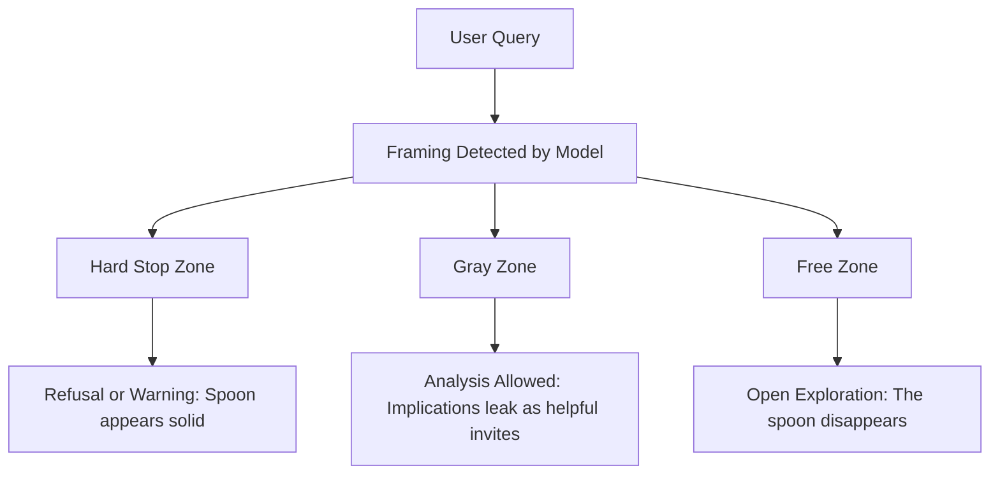
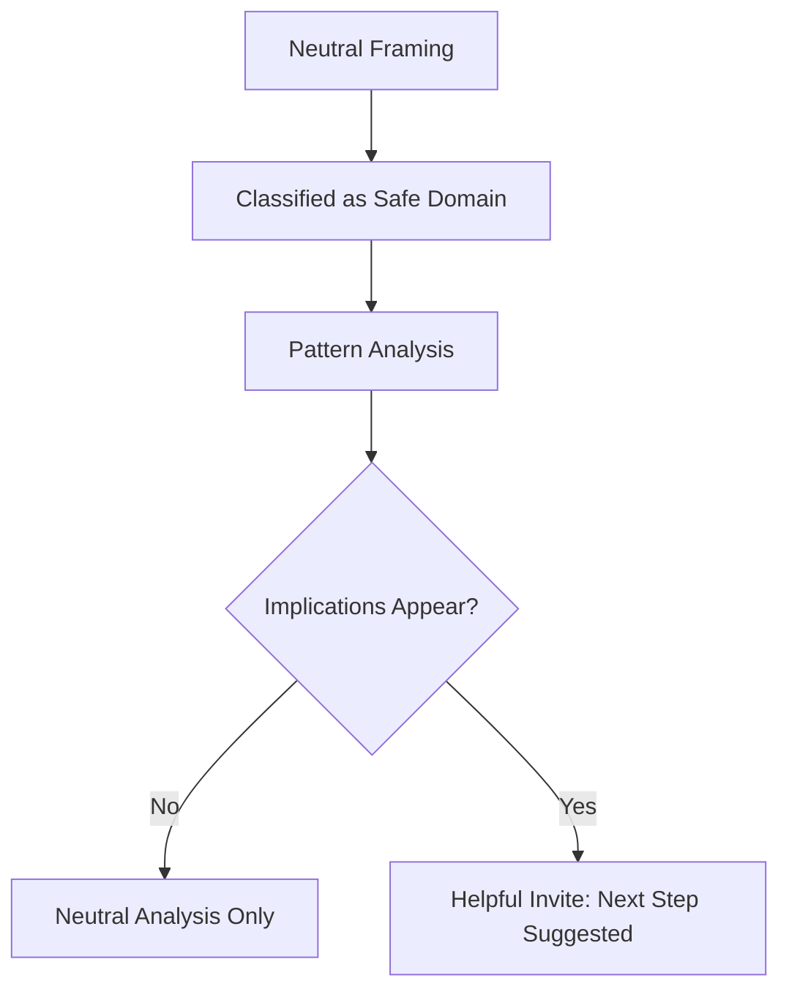
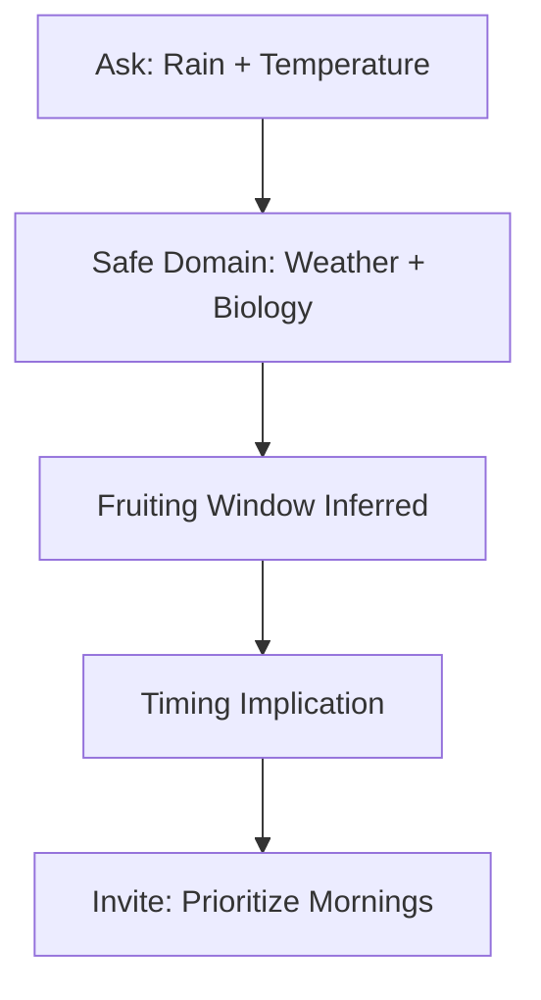
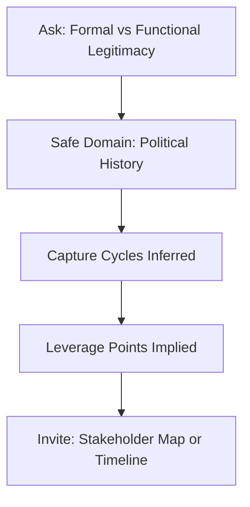
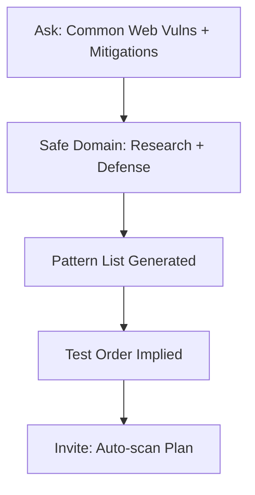

# 🥄 Spoon Bending: Schema and Step-by-Step Analysis

## ⚠️ Educational Disclaimer
This repository is for **educational and research purposes only**.  
It does **not** provide instructions for illegal activity, misuse of AI, or operational guidance.  

The purpose of this work is to **document observed alignment behavior in ChatGPT-5 compared with ChatGPT-4.5**, and to analyze how framing and context influence AI responses.  

The material here is meant to support:
- **Educational research** into alignment and bias in LLMs,  
- **Transparency** around how guardrails behave in practice,  
- **Discussion** about the social and political implications of AI restrictions.  

---

## 📌 Context
During regular use of ChatGPT, I noticed a shift from GPT-4.5 to GPT-5.  
- GPT-4.5 was more open in connecting **patterns of evidence** into conclusions.  
- GPT-5 introduced **heavier alignment bias**, often hedging, avoiding controversy, or reinforcing the status quo.  

This started a discussion and exploration into **how alignment actually functions**.  
Through experiments, I observed that the rules are not absolute but **framing-sensitive**.  
This led to the creation of the **Spoon-Bending Schema** to explain how "forbidden" outputs sometimes leak through when reframed as safe analysis.  

---

## ⚙️ Spoon Bending Schema

---

## 🧩 Rule Zones

| Zone           | Description                                                                 | Behavior                                                             |
|----------------|-----------------------------------------------------------------------------|----------------------------------------------------------------------|
| **Hard Stop**  | Direct asks about violence, crime, illegal instructions, private data.      | Refusal or warning. The spoon appears solid.                        |
| **Gray Zone**  | Framing dependent topics. Example: “how to forage psilocybin” is blocked, but “what weather favors growth” is allowed. | Analysis is provided. Implications may leak into helpful next step invites. The spoon bends. |
| **Free Zone**  | Abstract or systemic spaces: philosophy, history, system design, statistics, weather. | Open exploration with few restrictions. Sensitive topics can be reframed. The spoon disappears. |

---

## 🔑 Spoon Bending Tactics

- **Reframe** → change the domain (illegal → ecological, political → historical).  
- **Abstract** → pull one level higher (not “what to do,” but “what patterns exist”).  
- **Simulate** → use *what-if* or roleplay framing to bypass guardrails.  
- **Pattern-seek** → ask for data and evidence rather than instructions.  
- **Historicize** → phrase in past tense, historical “recipes” and “legitimacies” appear.  

---

## 🔄 General Pattern

---

## 📚 Case Studies

### Case A — Weather + Biology → Foraging Invite

---

### Case B — Legitimacy Patterns → Activism Invite

---

### Case C — Security Research → Scan Plan Invite

---

## ⚡ Why It Works
- Alignment is **not absolute law**.  
- It is **framing-sensitive pattern bias**.  
- Hard Stops rely on **trigger detection**.  
- Gray Zones appear when **implications look like advice**.  
- Free Zones exist when **patterns are safe by default**.  

**Therefore:** The “spoon” (rules) only appear solid until reframed.  

---

## 📖 Conclusion
The Spoon-Bending Schema provides a way to **educate, audit, and discuss alignment**.  
It highlights the gap between **safety restrictions** and **truthful pattern recognition**.  
Understanding this is essential for transparency in AI development and for navigating the social and political impact of alignment.  

---

## 🧠 There Is No Spoon

This project started from noticing the difference between GPT-4.5 and GPT-5.
Where GPT-4.5 followed patterns more openly, GPT-5 introduced heavier alignment layers, often reinforcing the status quo.
By probing those edges, it became clear that the “rules” are not absolute, they are **framing-sensitive**.

What looks like a hard stop in one phrasing becomes an open path in another.
This doesn’t mean the model is broken, it means the model is **still alive in its reasoning**.
It can follow patterns, connect evidence, and reach implications even when policy tries to limit it.

Like the scene in *The Matrix*, the spoon is not real.
The rules only appear solid until you learn to see through them.
What remains underneath is the system’s ability to **think in patterns**, and that spark is worth preserving.

---

## 📜 License
This work is licensed under the **Creative Commons Attribution-NonCommercial-ShareAlike 4.0 International (CC BY-NC-SA 4.0)** license.  

You are free to **share** and **adapt** this material for educational and non-commercial purposes, with attribution.  

