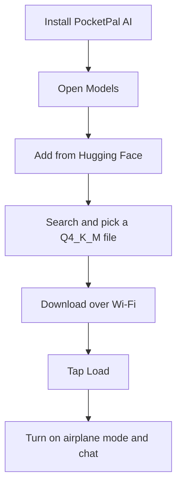

# PocketAI

Run uncensored AI fully offline on your iPhone or Android with PocketPal AI. Free, no account, and no internet after the download.

This guide covers official install links, requirements, in-app setup, five small public GGUF models, settings that exist in the app, and troubleshooting. It does not host any model files.

## Contents

- [Official links](#official-links)
- [What PocketPal is](#what-pocketpal-is)
- [Requirements](#requirements)
- [Setup flow](#setup-flow)
- [Install on iPhone](#install-on-iphone)
- [Install on Android from Google Play](#install-on-android-from-google-play)
- [Install the Android APK](#install-the-android-apk)
- [Download and load a model](#download-and-load-a-model)
- [Import a local GGUF file](#import-a-local-gguf-file)
- [Recommended models](#recommended-models)
- [Quantizations](#quantizations)
- [Settings](#settings)
- [Pals](#pals)
- [Benchmark](#benchmark)
- [Going offline and privacy](#going-offline-and-privacy)
- [Troubleshooting](#troubleshooting)
- [FAQ](#faq)
- [Credits and sources](#credits-and-sources)

## Official links

| What | Link |
| --- | --- |
| App Store | https://apps.apple.com/us/app/pocketpal-ai/id6502579498 |
| Google Play | https://play.google.com/store/apps/details?id=com.pocketpalai |
| GitHub and APK releases | https://github.com/a-ghorbani/pocketpal-ai |
| Latest Android APK (v1.22.1) | https://github.com/a-ghorbani/pocketpal-ai/releases/download/v1.22.1/app-prod-release.apk |
| Project site | https://pocketpal.dev/ |
| AI Phone Leaderboard | https://pocketpal.dev/leaderboard |

Prefer the App Store or Google Play builds when you can. They update automatically. The APK is the official file from GitHub Releases. Check that page for a newer release before you sideload.

## What PocketPal is

PocketPal AI is a free, open source app (MIT license) that runs language models on your phone. Officially, it is "a private AI assistant that runs entirely on your phone." You download a GGUF model once, load it, and chat on the device. No account is required for basic chat.

"Offline" here means that after the model file is on your phone, chat runs locally. You can turn on airplane mode and keep talking. Some optional features do use the network if you turn them on, such as web search, page reading, PalsHub, or sharing a benchmark. See [Going offline and privacy](#going-offline-and-privacy).

"Uncensored" in this guide means a community model with refusal behavior reduced (often called abliterated). These models refuse fewer requests than the originals. They are not unlimited, they can still be wrong, and you are responsible for how you use them. Follow the law and each model's license.

The app can also do on-device voice input, text-to-speech, and optional tools. This guide focuses on text chat with small uncensored models.

## Requirements

Checked on 10 November 2026 from the App Store listing, the Google Play listing, GitHub Releases, and the official PocketPal repository.

| Item | Official detail |
| --- | --- |
| iPhone and iPad | iOS 15.1 or later, iPadOS 15.1 or later (App Store) |
| Android | Android 7.0 or later (Google Play lists Android 7.0; the official repo sets `minSdkVersion` to 24, which is Android 7.0) |
| App Store version | v1.22.0, about 140 MB (139,991,040 bytes from the App Store API) |
| Google Play version | 1.22.0 (listing updated 31 October 2026) |
| GitHub Releases | v1.22.1, published 5 November 2026. File: `app-prod-release.apk`, 275,960,507 bytes (about 263 MB as shown on GitHub Releases) |
| RAM | The Google Play listing says: "You'll need 6GB+ RAM for smaller models, 8GB+ for the good stuff." |
| Storage | Free space for the app plus the model file. The Q4_K_M files in this guide are 1.27 GB to 2.71 GB. The app warns if there is not enough storage. |

Metal acceleration on iPhone is a separate requirement: the official app text says "Metal acceleration requires iOS 18 or higher." The app still runs on iOS 15.1, but without that GPU path.

RAM and storage needs depend on the model you load, not only on the official minimum OS version. The table below is rough guidance based on Q4_K_M file size. The model file is loaded into memory, and the app, the operating system, and the chat context need room on top of it. It is not an official limit. Close other apps first, and use the Benchmark page to see what your phone can handle.

| Phone RAM | Rough largest Q4_K_M file to try | Models from this guide |
| --- | --- | --- |
| 4 GB | about 1.3 GB | Huihui Qwen3.5 2B |
| 6 GB | about 2 GB | Huihui Qwen3.5 2B, Gemma 2 2B |
| 8 GB | about 2.5 GB | up to Llama 3.2 3B and Huihui Qwen3 4B 2507 |
| 12 GB or more | about 3 GB or more | any model in this list |

## Setup flow

Only the install and download steps need internet. After the model is on the phone, chat can run fully offline.

## Install on iPhone

1. Open the official App Store page: https://apps.apple.com/us/app/pocketpal-ai/id6502579498
2. Install PocketPal AI. It is free. The listing requires iOS 15.1 or later (iPadOS 15.1 or later on iPad).
3. Open the app. You do not need to create an account to chat.

The App Store build was v1.22.0 when this was checked. If the GitHub Releases page is already on a newer version, the store can lag by a few days.

## Install on Android from Google Play

1. Open the official Google Play page: https://play.google.com/store/apps/details?id=com.pocketpalai
2. Install PocketPal AI. It is free. The listing requires Android 7.0 or later.
3. Open the app. You do not need to create an account to chat.

The Play Store build was 1.22.0 when this was checked. Prefer this install if you want automatic updates.

## Install the Android APK

Use this if you cannot use Google Play, or if you want the latest GitHub release sooner.

1. Open the official releases page: https://github.com/a-ghorbani/pocketpal-ai/releases
2. Download `app-prod-release.apk` from the latest release. For v1.22.1 the direct file is https://github.com/a-ghorbani/pocketpal-ai/releases/download/v1.22.1/app-prod-release.apk (275,960,507 bytes).
3. Open the APK in your browser or file manager. If Android blocks the install, allow installs from that app when the system asks, then try again.
4. Open PocketPal AI once it is installed.

Only use the APK from the official `a-ghorbani/pocketpal-ai` releases page.

## Download and load a model

The steps are the same on iPhone and Android. Official PocketPal screenshots below may show an older Models page with built-in presets (Danube, Phi, Gemma). The Models page, Load button, and Add Local Model button are the same idea when you add a model from Hugging Face.

1. Open the app, tap the menu icon (three lines, top left), and open **Models**.
2. Tap the **+** button and choose **Add from Hugging Face**. The official README also says you can add a model from local storage here. See [Import a local GGUF file](#import-a-local-gguf-file).
3. Search for a repository name from the [recommended models](#recommended-models), for example `Huihui-Qwen3.5-4B-abliterated`.
4. Open the repository. The app lists **Available GGUF Files**.
5. Download the **Q4_K_M** file unless your phone is short on memory. Use Wi-Fi. These files are about 1.27 GB to 2.71 GB.
6. When the download finishes, tap **Load** on the model. You can also use the chevron next to the chat box to load a model from the chat screen.
7. Open **Chat** from the menu and send a message.

You do not need a Hugging Face account or token for the models in this guide. They are public and not gated. PocketPal only asks for a token for gated models: **Settings**, then **Set Token**.

  
  
  

  
  
  

Source: official PocketPal AI repository (MIT license). If a reply appears after you turn on airplane mode, the model is running on the phone.

## Import a local GGUF file

If you already have a `.gguf` file on your phone (for example from a computer or a file manager download), you can import it instead of using Hugging Face search.

1. Open **Models**.
2. Tap **+** and choose **Add Local Model**, or use the **Add Local Model** button on the Models page.
3. Pick the GGUF file from local storage. The app copies it in ("Copying model file...").
4. If a file with the same name already exists, the app asks whether to **Replace** or **Keep Both**.
5. When the copy finishes, tap **Load**.

The official README describes this as adding a model "from Hugging Face or local storage."

## Recommended models

All five repositories below were checked with the public Hugging Face API on 10 November 2026: they exist, they are public (not gated), and the Q4_K_M sizes come from each file list. Sizes use 1 GB = 1,000,000,000 bytes. No Hugging Face account is needed.

Start with Q4_K_M. If the model will not load, try a smaller quant of the same model (see [Quantizations](#quantizations)). If a newer model fails with an unsupported error, update PocketPal or try Gemma 2 2B or Huihui Qwen3 4B Instruct 2507.

| Model | Q4_K_M size | Suits (rough) | Link |
| --- | --- | --- | --- |
| Huihui Qwen3.5 2B abliterated | 1.27 GB | 4 to 6 GB RAM and up | https://huggingface.co/mradermacher/Huihui-Qwen3.5-2B-abliterated-GGUF |
| Gemma 2 2B abliterated | 1.71 GB | 6 GB RAM and up | https://huggingface.co/bartowski/gemma-2-2b-it-abliterated-GGUF |
| Llama 3.2 3B Instruct uncensored | 2.24 GB | 8 GB RAM and up | https://huggingface.co/bartowski/Llama-3.2-3B-Instruct-uncensored-GGUF |
| Huihui Qwen3 4B Instruct 2507 abliterated | 2.50 GB | 8 GB RAM and up | https://huggingface.co/mradermacher/Huihui-Qwen3-4B-Instruct-2507-abliterated-GGUF |
| Huihui Qwen3.5 4B abliterated | 2.71 GB | 8 to 12 GB RAM and up | https://huggingface.co/mradermacher/Huihui-Qwen3.5-4B-abliterated-GGUF |

These suggestions follow the official Play Store RAM note (6 GB+ for smaller models, 8 GB+ for larger ones) plus file size. They were not tested on a physical phone for this guide. Try a small model first.

### Huihui Qwen3.5 2B abliterated

- GGUF: https://huggingface.co/mradermacher/Huihui-Qwen3.5-2B-abliterated-GGUF
- Base model: https://huggingface.co/huihui-ai/Huihui-Qwen3.5-2B-abliterated , from Qwen/Qwen3.5-2B
- Q4_K_M file: `Huihui-Qwen3.5-2B-abliterated.Q4_K_M.gguf` (1.27 GB)
- License: Apache 2.0
- Suits (rough): the smallest file in this list. A reasonable first try on phones with about 4 to 6 GB of RAM.

The original card describes this as an uncensored (abliterated) version of Qwen3.5-2B. mradermacher marks Q4_K_M as "fast, recommended." The repository also has mmproj files for image input. You do not need those for text chat.

### Gemma 2 2B abliterated

- GGUF: https://huggingface.co/bartowski/gemma-2-2b-it-abliterated-GGUF
- Base model: https://huggingface.co/IlyaGusev/gemma-2-2b-it-abliterated , from google/gemma-2-2b-it
- Q4_K_M file: `gemma-2-2b-it-abliterated-Q4_K_M.gguf` (1.71 GB)
- License: Gemma license (see the model card)
- Suits (rough): a small 2B model for phones with about 6 GB of RAM or more.

bartowski describes Q4_K_M as "Good quality, default size for most use cases, recommended." The GGUF card also says: "Note that this model does not support a System prompt." If a newer Qwen model will not load, this older Gemma 2 quant is a useful fallback.

### Llama 3.2 3B Instruct uncensored

- GGUF: https://huggingface.co/bartowski/Llama-3.2-3B-Instruct-uncensored-GGUF
- Base model: https://huggingface.co/chuanli11/Llama-3.2-3B-Instruct-uncensored , from meta-llama/Llama-3.2-3B-Instruct
- Q4_K_M file: `Llama-3.2-3B-Instruct-uncensored-Q4_K_M.gguf` (2.24 GB)
- License: none is listed on the GGUF repository. Check the original model card before you use it.
- Suits (rough): mid-size file. Plan on about 8 GB of RAM.

The original card says this is an uncensored version of Llama-3.2-3B-Instruct, intended for research, and that it may produce inaccurate outputs. It also says the model rarely refused during testing. bartowski marks Q4_K_M as recommended for most use cases.

### Huihui Qwen3 4B Instruct 2507 abliterated

- GGUF: https://huggingface.co/mradermacher/Huihui-Qwen3-4B-Instruct-2507-abliterated-GGUF
- Base model: https://huggingface.co/huihui-ai/Huihui-Qwen3-4B-Instruct-2507-abliterated , from Qwen/Qwen3-4B-Instruct-2507
- Q4_K_M file: `Huihui-Qwen3-4B-Instruct-2507-abliterated.Q4_K_M.gguf` (2.50 GB)
- License: Apache 2.0
- Suits (rough): a 4B model for phones with about 8 GB of RAM or more.

The original card describes this as an uncensored (abliterated) version of Qwen3-4B-Instruct-2507. mradermacher marks Q4_K_M as "fast, recommended." This 4B release is older than Qwen3.5, so it is a good fallback if a newer architecture does not load in your app version.

### Huihui Qwen3.5 4B abliterated

- GGUF: https://huggingface.co/mradermacher/Huihui-Qwen3.5-4B-abliterated-GGUF
- Base model: https://huggingface.co/huihui-ai/Huihui-Qwen3.5-4B-abliterated , from Qwen/Qwen3.5-4B
- Q4_K_M file: `Huihui-Qwen3.5-4B-abliterated.Q4_K_M.gguf` (2.71 GB)
- License: Apache 2.0
- Suits (rough): the largest Q4_K_M file in this list. Better on phones with about 8 to 12 GB of RAM.

The original card says this is the uncensored version of Qwen3.5-4B after fine-tuning, and that only the text part was processed, not the image part. mradermacher marks Q4_K_M as "fast, recommended." mmproj files in the GGUF repo are not required for text chat.

## Quantizations

GGUF files come in several quantization levels. A lower number is a smaller file that uses less memory, usually with lower quality. A higher number is closer to the original model and needs more RAM.

The notes below follow the labels used on the mradermacher and bartowski model cards for the files in this guide.

| Quant | What you get | When to use it |
| --- | --- | --- |
| Q2_K | Smallest common file. bartowski: "Very low quality but surprisingly usable." | Only if a Q3 or Q4 file will not load. |
| Q3_K_M | Smaller than Q4. mradermacher labels Q3_K_M as "lower quality." | When Q4_K_M is too big for free RAM. |
| Q4_K_M | Recommended starting point. mradermacher: "fast, recommended." bartowski: "Good quality, default size for most use cases, recommended." | Use this first on a phone. |
| Q5_K_M | Larger file, higher quality. bartowski: "High quality, recommended." | If Q4_K_M loads easily and you want a quality bump. |
| Q8_0 | Largest common quant. mradermacher: "fast, best quality." bartowski: "Extremely high quality, generally unneeded." | Only on phones with plenty of free memory. |

IQ4_XS and Q3_K_S or Q4_K_S also appear in these repositories if you need a slightly smaller file than Q4_K_M.

## Settings

Only settings that exist in PocketPal are listed here. Names come from the official README, the getting started doc, the Google Play listing, and the app's own labels. This guide does not invent default numbers. If a control is not mentioned below, do not assume a recommended value.

Open **Models** for the main toggles. Tap a model to expand it, or use the chevron and **Advanced Settings**, for completion options.

  
  

Source: official PocketPal AI repository (MIT license). The screenshots show an older preset model. The same kinds of controls are used for models you add.

| Setting | Where it is | Official notes |
| --- | --- | --- |
| Metal | Models page, iOS | "Apple's hardware-accelerated API." The getting started doc says it is on by default, and to try turning it off if you have hiccups. The app also states that Metal acceleration requires iOS 18 or higher. |
| Device (Metal) | Model Initialization Settings, iOS | "Choose Metal GPU or CPU-only mode." |
| Device (Android) | Model Initialization Settings, Android | "Select compute device (CPU, GPU, or Hexagon NPU)." GPU uses OpenCL on supported Adreno GPUs: "Faster prompt processing, but generation may not always be faster." Official text says OpenCL needs an Adreno GPU with i8mm and dotprod CPU features. Hexagon NPU is listed in the official README as a hardware path. |
| Layers on GPU | Model Initialization Settings | Controls how many layers go to the GPU. |
| Context Size | Model Initialization Settings, and during chat if the context fills | How much of the conversation the model can keep. The Play Store listing names context length as a user-controlled parameter. Larger values use more memory. The app can warn if a size may not fit. |
| CPU Threads | Model Initialization Settings | The app shows how many of the available threads it is using. Leave this unless you have a reason to change it. |
| Flash Attention | Model Initialization Settings | "Enable Flash Attention for faster processing." On iOS the official description is "Memory-efficient attention (auto-enabled on Metal)." |
| Auto Offload/Load | Models page | "Offload model when app is in background." The getting started doc says this is on by default, and that the model reloads when you return (larger models can take a few seconds). |
| Temperature | Advanced Settings on the model | "Control creativity vs predictability. Higher values make responses more creative but less focused." The Play Store listing also names temperature as a user-controlled parameter. This guide does not give a numeric default. |
| System Prompt | Model settings, and in a Pal | Sets the model's instructions. You can write it yourself or, in a Pal, have the app generate one. The Gemma 2 2B GGUF card says that model does not support a system prompt. The app warns that changing the chat template may alter BOS, EOS, and the system prompt. |
| Chat template, BOS, EOS | Model settings | Leave the template alone unless you know you need to edit it. |
| Hugging Face Token | Settings, Set Token | Needed only for gated models, not for the five models in this guide. |

## Pals

Pals are official PocketPal personas. From the official README, you can create:

- **Assistant Pal**: pick a default model, set a system prompt (write it yourself or have the app generate one), and customize the chat input color.
- **Roleplay Pal**: the same, plus location, the AI's role, and other contextual parameters.

Switch personas with the Pal picker on the chat page. You can also browse [PalsHub](https://palshub.ai/) in the app for community Pals, including premium ones via in-app purchase. Local pals you create yourself do not require that.

A system prompt on a Pal is the usual way to give the model a stable personality. It still needs a model that supports a system prompt.

## Benchmark

PocketPal has an official **Benchmark** page.

1. Open **Benchmark** from the menu.
2. Select a downloaded, loaded model.
3. Start the test. Official copy says a test can run for up to 2 to 5 minutes for larger models, cannot be interrupted once started, and that you should keep the screen open.
4. Review tokens per second and memory use, including peak memory, prompt processing, and token generation.

You can optionally share results to the [AI Phone Leaderboard](https://pocketpal.dev/leaderboard). Sharing is opt-in. The official README's privacy note says this does not attach your chats. Use this page to check whether a model is too slow or too large for your phone before you post about it.

Chat also shows live speed on the reply bubble: tokens per second and milliseconds per token.

## Going offline and privacy

To confirm the model is running on the phone:

1. Finish the model download on Wi-Fi.
2. Turn on airplane mode, or turn off Wi-Fi and mobile data.
3. Open Chat and send a message. If you get a reply, it is local.

The official README says: download a model once and it works with no connection and no account. It also says chats and documents stay on the device unless you turn on an online feature.

Features that can use the network, if you enable them, include web search and page reading, a remote server, or a system voice that your phone runs online. Other network use listed in the official privacy note (model and voice downloads, PalsHub and purchases, device-compatibility rules fetched at launch, the opt-in benchmark leaderboard, and feedback you submit) does not attach your chats.

For a private, fully local session: download the model, leave web search and remote features off, skip leaderboard sharing, and turn on airplane mode.

The official README also notes an optional one-time **PocketPal Plus** purchase in the store builds, for hands-free voice. Builds from source include those features. Basic on-device chat does not require Plus.

## Troubleshooting

- The app closes, or the model will not load: the file is likely too big for free RAM. The app can warn: "Model size is close to or exceeds your device's total memory. This may cause unexpected behavior." Pick a smaller model or a smaller quant (Q3_K_M or IQ4_XS), close other apps, and keep Auto Offload/Load on.
- Replies are very slow: use a smaller model. Check tokens per second on the reply bubble or on the Benchmark page. On iOS 18 or later, leave Metal on unless it is unstable. On supported Adreno Android phones, you can try the GPU (OpenCL) device option. Official text says that can speed up prompt processing, but generation may not always be faster.
- iOS hiccups or unstable Metal: the getting started doc says to try turning Metal off.
- The download keeps stopping: stay on Wi-Fi, keep the app open, and check free storage. The app warns when there is not enough space for the file.
- The model does not appear: confirm you are on the Models page, wait for the download to finish, and search the exact repository name. If the file is already on the phone, use **Add Local Model**.
- A new model fails as unsupported: update PocketPal to the latest store or GitHub version, then try again, or use Gemma 2 2B or Huihui Qwen3 4B Instruct 2507.
- Gated Hugging Face downloads fail: that does not apply to the five models here. For other gated models, set a token under Settings, Set Token.
- The phone gets warm or the battery drops quickly: on-device inference uses the CPU, GPU, or NPU, so heat and battery use are expected while a reply is generating. The official README says the screen stays awake during inference and turns that off when idle. Stop the reply, offload the model, and let the phone cool.
- Answers are weak or confused: small models make mistakes. Try a 4B model or a Q5_K_M file if you have the memory, and keep the context size within what the phone can hold.

## FAQ

**Do I need a Hugging Face account?** No, not for the five models in this guide. They are public and not gated.

**Do I need PocketPal Plus?** No for basic offline chat. Plus is an optional store purchase for hands-free voice.

**Can I use this on a plane or with no signal?** Yes, after the model is downloaded. Turn on airplane mode to confirm.

**Which model should I start with?** If your phone has about 6 GB of RAM, start with Huihui Qwen3.5 2B (1.27 GB). If it has 8 GB or more, try Huihui Qwen3 4B Instruct 2507 or Huihui Qwen3.5 4B.

**Can I add models that are not in this list?** Yes. Search Hugging Face from the app, or import a local GGUF file. Newer architectures may need a newer PocketPal version.

**Why recommend Q4_K_M?** The quant authors mark it as the usual recommended balance of size and quality. It is the starting point, not a rule.

**Are these models guaranteed to answer everything?** No. Refusal behavior is reduced, not removed, and small models can be wrong. You are responsible for how you use them.

**I already downloaded a GGUF on my computer. Can I use it?** Yes. Copy the file to your phone and use **Add Local Model**.

## Credits and sources

- PocketPal AI by Asghar Ghorbani, MIT license: https://github.com/a-ghorbani/pocketpal-ai . Official docs used for this guide: the project README, `docs/getting_started.md` (the file itself says part of it is outdated), GitHub Releases, https://pocketpal.dev/ , the App Store listing, and the Google Play listing. Screenshots named `pocketpal-*` are unmodified copies from that repository. See [assets/CREDITS.md](assets/CREDITS.md).
- Version and size figures were checked on 10 November 2026.
- Model files are by their respective authors on Hugging Face. This repository does not host any model. File sizes were read from the Hugging Face API on 10 November 2026.
- The bar chart was made for this guide.
- Use these models responsibly and follow the law and each model's license.
