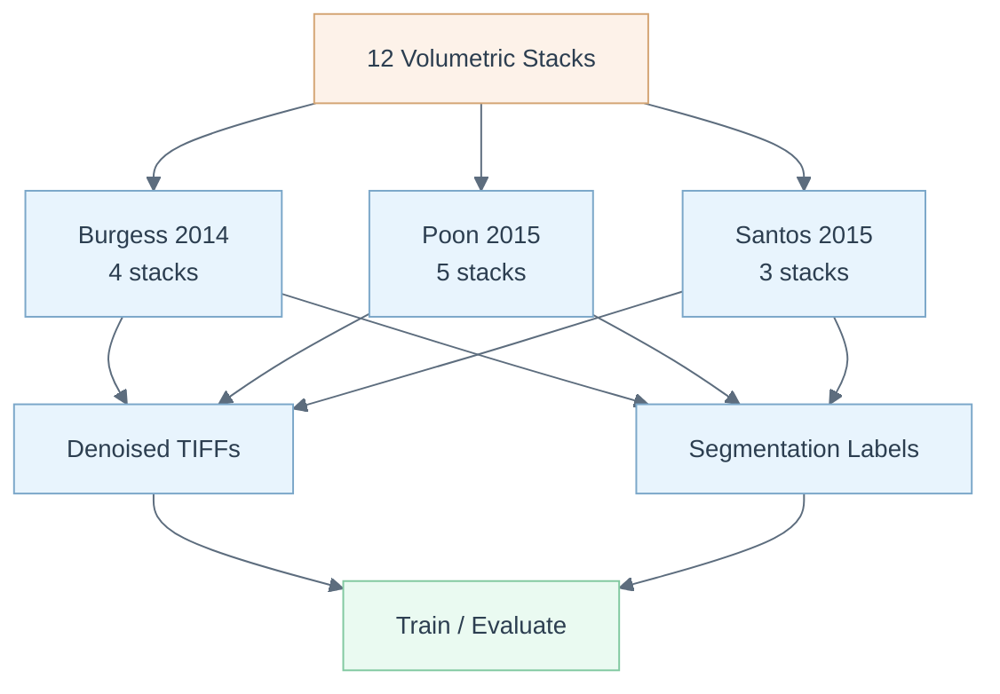

# vesselNN Dataset

> Open-source volumetric brain vasculature dataset -- 12 two-photon microscopy stacks with dense voxel-level segmentation labels, companion data to [Teikari et al. (2016)](https://arxiv.org/abs/1606.02382).



## Overview

This repository provides 12 volumetric two-photon microscopy stacks of mouse brain vasculature with dense voxel-level segmentation labels. The data was acquired at the [Focused Ultrasound Lab](http://sunnybrook.ca/research/content/?page=sri-groups-fus) at Sunnybrook Research Institute (University of Toronto) using an Olympus FV1000MPE multiphoton microscopy system.

The dataset spans three acquisition campaigns covering diverse vascular morphologies: normal brain vasculature, blood-brain barrier disruption models, and tumor vasculature. Each stack is provided as a BM4D-denoised multi-layer 8-bit TIFF along with its corresponding manual segmentation label volume, making the data immediately usable for training and benchmarking volumetric segmentation methods.

This dataset was designed as the companion data for the [vesselNN](https://github.com/petteriTeikari/vesselNN) segmentation framework.

## Key Features

- 12 volumetric stacks with paired input/label volumes
- Dense voxel-level manual segmentation annotations
- BM4D denoising applied to raw Poisson-corrupted acquisitions
- Three distinct vascular morphology categories (normal, BBB disruption, tumor)
- Pre-computed VD2D and VD2D3D experiment outputs for the recursive segmentation pipeline
- Acquisition metadata in XML format for all stacks

## Dataset Contents

| Source | Stacks | Description |
|--------|--------|-------------|
| Burgess 2014 | 4 | BBB disruption, sparse vessels, transgenic mouse, low-resolution high-SNR |
| Poon 2015 | 5 | BBB leakage/no-leakage, mixed-size vessels, plaque vasculature |
| Santos 2015 | 3 | Low-contrast vessels, mixed-size low-contrast, tumor vasculature |

## Project Structure

```
vesselNN_dataset/
├── denoised/          # BM4D-denoised input stacks (8-bit multi-layer TIFF)
├── labels/            # Voxel-level dense segmentation labels
├── metadata/          # Acquisition metadata (XML)
└── experiments/
    ├── VD2D_tanh/     # Stage 1 outputs from VD2D recursive framework
    └── VD2D3D_tanh/   # Stage 2 outputs from VD2D3D framework
```

## Quick Start

```bash
# Clone the dataset
git clone https://github.com/petteriTeikari/vesselNN_dataset

# Load a stack in Python
from tifffile import imread

volume = imread("denoised/burgess2014_bbbDisruption_BM4D_denoised.tif")
labels = imread("labels/burgess2014_bbbDisruption_labels_v1.tif")

print(volume.shape, labels.shape)
```

## Citation

```bibtex
@article{teikari2016deep,
  title={Deep Learning Convolutional Networks for Multiphoton Microscopy
         Vasculature Segmentation},
  author={Teikari, Petteri and Santos, Marc and Poon, Charissa and Hynynen, Kullervo},
  journal={arXiv preprint arXiv:1606.02382},
  year={2016}
}
```

## License

MIT
