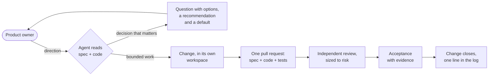

<div align="center">

# Product-Kit

### One short, current spec of what your product must be.<br>Your coding agent changes it together with the code.

[](LICENSE)
[](CHANGELOG.md)
[](#status)

<sub>Written for people. Kept current by agents.</sub>

<br>

[Compared](#compared) · [What each area gets](#what-each-area-gets) · [How it works](#how-it-works) · [Works for you?](#works-for-you) · [Quick start](#quick-start) · [FAQ](#faq)

</div>

<br>

In many teams, the answer to *"what is this product supposed to be?"* lives in people's heads, old documents, tickets and chats. Coding agents raise the stakes: they change code quickly, and each new session starts without that context.

Product-Kit keeps the answer in one short spec inside the repository: the problem, who it's for, the user journeys, what must be true, how the system is built, and the bet you're making. People own it. Agents read it before a change and update it in the same pull request, so it stays current.

## Compared

|                          | No shared spec                        | [Spec Kit](https://github.com/github/spec-kit) (spec-driven development)            | Product-Kit                                                                  |
| ------------------------ | ------------------------------------- | ------------------------------------------------------------------------------------ | ---------------------------------------------------------------------------- |
| **The spec's job**       | —                                     | Drive the build: spec → plan → tasks → code                                          | Give direction; code and tests stay the exact implementation                 |
| **Scope**                | —                                     | One feature at a time, under a project constitution                                  | The whole product, from user journeys to the system's parts                  |
| **After a change ships** | Docs get updated if someone remembers | The team's choice: keep the feature folder as history, or edit the spec and regenerate plan and tasks | The spec changes in the same pull request; the change leaves one log line |
| **Finished means**       | The team's judgment                   | Converge reports no gaps against the feature's spec                                  | Evidence: a version, an environment and a run                                |
| **Your role**            | Explain the context to each session   | Review each step's output before the next                                            | Answer the questions that change the outcome                                 |

<sub>Spec Kit compared as of 2026-10-22.</sub>

## What each area gets

|                 |                                                                                                                          |
| --------------- | ------------------------------------------------------------------------------------------------------------------------ |
| **Leadership**  | ✅ One page on what the product is, who it's for and the bet behind it, including the signal that would prove the bet wrong. |
| **Product**     | ✅ Direction kept in your own words. Questions come back only when the answer changes the outcome, each with options and a recommendation. After release, outcomes can be checked against the bet. |
| **Engineering** | ✅ Architecture and decisions, with the alternatives that were rejected, in one place. Spec, code and tests change in one pull request, with review sized to risk. |
| **QA**          | ✅ User journeys with scenarios, variations and success criteria. Tests cite the IDs they prove; done needs evidence.     |
| **Agents**      | ✅ Short, current context to work from, and written rules on what they may do.                                           |
| **Design**      | ⚠️ User journeys, personas and the surfaces they use, but no visual design or UI specs.                                 |

## How it works



```text
You:    Users need to see which requests need their attention.
Agent:  Individual users or team coordinators? I recommend individuals and will assume that
        if you don't answer.
You:    Individuals.
Agent:  Change 012 adds requirement R-04 with the code. Acceptance A1 passes on staging
        (rev 3f2c1ab, run link); live usefulness is still unmeasured.
```

1. **Narrow, don't compile.** The spec rules out expensive wrong choices and never aims to be complete; code and tests are the exact implementation.
2. **Journeys first.** Every requirement and every part of the architecture names the user journeys it serves.
3. **People own intent.** The agent asks with a recommendation and a default, keeps answers verbatim, and never grants itself more scope, attempts or permission.
4. **Evidence or unknown.** "Done" names a revision, an environment and a run; without them a claim stays unknown.
5. **Short by design.** Every file has a reading budget and a place to grow. The spec explains the system; git, pull requests and CI explain the work.

## Works for you?

|                            |                                                                                                       |
| -------------------------- | ----------------------------------------------------------------------------------------------------- |
| **Cost**                   | ✅ Free (MIT)                                                                                         |
| **Setup**                  | ✅ Git, Bash and a named product owner                                                                |
| **Existing code**          | ✅ Starts from what's true today                                                                      |
| **Parallel work**          | ✅ Each change in its own worktree                                                                    |
| **Control**                | ✅ Written policy for merge, release, deploy and spend; review can be checked in CI                   |
| **Data**                   | ✅ Stays in your repo; no service, no account                                                         |
| **Lock-in**                | ✅ Low: plain Markdown                                                                                |
| **Large products**         | ⚠️ Designed for it (layered spec, agents read only what a change touches), but proven on only a handful of projects |
| **Agents**                 | ⚠️ Installs for Claude Code, OpenCode, Codex and other `AGENTS.md` readers; [real-agent testing](docs/harnesses.md) is still limited |
| **Many repos**             | ⚠️ One spec per repo; a shared interface belongs to the repo that provides it                         |
| **Maturity**               | ⚠️ Experimental: 1.1.1, one maintainer                                                                |
| **Roadmap**                | ⚠️ Lifecycle stages (Idea → MVP → GA) and which journeys belong to each; no dates or timelines        |
| **Ticketing**              | ❌ Not a ticket tracker; the work itself lives in git, pull requests and CI                           |
| **One-off scripts**        | ❌ A spec costs more than it saves                                                                    |

**Try it:** pick one product and give it a few weeks. Install the kit, let the agent draft the spec, and have the owner correct it.

<br>

---

<div align="center">

### Setup and reference

</div>

## Quick start

**Requires** Git and Bash.

**1. Ask your agent to set it up.** From your project root, give your coding agent this:

```text
Add Product-Kit (https://github.com/pevyhlas/product-kit) to this repository as a git
submodule at .product-kit, pinned to tag v1.1.1, and run .product-kit/scripts/init.sh.
Then adopt it by following .prdkit/workflows/init.md.
```

The agent installs the kit, reads your repository, fills in the project constitution and writes a first spec of what is true now. Anything it inferred is marked `hypothesis`.

**2. Answer the inbox.** Open questions land in `specs/inbox.md`, each with options and a recommendation; answer with a number or in your own words. Then read `specs/product.md` and `specs/architecture.md`, correct what's wrong, and commit. Changes start from the current commit, so commit before the first one.

**3. Work.**

| You type                      | The agent                                                              |
| ----------------------------- | ---------------------------------------------------------------------- |
| `/prdkit <outcome>`           | Routes it: answers from the spec, records direction, or opens a change |
| `/prdkit --explore <idea>`    | Discusses options; edits nothing                                       |
| `/prdkit --plan <outcome>`    | Writes a change record, no code                                        |
| `/prdkit --execute <outcome>` | Runs the bounded change                                                |
| `/prdkit continue`            | Resumes from the change's State and the actual repository              |
| `/prdkit-status`              | Shows what's true now, in flight, live, held and waiting on the owner  |

```text
/prdkit Help define the first useful release of this product.
/prdkit --explore Would collaboration actually help our current users?
/prdkit Let users see their unresolved requests.
```

<details>
<summary><b>Install manually</b></summary>

<br>

```bash
git submodule add https://github.com/pevyhlas/product-kit .product-kit
git -C .product-kit checkout v1.1.1
bash .product-kit/scripts/init.sh
```

Then run `/prdkit-init` in your agent session.

</details>

<details>
<summary><b>Choose your agent harness</b></summary>

<br>

```bash
bash .product-kit/scripts/init.sh --harness claude,opencode
```

| `--harness`        | Installs                                                |
| ------------------ | ------------------------------------------------------- |
| `claude`           | `/prdkit-*` commands in `.claude/commands/`             |
| `opencode`         | `/prdkit-*` commands in `.opencode/commands/`           |
| `codex` / `agents` | A managed `AGENTS.md` section pointing to the playbooks |
| `all`              | All of the above                                        |

A fresh install defaults to `claude` + `agents`, and adds `opencode` or `codex` when the project already uses them. With no slash commands at all, ask the agent to read `.prdkit/workflows/protocol.md`. See [harness support](docs/harnesses.md) for what is tested.

</details>

<details>
<summary><b>What the installer adds to your repo</b></summary>

<br>

| Path | Contents |
| --- | --- |
| `.claude/commands/`, `.opencode/commands/` | `/prdkit-*` commands (copied; `--symlink` to link them into the kit instead) |
| `AGENTS.md` | A section between markers; your own text is never touched |
| `.prdkit/workflows/` | Neutral playbooks every agent can follow |
| `.prdkit/templates/`, `.prdkit/scripts/bash/` | Spec templates and helper scripts |
| `.prdkit/memory/` | Your settings: `constitution.md`, `agents.md`, `config.md`, `task-ledger.md` |
| `.prdkit/.manifest` | Version, harnesses and file hashes, so upgrades know what you edited |
| `.gitignore` | `.prdkit/ledger/`, `.prdkit/cache/`, `.prdkit/retrospective/`, `.worktrees/` |

`specs/` is yours. The installer never creates or edits anything there.

</details>

<details>
<summary><b>CI gates and review tiers</b></summary>

<br>

```bash
bash .prdkit/scripts/bash/check-adoption.sh    # pinned kit version and install integrity
bash .prdkit/scripts/bash/doctor.sh --strict   # spec integrity, reading budgets, agent context size
```

`check-review.sh` verifies, on a change branch, that the recorded review verdicts cover the exact head being merged. It checks the record; it doesn't review. See [CI gates](docs/ci-gates.md).

| Tier | When                                           | Independent reviewers        |
| ---- | ---------------------------------------------- | ---------------------------- |
| T0   | Docs only, no behavior change                  | None                         |
| T1   | Inside one part, no interface change           | 1                            |
| T2   | Several parts, an interface, security or data  | 1 per applicable concern     |
| T3   | Product (L0) edit or architecture one-way door | Design review plus the owner |

</details>

<details>
<summary><b>Upgrade</b></summary>

<br>

```bash
git -C .product-kit fetch --tags && git -C .product-kit checkout vX.Y.Z
bash .product-kit/scripts/init.sh --check     # read-only drift report
bash .product-kit/scripts/init.sh --upgrade
```

Kit-owned commands and scripts are refreshed, templates and memory you edited are kept, and `specs/` is never touched. Each [CHANGELOG](CHANGELOG.md) entry says what else to do.

</details>

## The spec

One spec in three levels, each opening with a one-page summary that links its detail:

```text
L0  specs/product.md            one page: stage, pains, personas, core loop, journeys, the bet
    specs/product/journeys/     one file per journey (J): who, intent, scenario, variations
    specs/product/*.md          requirements (R), qualities (Q), constraints (C), non-goals (N)
    specs/product/lifecycle.md  the stage now: Idea, Demo, MVP, previews, GA, Sunset, Retired
L1  specs/architecture.md       one page: diagram, parts and why, core loop, key decisions
    specs/architecture/         decisions (D) and topics: security, observability, data, ...
L2  specs/parts/<part>.md       one box: why it exists, components, behaviors, invariants
    code and tests              the exact implementation; tests cite the IDs they prove
```

Around it: open changes in `specs/changes/` (deleted when they close), one line per closed change in `specs/log.md`, owner direction and open questions in `specs/inbox.md`, and holds, waivers and deployments in `specs/records.md`. A small project can keep everything in one `specs/SPEC.md`.

<details>
<summary><b>Example: a product page and a journey</b> (from <a href="examples/request-service"><code>examples/request-service</code></a>)</summary>

<br>

`specs/product.md`, trimmed:

```markdown
# Request service

Requesters in one organization see their request's status and resolution
without chasing an operator.

**Stage**: Idea · next: MVP

## Problem

| Pain today                                 | Evidence | Solved by |
|--------------------------------------------|----------|-----------|
| No status after submitting                 | assumed  | J-01      |
| Operators answer the same update questions | assumed  | J-01      |

## What must be true

- A requester submits once and always sees the current status (R-01, Q-01).
- Only the requester and operators see the resolution (R-02).
- Sign-in is the organization's own (C-01); no routing rules or analytics yet (N-01).

## The bet

Requesters who can see status stop asking operators for updates.
Wrong if update requests do not fall after release.
```

`specs/product/journeys/j-01-get-a-request-handled.md`, trimmed:

```markdown
# J-01 Get a request handled (hypothesis, from: mvp)

**Who**: requester · **Area**: requests · **Surfaces**: web page

## Scenario
1. Submits a request: what they need and by when.
2. Sees it listed as received.
3. Checks back later and sees its status; an operator is on it.
4. Reads the resolution when it is resolved.

## Variations
- **Signed out**: signs in with the organization's account and lands back on the request.
- **Another requester's request**: sees nothing of it.

## Success
The requester gets the resolution without asking for an update.
```

</details>

## All commands

| Command             | Purpose                                                                        |
| ------------------- | ------------------------------------------------------------------------------ |
| `/prdkit`           | Turn a request into a change, continue an open change, or answer from the spec |
| `/prdkit-status`    | Generated view: true now, in flight, live, held, owner queue, longest pole     |
| `/prdkit-product`   | Shape or edit product intent (L0), with the owner's words quoted               |
| `/prdkit-target`    | Plan a programme: a parent change with child changes and owner gates           |
| `/prdkit-learn`     | Evaluate outcomes against the thesis, qualities and hypotheses                 |
| `/prdkit-init`      | Adopt the kit, or cut a 0.x project over to the 1.1 layout                     |
| `/prdkit-configure` | Constitution, action policy, capabilities and settings                         |
| `/prdkit-doctor`    | Read-only diagnosis of layout, budgets, IDs, records and agent context         |

Behind each command the agent follows a [playbook](workflows/README.md). See the [command reference](docs/commands.md) and the [agent workflow](docs/agent-workflow.md).

## FAQ

<details>
<summary><b>Do we need coding agents to use it?</b></summary>

<br>

The spec is plain Markdown that anyone can read and edit, and it's useful on its own. Keeping it current is the hard part, and Product-Kit is designed for agents to do that with every change. Without an agent you can still use the templates and the `status` and `doctor` scripts, but the upkeep is on you.

</details>

<details>
<summary><b>Does anyone have to write the spec by hand?</b></summary>

<br>

No. The agent drafts and maintains it; people answer questions and review the one-page summaries. Product-level edits quote the owner's own words.

</details>

<details>
<summary><b>Can we pause an agent mid-change?</b></summary>

<br>

Yes. Ask for a hold; it's recorded in `specs/records.md` and stays in force until the owner lifts it. `/prdkit continue` resumes later from the change's recorded state.

</details>

<details>
<summary><b>Our agents already manage worktrees (Claude Code, Codex, Cursor).</b></summary>

<br>

Pick one owner per change: the kit creates the worktree, or open changes with `--no-worktree` and let the agent tool handle isolation. See [worktrees across harnesses](docs/harnesses.md#worktrees-across-harnesses).

</details>

<details>
<summary><b>Coming from Product-Kit 0.x?</b></summary>

<br>

Upgrade, then run one cutover between changes with `/prdkit-init`. See [migrating to 1.0](docs/migrating-to-1.0.md).

</details>

## Learn more

[Getting started](docs/getting-started.md) · [Human workflow](docs/human-workflow.md) · [Agent workflow](docs/agent-workflow.md) · [Commands](docs/commands.md) · [CI gates](docs/ci-gates.md) · [Harnesses](docs/harnesses.md) · [Customization](docs/customization.md) · [Adoption](docs/adoption.md) · [Example project](examples/request-service)

## Status

⚠️ **Experimental.** One maintainer builds Product-Kit and uses it on a handful of projects. Interfaces can change between releases; each [CHANGELOG](CHANGELOG.md) entry says how to upgrade.

## Contributing

```bash
bash tests/run.sh
```

jq 1.6+ is needed for the optional-enrichment tests; CI adds ShellCheck. [Behavioral evals](tests/evals/README.md) run real agents locally.

Issues and draft pull requests are welcome; only the maintainer merges. See [CONTRIBUTING.md](CONTRIBUTING.md), [SECURITY.md](SECURITY.md) and the [code of conduct](CODE_OF_CONDUCT.md).

## License

[MIT](LICENSE). Product-Kit originates from GitHub's [Spec Kit](https://github.com/github/spec-kit); its notice is in [THIRD_PARTY_NOTICES.md](THIRD_PARTY_NOTICES.md).
