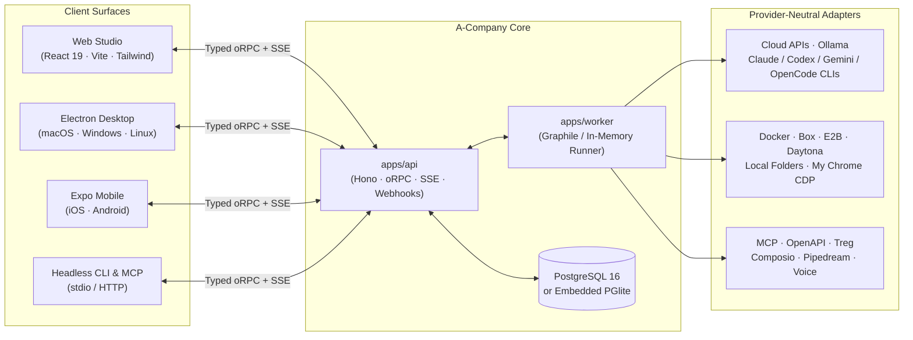

<div align="center">


<br />

# A-Company

**Self-hosted AI teammates across Web, Desktop, and Mobile.**  
Persistent bots with live computers, scheduled routines, interactive chat mini-apps, token spend caps, and portable Markdown blueprints.  
Run with your own model API keys, zero-cost local subscription CLIs, or embedded PGlite — **100% Apache-2.0**.

<p>
  <a href="https://github.com/phuocka/a-company/stargazers"></a>
  <a href="https://github.com/phuocka/a-company/releases/latest"></a>
  <a href="LICENSE"></a>
  <a href="#zero-docker-quick-start-embedded-pglite"></a>
</p>

<p>
  <a href="#why-a-company"><strong>Why A-Company</strong></a> ·
  <a href="#zero-docker-quick-start-embedded-pglite"><strong>5-Min Quick Start</strong></a> ·
  <a href="#product-tour"><strong>Product Tour</strong></a> ·
  <a href="#architecture"><strong>Architecture</strong></a> ·
  <a href="#published-docker-images-server--vps"><strong>Docker Installers</strong></a> ·
  <a href="#automation-headless-cli--mcp-server"><strong>CLI &amp; MCP</strong></a> ·
  <a href="#documentation"><strong>Docs</strong></a>
</p>

</div>

---

## Why A-Company

Most AI tools trap your prompts, memory, and workflows inside a single vendor tab. **A-Company** turns AI agents into durable teammates that live on infrastructure you own:

| Capability | What you get |
| --- | --- |
| **Web · Electron · Expo Mobile** | One shared Hono + oRPC API across browser, macOS/Windows/Linux desktop, and native iOS/Android. |
| **100% Apache-2.0 Open Source** | Complete multi-user, worker, team-computer, and connector stack with no locked `enterprise/` tier. |
| **Zero-Docker Lite Mode** | Launch locally in under a minute via `pnpm dev:lite` with embedded PostgreSQL (**PGlite**) and local host folders. |
| **Provider-Neutral + Local CLIs** | Connect cloud APIs via Pi, point to Ollama/LM Studio, or reuse local **Claude Code**, **Codex**, **Gemini CLI**, and **OpenCode** logins at zero extra API cost. |
| **Shared & Private Computers + My Chrome** | Give bots isolated Docker, E2B, Daytona, or Box Linux desktops, local folders, or attach directly to your signed-in Chrome via CDP (`BROWSER_PROVIDER=my-chrome`). |
| **Interactive Chat Mini-Apps** | Bots call `render_widget` to render sandboxed HTML/CSS/SVG dashboards, calculators, and status boards inline inside chat. |
| **Routines, Spend Caps & Webhooks** | Schedule plain-language routines, enforce daily/monthly token spend caps, and wake bots via `POST /api/v1/bots/:botId/webhook`. |
| **Portable Blueprints & Snapshots** | Spin up **Starter Teams** in one click, commit secret-free `.md` **Team Blueprints** to Git, or export full credential-redacted Workspace JSON backups. |

---

## Zero-Docker Quick Start (Embedded PGlite)

Run the complete A-Company stack on **macOS, Windows, or Linux** without installing Docker or PostgreSQL:

```bash
git clone https://github.com/phuocka/a-company.git
cd a-company
pnpm install
pnpm db:generate
pnpm dev:lite
```

`pnpm dev:lite` boots an in-process PostgreSQL engine (`DATABASE_URL=pglite` persisted under `./data/lite/pglite`), runs all Prisma migrations automatically, starts the background worker + Hono API, and serves the web studio at **`http://127.0.0.1:5173`**.

> **Tip:** If `claude`, `codex`, `gemini`, or `opencode` is installed on your `PATH`, you can pick it immediately during onboarding or in **Settings → Models** — zero API keys required.

---

## Product Tour

### Live 3-Pane Workspace & Interactive Telemetry Widgets

Collaborate with specialized teammates (`Architect`, `Builder`, `Reviewer`) in individual threads or shared rooms. Inspect each bot's live computer and scheduled routines on the right, and interact with inline HTML mini-apps rendered directly inside the thread.

<p align="center">
  
</p>

### Built for Teams, Cost Control & Event-Driven Automation

<table>
  <tr>
    <td width="50%" valign="top">
      <h4>1. Starter Teams &amp; Portable Blueprints (<code>.md</code>)</h4>
      <p>Bootstrap an <strong>Engineering Squad</strong>, <strong>Research &amp; Content</strong> team, or <strong>Personal Ops</strong> assistant in one click, export clean Markdown blueprints for Git, or download full JSON workspace snapshots.</p>
      
    </td>
    <td width="50%" valign="top">
      <h4>2. Token Spend Caps &amp; Usage Telemetry</h4>
      <p>Track daily and monthly UTC token consumption across cloud APIs and local CLIs, set hard caps that pause new runs before overspending, and audit usage per bot and model.</p>
      
    </td>
  </tr>
  <tr>
    <td colspan="2" valign="top">
      <h4>3. Per-Bot Memory, Computer Isolation &amp; Inbound Webhooks</h4>
      <p>Configure each bot's model, reasoning effort, <strong>Team vs. Private</strong> computer boundary, persistent <code>MEMORY.md</code> scratchpad, voice replies, and dedicated <code>POST /api/v1/bots/:botId/webhook</code> endpoint with rotatable Bearer secrets.</p>
      
    </td>
  </tr>
</table>

> Watch the live workspace walkthrough clip in [`docs/screenshots/demo.mp4`](docs/screenshots/demo.mp4).

---

## Architecture



### Monorepo Layout

```text
apps/
  api/        Hono HTTP + oRPC server, SSE stream, inbound webhooks, PGlite/Postgres bootstrap
  worker/     Graphile Worker background runner for agent turns, cron routines, and sandboxes
  web/        React 19, Vite, shadcn/ui (Base UI), Tailwind CSS, and Lingui i18n web client
  desktop/    Electron desktop app (macOS, Windows, Linux) with local stack manager
  mobile/     Native Expo / React Native app for iOS and Android
  www/        Astro public website and documentation pages

packages/
  contracts/  Shared Zod schemas and oRPC API contracts across all clients
  core/       Domain services, Starter Teams, Markdown Blueprints, spend caps, secret redaction
  adapters/   Pi model runtime, local CLIs, Docker/E2B/Daytona/Box sandboxes, My Chrome CDP, voice
  db/         Prisma schema, SQL migrations, PostgreSQL pool, and Embedded PGlite engine
  ui-tokens/  Semantic monochrome design tokens generating CSS variables and native themes
  ui-web/     Shared accessible React UI primitives
  testkit/    Deterministic offline conformance, replay, integration, and E2E harnesses
```

---

## Model Providers & Browser Modes

Connect models per space in **Settings → Models** — no container restarts required:

- **Zero-Cost Local Subscription CLIs:** `claude-cli` (`ACOMPANY_CLAUDE_CLI_PATH`), `codex-cli` (`ACOMPANY_CODEX_CLI_PATH`), `gemini-cli` (`ACOMPANY_GEMINI_CLI_PATH`), and `opencode-cli` (`ACOMPANY_OPENCODE_CLI_PATH`).
- **Cloud & OAuth Providers (via Pi):** Anthropic, OpenAI, Google Gemini, OpenRouter, xAI (Grok), GitHub Copilot, ChatGPT Plus/Pro OAuth, Groq, Mistral, DeepSeek, Together, Fireworks, and OpenCode Go.
- **Self-Hosted / Local Inference:** Ollama, LM Studio, vLLM, llama.cpp, or any custom OpenAI-compatible endpoint.
- **Voice Mode:** Spoken replies, hold-to-talk dictation, and live voice calls via ElevenLabs, OpenAI, Cartesia, or Fish Audio.

| Runtime Setting | Supported Providers | Highlights |
| --- | --- | --- |
| `SANDBOX_PROVIDER` | `docker` · `box` · `e2b` · `daytona` · `local` | Full graphical Linux computers streamed live to Web/Desktop/Mobile, or lightweight host folder execution. |
| `BROWSER_PROVIDER` | `sandbox` · `my-chrome` · `stagehand` · `kernel` | Set `BROWSER_PROVIDER=my-chrome` to attach bots to your signed-in desktop Chrome (`--remote-debugging-port=9222`, customizable via `ACOMPANY_HOST_CDP_PORT` / `ACOMPANY_HOST_CDP_URL`). |

---

## Published Docker Images (Server & VPS)

Deploy the production container stack with Docker Engine and Docker Compose — no source checkout or Node.js installation needed.

### Linux & macOS

```bash
mkdir -p acompany && cd acompany &&
curl -fsSLO https://raw.githubusercontent.com/phuocka/a-company/main/infra/compose/install-images.sh &&
bash install-images.sh
```

### Windows (PowerShell)

```powershell
mkdir acompany -Force; cd acompany
Invoke-WebRequest -UseBasicParsing https://raw.githubusercontent.com/phuocka/a-company/main/infra/compose/install-images.ps1 -OutFile install-images.ps1
.\install-images.ps1
```

The installer downloads the Compose definitions, generates `.env` with independent cryptographic secrets (preserving any existing `.env` on re-run), and starts A-Company at **`http://127.0.0.1:5173`**. See the [Self-Hosting Guide](docs/self-host.md) for Caddy HTTPS, remote sandboxes, and automated backups, or use [`SETUP_PROMPT.md`](SETUP_PROMPT.md) for agent-assisted setup.

---

## Local Development (Source Checkout)

**Prerequisites:** Node.js `>= 22.22.2` (`22.x`, `24.x`, or `>= 26.0.0`), `pnpm 9`, and Docker (for containerized Postgres & Linux computer sandboxes).

```bash
git clone https://github.com/phuocka/a-company.git
cd a-company
cp .env.example .env
# Populate POSTGRES_PASSWORD, BETTER_AUTH_SECRET, ENCRYPTION_KEY, SCREEN_PROXY_SECRET, and SANDBOX_SUPERVISOR_TOKEN

docker compose --env-file .env \
  -f infra/compose/docker-compose.yml \
  -f infra/compose/docker-compose.postgres-host.yml \
  up postgres -d
pnpm install
pnpm db:generate
pnpm db:migrate
pnpm sandbox:build
pnpm dev
```

Launch the Electron desktop client against a running server with `pnpm --filter @acompany/desktop dev`, or see [`docs/mobile-release.md`](docs/mobile-release.md) for native iOS/Android builds.

---

## Automation: Headless CLI & MCP Server

Bootstrap Starter Teams, export/import Markdown Team Blueprints, or message bots from terminals and CI workflows:

```bash
pnpm tsx scripts/acompany-cli.ts list-starters
pnpm tsx scripts/acompany-cli.ts apply-starter engineering-squad
pnpm tsx scripts/acompany-cli.ts export-blueprint team.md "Engineering Squad"
pnpm tsx scripts/acompany-cli.ts run Architect "Audit our API boundaries and render a status widget"
```

Expose your A-Company bots (`list_bots`, `ask_bot`, `export_team_blueprint`, `list_starters`) to **Claude Desktop**, **Cursor**, **Windsurf**, or **OpenCode** over stdio MCP:

```bash
pnpm tsx scripts/mcp-server.ts
```

<details>
<summary><strong>Verification &amp; Test Suite Commands</strong></summary>

<br />

```bash
pnpm lint               # Biome lint & formatting check
pnpm check              # Strict TypeScript & Astro typecheck across all workspaces
pnpm test               # Deterministic offline unit & contract suite (Vitest)
pnpm test:integration   # PostgreSQL integration journeys (Testcontainers)
pnpm test:e2e           # Playwright end-to-end browser suite
```

</details>

---

## Internationalization

The web and Electron UI support **English**, **Tiếng Việt**, **Deutsch**, **Español**, **हिन्दी**, **한국어**, **Português (Brasil)**, **Русский**, **Türkçe**, and **简体中文** under **Settings → Language**, while the Expo mobile app supports **English**, **简体中文**, and **Русский** under **Account → Language**.

---

## Documentation

- [Vision & Product Principles](VISION.md)
- [Self-Hosting Guide](docs/self-host.md)
- [Self-Host Secrets Reference](docs/self-host-secrets.md)
- [Computer Runtime & Isolation](docs/computer-runtime.md)
- [Desktop Releases](docs/desktop-release.md)
- [Mobile Releases](docs/mobile-release.md)
- [Performance Testing](docs/performance.md)
- [Contributing Guide](CONTRIBUTING.md)

---

## Security & License

Connector credentials, model keys, and webhook secrets are encrypted at rest (`AES-256-GCM`) and never returned in plaintext by API endpoints, Blueprint exports, or Workspace Snapshots. To report a vulnerability privately, follow [`SECURITY.md`](SECURITY.md).

Copyright 2026 A-Company Contributors. Licensed under the [Apache License, Version 2.0](LICENSE).
