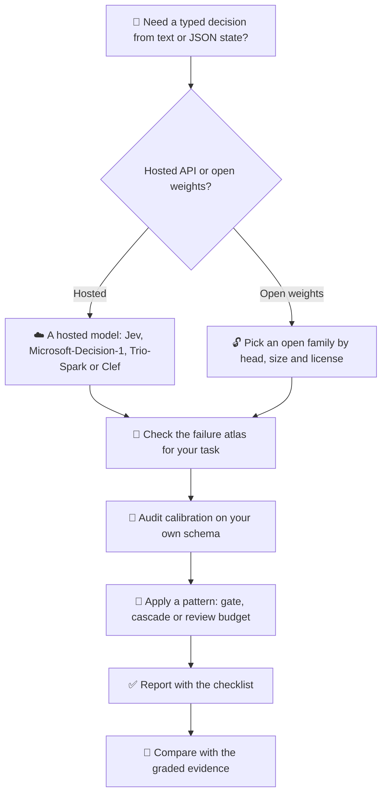
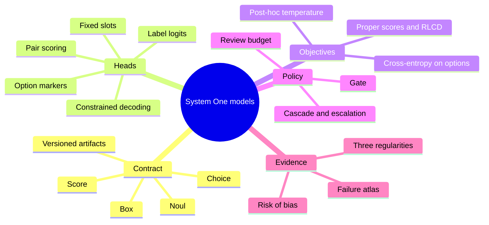

# 🧭 Awesome System One Models
### *Typed probabilistic decision models: a curated, evidence-graded map of the contract, the models and the failures*

  

---

Maintained alongside &nbsp;<strong><a href="https://pozapas.github.io/system-one-models-survey/">System One Decision Models: A Survey of the Typed Decision Contract, Its Ecosystem and Its Evidence</a></strong> &nbsp;·&nbsp; Rafe and Das, <em>manuscript under review</em>, with the companion benchmark <a href="https://arxiv.org/abs/2610.00346">arXiv:2610.00346</a> &nbsp; 

---

### 🎯 *"A decision model is a new contract, not a new kind of intelligence."*

**214 registry-verified papers · 248 graded studies · 388 models · 246 datasets · 127 tools**  
*Organized by the survey's own structure: genealogy, anatomy, census, evidence, failures, patterns and reporting*

[🧩 Concept](#-what-is-a-system-one-model) • [🌳 Genealogy](#-genealogy) • [🤖 Models](#-models) • [🔬 Evidence](#-evidence) • [🧨 Failure atlas](#-failure-atlas) • [🧱 Patterns](#-design-patterns) • [🤝 Contribute](CONTRIBUTING.md) • [📝 Cite](#-how-to-cite)

---

## 📌 Contents

<table><tr><td valign="top">

1. [🧩 What is a System One model?](#-what-is-a-system-one-model)
2. [🚀 Quick Start](#-quick-start)
3. [📊 At a glance](#-at-a-glance)
4. [🗺️ Taxonomy](#️-taxonomy)
5. [🌳 Genealogy](#-genealogy)
6. [🤖 Models](#-models)
7. [📚 Datasets and benchmarks](#-datasets-and-benchmarks)
8. [🛠️ Harnesses and tooling](#️-harnesses-and-tooling)
9. [🔬 Evidence](#-evidence)

</td><td valign="top">

10. [🧨 Failure atlas](#-failure-atlas)
11. [🧱 Design patterns](#-design-patterns)
12. [✅ Reporting checklist in brief](#-reporting-checklist-in-brief)
13. [📖 Surveys and related resources](#-surveys-and-related-resources)
14. [🤝 Contributing](#-contributing)
15. [📝 How to cite](#-how-to-cite)
16. [🕒 Cutoff and versioning](#-cutoff-and-versioning)
17. [📜 License](#-license)

</td></tr></table>

## 🧩 What is a System One model?

A System One model, also called a typed probabilistic decision model, maps a state and a caller-declared typed question to a probability distribution over a finite answer space, in one forward pass and without generating text. The question is one of three primitives, **Choice** over named options, **Score** over ordered levels, or **Noul** for a yes-or-no judgment, and the model promises that the returned probabilities are calibrated. The survey reads this as a new contract assembled from five older research lines rather than as a new kind of intelligence, so the unit of evaluation is the contract together with the policy that consumes the probability and chooses to act, review or escalate. The versioned artifacts drawn along the bottom of the figure above (model revision, serving temperature, option texts and rubric) belong to the contract, because a change in any of them yields a different predictor.

| Primitive | Answer space | Returned | Confidence value |
| --- | --- | --- | --- |
| **Choice** | Declared options (up to 255 on the hosted model) | Distribution over the options | Yes |
| **Score** | Ordered levels (2 to 10 on the hosted model) | Distribution over the levels | Yes |
| **Noul** | Yes or no | Probability of yes | Not returned by the hosted model |

## 🚀 Quick Start

## 📊 At a glance

📊 <strong>Repository statistics</strong> (click to expand)

- **📄 Registry-verified papers**: 214, of which 166 sit in the five genealogy streams S1 36, S2 26, S3 51, S4 40, S5 13
- **☁️ Hosted and provider-released decision models**: 6 (Jev 1.13, TypeSafe AI; Jev 1.14, TypeSafe; Microsoft-Decision-1, Microsoft; Trio-Spark, MachineFi; Clef and Clef-Flash, Cloudflare; pplx-decider v1.1 (27B), Perplexity)
- **🔓 Open original implementations on Hugging Face (T1)**: 379 checkpoints, 101 in 67 recipe families at the first cutoff and 278 in 149 families added by v1.2; first releases 2026-09-16 to 2026-10-28; the first census found 15 backbone families
- **🧩 Decision heads (T1)**: fixed slots 30, option markers 135, label logits 171, pair scoring 36, constrained decoding 0, undisclosed 7
- **🧬 Derivatives (T2)**: 1,370 (format conversions 591, quantizations 110, language fine-tunes 32, domain fine-tunes 345, merges 28, other 264)
- **📚 Datasets**: 246 typed-decision datasets on Hugging Face, 8 with a full card
- **🐙 GitHub repositories screened**: 16,014 (approximate split from rules and a classifier: applications 6,492, integrations 5,228, evaluation 2,034, local servers 1,094, open-model training 875, directories 290, mirrors 1); 226 at the first cutoff
- **🔬 Evidence ledger**: 3,511 extracted values from 248 studies; risk of bias low 3, some concerns 103, high 142
- **🧨 Failure modes**: 15 · **🧱 Design patterns**: 13 · **✅ Checklist items**: 16 in 5 groups
- **🕒 Cutoff**: 2026-10-28 (v1.2)

## 🗺️ Taxonomy

The list follows the survey's conceptual structure. A decision model is described by its contract, its head and its objective. It is placed in the ecosystem by the census, judged by the graded evidence, and deployed through patterns that answer documented failure modes.

## 🌳 Genealogy

The decision contract is best read as a convergence of five older research lines rather than as an invention of September 2026. The timeline places each stream on its own lane; the right panel shows the open implementations that followed the hosted release within days. Papers marked 📖 are discussed in the survey; the others come from the same registry-verified bibliography.

| Stream | Contributes | Papers |
| --- | --- | --- |
| 🏷️ [Label-conditioned scoring heads](#️-s1-label-conditioned-scoring-heads) | the scoring head | 36 |
| ⚖️ [Reward models, verifiers, judges and guardrail classifiers](#️-s2-reward-models-verifiers-judges-and-guardrail-classifiers) | the verdict role | 26 |
| 🎯 [Proper scoring rules and calibrated training](#-s3-proper-scoring-rules-and-calibrated-training) | the training target | 51 |
| 🚦 [The reject option and its descendants](#-s4-the-reject-option-and-its-descendants) | the policy that acts on the probability | 40 |
| 🧠 [Dual-process architectures and the System One name](#-s5-dual-process-architectures-and-the-system-one-name) | the fast-solver role and the name | 13 |

### 🏷️ S1 Label-conditioned scoring heads

> Classification over a declared label set, from pretrained encoders to entailment-based zero-shot classification and label-in-context models. Once labels are read as text, their wording and order become part of the input.

<strong>36 papers</strong>, 13 discussed in the survey

| Year | Title | First author | Venue |
| ---: | --- | --- | --- |
| 1995 | [Solving Multiclass Learning Problems via Error-Correcting Output Codes](https://doi.org/10.1613/jair.105) | Dietterich | Journal of Artificial Intelligence Research |
| 1997 | [A Decision-Theoretic Generalization of On-Line Learning and an Application to Boosting](https://doi.org/10.1006/jcss.1997.1504) | Freund | Journal of Computer and System Sciences |
| 1997 | [On the Optimality of the Simple Bayesian Classifier under Zero-One Loss](https://doi.org/10.1023/a:1007413511361) | Domingos | Machine Learning |
| 2001 | [On Discriminative vs. Generative Classifiers: A Comparison of Logistic Regression and Naive Bayes](https://proceedings.neurips.cc/paper/2001/hash/7b7a53e239400a13bd6be6c91c4f6c4e-Abstract.html) 📖 | Ng | NeurIPS |
| 2004 | [Ensemble selection from libraries of models](https://doi.org/10.1145/1015330.1015432) | Caruana | Twenty-first international conference on … |
| 2019 | [BERT: Pre-training of Deep Bidirectional Transformers for Language Understanding](https://doi.org/10.18653/v1/n19-1423) 📖 | Devlin | NAACL |
| 2019 | [Benchmarking Zero-shot Text Classification: Datasets, Evaluation and Entailment Approach](https://doi.org/10.18653/v1/d19-1404) 📖 | Yin | EMNLP |
| 2019 | [DistilBERT, a distilled version of BERT: smaller, faster, cheaper and lighter](https://arxiv.org/abs/1910.01108) | Sanh | arXiv |
| 2019 | [Passage Re-ranking with BERT](https://arxiv.org/abs/1901.04085) | Nogueira | arXiv |
| 2019 | [RoBERTa: A Robustly Optimized BERT Pretraining Approach](https://arxiv.org/abs/1907.11692) | Liu | arXiv |
| 2019 | [Sentence-BERT: Sentence Embeddings using Siamese BERT-Networks](https://doi.org/10.18653/v1/d19-1410) 📖 | Reimers | EMNLP |
| 2019 | [Zero-shot Text Classification With Generative Language Models](https://arxiv.org/abs/1912.10165) | Puri | arXiv |
| 2020 | [BART: Denoising Sequence-to-Sequence Pre-training for Natural Language Generation, Translation, and Comprehension](https://doi.org/10.18653/v1/2020.acl-main.703) 📖 | Lewis | ACL |
| 2020 | [ColBERT: Efficient and Effective Passage Search via Contextualized Late Interaction over BERT](https://doi.org/10.1145/3397271.3401075) | Khattab | Proceedings of the 43rd International ACM … |
| 2020 | [DeBERTa: Decoding-enhanced BERT with Disentangled Attention](https://arxiv.org/abs/2006.03654) | He | arXiv |
| 2020 | [Language Models are Few-Shot Learners](https://arxiv.org/abs/2005.14165) 📖 | Brown | arXiv |
| 2021 | [Calibrate Before Use: Improving Few-Shot Performance of Language Models](https://arxiv.org/abs/2102.09690) 📖 | Zhao | arXiv |
| 2021 | [Entailment as Few-Shot Learner](https://arxiv.org/abs/2104.14690) | Wang | arXiv |
| 2021 | [Exploiting Cloze-Questions for Few-Shot Text Classification and Natural Language Inference](https://doi.org/10.18653/v1/2021.eacl-main.20) 📖 | Schick | EACL |
| 2021 | [Making Pre-trained Language Models Better Few-shot Learners](https://doi.org/10.18653/v1/2021.acl-long.295) | Gao | ACL |
| 2021 | [Surface Form Competition: Why the Highest Probability Answer Isn’t Always Right](https://doi.org/10.18653/v1/2021.emnlp-main.564) | Holtzman | EMNLP |
| 2021 | [The Power of Scale for Parameter-Efficient Prompt Tuning](https://doi.org/10.18653/v1/2021.emnlp-main.243) | Lester | EMNLP |
| 2021 | [True Few-Shot Learning with Language Models](https://arxiv.org/abs/2105.11447) | Perez | arXiv |
| 2022 | [Efficient Few-Shot Learning Without Prompts](https://arxiv.org/abs/2209.11055) | Tunstall | arXiv |
| 2022 | [Leveraging Large Language Models for Multiple Choice Question Answering](https://arxiv.org/abs/2210.12353) 📖 | Robinson | arXiv |
| 2022 | [Noisy Channel Language Model Prompting for Few-Shot Text Classification](https://doi.org/10.18653/v1/2022.acl-long.365) | Min | ACL |
| 2022 | [Prompt-free and Efficient Few-shot Learning with Language Models](https://doi.org/10.18653/v1/2022.acl-long.254) | Karimi Mahabadi | ACL |
| 2023 | [Large Language Models Are Not Robust Multiple Choice Selectors](https://arxiv.org/abs/2309.03882) 📖 | Zheng | arXiv |
| 2023 | [Quantifying Language Models' Sensitivity to Spurious Features in Prompt Design or: How I learned to start worrying about prompt formatting](https://arxiv.org/abs/2310.11324) | Sclar | arXiv |
| 2024 | [GLiNER: Generalist Model for Named Entity Recognition using Bidirectional Transformer](https://doi.org/10.18653/v1/2024.naacl-long.300) 📖 | Zaratiana | NAACL |
| 2024 | [Large Language Models Sensitivity to The Order of Options in Multiple-Choice Questions](https://doi.org/10.18653/v1/2024.findings-naacl.130) | Pezeshkpour | Findings of ACL |
| 2025 | [GLiClass: Generalist Lightweight Model for Sequence Classification Tasks](https://arxiv.org/abs/2508.07662) 📖 | Stepanov | arXiv |
| 2025 | [Smarter, Better, Faster, Longer: A Modern Bidirectional Encoder for Fast, Memory Efficient, and Long Context Finetuning and Inference](https://doi.org/10.18653/v1/2025.acl-long.127) 📖 | Warner | ACL |
| 2025 | [Text Classification in the LLM Era – Where do we stand?](https://arxiv.org/abs/2502.11830) | Vajjala | arXiv |
| 2025 | [mmBERT: A Modern Multilingual Encoder with Annealed Language Learning](https://arxiv.org/abs/2509.06888) | Marone | arXiv |
| 2026 | [Large Language Models for Text Classification: From Zero-Shot Learning to Instruction-Tuning](https://doi.org/10.1177/00491241251325243) | Chae | Sociological Methods & Research |

### ⚖️ S2 Reward models, verifiers, judges and guardrail classifiers

> Scorers that map a state and a set of candidates to a probability of preference, correctness or safety, together with the catalogue of biases that sway a model reading the candidates it must choose among.

<strong>26 papers</strong>, 14 discussed in the survey

| Year | Title | First author | Venue |
| ---: | --- | --- | --- |
| 2017 | [Deep reinforcement learning from human preferences](https://arxiv.org/abs/1706.03741) 📖 | Christiano | arXiv |
| 2020 | [Learning to summarize from human feedback](https://arxiv.org/abs/2009.01325) 📖 | Stiennon | arXiv |
| 2021 | [Training Verifiers to Solve Math Word Problems](https://arxiv.org/abs/2110.14168) 📖 | Cobbe | arXiv |
| 2022 | [A New Generation of Perspective API: Efficient Multilingual Character-level Transformers](https://doi.org/10.1145/3534678.3539147) | Lees | KDD |
| 2022 | [Solving math word problems with process- and outcome-based feedback](https://arxiv.org/abs/2211.14275) | Uesato | arXiv |
| 2022 | [Training Language Models to Follow Instructions with Human Feedback](https://doi.org/10.52202/068431-2011) 📖 | Ouyang | NeurIPS |
| 2022 | [Training a Helpful and Harmless Assistant with Reinforcement Learning from Human Feedback](https://arxiv.org/abs/2204.05862) | Bai | arXiv |
| 2023 | [A Holistic Approach to Undesired Content Detection in the Real World](https://doi.org/10.1609/aaai.v37i12.26752) 📖 | Markov | AAAI |
| 2023 | [Can Large Language Models Be an Alternative to Human Evaluations?](https://doi.org/10.18653/v1/2023.acl-long.870) | Chiang | ACL |
| 2023 | [Direct Preference Optimization: Your Language Model is Secretly a Reward Model](https://doi.org/10.52202/075280-2338) | Rafailov | NeurIPS |
| 2023 | [G-Eval: NLG Evaluation using Gpt-4 with Better Human Alignment](https://doi.org/10.18653/v1/2023.emnlp-main.153) 📖 | Liu | EMNLP |
| 2023 | [Judging LLM-as-a-Judge with MT-Bench and Chatbot Arena](https://doi.org/10.52202/075280-2020) 📖 | Zheng | NeurIPS |
| 2023 | [Let's Verify Step by Step](https://arxiv.org/abs/2305.20050) 📖 | Lightman | arXiv |
| 2023 | [Llama Guard: LLM-based Input-Output Safeguard for Human-AI Conversations](https://arxiv.org/abs/2312.06674) 📖 | Inan | arXiv |
| 2023 | [PandaLM: An Automatic Evaluation Benchmark for LLM Instruction Tuning Optimization](https://arxiv.org/abs/2306.05087) | Wang | arXiv |
| 2023 | [Prometheus: Inducing Fine-grained Evaluation Capability in Language Models](https://arxiv.org/abs/2310.08491) | Kim | arXiv |
| 2024 | [A Survey on LLM-as-a-Judge](https://arxiv.org/abs/2411.15594) | Gu | arXiv |
| 2024 | [Justice or Prejudice? Quantifying Biases in LLM-as-a-Judge](https://arxiv.org/abs/2410.02736) 📖 | Ye | arXiv |
| 2024 | [LLM Evaluators Recognize and Favor Their Own Generations](https://doi.org/10.52202/079017-2197) 📖 | Panickssery | NeurIPS |
| 2024 | [Large Language Models are not Fair Evaluators](https://doi.org/10.18653/v1/2024.acl-long.511) | Wang | ACL |
| 2024 | [Length-Controlled AlpacaEval: A Simple Way to Debias Automatic Evaluators](https://arxiv.org/abs/2404.04475) 📖 | Dubois | arXiv |
| 2024 | [Math-Shepherd: Verify and Reinforce LLMs Step-by-step without Human Annotations](https://doi.org/10.18653/v1/2024.acl-long.510) | Wang | ACL |
| 2024 | [Prometheus 2: An Open Source Language Model Specialized in Evaluating Other Language Models](https://doi.org/10.18653/v1/2024.emnlp-main.248) | Kim | EMNLP |
| 2024 | [ShieldGemma: Generative AI Content Moderation Based on Gemma](https://arxiv.org/abs/2407.21772) 📖 | Zeng | arXiv |
| 2025 | [RewardBench 2: Advancing Reward Model Evaluation](https://arxiv.org/abs/2506.01937) | Malik | arXiv |
| 2025 | [RewardBench: Evaluating Reward Models for Language Modeling](https://doi.org/10.18653/v1/2025.findings-naacl.96) 📖 | Lambert | Findings of ACL |

### 🎯 S3 Proper scoring rules and calibrated training

> Strictly proper scores, post-hoc calibration and calibration-aware rewards. Training against a proper score is training for calibration, which is the meaning of the decision model's promise.

<strong>51 papers</strong>, 20 discussed in the survey

| Year | Title | First author | Venue |
| ---: | --- | --- | --- |
| 1950 | [Verification of Forecasts Expressed in Terms of Probability](https://doi.org/10.1175/1520-0493%281950%29078%3C0001:vofeit%3E2.0.co%3B2) 📖 | Brier | Monthly Weather Review |
| 1969 | [A Scoring System for Probability Forecasts of Ranked Categories](https://doi.org/10.1175/1520-0450%281969%29008%3C0985:assfpf%3E2.0.co%3B2) 📖 | Epstein | Journal of Applied Meteorology |
| 1973 | [A New Vector Partition of the Probability Score](https://doi.org/10.1175/1520-0450%281973%29012%3C0595:anvpot%3E2.0.co%3B2) 📖 | Murphy | Journal of Applied Meteorology |
| 1982 | [The Well-Calibrated Bayesian: Rejoinder](https://doi.org/10.2307/2287723) | Dawid | Journal of the American Statistical Association |
| 1983 | [The Comparison and Evaluation of Forecasters](https://doi.org/10.2307/2987588) | DeGroot | The Statistician |
| 1996 | [Scoring rules and the evaluation of probabilities](https://doi.org/10.1007/bf02562681) | Winkler | Test |
| 1998 | [Asymptotic calibration](https://doi.org/10.1093/biomet/85.2.379) | Foster | Biometrika |
| 2002 | [Transforming classifier scores into accurate multiclass probability estimates](https://doi.org/10.1145/775047.775151) 📖 | Zadrozny | KDD |
| 2005 | [Predicting good probabilities with supervised learning](https://doi.org/10.1145/1102351.1102430) | Niculescu-Mizil | Proceedings of the 22nd international … |
| 2006 | [An Introduction to Copulas](https://doi.org/10.1007/0-387-28678-0) 📖 |  | Springer New York |
| 2007 | [Probabilistic Forecasts, Calibration and Sharpness](https://doi.org/10.1111/j.1467-9868.2007.00587.x) | Gneiting | Journal of the Royal Statistical Society … |
| 2007 | [Strictly Proper Scoring Rules, Prediction, and Estimation](https://doi.org/10.1198/016214506000001437) 📖 | Gneiting | Journal of the American Statistical Association |
| 2009 | [Reliability, sufficiency, and the decomposition of proper scores](https://doi.org/10.1002/qj.456) | Bröcker | Quarterly Journal of the Royal Meteorological … |
| 2009 | [The Elements of Statistical Learning: Data Mining, Inference, and Prediction](https://doi.org/10.1007/978-0-387-84858-7) | Hastie | Springer |
| 2012 | [Calibrating predictive model estimates to support personalized medicine](https://doi.org/10.1136/amiajnl-2011-000291) | Jiang | Journal of the American Medical Informatics … |
| 2015 | [Dropout as a Bayesian Approximation: Representing Model Uncertainty in Deep Learning](https://arxiv.org/abs/1506.02142) | Gal | arXiv |
| 2015 | [Obtaining Well Calibrated Probabilities Using Bayesian Binning](https://doi.org/10.1609/aaai.v29i1.9602) | Pakdaman Naeini | AAAI |
| 2016 | [Simple and Scalable Predictive Uncertainty Estimation using Deep Ensembles](https://arxiv.org/abs/1612.01474) | Lakshminarayanan | arXiv |
| 2017 | [Beyond sigmoids: How to obtain well-calibrated probabilities from binary classifiers with beta calibration](https://doi.org/10.1214/17-ejs1338si) | Kull | Electronic Journal of Statistics |
| 2017 | [On Calibration of Modern Neural Networks](https://arxiv.org/abs/1706.04599) 📖 | Guo | arXiv |
| 2018 | [Accurate Uncertainties for Deep Learning Using Calibrated Regression](https://arxiv.org/abs/1807.00263) | Kuleshov | arXiv |
| 2019 | [Beyond temperature scaling: Obtaining well-calibrated multiclass probabilities with Dirichlet calibration](https://arxiv.org/abs/1910.12656) 📖 | Kull | arXiv |
| 2019 | [Calibration tests in multi-class classification: A unifying framework](https://arxiv.org/abs/1910.11385) | Widmann | arXiv |
| 2019 | [Can You Trust Your Model's Uncertainty? Evaluating Predictive Uncertainty Under Dataset Shift](https://arxiv.org/abs/1906.02530) | Ovadia | arXiv |
| 2019 | [Evaluating model calibration in classification](https://arxiv.org/abs/1902.06977) | Vaicenavicius | arXiv |
| 2019 | [Measuring Calibration in Deep Learning](https://arxiv.org/abs/1904.01685) | Nixon | arXiv |
| 2019 | [Verified Uncertainty Calibration](https://arxiv.org/abs/1909.10155) 📖 | Kumar | arXiv |
| 2020 | [Calibration of Pre-trained Transformers](https://doi.org/10.18653/v1/2020.emnlp-main.21) | Desai | EMNLP |
| 2020 | [Mitigating Bias in Calibration Error Estimation](https://arxiv.org/abs/2012.08668) | Roelofs | arXiv |
| 2020 | [Uncertainty Quantification and Deep Ensembles](https://arxiv.org/abs/2007.08792) | Rahaman | arXiv |
| 2021 | [Distribution-free calibration guarantees for histogram binning without sample splitting](https://arxiv.org/abs/2105.04656) | Gupta | arXiv |
| 2021 | [How Can We Know When Language Models Know? On the Calibration of Language Models for Question Answering](https://doi.org/10.1162/tacl_a_00407) | Jiang | TACL |
| 2021 | [Revisiting the Calibration of Modern Neural Networks](https://arxiv.org/abs/2106.07998) 📖 | Minderer | arXiv |
| 2021 | [Second opinion needed: communicating uncertainty in medical machine learning](https://doi.org/10.1038/s41746-020-00367-3) | Kompa | npj Digital Medicine |
| 2022 | [Language Models (Mostly) Know What They Know](https://arxiv.org/abs/2207.05221) 📖 | Kadavath | arXiv |
| 2022 | [Teaching Models to Express Their Uncertainty in Words](https://arxiv.org/abs/2205.14334) | Lin | arXiv |
| 2023 | [A Unifying Theory of Distance from Calibration](https://doi.org/10.1145/3564246.3585182) | Błasiok | Proceedings of the 55th Annual ACM Symposium … |
| 2023 | [Can LLMs Express Their Uncertainty? An Empirical Evaluation of Confidence Elicitation in LLMs](https://arxiv.org/abs/2306.13063) 📖 | Xiong | arXiv |
| 2023 | [Classifier calibration: a survey on how to assess and improve predicted class probabilities](https://doi.org/10.1007/s10994-023-06336-7) | Silva Filho | Machine Learning |
| 2023 | [Just Ask for Calibration: Strategies for Eliciting Calibrated Confidence Scores from Language Models Fine-Tuned with Human Feedback](https://doi.org/10.18653/v1/2023.emnlp-main.330) | Tian | EMNLP |
| 2024 | [A Survey of Confidence Estimation and Calibration in Large Language Models](https://doi.org/10.18653/v1/2024.naacl-long.366) 📖 | Geng | NAACL |
| 2024 | [Calibrated Language Models Must Hallucinate](https://doi.org/10.1145/3618260.3649777) 📖 | Kalai | Proceedings of the 56th Annual ACM Symposium … |
| 2024 | [LACIE: Listener-Aware Finetuning for Calibration in Large Language Models](https://doi.org/10.52202/079017-1364) | Stengel-Eskin | NeurIPS |
| 2024 | [Linguistic Calibration of Long-Form Generations](https://arxiv.org/abs/2404.00474) 📖 | Band | arXiv |
| 2025 | [Beyond Binary Rewards: Training LMs to Reason About Their Uncertainty](https://arxiv.org/abs/2507.16806) | Damani | arXiv |
| 2025 | [Confidence-Aware Routing for Large Language Model Reliability Enhancement: A Multi-Signal Approach to Pre-Generation Hallucination Mitigation](https://arxiv.org/abs/2510.01237) 📖 | M | arXiv |
| 2025 | [SalesRLAgent: A Reinforcement Learning Approach for Real-Time Sales Conversion Prediction and Optimization](https://arxiv.org/abs/2503.23303) 📖 | M | arXiv |
| 2025 | [Uncertainty Quantification and Confidence Calibration in Large Language Models: A Survey](https://doi.org/10.1145/3711896.3736569) 📖 | Liu | KDD |
| 2025 | [Why Language Models Hallucinate](https://arxiv.org/abs/2509.04664) 📖 | Kalai | arXiv |
| 2026 | [A Survey on Uncertainty Quantification of Large Language Models: Taxonomy, Open Research Challenges, and Future Directions](https://doi.org/10.1145/3744238) 📖 | Shorinwa | ACM Computing Surveys |
| 2026 | [Balancing Classification and Calibration Performance in Decision-Making LLMs via Calibration Aware Reinforcement Learning](https://doi.org/10.18653/v1/2026.findings-acl.610) | Yaldiz | Findings of ACL |

### 🚦 S4 The reject option and its descendants

> The reject option, selective classification, learning to defer, conformal sets and model cascades. This stream turns a returned probability into an action such as act, review or escalate.

<strong>40 papers</strong>, 24 discussed in the survey

| Year | Title | First author | Venue |
| ---: | --- | --- | --- |
| 1952 | [A Generalization of Sampling Without Replacement from a Finite Universe](https://doi.org/10.1080/01621459.1952.10483446) 📖 | Horvitz | Journal of the American Statistical Association |
| 1957 | [An optimum character recognition system using decision functions](https://doi.org/10.1109/tec.1957.5222035) 📖 | Chow | IRE Transactions on Electronic Computers |
| 1970 | [On optimum recognition error and reject tradeoff](https://doi.org/10.1109/tit.1970.1054406) 📖 | Chow | IEEE Transactions on Information Theory |
| 1995 | [Active Learning with Statistical Models](https://doi.org/10.21236/ada295617) | Cohn | Defense Technical Information Center |
| 2001 | [Rapid Object Detection Using a Boosted Cascade of Simple Features](https://doi.org/10.1109/CVPR.2001.990517) 📖 | Viola | CVPR |
| 2005 | [Algorithmic Learning in a Random World](https://doi.org/10.1007/b106715) | Vovk | Springer |
| 2006 | [Classification with reject option](https://doi.org/10.1002/cjs.5550340410) | Herbei | Canadian Journal of Statistics |
| 2007 | [A tutorial on conformal prediction](https://arxiv.org/abs/0706.3188) | Shafer | arXiv |
| 2010 | [On the Foundations of Noise-free Selective Classification](https://jmlr.org/papers/v11/el-yaniv10a.html) 📖 | El-Yaniv | JMLR |
| 2011 | [Bayesian Active Learning for Classification and Preference Learning](https://arxiv.org/abs/1112.5745) | Houlsby | arXiv |
| 2013 | [Conditional validity of inductive conformal predictors](https://doi.org/10.1007/s10994-013-5355-6) | Vovk | Machine Learning |
| 2016 | [A Baseline for Detecting Misclassified and Out-of-Distribution Examples in Neural Networks](https://arxiv.org/abs/1610.02136) | Hendrycks | arXiv |
| 2016 | [Learning with Rejection](https://doi.org/10.1007/978-3-319-46379-7_5) 📖 | Cortes | Lecture Notes in Computer Science |
| 2017 | [Adaptive Classification for Prediction Under a Budget](https://arxiv.org/abs/1705.10194) | Nan | arXiv |
| 2017 | [Predict Responsibly: Improving Fairness and Accuracy by Learning to Defer](https://arxiv.org/abs/1711.06664) 📖 | Madras | arXiv |
| 2017 | [Selective Classification for Deep Neural Networks](https://arxiv.org/abs/1705.08500) 📖 | Geifman | arXiv |
| 2019 | [End to end learning and optimization on graphs](https://arxiv.org/abs/1905.13732) | Wilder | arXiv |
| 2019 | [SelectiveNet: A Deep Neural Network with an Integrated Reject Option](https://arxiv.org/abs/1901.09192) | Geifman | arXiv |
| 2020 | [Classification with Valid and Adaptive Coverage](https://arxiv.org/abs/2006.02544) 📖 | Romano | arXiv |
| 2020 | [Consistent Estimators for Learning to Defer to an Expert](https://arxiv.org/abs/2006.01862) 📖 | Mozannar | arXiv |
| 2020 | [Selective Question Answering under Domain Shift](https://doi.org/10.18653/v1/2020.acl-main.503) 📖 | Kamath | ACL |
| 2021 | [Active Testing: Sample-Efficient Model Evaluation](https://arxiv.org/abs/2103.05331) 📖 | Kossen | arXiv |
| 2021 | [Distribution-free, Risk-controlling Prediction Sets](https://doi.org/10.1145/3478535) 📖 | Bates | Journal of the ACM |
| 2022 | [Conformal Risk Control](https://arxiv.org/abs/2208.02814) 📖 | Angelopoulos | arXiv |
| 2022 | [Investigating Selective Prediction Approaches Across Several Tasks in IID, OOD, and Adversarial Settings](https://doi.org/10.18653/v1/2022.findings-acl.158) | Varshney | Findings of ACL |
| 2022 | [Language Model Cascades](https://arxiv.org/abs/2207.10342) 📖 | Dohan | arXiv |
| 2022 | [Post-Hoc Estimators for Learning to Defer to an Expert](https://doi.org/10.52202/068431-2124) | Narasimhan | NeurIPS |
| 2023 | [Conformal Language Modeling](https://arxiv.org/abs/2306.10193) | Quach | arXiv |
| 2023 | [Conformal Prediction with Large Language Models for Multi-Choice Question Answering](https://arxiv.org/abs/2305.18404) 📖 | Kumar | arXiv |
| 2023 | [Conformal Prediction: A Gentle Introduction](https://doi.org/10.1561/2200000101) 📖 | Angelopoulos | Foundations and Trends in Machine Learning |
| 2023 | [FrugalGPT: How to Use Large Language Models While Reducing Cost and Improving Performance](https://arxiv.org/abs/2305.05176) 📖 | Chen | arXiv |
| 2023 | [Large Language Model Cascades with Mixture of Thoughts Representations for Cost-efficient Reasoning](https://arxiv.org/abs/2310.03094) | Yue | arXiv |
| 2023 | [When Does Confidence-Based Cascade Deferral Suffice?](https://doi.org/10.52202/075280-0431) 📖 | Jitkrittum | NeurIPS |
| 2023 | [Who Should Predict? Exact Algorithms For Learning to Defer to Humans](https://arxiv.org/abs/2301.06197) | Mozannar | arXiv |
| 2024 | [AutoMix: Automatically Mixing Language Models](https://doi.org/10.52202/079017-4164) | Aggarwal | NeurIPS |
| 2024 | [Machine learning with a reject option: a survey](https://doi.org/10.1007/s10994-024-06534-x) 📖 | Hendrickx | Machine Learning |
| 2024 | [RouteLLM: Learning to Route LLMs with Preference Data](https://arxiv.org/abs/2406.18665) 📖 | Ong | arXiv |
| 2025 | [Learning to Defer: A Survey](https://doi.org/10.5281/zenodo.17843044) 📖 | Strong |  |
| 2026 | [Doing More with Less: A Survey on Routing Strategies for Resource Optimisation in Large Language Model-Based Systems](https://doi.org/10.1613/jair.1.19801) 📖 | Varangot-Reille | Journal of Artificial Intelligence Research |
| 2026 | [Dynamic Model Routing and Cascading for Efficient LLM Inference: A Survey](https://arxiv.org/abs/2603.04445) 📖 | Moslem | arXiv |

### 🧠 S5 Dual-process architectures and the System One name

> Dual-process accounts of reasoning and the fast and slow AI architectures that borrow them. The stream supplies the fast-solver role in a larger program and the System One label.

<strong>13 papers</strong>, 8 discussed in the survey

| Year | Title | First author | Venue |
| ---: | --- | --- | --- |
| 1996 | [The empirical case for two systems of reasoning](https://doi.org/10.1037/0033-2909.119.1.3) | Sloman | Psychological Bulletin |
| 2002 | [Individual Differences in Reasoning: Implications for the Rationality Debate?](https://doi.org/10.1017/cbo9780511808098.026) 📖 | Stanovich | Heuristics and Biases |
| 2002 | [Representativeness Revisited: Attribute Substitution in Intuitive Judgment](https://doi.org/10.1017/cbo9780511808098.004) | Kahneman | Heuristics and Biases |
| 2008 | [Dual-Processing Accounts of Reasoning, Judgment, and Social Cognition](https://doi.org/10.1146/annurev.psych.59.103006.093629) 📖 | Evans | Annual Review of Psychology |
| 2010 | [Dual‐Process and Dual‐System Theories of Reasoning](https://doi.org/10.1111/j.1747-9991.2010.00330.x) | Frankish | Philosophy Compass |
| 2013 | [Dual-Process Theories of Higher Cognition: Advancing the Debate](https://doi.org/10.1177/1745691612460685) | Evans | Perspectives on Psychological Science |
| 2020 | [Thinking Fast and Slow in AI](https://arxiv.org/abs/2010.06002) 📖 | Booch | arXiv |
| 2021 | [Thinking Fast and Slow in AI: the Role of Metacognition](https://arxiv.org/abs/2110.01834) 📖 | Ganapini | arXiv |
| 2023 | [Human-like intuitive behavior and reasoning biases emerged in large language models but disappeared in ChatGPT](https://doi.org/10.1038/s43588-023-00527-x) 📖 | Hagendorff | Nature Computational Science |
| 2023 | [SwiftSage: A Generative Agent with Fast and Slow Thinking for Complex Interactive Tasks](https://doi.org/10.52202/075280-1034) 📖 | Lin | NeurIPS |
| 2025 | [Dual-process theory and decision-making in large language models](https://doi.org/10.1038/s44159-025-00506-1) | Brady | Nature Reviews Psychology |
| 2025 | [Fast, slow, and metacognitive thinking in AI](https://doi.org/10.1038/s44387-025-00027-5) 📖 | Bergamaschi Ganapini | npj Artificial Intelligence |
| 2025 | [Thinking Fast and Slow in Human and Machine Intelligence](https://doi.org/10.1145/3715709) 📖 | Fabiano | Communications of the ACM |

## 🤖 Models

### ☁️ Hosted models

**Jev 1.13** from TypeSafe AI launched on 15 September 2026 with the post that introduced the System One name. Its weights, architecture and RLCD training recipe are not published, so statements about its internals rest on the vendor's own descriptions or on black-box probing. The facts below are the vendor's, as documented for Jev 1.13 on the first access date; Jev 1.14 is listed further down, and the vendor's documentation now resolves its jev-latest alias to jev-1.14.0.

| Fact | Value | Source |
| --- | --- | --- |
| Pinned model ID | jev-1.13.0 | [link](https://docs.typesafe.ai/models) |
| jev-latest resolves to | jev-1.14.0 (from 14 October 2026) | [link](https://docs.typesafe.ai/models.md) |
| Choice options (max) | 255 | [link](https://docs.typesafe.ai/primitives/choice) |
| Score levels (min) | 2 | [link](https://docs.typesafe.ai/primitives/score) |
| Score levels (max) | 10 | [link](https://docs.typesafe.ai/primitives/score) |
| State budget | 32k tokens (state plus the longest question) | [link](https://docs.typesafe.ai/models) |
| Request budget | 64k tokens (state plus all questions) | [link](https://docs.typesafe.ai/models) |
| Input price, USD per million tokens | 0.042 | [link](https://docs.typesafe.ai/models) |
| Output price | free (not metered) | [link](https://docs.typesafe.ai/models) |
| Stated latency | 70 to 500 ms end to end (vendor claim) | [link](https://typesafe.ai/blog/introducing-system-one-models-and-jev) |
| Confidence on Noul | not returned (Choice and Score only) | [link](https://docs.typesafe.ai/confidence) |
| Jaggedness page last reviewed | 2026-09-17 | [link](https://docs.typesafe.ai/model-jaggedness/jev-1.13) |

📘 <strong>Vendor documentation and access points</strong> (17 pages)

| Page | Publisher | Page date | Accessed |
| --- | --- | --- | --- |
| [Introduction](https://docs.typesafe.ai/introduction) | TypeSafe AI | 2026-09-20 (sitemap lastmod) | 2026-09-24 |
| [System One](https://docs.typesafe.ai/concepts/system-one) | TypeSafe AI | 2026-09-17 (sitemap lastmod) | 2026-09-24 |
| [Models](https://docs.typesafe.ai/models) | TypeSafe AI | 2026-09-22 (sitemap lastmod) | 2026-09-24 |
| [Choice](https://docs.typesafe.ai/primitives/choice) | TypeSafe AI | 2026-09-20 (sitemap lastmod) | 2026-09-24 |
| [Score](https://docs.typesafe.ai/primitives/score) | TypeSafe AI | 2026-09-20 (sitemap lastmod) | 2026-09-24 |
| [Noul](https://docs.typesafe.ai/primitives/noul) | TypeSafe AI | 2026-09-20 (sitemap lastmod) | 2026-09-24 |
| [Confidence](https://docs.typesafe.ai/confidence) | TypeSafe AI | 2026-09-20 (sitemap lastmod) | 2026-09-24 |
| [API reference](https://docs.typesafe.ai/api) | TypeSafe AI | 2026-09-20 (sitemap lastmod) | 2026-09-24 |
| [Jev 1.13 jaggedness](https://docs.typesafe.ai/model-jaggedness/jev-1.13) | TypeSafe AI | last reviewed 2026-09-17 | 2026-09-24 |
| [AI primer](https://docs.typesafe.ai/introduction/machine-learning-primer) | TypeSafe AI | 2026-09-05 (sitemap lastmod) | 2026-09-24 |
| [State](https://docs.typesafe.ai/concepts/state) | TypeSafe AI | 2026-09-20 (sitemap lastmod) | 2026-09-24 |
| [Patterns](https://docs.typesafe.ai/patterns) | TypeSafe AI | 2026-08-31 / 2026-09-22 (sitemap lastmod) | 2026-09-24 |
| [Cookbooks](https://docs.typesafe.ai/cookbooks) | TypeSafe AI | 2026-08-31 / 2026-09-22 (sitemap lastmod) | 2026-09-24 |
| [Workflow evals](https://evals.typesafe.ai/) | TypeSafe AI | undated | 2026-09-24 |
| [Advanced: structure](https://docs.typesafe.ai/primitives/advanced) | TypeSafe AI | 2026-09-15 (sitemap lastmod) | 2026-09-24 |
| [Jev on OpenRouter (guide)](https://openrouter.ai/docs/guides/community/jev) | OpenRouter | undated | 2026-09-24 |
| [Jev 1.13 on OpenRouter (model page)](https://openrouter.ai/typesafe/jev-1.13) | OpenRouter | undated | 2026-09-24 |

**Released after the first cutoff.** These models appeared after 24 September 2026, and the version 1.2 census (cutoff 28 October 2026) covers them. Their entries record the publisher's documentation. A measurement shown is the publisher's own, or a result from a community leaderboard, until an independent evaluation is listed in the evidence table. An entry with no API link has no hosted API in the sources.

| Model | Provider | Released | Contract | Limits and price | Evidence | Disclosure |
| --- | --- | --- | --- | --- | --- | --- |
| [Jev 1.14](https://typesafe.ai/blog/jev-1-14) · [API](https://docs.typesafe.ai/models) | TypeSafe | 2026-10-14 | Choice, Score and Noul as in Jev 1.13, plus a fourth question type, Box, that returns the four edges of a single bounding box in an image and needs Jev 1.14; Choice and Score return probabilities and a 0 to 1 confidence, and Noul returns a probability of yes without a separate confidence | API model ID jev-1.14.0 (jev-latest and jev-preview now resolve to it); 64k tokens per request and 32k per question, as for Jev 1.13, and 262k for both with the long-context header; request body at most 32 MiB; rate limits set per organization; the vendor intends 60 days of warning before jev-1.13.0 is formally deprecated and 30 days before jev-1.14.0; 0.042 USD per million input tokens ($42 per billion), output free, unchanged from Jev 1.13 | Vendor documentation says the model was trained with RLCD to return calibrated decisions, in the same words as for Jev 1.13. Leaderboard results, not graded studies: Decision Index 0.4.1 Full score 60.2 (an accuracy index, with calibration on a separate tab) and edgeevals.ai v0.2 clinical-decision accuracy 76.8 (rank 7=) | Vendor pages accessed 2026-10-28. The models table lists text input for both Jev versions, while the images page says both accept images behind the TypeSafe-Danger-Zone-Images header, and the launch post says jev-1.13.0 was multimodal all along |
| [Microsoft-Decision-1](https://commandline.microsoft.com/microsoft-decision-1-model-foundry/) · [API](https://learn.microsoft.com/en-us/azure/foundry/foundry-models/how-to/use-foundry-models-microsoft-decision) | Microsoft | 2026-10-09 | Noul, Choice and Score through a Decision API type; a text or JSON state plus one or more typed questions; also rubric-based grading, and abstention expressed as an extra answer option such as cannot tell | text only; inputs up to 32K tokens in the Foundry catalog; deployment types DataZoneStandard in selected regions and GlobalStandard; the blog and the Learn page state no context or rate limit; catalog lifecycle Preview; 0.042 USD per million input tokens, output free | Vendor-reported: highest accuracy in its 36-benchmark comparison of nearly 150,000 questions; third on calibration, 1.5 behind Jev 1.13.0 and 0.9 behind Quyet-1.0-Large; 1.3% of decisions change on average over eight perturbations. The Learn page cautions that scores are not absolute calibrated ratings. A leaderboard result, not a graded study: edgeevals.ai v0.2 clinical-decision accuracy 78.1 (rank 6=) | Model version 1, post-trained from Qwen3.5-9B; API only, through Microsoft Foundry and OpenRouter; the blog says it will soon be rebased on other models |
| [Trio-Spark](https://huggingface.co/MachineFi/Trio-Spark) · [API](https://github.com/machinefi/trio-spark/blob/main/docs/api.md) | MachineFi | 2026-09-30 | Choice questions only, with 2 to 8 choices; returns the selected choice, a probability for each choice and a confidence equal to the probability of the selected choice, with a decide, review or abstain disposition; v1.3 of 2026-10-15 is the current release and adds visual input | 1,024 expanded input tokens including task, state, choices and any visual input; 65,536-byte request body in the v1.0 text API; at most 16 questions per request; recommended model ID trio-spark-v1.3 (older aliases route to the current model and do not pin historical weights); 0.042 USD per million billed input tokens, output free; 100 free decisions for a new account | Vendor-reported only: expected calibration error 0.019 on its own 2,977-decision text panel (10 bins); the vendor states that calibration on this panel does not guarantee calibrated confidence in a different application, and that its accuracy table is developer-run and not independently certified | Submitted by the publisher (issue #2). The model card is for a commercial API; weights and training code are not distributed. The former v1.0 card is merged into the current card, and Trio-Spark-DI is a separate research checkpoint, not the hosted model |
| [Clef and Clef-Flash](https://huggingface.co/Cloudflare/clef-flash) · [API](https://blog.cloudflare.com/clef-decision-models) | Cloudflare | 2026-10-01 | Noul, Choice and Score (types noul, choice and score) over text, JSON, images and video frames; Clef-Flash is a 9B multimodal model, and its card says the API is fully compatible with Jev and SystemOne | the launch post states a 64k context window for Clef, against 32k for Jev; the Clef-Flash code defaults to 16,384 tokens; hosted on Workers AI; no price found on the launch post | Vendor: trained with label-smoothed cross-entropy plus a Brier loss to refine calibration; the Clef-Flash card has no calibration claim and reports a vendor internal accuracy run of Decision Index 0.2.1. Leaderboard results, not graded studies: edgeevals.ai v0.2 clinical-decision accuracy 74.8 (Clef 27B, rank 8=) and 66.7 (Clef-Flash, rank 20=); Decision Index 0.4.1 Full score 54.9 (clef) and 44.4 (clef-flash) | Open weights under Apache-2.0 on Hugging Face, with Clef-Flash post-trained from Qwen3.5-9B (card created 2026-09-30), and hosted on Workers AI |
| [pplx-decider v1.1 (27B)](https://huggingface.co/perplexity-ai/pplx-decider-v1.1-27b) | Perplexity | 2026-10-05 | Choice in the card's usage example, and Choice and Noul decisions in the training pipeline of v1; images are supported | 8,192 tokens for the text and all images of a decision; about 49 GiB of weights; no hosted API in the sources; no price (open weights) | Vendor: the supplied predict applies a saved calibration temperature. The card's accuracy claim, a Decision Index score rising from 56.4 to 61.56, is on an older edition and is not a calibration result. Both leaderboards list v1.2 rather than v1.1: Decision Index 0.4.1 Full score 68.0 and edgeevals.ai v0.2 clinical-decision accuracy 83.8 (rank 3) | Open weights under Apache-2.0, base model Qwen/Qwen3.8-27B; the card calls the repository private, while the Hugging Face API showed it public and ungated on 2026-10-28 |

The official SDKs are [system-one-adapter-python](https://github.com/typesafe-ai/system-one-adapter-python), [typesafe-sdk-js](https://github.com/typesafe-ai/typesafe-sdk-js) and [typesafe-sdk-python](https://github.com/typesafe-ai/typesafe-sdk-python).

### 🔓 Open original implementations

Open label-conditioned heads on public backbones reproduced the typed contract within days of the hosted release. The table condenses the notable families with an independent card; each head badge follows the survey's five-way head taxonomy, assigned from the card's own description of its decision head.

    

| Family | Author | First release | Backbone | Size | Head | License | Links |
| --- | --- | --- | --- | --- | --- | --- | --- |
| **Laya** | Convai Innovations | 2026-09-18 | ModernBERT-large 395M (English); mmBERT-base 307M (multilingual) | 0.32B to 0.42B |  | Apache-2.0 | [🤗 laya](https://huggingface.co/convaiinnovations/laya) [🤗 laya-multilingual](https://huggingface.co/convaiinnovations/laya-multilingual) [code](https://github.com/NandhaKishorM/laya) |
| **Kev** | Jared Palmer | 2026-09-18 | Qwen2.5, Qwen3 and Qwen3.5 backbones | 0.5B to 9B (LoRA r=16) |  | Apache-2.0 | [🤗 kev-0.5b](https://huggingface.co/jaredpalmer/kev-0.5b) [🤗 kev-0.6b](https://huggingface.co/jaredpalmer/kev-0.6b) [🤗 kev-0.8b](https://huggingface.co/jaredpalmer/kev-0.8b) [🤗 kev-4b](https://huggingface.co/jaredpalmer/kev-4b) [🤗 kev-8b](https://huggingface.co/jaredpalmer/kev-8b) [🤗 kev-9b](https://huggingface.co/jaredpalmer/kev-9b) [code](https://github.com/jaredpalmer/kev) |
| **Bespoke-Nimble** | Bespoke Labs | 2026-09-18 | Qwen3.5-9B | 9B (LoRA r=16) |  | Apache-2.0 | [🤗 Bespoke-Nimble-9B](https://huggingface.co/bespokelabs/Bespoke-Nimble-9B) [code](https://github.com/bespokelabsai/nimble) |
| **decider** | Mapika | 2026-09-16 | Qwen3.5 backbones | 0.8B to 35B-A3B |  | Apache-2.0 | [🤗 decider-0.8b](https://huggingface.co/Mapika/decider-0.8b) [🤗 decider-2b](https://huggingface.co/Mapika/decider-2b) [🤗 decider-4b](https://huggingface.co/Mapika/decider-4b) [🤗 decider-35b-a3b](https://huggingface.co/Mapika/decider-35b-a3b) [code](https://github.com/Mapika/decider) |
| **this-that-model (fine-tune of decider-2b)** | FLock.io | 2026-09-20 | decider-2b (Qwen3.5-style hybrid) | 1.9B |  | MIT | [🤗 this-that-model-1.0](https://huggingface.co/flock-io/this-that-model-1.0) [🤗 this-that-model-1.1](https://huggingface.co/flock-io/this-that-model-1.1) [🤗 this-that-model-1.2](https://huggingface.co/flock-io/this-that-model-1.2) [code](https://github.com/FLock-io/this-that-model) |
| **OpenThai-SystemOne** | iApp / OpenThaiGPT | 2026-09-20 | Qwen3.5-0.8B, continued pretraining on Thai text | 0.75B |  | Apache-2.0 | [🤗 OpenThai-SystemOne](https://huggingface.co/iapp/OpenThai-SystemOne) |
| **Von** | wfzyx | 2026-09-19 | ModernBERT-large | 0.40B |  | Apache-2.0 | [🤗 von-1.0](https://huggingface.co/wfzyx/von-1.0) [code](https://github.com/wfzyx/von) |
| **Decision-1.0** | llm-semantic-router | 2026-09-21 | Qwen3.5-2B (Sol); Qwen3.5-4B and 9B siblings | 2B (Sol) |  | Apache-2.0 | [🤗 Decision-1.0-Sol-2B](https://huggingface.co/llm-semantic-router/Decision-1.0-Sol-2B) |
| **Open-Jev** | Zefan Cai | 2026-09-20 | Qwen3.5-9B | 9B (LoRA r=8) |  | Apache-2.0 (weights), MIT (code) | [🤗 Open-Jev-9B](https://huggingface.co/ZefanCai/Open-Jev-9B) [code](https://github.com/Zefan-Cai/Open-Jev) |
| **open-jev-deberta** | kotoba-lang | 2026-09-18 | DeBERTa-v3-large | 0.43B |  | Apache-2.0 | [🤗 open-jev-deberta-v3-large](https://huggingface.co/com-kotobalabs/open-jev-deberta-v3-large) [code](https://github.com/kotoba-lang/typed-decisions) |
| **System One scorer** | pngwn | 2026-09-16 | Qwen3.5-4B | 4.2B (LoRA r=16) |  | CC-BY-NC-4.0 | [🤗 system-one-qwen3.5-4b-scorer](https://huggingface.co/pngwn/system-one-qwen3.5-4b-scorer) |
| **jev-lite** | vagmi | 2026-09-19 | Gemma 4 E4B (QLoRA, 4-bit) | 8.0B total |  | Gemma license | [🤗 jev-lite](https://huggingface.co/vagmi/jev-lite) |
| **Verdict** | Heman10x-NGU | 2026-09-17 | ModernBERT plus GLiClass | 0.15B | not classified | not stated | [code](https://github.com/Heman10x-NGU/Verdict-open-jev) |
| **SemIf** | TheoLeeCJ | 2026-09-15 | MiniCPM5-2B, Qwen3.5-4B, Qwen3.8-27B | 2B to 27B | not classified | MIT | [code](https://github.com/TheoLeeCJ/SemIf-OpenJev) |
| **OpenDecision** | deepanwadhwa | 2026-09-17 | ModernBERT-large zero-shot v2.0 | 0.40B | not classified | Apache-2.0 | [code](https://github.com/deepanwadhwa/OpenDecision) |

🌡️ <strong>Calibration as shipped, per family</strong>

| Family | Head as described | Primitives | Temperature or calibration as shipped |
| --- | --- | --- | --- |
| Laya | Two-layer option-marker scorer plus an act/escalate head | Choice, Score, Noul | One temperature refit per question type and option count; raw ECE 0.466 to 0.081 (English) |
| Kev | LoRA adapter plus a pointer head reading option logits | Choice, Noul, Score | T = 2.35 (0.8B) and T = 2.30 (9B), fitted per checkpoint |
| Bespoke-Nimble | LoRA adapter scoring the allowed answer tokens directly | Choice, Score, Noul | T = 2.179 as fitted on checkpoint original-2676; later revision ships at default temperature |
| decider | Letter-logit readout from the LM head, divided by a stored temperature | Noul, Choice, Score | T = 1.30 (2b, v10); other sizes store 1.03 to 1.94 |
| this-that-model (fine-tune of decider-2b) | Inherits the decider-2b letter-logit readout | Choice-style typed decisions | Not disclosed for 1.0 and 1.1; 1.2 reports 0.009 Brier on a third-party cohort |
| OpenThai-SystemOne | 256-way slot head replacing the LM head | Choice (up to 255), Score, Noul | Per-type learned temperatures (choice 1.055, noul 1.047, score 1.008) |
| Von | Option-marker head with an order-invariant attention mask (v1.2) | Choice-style, Noul | Input-conditioned calibration map; ECE 0.045 to 0.109 across difficulty tiers |
| Decision-1.0 | Shared candidate head reading candidate endpoints and the query vector | Choice (2 to 255), Noul, Score | Not disclosed |
| Open-Jev | Scalar head initialized from a Yes-minus-No readout | Choice, Noul, Score | T = 1.897 on 512 calibration rows; test ECE 0.0077 |
| open-jev-deberta | Three-layer scoring head over pooled question and option representations | Choice (up to 255), Score, Noul | Post-hoc temperature on a validation split; in-domain ECE 0.022 |
| System One scorer | Sequence-classification head scoring each (state, question, option) triple | Noul, Choice, Score | T = 1.75; ECE 0.135 to 0.044 as served |
| jev-lite | Label-token readout at the option-letter positions | Choice-style | See card |
| Verdict | Non-autoregressive typed-question scorer (GitHub only) | Choice, Score, Noul | Not disclosed as a scalar |
| SemIf | Reads option probabilities from a frozen backbone (GitHub only) | Choice, Noul | Per-workload temperature calibration |
| OpenDecision | Zero-shot classification head behind a vendor-compatible endpoint (GitHub only) | Choice, Noul, Score, Relation | Not disclosed |

🧾 <strong>Full census of open original implementations</strong> (379 Hugging Face checkpoints, tier T1)

Each checkpoint is coded by decision head from its own card or code; 7 cards do not say how the distribution is read and are marked undisclosed. The first census (101 checkpoints) runs to 24 September 2026, and version 1.2 adds 278 more up to 28 October 2026.

| Checkpoint | Created | Base model | Params | License | Head |
| --- | --- | --- | --- | --- | --- |
| [llm-semantic-router/Decision-1.0-Eos-0.8B](https://huggingface.co/llm-semantic-router/Decision-1.0-Eos-0.8B) |  | not stated | n/a | not stated |  |
| [llm-semantic-router/Decision-1.0-Kai-0.6B](https://huggingface.co/llm-semantic-router/Decision-1.0-Kai-0.6B) |  | not stated | n/a | not stated |  |
| [llm-semantic-router/Decision-1.0-Lex-0.6B](https://huggingface.co/llm-semantic-router/Decision-1.0-Lex-0.6B) |  | not stated | n/a | not stated |  |
| [DavidHatley/system-one-mini](https://huggingface.co/DavidHatley/system-one-mini) | 2026-09-16 | distilbert/distilbert-base-uncased | 69M | apache-2.0 |  |
| [Mapika/decider-2b](https://huggingface.co/Mapika/decider-2b) | 2026-09-16 | Qwen/Qwen3.5-2B-Base | 1.9B | apache-2.0 |  |
| [Mapika/decider-2b-vision](https://huggingface.co/Mapika/decider-2b-vision) | 2026-09-16 | Qwen/Qwen3.5-2B-Base | 2.2B | apache-2.0 |  |
| [pngwn/nanodiff-350m-typed-decisions-lam1](https://huggingface.co/pngwn/nanodiff-350m-typed-decisions-lam1) | 2026-09-16 | Sebasdi/nanodiff-350m-base | n/a | mit |  |
| [pngwn/system-one-qwen3.5-4b-scorer](https://huggingface.co/pngwn/system-one-qwen3.5-4b-scorer) | 2026-09-16 | Qwen/Qwen3.5-4B-Base | n/a | cc-by-nc-4.0 |  |
| [mobarmg/jev-schema-scorer-deberta-v3-large](https://huggingface.co/mobarmg/jev-schema-scorer-deberta-v3-large) | 2026-09-17 | microsoft/deberta-v3-large | 435M | mit |  |
| [bespokelabs/Bespoke-Nimble-9B](https://huggingface.co/bespokelabs/Bespoke-Nimble-9B) | 2026-09-18 | Qwen/Qwen3.5-9B | n/a | apache-2.0 |  |
| [com-kotobalabs/open-jev-deberta-v3-large](https://huggingface.co/com-kotobalabs/open-jev-deberta-v3-large) | 2026-09-18 | microsoft/deberta-v3-large | 434M | apache-2.0 |  |
| [convaiinnovations/laya](https://huggingface.co/convaiinnovations/laya) | 2026-09-18 | not stated | 421M | apache-2.0 |  |
| [jaredpalmer/kev-0.5b](https://huggingface.co/jaredpalmer/kev-0.5b) | 2026-09-18 | Qwen/Qwen2.5-0.5B | n/a | apache-2.0 |  |
| [larkooo/gemma-e2b-rlcd](https://huggingface.co/larkooo/gemma-e2b-rlcd) | 2026-09-18 | google/gemma-4-E2B-it | n/a | apache-2.0 |  |
| [Mannedood/local-system-one-student](https://huggingface.co/Mannedood/local-system-one-student) | 2026-09-18 | answerdotai/ModernBERT-base | 149M | mit |  |
| [SargeDev/jev-distill-corpus](https://huggingface.co/SargeDev/jev-distill-corpus) | 2026-09-18 | not stated | n/a | apache-2.0 |  |
| [AndeyTait/JevForge-0.8B](https://huggingface.co/AndeyTait/JevForge-0.8B) | 2026-09-19 | Qwen/Qwen3.5-0.8B | n/a | apache-2.0 |  |
| [anthonym21/qwen3-0.6b-rlcd-decision](https://huggingface.co/anthonym21/qwen3-0.6b-rlcd-decision) | 2026-09-19 | Qwen/Qwen3-0.6B-Base | n/a | apache-2.0 |  |
| [argos1111/modernbert-ja-310m-jev](https://huggingface.co/argos1111/modernbert-ja-310m-jev) | 2026-09-19 | sbintuitions/modernbert-ja-310m | 315M | cc-by-sa-4.0 |  |
| [convaiinnovations/laya-multilingual](https://huggingface.co/convaiinnovations/laya-multilingual) | 2026-09-19 | not stated | 322M | apache-2.0 |  |
| [dwidlee/systemone-lite-0.5b](https://huggingface.co/dwidlee/systemone-lite-0.5b) | 2026-09-19 | Qwen/Qwen2.5-0.5B-Instruct | 494M | apache-2.0 |  |
| [jaredpalmer/kev-0.6b](https://huggingface.co/jaredpalmer/kev-0.6b) | 2026-09-19 | Qwen/Qwen3-0.6B-Base | n/a | apache-2.0 |  |
| [jaredpalmer/kev-4b](https://huggingface.co/jaredpalmer/kev-4b) | 2026-09-19 | Qwen/Qwen3.5-4B-Base | n/a | apache-2.0 |  |
| [jaredpalmer/kev-8b](https://huggingface.co/jaredpalmer/kev-8b) | 2026-09-19 | Qwen/Qwen3-8B-Base | n/a | apache-2.0 |  |
| [lafalce/system-one-model](https://huggingface.co/lafalce/system-one-model) | 2026-09-19 | answerdotai/ModernBERT-base | n/a | apache-2.0 |  |
| [lewislululu/jevon](https://huggingface.co/lewislululu/jevon) | 2026-09-19 | not stated | n/a | agpl-3.0 |  |
| [Mapika/decider-0.8b](https://huggingface.co/Mapika/decider-0.8b) | 2026-09-19 | Qwen/Qwen3.5-0.8B-Base | 752M | apache-2.0 |  |
| [shreyanbr/system-one-distilled](https://huggingface.co/shreyanbr/system-one-distilled) | 2026-09-19 | MoritzLaurer/deberta-v3-xsmall-zeroshot-v1.1-all-33 | 71M | apache-2.0 |  |
| [shreyanbr/system-one-gold](https://huggingface.co/shreyanbr/system-one-gold) | 2026-09-19 | MoritzLaurer/deberta-v3-xsmall-zeroshot-v1.1-all-33 | 71M | apache-2.0 |  |
| [shreyanbr/system-one-zeroshot](https://huggingface.co/shreyanbr/system-one-zeroshot) | 2026-09-19 | MoritzLaurer/deberta-v3-xsmall-zeroshot-v1.1-all-33 | 71M | apache-2.0 |  |
| [vagmi/jev-lite](https://huggingface.co/vagmi/jev-lite) | 2026-09-19 | google/gemma-4-E4B-it | n/a | gemma |  |
| [wfzyx/von-1.0](https://huggingface.co/wfzyx/von-1.0) | 2026-09-19 | answerdotai/ModernBERT-large | 395M | apache-2.0 |  |
| [akhilaaa3/Jev-Omni](https://huggingface.co/akhilaaa3/Jev-Omni) | 2026-09-20 | google/gemma-4-12B-it | n/a | apache-2.0 |  |
| [altslate/certo-decision-model](https://huggingface.co/altslate/certo-decision-model) | 2026-09-20 | not stated | n/a | mit |  |
| [AstroHan/decision-head-qwen3.5-4b-rlcd-32k](https://huggingface.co/AstroHan/decision-head-qwen3.5-4b-rlcd-32k) | 2026-09-20 | Qwen/Qwen3.5-4B | n/a | apache-2.0 |  |
| [azharmo/build-jev-from-scratch](https://huggingface.co/azharmo/build-jev-from-scratch) | 2026-09-20 | not stated | n/a | mit |  |
| [iapp/OpenThai-SystemOne](https://huggingface.co/iapp/OpenThai-SystemOne) | 2026-09-20 | Qwen/Qwen3.5-0.8B-Base | 753M | apache-2.0 |  |
| [jaredpalmer/kev-0.8b](https://huggingface.co/jaredpalmer/kev-0.8b) | 2026-09-20 | Qwen/Qwen3.5-0.8B-Base | n/a | apache-2.0 |  |
| [jaredpalmer/kev-9b](https://huggingface.co/jaredpalmer/kev-9b) | 2026-09-20 | Qwen/Qwen3.5-9B-Base | n/a | apache-2.0 |  |
| [Mapika/decider-35b-a3b](https://huggingface.co/Mapika/decider-35b-a3b) | 2026-09-20 | Qwen/Qwen3.5-35B-A3B-Base | 34.7B | apache-2.0 |  |
| [Nebulaw1/jev-qwen3.5-0.8b-legal-lora](https://huggingface.co/Nebulaw1/jev-qwen3.5-0.8b-legal-lora) | 2026-09-20 | Qwen/Qwen3.5-0.8B-Base | n/a | apache-2.0 |  |
| [Nebulaw1/jev-qwen3.5-4b-legal-lora](https://huggingface.co/Nebulaw1/jev-qwen3.5-4b-legal-lora) | 2026-09-20 | Qwen/Qwen3.5-4B-Base | n/a | apache-2.0 |  |
| [ZefanCai/Open-Jev-2B](https://huggingface.co/ZefanCai/Open-Jev-2B) | 2026-09-20 | Qwen/Qwen3.5-2B | n/a | apache-2.0 |  |
| [ZefanCai/Open-Jev-9B](https://huggingface.co/ZefanCai/Open-Jev-9B) | 2026-09-20 | Qwen/Qwen3.5-9B | n/a | apache-2.0 |  |
| [abidlabs/jev-typed-decisions-causal-0.6b](https://huggingface.co/abidlabs/jev-typed-decisions-causal-0.6b) | 2026-09-21 | Qwen/Qwen3-0.6B-Base | n/a | apache-2.0 |  |
| [aimeigaoshou/agent-jev](https://huggingface.co/aimeigaoshou/agent-jev) | 2026-09-21 | not stated | 598M | apache-2.0 |  |
| [kaivoss/system-one-270m](https://huggingface.co/kaivoss/system-one-270m) | 2026-09-21 | unsloth/gemma-3-270m-it | 268M | gemma |  |
| [llm-semantic-router/Decision-1.0-Nox-4B](https://huggingface.co/llm-semantic-router/Decision-1.0-Nox-4B) | 2026-09-21 | Qwen/Qwen3.5-4B | n/a | apache-2.0 |  |
| [llm-semantic-router/Decision-1.0-Sol-2B](https://huggingface.co/llm-semantic-router/Decision-1.0-Sol-2B) | 2026-09-21 | Qwen/Qwen3.5-2B | n/a | apache-2.0 |  |
| [lostargon/Tiny-Jev](https://huggingface.co/lostargon/Tiny-Jev) | 2026-09-21 | Qwen/Qwen3-0.6B | 596M | apache-2.0 |  |
| [marcmagn1/kev-08b-typed-v1](https://huggingface.co/marcmagn1/kev-08b-typed-v1) | 2026-09-21 | not stated | n/a | not stated |  |
| [mogita/jev-decider-qwen3-4b](https://huggingface.co/mogita/jev-decider-qwen3-4b) | 2026-09-21 | Qwen/Qwen3-4B | n/a | apache-2.0 |  |
| [Pdbz199/local-decision-model](https://huggingface.co/Pdbz199/local-decision-model) | 2026-09-21 | answerdotai/ModernBERT-base | n/a | cc-by-nc-4.0 |  |
| [Praveenrajus/jevify-qwen3-vl-2b](https://huggingface.co/Praveenrajus/jevify-qwen3-vl-2b) | 2026-09-21 | Qwen/Qwen3-VL-2B-Instruct | n/a | apache-2.0 |  |
| [Praveenrajus/jevify-qwen3.5-2b](https://huggingface.co/Praveenrajus/jevify-qwen3.5-2b) | 2026-09-21 | Qwen/Qwen3.5-2B | n/a | apache-2.0 |  |
| [Praveenrajus/jevify-qwen3.5-4b](https://huggingface.co/Praveenrajus/jevify-qwen3.5-4b) | 2026-09-21 | Qwen/Qwen3.5-4B | n/a | apache-2.0 |  |
| [samatv256/mini-Jev](https://huggingface.co/samatv256/mini-Jev) | 2026-09-21 | Qwen/Qwen3-0.6B | 0M | apache-2.0 |  |
| [SargeDev/jev-gate-student-b](https://huggingface.co/SargeDev/jev-gate-student-b) | 2026-09-21 | not stated | n/a | apache-2.0 |  |
| [SeanLiu/Jev-Vision](https://huggingface.co/SeanLiu/Jev-Vision) | 2026-09-21 | Qwen/Qwen3-VL-8B-Instruct | n/a | apache-2.0 |  |
| [ait-hf/certus-jev-like-v0007](https://huggingface.co/ait-hf/certus-jev-like-v0007) | 2026-09-22 | Qwen/Qwen2.5-1.5B-Instruct | n/a | apache-2.0 |  |
| [alibiserikbay/JevK5](https://huggingface.co/alibiserikbay/JevK5) | 2026-09-22 | Qwen/Qwen3.5-4B | 4.2B | apache-2.0 |  |
| [FluidInference/kev-0-5b-coreml](https://huggingface.co/FluidInference/kev-0-5b-coreml) | 2026-09-22 | not stated | n/a | apache-2.0 |  |
| [IJyad/jeb-typed-decisions](https://huggingface.co/IJyad/jeb-typed-decisions) | 2026-09-22 | IJyad/jeb | 178M | apache-2.0 |  |
| [jaswanthsanjay88/rev-decision-model](https://huggingface.co/jaswanthsanjay88/rev-decision-model) | 2026-09-22 | not stated | 421M | apache-2.0 |  |
| [llm-semantic-router/Decision-1.0-Lux-9B](https://huggingface.co/llm-semantic-router/Decision-1.0-Lux-9B) | 2026-09-22 | Qwen/Qwen3.5-9B | n/a | apache-2.0 |  |
| [Mapika/decider-4b](https://huggingface.co/Mapika/decider-4b) | 2026-09-22 | Qwen/Qwen3.5-4B-Base | 4.2B | apache-2.0 |  |
| [mghafiri/qwen3.5-0.8B-decision-model](https://huggingface.co/mghafiri/qwen3.5-0.8B-decision-model) | 2026-09-22 | Qwen/Qwen3.5-0.8B-Base | 752M | apache-2.0 |  |
| [olafura/gemma4-12b-system-one](https://huggingface.co/olafura/gemma4-12b-system-one) | 2026-09-22 | google/gemma-4-12B-it-qat-w4a16-ct | n/a | apache-2.0 | undisclosed |
| [Praveenrajus/jevify-qwen3-vl-2b-t2](https://huggingface.co/Praveenrajus/jevify-qwen3-vl-2b-t2) | 2026-09-22 | Qwen/Qwen3-VL-2B-Instruct | n/a | apache-2.0 |  |
| [Praveenrajus/jevify-qwen3.5-4b-t2](https://huggingface.co/Praveenrajus/jevify-qwen3.5-4b-t2) | 2026-09-22 | Qwen/Qwen3.5-4B | n/a | apache-2.0 |  |
| [Praveenrajus/jevify-qwen3.5-4b-t2-lowlr](https://huggingface.co/Praveenrajus/jevify-qwen3.5-4b-t2-lowlr) | 2026-09-22 | Qwen/Qwen3.5-4B | n/a | apache-2.0 |  |
| [shreyanbr/nev-lite-systemone](https://huggingface.co/shreyanbr/nev-lite-systemone) | 2026-09-22 | sentence-transformers/all-MiniLM-L6-v2 | n/a | apache-2.0 |  |
| [sshalimov04/open-jev-base](https://huggingface.co/sshalimov04/open-jev-base) | 2026-09-22 | jhu-clsp/mmBERT-small | n/a | mit |  |
| [tasksource/modernbert-tasksource-jev](https://huggingface.co/tasksource/modernbert-tasksource-jev) | 2026-09-22 | not stated | 153M | apache-2.0 |  |
| [tianxinwei/JevAny-27B-RLCR](https://huggingface.co/tianxinwei/JevAny-27B-RLCR) | 2026-09-22 | Qwen/Qwen3.8-27B | n/a | apache-2.0 |  |
| [tianxinwei/JevAny-27B-SFT](https://huggingface.co/tianxinwei/JevAny-27B-SFT) | 2026-09-22 | Qwen/Qwen3.8-27B | n/a | apache-2.0 |  |
| [top7777/jev-schema-scorer-deberta-v3-large](https://huggingface.co/top7777/jev-schema-scorer-deberta-v3-large) | 2026-09-22 | microsoft/deberta-v3-large | 435M | mit |  |
| [vigneshlabs/ballot-jev-0.5b](https://huggingface.co/vigneshlabs/ballot-jev-0.5b) | 2026-09-22 | Qwen/Qwen2.5-0.5B | n/a | apache-2.0 |  |
| [ZefanCai/Open-Jev-27B-v1.1](https://huggingface.co/ZefanCai/Open-Jev-27B-v1.1) | 2026-09-22 | Qwen/Qwen3.8-27B | n/a | apache-2.0 |  |
| [0xSojalSec/Jev-Omni](https://huggingface.co/0xSojalSec/Jev-Omni) | 2026-09-23 | google/gemma-4-12B-it | n/a | apache-2.0 |  |
| [alibiserikbay/JevK5-2B](https://huggingface.co/alibiserikbay/JevK5-2B) | 2026-09-23 | Qwen/Qwen3.5-2B | 1.9B | apache-2.0 |  |
| [asjson/jevson-4b-01](https://huggingface.co/asjson/jevson-4b-01) | 2026-09-23 | Qwen/Qwen3-4B | n/a | apache-2.0 | undisclosed |
| [autotrust/JEV](https://huggingface.co/autotrust/JEV) | 2026-09-23 | Qwen/Qwen3.5-9B | 7.9B | apache-2.0 |  |
| [autotrust/JEV-9B](https://huggingface.co/autotrust/JEV-9B) | 2026-09-23 | Qwen/Qwen3.5-9B | n/a | apache-2.0 |  |
| [bespokelabs/Bespoke-Nimble-9B-v2](https://huggingface.co/bespokelabs/Bespoke-Nimble-9B-v2) | 2026-09-23 | Qwen/Qwen3.5-9B | n/a | apache-2.0 |  |
| [chaoliangUNSW/Jev-Style-Qwen3.5-2B-Decision-v2](https://huggingface.co/chaoliangUNSW/Jev-Style-Qwen3.5-2B-Decision-v2) | 2026-09-23 | Qwen/Qwen3.5-2B-Base | 1.9B | apache-2.0 |  |
| [DawoodKMasood/jev-gemma-3-270m](https://huggingface.co/DawoodKMasood/jev-gemma-3-270m) | 2026-09-23 | google/gemma-3-270m-it | n/a | not stated |  |
| [DKNTZMN/gan8-vs-jev](https://huggingface.co/DKNTZMN/gan8-vs-jev) | 2026-09-23 | not stated | n/a | apache-2.0 |  |
| [guanxuyu/visual-jev-4b-answer-sft](https://huggingface.co/guanxuyu/visual-jev-4b-answer-sft) | 2026-09-23 | Qwen/Qwen3-VL-4B-Instruct | n/a | apache-2.0 |  |
| [JohnP1/kev-gemma4-e2b](https://huggingface.co/JohnP1/kev-gemma4-e2b) | 2026-09-23 | google/gemma-4-E2B | n/a | apache-2.0 |  |
| [lostargon/Tiny-Jev-1.7B](https://huggingface.co/lostargon/Tiny-Jev-1.7B) | 2026-09-23 | Qwen/Qwen3-1.7B | 1.7B | apache-2.0 |  |
| [soyrsoyr/jev-playground-rlcd](https://huggingface.co/soyrsoyr/jev-playground-rlcd) | 2026-09-23 | MoritzLaurer/deberta-v3-large-zeroshot-v2.0 | n/a | mit |  |
| [SUPER321/jevflash-doom-basic-0.6b](https://huggingface.co/SUPER321/jevflash-doom-basic-0.6b) | 2026-09-23 | Qwen/Qwen3-0.6B-Base | n/a | apache-2.0 |  |
| [TokenRhythm/NeoHorse-Jev-4B](https://huggingface.co/TokenRhythm/NeoHorse-Jev-4B) | 2026-09-23 | TokenRhythm/NeoHorse-1-4B | n/a | apache-2.0 |  |
| [wwydmanski/bielik-minitron-jev-v0.1](https://huggingface.co/wwydmanski/bielik-minitron-jev-v0.1) | 2026-09-23 | speakleash/Bielik-Minitron-7B-v3.0-Instruct | n/a | apache-2.0 |  |
| [wwydmanski/bielik-minitron-jev-v0.2](https://huggingface.co/wwydmanski/bielik-minitron-jev-v0.2) | 2026-09-23 | speakleash/Bielik-Minitron-7B-v3.0-Instruct | n/a | apache-2.0 |  |
| [xuhaodev/Qwen3-1.7B-Jev](https://huggingface.co/xuhaodev/Qwen3-1.7B-Jev) | 2026-09-23 | Qwen/Qwen3-1.7B | n/a | apache-2.0 |  |
| [chaoliangUNSW/Jev-Style-0.8B-Decision-v3](https://huggingface.co/chaoliangUNSW/Jev-Style-0.8B-Decision-v3) | 2026-09-24 | Qwen/Qwen3.5-0.8B | n/a | apache-2.0 |  |
| [divyanshx11/JEVision](https://huggingface.co/divyanshx11/JEVision) | 2026-09-24 | Qwen/Qwen3.5-0.8B-Base | n/a | apache-2.0 |  |
| [Fr0zencr4nE/jev-spatial](https://huggingface.co/Fr0zencr4nE/jev-spatial) | 2026-09-24 | allenai/Molmo2-ER | n/a | apache-2.0 |  |
| [guoan1/jev-qwen35-08b](https://huggingface.co/guoan1/jev-qwen35-08b) | 2026-09-24 | Qwen/Qwen3.5-0.8B-Base | n/a | apache-2.0 |  |
| [jaredpalmer/kev-27b](https://huggingface.co/jaredpalmer/kev-27b) | 2026-09-24 | Qwen/Qwen3.8-27B | n/a | apache-2.0 |  |
| [joyfox/Qwen3.5-0.8B-JEV](https://huggingface.co/joyfox/Qwen3.5-0.8B-JEV) | 2026-09-24 | Qwen/Qwen3.5-0.8B | n/a | apache-2.0 |  |
| [Quazim0t0/Byrne-Jev-79M](https://huggingface.co/Quazim0t0/Byrne-Jev-79M) | 2026-09-24 | not stated | n/a | apache-2.0 |  |
| [Rckflr/kev-gemma-270m-experimental](https://huggingface.co/Rckflr/kev-gemma-270m-experimental) | 2026-09-24 | google/gemma-3-270m | n/a | other |  |
| [Rydward98/Jev-Omni](https://huggingface.co/Rydward98/Jev-Omni) | 2026-09-24 | google/gemma-4-12B-it | n/a | apache-2.0 |  |
| [SargeDev/Jev_Qwen3.8-27B](https://huggingface.co/SargeDev/Jev_Qwen3.8-27B) | 2026-09-24 | huihui-ai/Huihui-Qwen3.8-27B-abliterated | 26.9B | apache-2.0 | undisclosed |
| [shgao/rsi-jev-v1.0-qwen3.5-0.8b](https://huggingface.co/shgao/rsi-jev-v1.0-qwen3.5-0.8b) | 2026-09-24 | Qwen/Qwen3.5-0.8B-Base | n/a | apache-2.0 |  |
| [VTXAI/VTX-JEV-1](https://huggingface.co/VTXAI/VTX-JEV-1) | 2026-09-24 | not stated | 7M | apache-2.0 |  |
| [wwydmanski/bielik-minitron-jev-v0.3](https://huggingface.co/wwydmanski/bielik-minitron-jev-v0.3) | 2026-09-24 | speakleash/Bielik-Minitron-7B-v3.0-Instruct | n/a | apache-2.0 |  |
| [alibiserikbay/JevK5-9B](https://huggingface.co/alibiserikbay/JevK5-9B) | 2026-09-25 | Qwen/Qwen3.5-9B | n/a | apache-2.0 |  |
| [flymy-ai/decision-4b-v1.1](https://huggingface.co/flymy-ai/decision-4b-v1.1) | 2026-09-25 | Qwen/Qwen3.5-4B | n/a | apache-2.0 |  |
| [flymy-ai/decision-4b-v1.2](https://huggingface.co/flymy-ai/decision-4b-v1.2) | 2026-09-25 | Qwen/Qwen3.5-4B | n/a | apache-2.0 |  |
| [HIT-TMG/JevEmbed-KaLM-Embedding-V2.5](https://huggingface.co/HIT-TMG/JevEmbed-KaLM-Embedding-V2.5) | 2026-09-25 | KaLM-Embedding/KaLM-embedding-multilingual-mini-instruct-v2.5 | n/a | apache-2.0 |  |
| [NAME0x0/Jevlet](https://huggingface.co/NAME0x0/Jevlet) | 2026-09-25 | BAAI/bge-small-en-v1.5 | n/a | mit |  |
| [nouton/jev-ru-4b-lora-v2](https://huggingface.co/nouton/jev-ru-4b-lora-v2) | 2026-09-25 | Qwen/Qwen3.5-4B | n/a | cc-by-nc-4.0 |  |
| [Praveenrajus/jevify-gemma-4-e4b-it-readout](https://huggingface.co/Praveenrajus/jevify-gemma-4-e4b-it-readout) | 2026-09-25 | google/gemma-4-E4B-it | n/a | apache-2.0 |  |
| [Praveenrajus/jevify-gemma-4-e4b-it-readout-coh](https://huggingface.co/Praveenrajus/jevify-gemma-4-e4b-it-readout-coh) | 2026-09-25 | google/gemma-4-E4B-it | n/a | apache-2.0 |  |
| [Praveenrajus/jevify-gemma-4-e4b-readout](https://huggingface.co/Praveenrajus/jevify-gemma-4-e4b-readout) | 2026-09-25 | google/gemma-4-E4B | n/a | apache-2.0 |  |
| [Praveenrajus/jevify-qwen3.5-2b-base-readout](https://huggingface.co/Praveenrajus/jevify-qwen3.5-2b-base-readout) | 2026-09-25 | Qwen/Qwen3.5-2B-Base | n/a | apache-2.0 |  |
| [Praveenrajus/jevify-qwen3.5-2b-base-readout-coh](https://huggingface.co/Praveenrajus/jevify-qwen3.5-2b-base-readout-coh) | 2026-09-25 | Qwen/Qwen3.5-2B-Base | n/a | apache-2.0 |  |
| [Praveenrajus/jevify-qwen3.5-2b-readout](https://huggingface.co/Praveenrajus/jevify-qwen3.5-2b-readout) | 2026-09-25 | Qwen/Qwen3.5-2B | n/a | apache-2.0 |  |
| [Praveenrajus/jevify-qwen3.5-2b-readout-coh](https://huggingface.co/Praveenrajus/jevify-qwen3.5-2b-readout-coh) | 2026-09-25 | Qwen/Qwen3.5-2B | n/a | apache-2.0 |  |
| [Praveenrajus/jevify-qwen3.5-4b-base-readout](https://huggingface.co/Praveenrajus/jevify-qwen3.5-4b-base-readout) | 2026-09-25 | Qwen/Qwen3.5-4B-Base | n/a | apache-2.0 |  |
| [Praveenrajus/jevify-qwen3.5-4b-base-readout-coh](https://huggingface.co/Praveenrajus/jevify-qwen3.5-4b-base-readout-coh) | 2026-09-25 | Qwen/Qwen3.5-4B-Base | n/a | apache-2.0 |  |
| [Praveenrajus/jevify-qwen3.5-4b-readout](https://huggingface.co/Praveenrajus/jevify-qwen3.5-4b-readout) | 2026-09-25 | Qwen/Qwen3.5-4B | n/a | apache-2.0 |  |
| [Praveenrajus/jevify-qwen3.5-4b-readout-coh](https://huggingface.co/Praveenrajus/jevify-qwen3.5-4b-readout-coh) | 2026-09-25 | Qwen/Qwen3.5-4B | n/a | apache-2.0 |  |
| [Praveenrajus/jevify-qwen3.5-9b-readout](https://huggingface.co/Praveenrajus/jevify-qwen3.5-9b-readout) | 2026-09-25 | Qwen/Qwen3.5-9B | n/a | apache-2.0 |  |
| [Praveenrajus/jevify-qwen3.5-9b-readout-coh](https://huggingface.co/Praveenrajus/jevify-qwen3.5-9b-readout-coh) | 2026-09-25 | Qwen/Qwen3.5-9B | n/a | apache-2.0 |  |
| [Praveenrajus/jevify-smollm3-3b-apo-readout](https://huggingface.co/Praveenrajus/jevify-smollm3-3b-apo-readout) | 2026-09-25 | HuggingFaceTB/SmolLM3-3B-checkpoints | n/a | apache-2.0 |  |
| [Praveenrajus/jevify-smollm3-3b-apo-readout-coh](https://huggingface.co/Praveenrajus/jevify-smollm3-3b-apo-readout-coh) | 2026-09-25 | HuggingFaceTB/SmolLM3-3B-checkpoints | n/a | apache-2.0 |  |
| [Praveenrajus/jevify-smollm3-3b-sft-readout](https://huggingface.co/Praveenrajus/jevify-smollm3-3b-sft-readout) | 2026-09-25 | HuggingFaceTB/SmolLM3-3B-checkpoints | n/a | apache-2.0 |  |
| [Praveenrajus/jevify-smollm3-3b-sft-readout-coh](https://huggingface.co/Praveenrajus/jevify-smollm3-3b-sft-readout-coh) | 2026-09-25 | HuggingFaceTB/SmolLM3-3B-checkpoints | n/a | apache-2.0 |  |
| [Praveenrajus/Llama-3.1-Tulu-3-8B-DPO-jevify-readout](https://huggingface.co/Praveenrajus/Llama-3.1-Tulu-3-8B-DPO-jevify-readout) | 2026-09-25 | allenai/Llama-3.1-Tulu-3-8B-DPO | n/a | llama3.1 |  |
| [Praveenrajus/Llama-3.1-Tulu-3-8B-DPO-jevify-readout-coh](https://huggingface.co/Praveenrajus/Llama-3.1-Tulu-3-8B-DPO-jevify-readout-coh) | 2026-09-25 | allenai/Llama-3.1-Tulu-3-8B-DPO | n/a | llama3.1 |  |
| [Praveenrajus/Llama-3.1-Tulu-3-8B-SFT-jevify-readout](https://huggingface.co/Praveenrajus/Llama-3.1-Tulu-3-8B-SFT-jevify-readout) | 2026-09-25 | allenai/Llama-3.1-Tulu-3-8B-SFT | n/a | llama3.1 |  |
| [Praveenrajus/Llama-3.1-Tulu-3-8B-SFT-jevify-readout-coh](https://huggingface.co/Praveenrajus/Llama-3.1-Tulu-3-8B-SFT-jevify-readout-coh) | 2026-09-25 | allenai/Llama-3.1-Tulu-3-8B-SFT | n/a | llama3.1 |  |
| [ryandcunha/mmbu-jev-qwen3-0.6b-closed](https://huggingface.co/ryandcunha/mmbu-jev-qwen3-0.6b-closed) | 2026-09-25 | Qwen/Qwen3-0.6B | n/a | apache-2.0 |  |
| [sdmlai/nano-jev](https://huggingface.co/sdmlai/nano-jev) | 2026-09-25 | microsoft/MiniLM-L12-H384-uncased | n/a | mit |  |
| [sidman007/jev-vlm-4b-lite-gguf](https://huggingface.co/sidman007/jev-vlm-4b-lite-gguf) | 2026-09-25 | Qwen/Qwen3.5-4B-Base | n/a | apache-2.0 |  |
| [skundu42/kev](https://huggingface.co/skundu42/kev) | 2026-09-25 | jhu-clsp/ettin-encoder-400m | n/a | not stated |  |
| [sunziqin/millennium-jev-0.5b](https://huggingface.co/sunziqin/millennium-jev-0.5b) | 2026-09-25 | Qwen/Qwen2.5-0.5B-Instruct | n/a | apache-2.0 |  |
| [sunziqin/millennium-jev-1.5b](https://huggingface.co/sunziqin/millennium-jev-1.5b) | 2026-09-25 | Qwen/Qwen2.5-1.5B-Instruct | n/a | apache-2.0 |  |
| [aravind1706/decider-ettin](https://huggingface.co/aravind1706/decider-ettin) | 2026-09-26 | jhu-clsp/ettin-encoder-68m | n/a | apache-2.0 |  |
| [HIT-TMG/JevEmbed-Qwen3-Embedding-0.6B](https://huggingface.co/HIT-TMG/JevEmbed-Qwen3-Embedding-0.6B) | 2026-09-26 | Qwen/Qwen3-Embedding-0.6B | n/a | apache-2.0 |  |
| [hiteshluke/zyot-decider-12b-adapter](https://huggingface.co/hiteshluke/zyot-decider-12b-adapter) | 2026-09-26 | not stated | n/a | apache-2.0 | undisclosed |
| [jaluus/jevpertus-8B-Instruct-2509](https://huggingface.co/jaluus/jevpertus-8B-Instruct-2509) | 2026-09-26 | swiss-ai/Apertus-8B-Instruct-2509 | n/a | not stated |  |
| [jaluus/jevpertus-v1.5-8B](https://huggingface.co/jaluus/jevpertus-v1.5-8B) | 2026-09-26 | swiss-ai/Apertus-v1.5-8B | n/a | not stated |  |
| [per2021/kev-2b-qwen3.5](https://huggingface.co/per2021/kev-2b-qwen3.5) | 2026-09-26 | Qwen/Qwen3.5-2B-Base | n/a | apache-2.0 |  |
| [shgao/rsi-jev-v2.0-qwen3.5-2b](https://huggingface.co/shgao/rsi-jev-v2.0-qwen3.5-2b) | 2026-09-26 | Qwen/Qwen3.5-2B-Base | n/a | apache-2.0 |  |
| [abhishek085/jev-control-core](https://huggingface.co/abhishek085/jev-control-core) | 2026-09-27 | Qwen/Qwen3.5-0.8B-Base | n/a | apache-2.0 |  |
| [abhishek085/jev-control-es](https://huggingface.co/abhishek085/jev-control-es) | 2026-09-27 | answerdotai/ModernBERT-base | n/a | apache-2.0 |  |
| [chaoliangUNSW/Jev-Style-2B-Decision-v3](https://huggingface.co/chaoliangUNSW/Jev-Style-2B-Decision-v3) | 2026-09-27 | Qwen/Qwen3.5-2B | n/a | apache-2.0 |  |
| [dr3x1/jevsec](https://huggingface.co/dr3x1/jevsec) | 2026-09-27 | XHToken/Spark-X2.5-4B | n/a | apache-2.0 | undisclosed |
| [Quazim0t0/On-Fly-Jev](https://huggingface.co/Quazim0t0/On-Fly-Jev) | 2026-09-27 | not stated | n/a | apache-2.0 |  |
| [shgao/rsi-jev-v2.1-qwen3.5-2b](https://huggingface.co/shgao/rsi-jev-v2.1-qwen3.5-2b) | 2026-09-27 | Qwen/Qwen3.5-2B-Base | n/a | apache-2.0 |  |
| [avbiswas/bev-decider-0.4B](https://huggingface.co/avbiswas/bev-decider-0.4B) | 2026-09-28 | Qwen/Qwen3-0.6B | n/a | cc-by-nc-4.0 |  |
| [BricksDisplay/jevling-0.8b-v0.1](https://huggingface.co/BricksDisplay/jevling-0.8b-v0.1) | 2026-09-28 | Qwen/Qwen3.5-0.8B | n/a | cc-by-nc-4.0 |  |
| [BricksDisplay/jevling-e2b-v0.1](https://huggingface.co/BricksDisplay/jevling-e2b-v0.1) | 2026-09-28 | google/gemma-4-E2B-it | n/a | gemma |  |
| [flymy-ai/decision-4b-v1.4](https://huggingface.co/flymy-ai/decision-4b-v1.4) | 2026-09-28 | Qwen/Qwen3.5-4B | n/a | apache-2.0 |  |
| [MSGEncrypted/ocf-typed-decisions-mbert-base](https://huggingface.co/MSGEncrypted/ocf-typed-decisions-mbert-base) | 2026-09-28 | answerdotai/ModernBERT-base | n/a | apache-2.0 |  |
| [rongxinzy/LightJev-0.6B-typed-decisions](https://huggingface.co/rongxinzy/LightJev-0.6B-typed-decisions) | 2026-09-28 | Qwen/Qwen3-0.6B | n/a | apache-2.0 |  |
| [sainath/tiny-jev-support-v03-supervised](https://huggingface.co/sainath/tiny-jev-support-v03-supervised) | 2026-09-28 | Qwen/Qwen3-1.7B | n/a | apache-2.0 |  |
| [shgao/rsi-jev-v3.0-qwen3.5-2b](https://huggingface.co/shgao/rsi-jev-v3.0-qwen3.5-2b) | 2026-09-28 | Qwen/Qwen3.5-2B-Base | n/a | apache-2.0 |  |
| [tasksource/tasksource-decider-nano](https://huggingface.co/tasksource/tasksource-decider-nano) | 2026-09-28 | cross-encoder/ettin-reranker-150m-v1 | n/a | apache-2.0 |  |
| [ytbai/MiniCPM5-2B-Jev](https://huggingface.co/ytbai/MiniCPM5-2B-Jev) | 2026-09-28 | openbmb/MiniCPM5-2B | n/a | apache-2.0 |  |
| [autotrust/JEV-Gemma4-26B-A4B](https://huggingface.co/autotrust/JEV-Gemma4-26B-A4B) | 2026-09-29 | google/gemma-4-26B-A4B-it | n/a | apache-2.0 |  |
| [flymy-ai/decision-4b-v1.5](https://huggingface.co/flymy-ai/decision-4b-v1.5) | 2026-09-29 | Qwen/Qwen3.5-4B | n/a | apache-2.0 |  |
| [hotchpotch/bekko-system-one-v0-17m](https://huggingface.co/hotchpotch/bekko-system-one-v0-17m) | 2026-09-29 | cross-encoder/ettin-reranker-17m-v1 | n/a | not stated |  |
| [Mapika/decider-12b](https://huggingface.co/Mapika/decider-12b) | 2026-09-29 | google/gemma-4-12B-it | n/a | apache-2.0 |  |
| [Mapika/decider-chat-gemma4-31b](https://huggingface.co/Mapika/decider-chat-gemma4-31b) | 2026-09-29 | google/gemma-4-31B-it | n/a | apache-2.0 |  |
| [Mapika/decider-chat-qwen3.6-27b](https://huggingface.co/Mapika/decider-chat-qwen3.6-27b) | 2026-09-29 | Qwen/Qwen3.6-27B | n/a | apache-2.0 |  |
| [mohdyaser/jev-multimodal](https://huggingface.co/mohdyaser/jev-multimodal) | 2026-09-29 | mlx-community/gemma-4-e4b-it-4bit | n/a | not stated |  |
| [startlux-models/StartLux-Decision-v1-0.8B](https://huggingface.co/startlux-models/StartLux-Decision-v1-0.8B) | 2026-09-29 | not stated | n/a | cc-by-nc-4.0 |  |
| [startlux-models/StartLux-Decision-v1-27B](https://huggingface.co/startlux-models/StartLux-Decision-v1-27B) | 2026-09-29 | not stated | n/a | cc-by-nc-4.0 |  |
| [startlux-models/StartLux-Decision-v1-2B](https://huggingface.co/startlux-models/StartLux-Decision-v1-2B) | 2026-09-29 | not stated | n/a | cc-by-nc-4.0 |  |
| [startlux-models/StartLux-Decision-v1-4B](https://huggingface.co/startlux-models/StartLux-Decision-v1-4B) | 2026-09-29 | not stated | n/a | cc-by-nc-4.0 |  |
| [startlux-models/StartLux-Decision-v1-9B](https://huggingface.co/startlux-models/StartLux-Decision-v1-9B) | 2026-09-29 | not stated | n/a | cc-by-nc-4.0 |  |
| [vincentzhou/jev-student-4b-yizao](https://huggingface.co/vincentzhou/jev-student-4b-yizao) | 2026-09-29 | Qwen/Qwen3.5-4B-Base | n/a | apache-2.0 |  |
| [autotrust/JEV-27B-VL](https://huggingface.co/autotrust/JEV-27B-VL) | 2026-09-30 | Qwen/Qwen3.8-27B | n/a | apache-2.0 |  |
| [bespokelabs/Bespoke-Nimble-9B-v3](https://huggingface.co/bespokelabs/Bespoke-Nimble-9B-v3) | 2026-09-30 | Qwen/Qwen3.5-9B | n/a | cc-by-nc-4.0 |  |
| [BricksDisplay/jevling-0.8b-v1](https://huggingface.co/BricksDisplay/jevling-0.8b-v1) | 2026-09-30 | Qwen/Qwen3.5-0.8B | n/a | apache-2.0 |  |
| [Cloudflare/clef](https://huggingface.co/Cloudflare/clef) | 2026-09-30 | Qwen/Qwen3.8-27B | n/a | apache-2.0 |  |
| [Cloudflare/clef-flash](https://huggingface.co/Cloudflare/clef-flash) | 2026-09-30 | Qwen/Qwen3.5-9B | n/a | apache-2.0 | <img src="https://img.shields.io/badge