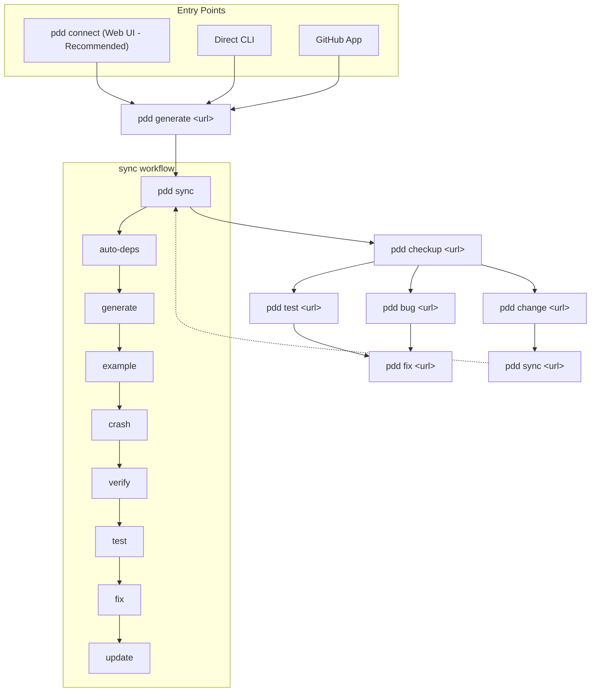

# PDD: The Last Programming Language™

 [](https://discord.gg/Yp4RTh8bG7)

## Introduction

PDD (Prompt-Driven Development) is a prompt-native programming system. `.prompt`
files are the human-authored source language; Python, TypeScript, Go, and other
traditional languages are generated artifacts.

PDD is the last programming language in this specific sense: developers author
durable intent, constraints, examples, and tests, then compile that source into
whatever implementation language the project needs. Code remains real and
reviewable, but it is no longer the primary source of truth.

**Getting started is simple:**

```bash
# Install and run
uv tool install pdd-cli
pdd setup
pdd connect
```

This launches a web interface at `localhost:9876` where you can:
- Implement GitHub issues automatically
- Generate and test code from prompts
- Manage your PDD projects visually

<p align="center">
  
</p>

For CLI users, PDD also offers powerful **agentic commands** that implement GitHub issues automatically:
- `pdd change <issue-url>` - Implement feature requests (13-step workflow)
- `pdd bug <issue-url>` - Create failing tests for bugs
- `pdd fix <issue-url>` - Fix the failing tests
- `pdd split <target-file>` - Diagnose and split large dev units (15-step workflow with intent classification, diagnosis, phase extraction, per-child verify gate, and repair)
- `pdd generate <issue-url>` - Generate architecture.json from a PRD issue (11-step workflow)
- `pdd test <issue-url>` - Generate UI tests from issue descriptions (18-step workflow with exploratory testing, contract validation, accessibility audits)

Choose `pdd bug` before `pdd change` when an issue reports a current runtime
symptom, even if it says the prompt or spec should be updated. Stack traces,
failing commands, wrong CLI/API/UI output, regressions, crashes, and incorrect
generated behavior should run through `pdd bug <issue-url>` followed by
`pdd fix <issue-url>` (`bug → fix`) so the failure is reproduced and covered by
a behavioral test. Use `pdd change` for explicit source-truth/spec/product
changes with no current runtime failure to reproduce (`change → sync` after
the source-truth change lands).

For prompt-based workflows, the **`sync`** command automates the complete development cycle with intelligent decision-making, real-time visual feedback, and sophisticated state management.

## Whitepaper

For the positioning essay behind this shift, read [The Last Programming Language](docs/the-last-programming-language.md).

For a detailed explanation of the concepts, architecture, and benefits of Prompt-Driven Development, please refer to our full whitepaper. This document provides an in-depth look at the PDD philosophy, its advantages over traditional development, and includes benchmarks and case studies.

[Read the Full Whitepaper with Benchmarks](docs/whitepaper_with_benchmarks/whitepaper_w_benchmarks.md)

For a case study on specification drift in AI-assisted coding workflows, read [Why AI Code Falls Apart](docs/whitepaper_specification_drift/whitepaper.md).

Also see the Prompt‑Driven Development Doctrine for core principles and practices: [docs/prompt-driven-development-doctrine.md](docs/prompt-driven-development-doctrine.md)

For a step-by-step methodology on turning a GitHub issue into a durable, human-verified user story, see [docs/generating_user_stories.md](docs/generating_user_stories.md).

For pre-merge prompt and user-story quality (vague terms, vocabulary, optional LLM review), see [docs/prompt_lint.md](docs/prompt_lint.md).

For deterministic contract-section lint (`<contract_rules>`, `<coverage>`, waivers, story `## Covers`), see [docs/contract_check.md](docs/contract_check.md).

For a rule-to-story/test coverage matrix (`pdd checkup coverage`), including the
`@pytest.mark.story` regression marker and the per-story `has_regression_test`
dimension, see [docs/coverage_contracts.md](docs/coverage_contracts.md) and
[docs/generating_user_stories.md](docs/generating_user_stories.md).

For non-interactive bounded prompt repair after a failed prompt source-set checkup, see [docs/prompt_repair.md](docs/prompt_repair.md).

For the deterministic prompt source-set quality gate and its `pdd.prompt_source_set_report.v1` JSON schema (including the per-finding `requires_clarification` / `clarification_reason` clarification signal), see [docs/checkup_prompt_quality_gate.md](docs/checkup_prompt_quality_gate.md).

For the agentic CLI routing policy (task-class-keyed static config table and bounded escalation ladder for `run_agentic_task`), see [docs/routing_policy.md](docs/routing_policy.md).

## Installation

### Prerequisites for macOS

On macOS, you'll need to install some prerequisites before installing PDD:

1. **Install Xcode Command Line Tools** (required for Python compilation):
   ```bash
   xcode-select --install
   ```

2. **Install Homebrew** (recommended package manager for macOS):
   ```bash
   /bin/bash -c "$(curl -fsSL https://raw.githubusercontent.com/Homebrew/install/HEAD/install.sh)"
   ```
   
   After installation, add Homebrew to your PATH:
   ```bash
   echo 'eval "$(/opt/homebrew/bin/brew shellenv)"' >> ~/.zprofile && eval "$(/opt/homebrew/bin/brew shellenv)"
   ```

3. **Install Python** (if not already installed):
   ```bash
   # Check if Python is installed
   python3 --version
   
   # If Python is not found, install it via Homebrew
   brew install python
   ```
   
   **Note**: Recent versions of macOS no longer ship with Python pre-installed. PDD requires Python 3.12 or higher. The `brew install python` command installs the latest Python 3 version.

### Recommended Method: uv

We recommend installing PDD using the [uv package manager](https://github.com/astral-sh/uv) for better dependency management and automatic environment configuration:

```bash
# Install uv if you haven't already 
curl -LsSf https://astral.sh/uv/install.sh | sh

# Install PDD using uv tool install
uv tool install pdd-cli
```

This installation method ensures:
- Faster installations with optimized dependency resolution
- Automatic environment setup without manual configuration
- Proper handling of the PDD_PATH environment variable
- Better isolation from other Python packages

The PDD CLI will be available immediately after installation without requiring any additional environment configuration.

Verify installation:
```bash
pdd --version
```

With the CLI on your `PATH`, continue with:
```bash
pdd setup
```
The command detects agentic CLI tools, scans for API keys, configures models, and seeds local configuration files.
If you postpone this step, the CLI detects the missing setup artifacts the first time you run another command and shows a reminder banner so you can complete it later (the banner is suppressed once `~/.pdd/api-env` exists or when your project already provides credentials via `.env` or `.pdd/`).

### Alternative: pip Installation

If you prefer using pip, you can install PDD with:
```bash
pip install pdd-cli
```


## Advanced Installation Options

### Virtual Environment Installation
```bash
# Create virtual environment
python -m venv pdd-env

# Activate environment
# On Windows:
pdd-env\Scripts\activate
# On Unix/MacOS:
source pdd-env/bin/activate

# Install PDD
pip install pdd-cli
```


## Getting Started

### Option 1: Web Interface (Recommended)

The easiest way to use PDD is through the web interface:

```bash
# 1. Install PDD
curl -LsSf https://astral.sh/uv/install.sh | sh
uv tool install pdd-cli

# 2. Run setup (API keys, shell completion)
pdd setup

# 3. Launch the web interface
pdd connect
```

This opens a browser-based interface where you can:
- **Run Commands**: Execute `pdd change`, `pdd bug`, `pdd fix`, `pdd sync` etc. visually
- **Browse Files**: View and edit prompts, code, and tests in your project
- **Remote Access**: Access your session from any browser via PDD Cloud (use `--local-only` to disable)

### Option 2: Issue-Driven CLI

For CLI enthusiasts, implement GitHub issues directly:

**Prerequisites:**
1. **GitHub CLI** - Required for issue access:
   ```bash
   brew install gh && gh auth login
   ```

2. **One Agentic CLI** - Required to run the workflows (install at least one):
   - **Claude Code**: `npm install -g @anthropic-ai/claude-code` (uses your stored Claude Max/Pro OAuth login if you've run `claude auth login`, otherwise falls back to `ANTHROPIC_API_KEY`; pdd auto-prefers OAuth — set `PDD_KEEP_ANTHROPIC_API_KEY=1` to force API-key billing)
   - **Antigravity CLI (`agy`, preferred)**: install via `curl -fsSL https://antigravity.google/cli/install.sh | bash` (uses Antigravity OAuth or keyring-backed Google subscription sign-in if present, otherwise `ANTIGRAVITY_API_KEY`/`GOOGLE_API_KEY`, Vertex AI env auth, or PDD's compatibility bridge from `GEMINI_API_KEY`). Set `PDD_AGENTIC_PROVIDER=antigravity` to pin the Antigravity binary, or `PDD_GOOGLE_CLI=agy|gemini|auto` to control binary selection (`auto` prefers `agy` when credentialed, but keeps legacy `gemini` for legacy-OAuth-only setups).
   - **Gemini CLI (legacy, rollback)**: `npm install -g @google/gemini-cli` (uses `~/.gemini` OAuth credentials if present, otherwise `GOOGLE_API_KEY` or `GEMINI_API_KEY`). Google announced consumer-tier Gemini CLI cutoff on **2026-06-18**; set `PDD_GOOGLE_CLI=gemini` only when you intentionally need the old binary.
   - **Codex CLI**: `npm install -g @openai/codex@latest` (GPT-5.6 requires Codex CLI 0.144.0 or newer; uses `~/.codex/auth.json` ChatGPT login if present, otherwise `OPENAI_API_KEY`)
   - **OpenCode CLI**: `npm install -g opencode-ai` (uses OpenCode provider auth from `opencode auth login`, `~/.config/opencode/opencode.json`, project `opencode.json`, or provider env vars; set `OPENCODE_MODEL=provider/model`)

**Usage:**
```bash
# Implement a feature request
pdd change https://github.com/owner/repo/issues/123

# Or fix a bug
pdd bug https://github.com/owner/repo/issues/456
pdd fix https://github.com/owner/repo/issues/456
```

### Option 3: Manual Prompt Workflow

For learning PDD fundamentals or working with existing prompt files:

```bash
cd your-project
pdd sync module_name  # Full automated workflow
```

See the [Hello Example](#-quickstart-hello-example) below for a step-by-step introduction.

---

## 🚀 Quickstart (Hello Example)

If you want to understand PDD fundamentals, follow this manual example to see it in action.

1. **Install prerequisites** (macOS/Linux):
   ```bash
   xcode-select --install      # macOS only
   curl -LsSf https://astral.sh/uv/install.sh | sh
   uv tool install pdd-cli
   pdd --version
   ```

2. **Clone repo**

   ```bash
     # Clone the repository (if not already done)
    git clone https://github.com/promptdriven/pdd.git
    cd pdd/examples/hello
   ```

3. **Set one API key** (choose your provider):
   ```bash
   export GEMINI_API_KEY="your-gemini-key"
   # OR
   export OPENAI_API_KEY="your-openai-key"
   ```

### Post-Installation Setup (Required first step after installation)

Run the comprehensive setup wizard:
```bash
pdd setup
```

The setup wizard runs these steps:
  1.  Detects agentic CLI tools (Claude, Gemini/Antigravity, Codex, OpenCode) and offers installation and credential configuration if needed. Credentials can be environment-variable API keys, stored OAuth/subscription/config credentials such as Claude Max/Pro, Google Gemini/Antigravity login, Vertex AI env auth, Codex ChatGPT login, or OpenCode provider auth/config.
  2. Scans for API keys across `.env`, `~/.pdd/api-env.*`, and the shell environment. If no API key is found but a selected CLI already has a stored OAuth/subscription/config credential, setup skips the API-key prompt for the agentic workflow and explains which direct prompt/LiteLLM commands still need API keys.
  3. Configures models from a reference CSV `data/llm_model.csv` of top ranked models across all LiteLLM-supported providers based on your available API keys
  4. If you have credentials for **more than one** provider, asks which provider(s) `pdd --local` should use, then removes the unselected providers' PDD-managed rows from `~/.pdd/llm_model.csv` (rows you hand-edited or added yourself are preserved — see below)
  5. Optionally creates a `.pddrc` project config
  6. Tests a model from your selected provider with a real LLM call
  7. Prints a structured summary (CLIs, keys, models, test result)

The wizard can be re-run at any time to update keys, add providers, or reconfigure settings.

#### Choosing your local provider

`pdd --local` selects a model from `~/.pdd/llm_model.csv` by cost/ranking, so if
the file lists several providers it can route to one you didn't intend — for
example a free GitHub Copilot login outranking a `GEMINI_API_KEY` you set on
purpose. To prevent that, when setup ends up with more than one usable provider
— which includes always-available device-login providers like GitHub Copilot,
so the prompt can appear even if you only set a single API key — it asks you to
pick which provider(s) to keep, then removes the unselected providers'
PDD-managed rows (rows you hand-edited or added yourself are preserved):

- **Default selection** excludes device-login providers (e.g. GitHub Copilot,
  which needs no API key) so a free login never silently outranks a key you
  configured. Select them explicitly to keep them.
- **Local models** (Ollama, LM Studio) and any **hand-edited/custom rows** for
  providers you don't configure are never offered for removal and are left
  untouched.
- Before removing any rows, setup **lists exactly what will be removed and asks
  you to confirm**, and snapshots the previous file to
  `~/.pdd/llm_model.csv.backup.<timestamp>` so the change is always reversible.
- Your choice is saved to `~/.pdd/setup_preferences.json`. Re-running setup
  re-uses it without re-asking and without re-adding the providers you dropped
  (so a later run stays quiet — no repeated prompt, no Copilot churn). It only
  adds new models for the providers you already chose.

To use a different provider later, delete `~/.pdd/setup_preferences.json` and
re-run `pdd setup` to pick a new selection (or edit `~/.pdd/llm_model.csv`
directly). Adding a provider through the setup options menu also updates your
saved selection.

> **Important:** After setup completes, source the API environment file so your keys take effect in the current terminal session:
> ```bash
> source ~/.pdd/api-env.zsh   # or api-env.bash, depending on your shell
> ```
> New terminal windows will load keys automatically.

If you skip this step, the first regular pdd command you run will detect the missing setup files and print a reminder banner so you can finish onboarding later.

5. **Run Hello**:
   ```bash
   cd ../hello
   pdd --force generate hello_python.prompt
   python3 hello.py
   ```

    ✅ Expected output:
    ```
    hello
    ```


## Cloud vs Local Execution

PDD commands can be run either in the cloud or locally. By default, all commands run in the cloud mode, which provides several advantages:

- No need to manage API keys locally
- Access to more powerful models
- Shared examples and improvements across the PDD community
- Automatic updates and improvements
- Better cost optimization

### Cloud Authentication

When running in cloud mode (default), PDD uses GitHub Single Sign-On (SSO) for authentication. On first use, you'll be prompted to authenticate:

1. PDD will open your default browser to the GitHub login page
2. Log in with your GitHub account
3. Authorize PDD Cloud to access your GitHub profile
4. Once authenticated, you can return to your terminal to continue using PDD

The authentication token is securely stored locally and automatically refreshed as needed.

### Local Mode Requirements

When running in local mode with the `--local` flag, you'll need to set up API keys for the language models:

```bash
# For OpenAI
export OPENAI_API_KEY=your_api_key_here

# For Anthropic
export ANTHROPIC_API_KEY=your_api_key_here

# For other supported providers (LiteLLM supports multiple LLM providers)
export PROVIDER_API_KEY=your_api_key_here
```

Some local-mode providers do not use API keys. GitHub Copilot models
authenticate through LiteLLM's OAuth device flow; run `pdd setup`, then choose
**Add a provider** from the options menu and pick GitHub Copilot to complete
that device login. (The provider-selection prompt described above only decides
which already-configured providers `pdd --local` uses — it does not perform the
OAuth login.)

Add these to your `.bashrc`, `.zshrc`, or equivalent for persistence.

PDD's local mode uses the packaged LiteLLM dependency (`>=1.84.0,<1.85` in this release) for interacting with language models, providing:

- Support for multiple model providers (OpenAI, Anthropic, Google/Vertex AI, and more)
- Automatic model selection based on strength settings
- Response caching for improved performance
- Smart token usage tracking and cost estimation
- Interactive API key acquisition when keys are missing

When keys are missing, PDD will prompt for them interactively and securely store them in your local `.env` file.

### Local Model Configuration

PDD uses a CSV file to configure model selection and capabilities. This configuration is loaded from:

1. User-specific configuration: `~/.pdd/llm_model.csv` (takes precedence if it exists)
2. Project-specific configuration: `<PROJECT_ROOT>/.pdd/llm_model.csv`
3. Package default: Bundled with PDD installation (fallback when no local configurations exist)

The CSV includes columns for:
- `provider`: The LLM provider (e.g., "openai", "anthropic", "google")
- `model`: The LiteLLM model identifier (e.g., "gpt-4", "claude-3-opus-20240229")
- `input`/`output`: Costs per million tokens
- `coding_arena_elo`: Raw Arena/static ELO metadata
- `model_rank_score`: Primary selection rank. DeepSWE rows use a high solve-rate band; Arena/static rows fall back to raw ELO.
- `model_rank_source`: Source of `model_rank_score` (for example `deepswe-solve-rate`, `arena-elo-fallback`, or `static`)
- `api_key`: The environment variable name for required authentication, or
  blank for local and device-flow providers such as Ollama, LM Studio, and
  GitHub Copilot
- `structured_output`: Whether the model supports structured JSON output
- `reasoning_type`: Support for reasoning capabilities ("none", "budget", "effort", or "adaptive")

For a concrete, up-to-date reference of supported models and example rows, see the bundled CSV in this repository: [pdd/data/llm_model.csv](pdd/data/llm_model.csv).

For proper model identifiers to use in your custom configuration, refer to the [LiteLLM Model List](https://docs.litellm.ai/docs/providers) documentation. LiteLLM typically uses model identifiers in the format `provider/model_name` (e.g., "openai/gpt-4", "anthropic/claude-3-opus-20240229").

#### Z.AI (GLM Models)

PDD supports two Z.AI API endpoints:

- **General API** (`https://api.z.ai/api/paas/v4`) — standard prepaid/resource billing, suitable for general use.
- **GLM Coding Plan** (`https://api.z.ai/api/coding/paas/v4`) — quota-backed subscription plan designed for coding workflows. Diagnostics show it as quota-backed rather than a per-token dollar estimate.

Both endpoints use the same API key. To use the bundled GLM Coding Plan rows:

```bash
export ZAI_API_KEY=your_zai_api_key_here
export PDD_MODEL_DEFAULT=glm-5.2
```

Or in your `.pddrc`:

```yaml
defaults:
  model: glm-5.2
```

The bundled catalog includes rows for `Z.AI` (general API) and `Z.AI Coding Plan` providers. PDD stores these rows as OpenAI-compatible `openai/glm-5.2` model strings with explicit `base_url` values, and resolves a bare user default such as `glm-5.2` to the quota-backed Coding Plan row instead of falling through to an unrelated provider.

To target the per-token General API endpoint (`https://api.z.ai/api/paas/v4`) instead of the Coding Plan endpoint, select the explicit OpenAI-compatible row:

```bash
export ZAI_API_KEY=your_zai_api_key_here
export PDD_MODEL_DEFAULT=openai/glm-5.2
```

Structured-output forcing is disabled for Z.AI rows until Z.AI schema support is verified; `reasoning_effort` is enabled through PDD's normal `low`/`medium`/`high` effort mapping.

Run `pdd setup` with `ZAI_API_KEY` set to have PDD detect Z.AI and include it in the provider configuration.

## Troubleshooting Common Installation Issues

1. **Command not found**
   ```bash
   # Add to PATH if needed
   export PATH="$HOME/.local/bin:$PATH"
   ```

2. **Permission errors**
   ```bash
   # Install with user permissions
   pip install --user pdd-cli
   ```

3. **macOS-specific issues**
   - **Xcode Command Line Tools not found**: Run `xcode-select --install` to install the required development tools
   - **Homebrew not found**: Install Homebrew using the command in the prerequisites section above
   - **Python not found or wrong version**: Install Python 3 via Homebrew: `brew install python`
   - **Permission denied during compilation**: Ensure Xcode Command Line Tools are properly installed and you have write permissions to the installation directory
   - **uv installation fails**: Try installing uv through Homebrew: `brew install uv`
   - **Python version conflicts**: If you have multiple Python versions, ensure `python3` points to Python 3.12+: `which python3 && python3 --version`

## Version

To check your installed version, run:
```
pdd --version
```
PDD includes an auto-update feature to ensure you always have access to the latest features and security patches. You can control this behavior using an environment variable (see "Auto-Update Control" section below).

## Supported Programming Languages

PDD supports a wide range of programming languages, including but not limited to:
- Python
- JavaScript
- TypeScript
- Java
- C++
- Ruby
- Go

The specific language is often determined by the prompt file's naming convention or specified in the command options.

## Prompt File Naming Convention

Prompt files in PDD commonly follow one of these formats:
```
<basename>_<language>.prompt
```
or, for architecture-driven projects with nested output paths:
```
<path/to/output_stem>_<Language>.prompt
```
Where:
- `<basename>` is the base name of the file or project in legacy flat layouts
- `<path/to/output_stem>` mirrors the output filepath without its extension in architecture-driven layouts
- `<language>` / `<Language>` is the programming language or prompt context suffix used by the project

Examples:
- `factorial_calculator_python.prompt` (basename: factorial_calculator, language: python)
- `responsive_layout_css.prompt` (basename: responsive_layout, language: css)
- `data_processing_pipeline_python.prompt` (basename: data_processing_pipeline, language: python)
- `src/models/user_Python.prompt` → generates `src/models/user.py`
- `app/api/orders/route_TypeScript.prompt` → generates `app/api/orders/route.ts`

PDD supports both conventions. Legacy hand-written prompts are often flat, while prompts generated from `architecture.json` typically mirror the target filepath directory structure.

## Prompt-Driven Development Philosophy

### Core Concepts

Prompt-Driven Development (PDD) inverts traditional software development by treating prompts as the primary artifact - not code. This paradigm shift has profound implications:

1. **Prompts as Source of Truth**: 
   In traditional development, source code is the ground truth that defines system behavior. In PDD, the prompts are authoritative, with code being a generated artifact.

2. **Natural Language Over Code**:
   Prompts are written primarily in natural language, making them more accessible to non-programmers and clearer in expressing intent.

3. **Regenerative Development**:
   When changes are needed, you modify the prompt and regenerate code, rather than directly editing the code. This maintains the conceptual integrity between requirements and implementation.

4. **Intent Preservation**:
   Prompts capture the "why" behind code in addition to the "what" - preserving design rationale in a way that comments often fail to do.

### Mental Model

To work effectively with PDD, adopt these mental shifts:

1. **Prompt-First Thinking**:
   Always start by defining what you want in a prompt before generating any code.

2. **Bidirectional Flow**:
   - Prompt → Code: The primary direction (generation)
   - Code → Prompt: Secondary but crucial (keeping prompts in sync with code changes)

3. **Modular Prompts**:
   Just as you modularize code, you should modularize prompts into self-contained units that can be composed.

4. **Integration via Examples**:
   Modules integrate through their examples, which serve as interfaces, allowing for token-efficient references.

### PDD Workflows: Conceptual Understanding

Each workflow in PDD addresses a fundamental development need:

1. **Initial Development Workflow**
   - **Purpose**: Creating functionality from scratch
   - **Conceptual Flow**: Define dependencies → Generate implementation → Create interfaces → Ensure runtime functionality → Verify correctness
   
   This workflow embodies the prompt-to-code pipeline, moving from concept to tested implementation.

2. **Code-to-Prompt Update Workflow**
   - **Purpose**: Maintaining prompt as source of truth when code changes
   - **Conceptual Flow**: Sync code changes to prompt → Identify impacts → Propagate changes
   
   This workflow ensures the information flow from code back to prompts, preserving prompts as the source of truth.

3. **Debugging Workflows**
   - **Purpose**: Resolving different types of issues
   - **Conceptual Types**:
     - **Context Issues**: Addressing misunderstandings in prompt interpretation
     - **Runtime Issues**: Fixing execution failures
     - **Logical Issues**: Correcting incorrect behavior
     - **Traceability Issues**: Connecting code problems back to prompt sections
   
   These workflows recognize that different errors require different resolution approaches.

4. **Refactoring Workflow**
   - **Purpose**: Improving prompt organization and reusability
   - **Conceptual Flow**: Extract functionality → Ensure dependencies → Create interfaces
   
   This workflow parallels code refactoring but operates at the prompt level.

5. **Multi-Prompt Architecture Workflow**
   - **Purpose**: Coordinating systems with multiple prompts
   - **Conceptual Flow**: Detect conflicts → Resolve incompatibilities → Regenerate code → Update interfaces → Verify system
   
   This workflow addresses the complexity of managing multiple interdependent prompts.

6. **Enhancement Phase**: Use Feature Enhancement when adding capabilities to existing modules.

### Workflow Selection Principles

The choice of workflow should be guided by your current development phase:

1. **Creation Phase**: Use Initial Development when building new functionality.

2. **Maintenance Phase**: Use Code-to-Prompt Update when existing code changes.

3. **Problem-Solving Phase**: Choose the appropriate Debugging workflow based on the issue type:
   - Preprocess → Generate for prompt interpretation issues
   - Crash for runtime errors
   - Bug → Fix for logical errors
   - Trace for locating problematic prompt sections

4. **Restructuring Phase**: Use Refactoring when prompts grow too large or complex.

5. **System Design Phase**: Use Multi-Prompt Architecture when coordinating multiple components.

6. **Enhancement Phase**: Use Feature Enhancement when adding capabilities to existing modules.

### PDD Design Patterns

Effective PDD employs these recurring patterns:

1. **Dependency Injection via Auto-deps**:
   Automatically including relevant dependencies in prompts.

2. **Interface Extraction via Example**:
   Creating minimal reference implementations for reuse.

3. **Bidirectional Traceability**:
   Maintaining connections between prompt sections and generated code.

4. **Test-Driven Prompt Fixing**:
   Using tests to guide prompt improvements when fixing issues.

5. **Hierarchical Prompt Organization**:
   Structuring prompts from high-level architecture to detailed implementations.

## Basic Usage

```
pdd [GLOBAL OPTIONS] COMMAND [OPTIONS] [ARGS]...
```

## Command Overview

Here is a brief overview of the main commands provided by PDD. Click the command name to jump to its detailed section:

### Command Relationships

The following diagram shows how PDD commands interact:



**Key concepts:**
- **Entry points**: `pdd connect` (web UI), direct CLI, or the GitHub App
- **Start**: `pdd generate <url>` scaffolds architecture, prompts, and `.pddrc` from a PRD GitHub issue
- **Core loop**: `pdd sync` runs the full auto-deps → generate → example → crash → verify → test → fix → update cycle for each module
- **Health check**: `pdd checkup <url>` identifies what needs attention next; `pdd checkup --pr ...` reviews an existing PR on its own merits (add `--issue ...` to also verify it resolves a specific issue)
- **Defect path**: `test <url>` or `bug <url>` surfaces failing tests → `fix <url>` resolves them
- **Feature path**: `change <url>` implements the feature → `sync <url>` re-runs sync across affected modules. Auth caveat: `sync <url>` still runs a LiteLLM-backed generate phase, so OAuth-only CLI setup is not enough; configure an API key first.

### Getting Started
- **[`connect`](#18-connect)**: **[RECOMMENDED]** Launch web interface for visual PDD interaction
- **[`setup`](#post-installation-setup-required-first-step-after-installation)**: Configure API keys and shell completion

### Agentic Commands (Issue-Driven)
- **[`change`](#8-change)**: Implement feature requests from GitHub issues (13-step workflow)
- **[`bug`](#14-bug)**: Analyze bugs and create failing tests from GitHub issues
- **[`checkup`](#17-checkup)**: Run automated project health checks from GitHub issues, or review/verify existing PRs (optionally against a source issue)
- **[`fix`](#6-fix)**: Fix failing tests (supports issue-driven and manual modes)
- **[`sync`](#1-sync)**: Multi-module parallel sync from a GitHub issue (when passed a URL instead of basename). This mode still requires API-key-backed LiteLLM for its generate phase; stored CLI OAuth alone is not sufficient.
- **[`test`](#4-test)**: Generate UI tests from GitHub issues (18-step workflow in agentic mode)

### Core Commands (Prompt-Based)
- **[`sync`](#1-sync)**: **[PRIMARY FOR PROMPT WORKFLOWS]** Automated prompt-to-code cycle
- **[`generate`](#2-generate)**: Creates runnable code from a prompt file; supports parameterized prompts via `-e/--env`
- **[`example`](#3-example)**: Generates a compact example showing how to use functionality defined in a prompt
- **[`test`](#4-test)**: Generates or enhances unit tests for a code file and its prompt
- **[`update`](#9-update)**: Updates the original prompt file based on modified code
- **[`verify`](#16-verify)**: Verifies functional correctness by running a program and judging output against intent
- **[`crash`](#12-crash)**: Fixes errors in a code module and its calling program that caused a crash

### Prompt Management
- **[`preprocess`](#5-preprocess)**: Preprocesses prompt files, handling includes, comments, and other directives
- **[`replay`](#5a-replay)**: Reconstructs and audits expanded prompt context from a snapshot-enabled run artifact
- **[`context`](#5b-context)**: Shows context-window usage by source for a hydrated prompt, Claude-Code `/context`-style
- **[`split`](#7-split)**: Splits large prompt files into smaller, more manageable ones
- **[`extracts prune`](#21-extracts)**: Garbage-collect orphaned extracts cache entries
- **[`auto-deps`](#15-auto-deps)**: Analyzes and inserts needed dependencies into a prompt file
- **[`sync-architecture`](#1a-sync-architecture)**: Updates `architecture.json` from prompt metadata tags
- **[`detect`](#10-detect)**: Analyzes prompts to determine which ones need changes based on a description
- **[`conflicts`](#11-conflicts)**: Finds and suggests resolutions for conflicts between two prompt files
- **[`trace`](#13-trace)**: Finds the corresponding line number in a prompt file for a given code line

### Utility Commands
- **[`auth`](#19-auth)**: Manages authentication with PDD Cloud
- **[`sessions`](#20-pdd-sessions---manage-remote-sessions)**: Manage remote sessions for `connect`
- **[`report-core`](#report-core-command)**: Create a GitHub issue from a debug snapshot
- **`contracts check`**: Run deterministic contract section checks; see [docs/contract_check.md](docs/contract_check.md)
- **`templates`**: List, inspect, and copy packaged prompt templates
- **`which`**: Print resolved configuration values and search paths
- **`install_completion`**: Refresh shell completion scripts

### User Story Prompt Tests
PDD can validate prompt changes against user stories stored as Markdown files. This uses `detect` under the hood: a story **passes** when `detect` returns no required prompt changes.

Defaults:
- Stories live in `user_stories/` and match `story__*.md`.
- Prompts are loaded from `prompts/` (excluding `*_llm.prompt` by default).

Overrides:
- `PDD_USER_STORIES_DIR` sets the stories directory.
- `PDD_PROMPTS_DIR` sets the prompts directory.

Commands:
- `pdd story add <issue-source> --devunit <name> [--devunit <name>]` creates a story file from a GitHub issue URL, issue number, or local Markdown file, linked to one or more dev units. Use `--text "..."` to supply the story source as inline text instead of a URL or file path. Supports `--prompt <path>` for explicit prompt selection, `--from-changed-files` to link currently changed `.prompt` files, `--dry-run` for a no-write preview, `--update` to merge prompt links into an existing story, and `--generate-regression` to print the follow-up `pdd test --from-story` command.
- `pdd story list [--with-regression-status]` lists all stories in `user_stories/` with their slug, file path, linked prompts, and (when the traceability API is available) `missing` / `has-test` / `stale` regression status. This is a presence/freshness signal only: `has-test` means a fresh, marker-linked regression test exists (or a legacy hashless traceability link), not that it passed — pass/fail is verified separately by the story lane (`pytest -m story`).
- `pdd story link <story-file> --prompt <path>` adds a prompt link to an existing story file without regenerating the story body. Validates that the story file is inside `user_stories/`.
- `pdd test --from-story user_stories/story__*.md --output tests/story_regression/test_story_*.py` generates deterministic pytest regression tests from the story contract. When the contract declares a machine-readable `## Entry Point`, the generated test is behavioral (preferred): it imports and calls the entry point and asserts the `## Oracle` / `## Negative Cases` bullets as Python expressions over `result`. Without an `## Entry Point`, it falls back to a text-pin test that pins the story/contract hash and clauses. Either way, generated tests are tagged with `@pytest.mark.story(...)`. See [docs/generating_user_stories.md](docs/generating_user_stories.md) Step 8.
- `pdd detect --stories` runs the validation suite.
- `pdd change` runs story validation after prompt modifications and fails if any story fails.
- `pdd fix user_stories/story__*.md` applies a single story to prompts and re-validates it.
- `pdd test --issue <url|number|issue.md> <prompt_1.prompt> [prompt_2.prompt ...]` generates a `story__*.md` file from the issue text and links those prompts.
- `pdd test user_stories/story__*.md` updates prompt links for an existing story file.
- Story validation prints PASS/FAIL/UNKNOWN and exits non-zero if any story does not pass. `pdd detect --stories` does not support CSV `--output`. Automation should use `--json` or atomic `--json-output FILE`; these modes imply read-only, non-interactive execution and emit schema `pdd.detect.stories.v1`. Exit 0 means every scoped story explicitly passed, 1 is a completed semantic story failure, 2 is a scope/configuration error, and 3 is an authentication/provider/timeout or incomplete-evaluation failure. The canonical scoped form is `pdd detect --stories --stories-dir user_stories --prompts-dir prompts --no-fail-fast --json`. Do not pass a story directory positionally.

Failure output:
- When a completed semantic evaluation fails, `pdd detect --stories` prints the evaluated prompt paths,
  per-prompt descriptions of the missing or stale behavior, and a
  `pdd fix user_stories/story__<slug>.md` next-step command.
- If prompt metadata is only partially or not at all resolvable, the story is
  `UNKNOWN`: PDD lists evaluated prompts and unresolved references, recommends
  repairing `pdd-story-prompts` metadata, and does not describe the problem as
  missing/stale behavior or recommend `pdd fix`.

Story prompt linkage:
- Stories may include optional metadata to scope validation to a subset of prompts:
  `<!-- pdd-story-prompts: prompts/a_python.prompt, prompts/b_python.prompt -->`
- If metadata is missing, `pdd detect --stories` validates against the full prompt set.
- `pdd test --issue ... <*.prompt>` links the prompt files passed on the command line directly in story metadata; it does not run `detect_change` during story authoring.
- In `--stories` mode, existing story metadata scopes validation; when metadata is missing, validation falls back to the full prompt set.
- **Cross-dev-unit stories:** When ≥2 prompt files are passed to `pdd test --issue`, a second metadata comment is also written alongside `pdd-story-prompts`:
  `<!-- pdd-story-dev-units: basename1.prompt, basename2.prompt -->`
  This marks the story as spanning multiple dev units (cross-unit). Single-prompt stories do not receive a `pdd-story-dev-units` comment. Cross-unit traceability is exposed via `get_cross_unit_stories_for_prompt` (forward lookup: which cross-unit stories include a given prompt) and `story_is_cross_unit` (returns `True` when the deduplicated union of the `pdd-story-prompts` and `pdd-story-dev-units` entries has ≥2 names — so one prompt link plus one distinct dev-unit link already counts as cross-unit). `pdd checkup coverage` reports cross-unit stories separately and counts each story once globally to prevent double-counting.

Template:
- See `user_stories/story__template.md` for a starter format.

Contract coverage:
- User stories are **example-level coverage** for named contract rules in prompts.
  Document rule IDs under each story's `## Covers` section (for example `R1` or
  `prompts/module_python.prompt#R2`). See `docs/coverage_contracts.md` and
  `docs/contract_check.md`.

Executable regression suite:
- Beyond drift validation, a story can carry a generated executable regression
  test marked `@pytest.mark.story`. Run the suite with `make regression-stories`
  (i.e. `pytest -m story`) in the public-safe, no-secrets lane.
- Generate a test for a story with
  `pdd test --from-story user_stories/story__<slug>.md`.
- Seed coverage ships for the top flows (`generate`, `sync`, `fix`, `change`,
  `update`) plus a batch of previously-fixed-bug regressions. See
  [docs/generating_user_stories.md](docs/generating_user_stories.md#story-regression-suite-executable-oracles).

## Global Options

These options can be used with any command:

- `--force`: Skip all interactive prompts (file overwrites, API key requests). Useful for CI/automation.
- `--strength FLOAT`: Set the strength of the AI model (0.0 to 1.0, default is 1.0 unless `.pddrc` or `PDD_STRENGTH_DEFAULT` overrides it).
  - 0.0: Cheapest available model
  - 0.5: Mid-ranked model
  - 1.0: Most powerful model (highest DeepSWE-first rank score)
- `--time FLOAT`: Controls the reasoning allocation for LLM models supporting reasoning capabilities (0.0 to 1.0, default is 0.25).
  - For models with specific reasoning token limits (e.g., 64k), a value of `1.0` utilizes the maximum available tokens.
  - For models with discrete effort levels, `1.0` corresponds to the highest effort level.
  - Values between 0.0 and 1.0 scale the allocation proportionally.
- `--temperature FLOAT`: Set the temperature of the AI model (default is 0.0).
- `--verbose`: Increase output verbosity for more detailed information. Includes token count and context window usage for each LLM call.
- `--quiet`: Decrease output verbosity for minimal information.
- `--color / --no-color`: Force or disable colored output across **all** commands. Default is auto: color is on when writing to a TTY and off when piped or when `NO_COLOR` is set. `--no-color` disables color everywhere; `--color` forces it on even through a pipe (e.g. `pdd --color sync | less -R`). The flag sets `NO_COLOR`/`FORCE_COLOR` for the run, so every console PDD builds inherits the choice. For `pdd context`, which has its own `--color/--no-color`, precedence is: the command's own flag wins, otherwise the global flag, otherwise auto-detect.
- `--output-cost PATH_TO_CSV_FILE`: Enable cost tracking and output a CSV file with usage details.
- `--estimate`, `--dry-run-cost`: Preview the LLM token and rough cost estimate for `pdd generate` without calling a provider, writing command outputs, or appending cost CSV rows.
- `--estimate-json`: Emit the estimate result as machine-readable JSON instead of the human-readable table.
- `--review-examples`: Review and optionally exclude few-shot examples before command execution.
- `--local`: Run commands locally instead of in the cloud.
- `--core-dump / --no-core-dump`: Write a debug snapshot for this run into `.pdd/core_dumps` (default: on). Use `--no-core-dump` to disable it.
- `--keep-core-dumps N`: Keep the most recent N debug snapshots (default: 10; use `0` to clean them immediately after writing).
- `--context CONTEXT_NAME`: Override automatic context detection and use the specified context from `.pddrc`.
- `--list-contexts`: List all available contexts defined in `.pddrc` and exit.
- `--compress-examples`: Automatically apply `mode="interface"` to example includes (legacy; prefer `--context-compression examples`).
- `--compress-test-context`: Rank and select tests under a configurable token budget (`PDD_TEST_TOKEN_BUDGET`, default 2 000 tokens) using import-graph distance, symbol overlap, failure recency, and file recency. Failing tests (from `PDD_FAILING_TESTS` or `.pytest_cache`) are always included first. A `TestPackingManifest` explaining selected and omitted tests is emitted in the run telemetry (legacy: prefer `--context-compression test`).
- `--context-compression {off,test,examples,contracts,all}`: Set context compression for this CLI invocation (default: `off`). Must appear **before** the subcommand (e.g. `pdd --context-compression test generate ...`). `sync` and `fix` also accept the same flags after their subcommand.
- `--compression-fallback {full,error}`: When compression or slicing fails, use full content (`full`, default) or abort (`error`). Global placement is the same as `--context-compression`.

### Core Dump Debug Bundles

PDD writes JSON debug snapshots to `.pdd/core_dumps` by default and keeps the 10 most recent files. These snapshots capture enough run context to replay and analyze failures. Disable them with `--no-core-dump`, or change retention with `--keep-core-dumps`.

```bash
pdd sync factorial_calculator
pdd --no-core-dump sync factorial_calculator
pdd --keep-core-dumps 20 crash prompts/calc_python.prompt src/calc.py examples/run_calc.py crash_errors.log
```

When debug snapshots are enabled, PDD:

- Captures the full CLI command and arguments
- Records relevant logs and internal trace information for that run
- Bundles the prompt(s), generated code, and key metadata needed to replay the issue

At the end of the run, PDD prints the path to the debug snapshot.  
Attach that bundle when you open a GitHub issue or send a bug report so maintainers can quickly reproduce and diagnose your problem.

#### `report-core` Command

The `report-core` command helps you report a bug by creating a GitHub issue with the core dump file. It simplifies the reporting process by automatically collecting relevant files and information.

**Usage:**
```bash
pdd report-core [OPTIONS] [CORE_FILE]
```

**Arguments:**
- `CORE_FILE`: The path to the core dump file (e.g., `.pdd/core_dumps/pdd-core-....json`). If omitted, the most recent core dump is used.

**Options:**
- `--api`: Create the issue directly via the GitHub API instead of opening a browser. This enables automatic Gist creation for attached files.
- `--repo OWNER/REPO`: Target GitHub repository. Required unless `PDD_GITHUB_REPO` is set.
- `--description`, `-d TEXT`: A short description of what went wrong.

**Authentication:**

To use the `--api` flag, you need to be authenticated with GitHub. PDD checks for credentials in the following order:

1.  **GitHub CLI**: `gh auth token` (recommended)
2.  **Environment Variables**: `GITHUB_TOKEN` or `GH_TOKEN`
3.  **Legacy**: `PDD_GITHUB_TOKEN`

**File Tracking & Gists:**

When using `--api`, PDD will:
1.  Collect all relevant files (prompts, code, tests, configs, meta files).
2.  Create a **private GitHub Gist** containing these files.
3.  Link the Gist in the created issue.

This ensures that all necessary context is available for debugging while keeping the issue body clean. If you don't use `--api`, files will be truncated to fit within the URL length limits of the browser-based submission.

---

### Context Selection Flags

- `--list-contexts` reads the nearest `.pddrc` (searching upward from the current directory), prints the available contexts one per line, and exits immediately with status 0. No auto‑update checks or subcommands run when this flag is present.
- `--context CONTEXT_NAME` is validated early against the same `.pddrc` source of truth. If the name is unknown, the CLI raises a `UsageError` and exits with code 2 before running auto‑update or subcommands.
- Precedence for configuration is: CLI options > `.pddrc` context > environment variables > defaults. See Configuration for details.

## Auto-Update Control

PDD automatically updates itself to ensure you have the latest features and security patches. However, you can control this behavior using the `PDD_AUTO_UPDATE` environment variable:

```bash
# Disable auto-updates
export PDD_AUTO_UPDATE=false

# Enable auto-updates (default behavior)
export PDD_AUTO_UPDATE=true
```

For persistent settings, add this environment variable to your shell's configuration file (e.g., `.bashrc` or `.zshrc`).

This is particularly useful in:
- Production environments where version stability is crucial
- CI/CD pipelines where consistent behavior is required
- Version-sensitive projects that require specific PDD versions

## AI Model Information

PDD uses a large language model to generate and manipulate code. The `--strength` and `--temperature` options allow you to control the model's output:

- Strength: Determines how powerful/expensive a model should be used. Higher values (closer to 1.0) result in high performance models with better capabilities (selected by `model_rank_score`, where DeepSWE is primary and Arena/static ELO is fallback), while lower values (closer to 0.0) select more cost-effective models.
- Temperature: Controls the randomness of the output. Higher values increase diversity but may lead to less coherent results, while lower values produce more focused and deterministic outputs.
- Time: (Optional, controlled by `--time FLOAT`) For models supporting reasoning, this scales the allocated reasoning resources (e.g., tokens or effort level) between minimum (0.0) and maximum (1.0), with a default of 0.25.

When running in local mode, PDD uses LiteLLM to select and interact with language models based on a configuration file that includes:
- Input and output costs per million tokens
- Primary `model_rank_score` values for selection and raw Arena/static `coding_arena_elo` metadata
- Required API key environment variables
- Structured output capability flags
- Reasoning capabilities (budget-based, effort-based, or adaptive)

## Output Cost Tracking

PDD includes a feature for tracking and reporting the cost of operations. When enabled, it generates a CSV file with usage details for each command execution.

### Usage

To enable cost tracking, use the `--output-cost` option with any command:

```
pdd --output-cost PATH_TO_CSV_FILE [COMMAND] [OPTIONS] [ARGS]...
```

The `PATH_TO_CSV_FILE` should be the desired location and filename for the CSV output.

### Dry-Run Cost Estimates

Use the global `--estimate` flag, or its alias `--dry-run-cost`, to preview the LLM cost for `pdd generate` before running it.

```
pdd --estimate generate prompts/example_python.prompt
pdd --estimate-json generate prompts/example_python.prompt
```

Estimate mode assembles the generate messages that would be sent to the provider, counts input tokens, predicts output tokens with a generate-specific heuristic, and prints the selected model, input tokens, predicted output tokens, uncertainty range, known input/output rates, rough estimated cost or `unknown`, and context-window usage percentage. It exits before provider invocation and before command output files are written.

This first version supports `generate` only. Other commands, including `sync`, agentic sync, `example`, `test`, `update`, `conflicts`, `crash`, and `fix`, fail closed with a clear unsupported-command message rather than showing a partial first-call or lower-bound estimate.

`--estimate-json` prints the same estimate fields as JSON for scripts. Estimate mode does not append rows to `--output-cost` CSV files; use `--output-cost` for actual-run accounting. Cost CSV rows are written only for real command executions, because no billable LLM call occurs in estimate mode.

### Cost Calculation and Presentation

PDD calculates costs based on the AI model usage for each operation. Costs are presented in USD (United States Dollars) and are calculated using the following factors:

1. Model strength: Higher strength settings generally result in higher costs.
2. Input size: Larger inputs (e.g., longer prompts or code files) typically incur higher costs.
3. Operation complexity: Some operations (like `fix` and `crash` with multiple iterations) may be more costly than simpler operations.

The exact cost per operation is determined by the LiteLLM integration using the provider's current pricing model. PDD uses an internal pricing table that is regularly updated to reflect the most current rates.

### CSV Output

The generated CSV file includes the following columns:
- timestamp: The date and time of the command execution
- model: The AI model used for the operation
- command: The PDD command that was executed
- cost: The estimated cost of the operation in USD (e.g., 0.05 for 5 cents). This will be zero for local models or operations that do not use a LLM.
- input_files: A list of input files involved in the operation
- output_files: A list of output files generated or modified by the operation
- attempted_models: Semicolon-delimited audit log of every model PDD attempted for the command, across all LLM calls the command made (e.g. `generate` runs code-generation followed by postprocess code extraction — both contribute). When PDD's default model fails and the run falls back to another provider (for example Vertex AI → DeepSeek), each attempted model appears here so users can see the full fallback history rather than only the final successful model. The `model` column above names the model that actually produced the command's output; `attempted_models` is the complete record of what was tried. For commands that catch a substep failure and recover with a different model, the list may contain entries that came AFTER the model named in `model` — those represent attempts that were tried but didn't produce the final output. For a single-attempt successful command this column contains just the successful model. Semicolons inside model names are sanitized to preserve the delimiter. **Ordering:** sequential (single-thread) command paths produce a list in wall-clock attempt order; concurrent paths (e.g. `auto-deps --concurrency > 1`, which fans summarization across worker threads) sort their per-file contributions by file-submission index — a deterministic alternative to wall-clock ordering, which would otherwise depend on thread-scheduler timing.
- requested_model: The model name that was explicitly requested for this command (e.g. the value of `PDD_MODEL_DEFAULT` or the model argument), before provider resolution or fallback.
- resolved_model: The actual model identity as observed after resolution, where observable. For agentic CLIs that do not expose their selected model, this field is empty.
- model_selection_outcome: How the final model was determined. One of `direct` (the requested model was used without fallback), `fallback` (a fallback model was substituted), `fixed_by_config` (model is fixed by user config and cannot be controlled by PDD), or `unconfirmed` (model identity could not be observed).
- strength_used: The strength value (0.0–1.0) passed to the LLM invocation for this command.
- cli_version: The installed PDD version at the time the command ran (from `importlib.metadata`).
- deepswe_manifest_date: The `retrieved_at` date of the DeepSWE manifest used for model ranking during this command. Empty if no manifest was loaded.

This comprehensive output allows for detailed tracking of not only the cost and type of operations but also the specific files involved in each PDD command execution.

### Environment Variable

You can set a default location for the cost output CSV file using the environment variable:

- **`PDD_OUTPUT_COST_PATH`**: Default path for the cost tracking CSV file.

If this environment variable is set, the CSV file will be saved to the specified path by default, unless overridden by the `--output-cost` option. For example, if `PDD_OUTPUT_COST_PATH=/path/to/cost/reports/`, the CSV file will be saved in that directory with a default filename.

### Cost Budgeting

For commands that support it (like the `fix` command), you can set a maximum budget using the `--budget` option. This helps prevent unexpected high costs, especially for operations that might involve multiple AI model calls.

Example:
```
pdd [GLOBAL OPTIONS] fix --budget 5.0 [OTHER OPTIONS] [ARGS]...
```
This sets a maximum budget of $5.00 for the fix operation.

## Commands

Here are the main commands provided by PDD:

### 1. sync

**[PRIMARY COMMAND]** Automatically execute the complete PDD workflow loop. With a basename, it syncs one module. With no argument, it runs Tier 1 project-wide sync by scanning `architecture.json` for modules whose prompt fingerprints changed or whose code outputs are missing, then runs those modules in dependency order. With a GitHub issue URL, it runs multi-module issue sync, but the generate phase still calls LiteLLM and requires an API key; stored Claude/Gemini/Antigravity/Codex OAuth or OpenCode provider auth alone is not sufficient for this mode.

```bash
# Project-wide architecture sync (no argument)
pdd [GLOBAL OPTIONS] sync [OPTIONS]

# Single-module sync
pdd [GLOBAL OPTIONS] sync [OPTIONS] BASENAME

# Multi-module sync from a GitHub issue (requires API-key-backed LiteLLM)
pdd [GLOBAL OPTIONS] sync [OPTIONS] GITHUB_ISSUE_URL
```

Important: Sync frequently overwrites generated files to keep outputs up to date. In most real runs, include the global `--force` flag to allow overwrites without interactive confirmation:

```
pdd --force sync BASENAME
```

```bash
# Single-module sync with replayable context snapshots
pdd --force sync --snapshot-context factorial_calculator
```

Snapshot-enabled runs write the canonical run manifest to `.pdd/evidence/runs/<run_id>.json` and replayable context artifacts to the sibling directory `.pdd/evidence/runs/<run_id>/`. Snapshot redaction runs before hashing and storage for known token, key, authorization header, URL credential, and secret-assignment patterns; raw environment dumps and bearer/API tokens must not be persisted. Commit only policy-approved snapshot files.

Arguments:
- No argument: Scan `architecture.json` and sync all modules that need deterministic Tier 1 prompt-to-code updates.
- `architecture.json` as a positional value is not a global-sync alias in v1; use no-argument `pdd sync` for project-wide Tier 1 sync.
- `BASENAME`: The base name for the prompt file (e.g., "factorial_calculator" for "factorial_calculator_python.prompt")
- `GITHUB_ISSUE_URL`: A GitHub issue URL for issue-driven multi-module sync. This path is not OAuth-only friendly because its generate phase uses LiteLLM; configure an API key even if your agentic CLI has a stored OAuth login.

Options:
- `--max-attempts INT`: Maximum number of fix attempts in any iterative loop (default is 3)
- `--model NAME`: Override the base model for this sync run (sets `PDD_MODEL_DEFAULT` for the invocation, e.g. `chatgpt/gpt-5.3-codex`, `claude-fable-5`, or `claude-opus-5`). Opus 5 and Fable 5 are distinct Anthropic models and each identifier executes its matching model; neither selection changes PDD's ordinary default model. The override is restored after the run. It affects the local `llm_invoke` route; for a `chatgpt/*` subscription model on a cloud-enabled install, also pass `--local`.
- `--budget FLOAT`: Maximum total cost allowed for the entire sync process (default is $20.0)
- `--skip-verify`: Skip the functional verification step
- `--skip-tests`: Skip unit test generation and fixing
- `--target-coverage FLOAT`: Desired code coverage percentage (default is 90.0)
- `--compress`: Use AST-based compression for Python few-shot examples (strips docstrings and logic-external comments). Helps fit more context into limited LLM windows without losing executable logic.
- `--fresh`: Disable the default surgical/edit-shaped regeneration of a mature module. By default, when a module already has non-empty code and its prompt changed, `pdd sync` edits the existing code in place (feeding the current code plus the prompt delta to the generator) so declared public symbols are preserved rather than dropped by a from-scratch rewrite. With `--fresh`, sync uses standard generation, which regenerates the module from scratch when the prompt change is large — use it when you intend a large rewrite rather than an in-place edit. New/empty modules are always generated fresh, and the public-surface / declared-interface gate still guards either path. `--fresh` acts on the standard multi-step single-module sync; in one-session/agentic sync the code is regenerated by the agent session, so `--fresh` only affects from-scratch (re)generation there. Single-module sync only: passing `--fresh` to project-wide (no-argument) or GitHub-issue agentic sync raises a `UsageError`.
- `--dry-run`: Display real-time sync analysis instead of running sync operations. For no-argument project-wide sync, this prints the dependency-ordered module list and estimated cost without executing any module syncs, plus a single compact roll-up of modules outside the Tier 1 (`generate` / `auto-deps`) scope — bucketed by reason (e.g. `Out of Tier 1 scope: 42 example, 31 test, 18 verify, 12 update, 74 no-prompt fixture`) instead of one warning line per skipped entry. When zero modules are stale, the `0 stale module(s)` fragment is rendered in green so the success signal is visually unambiguous. Actionable architecture-graph warnings (ambiguous or unresolved cross-arch dependencies) are still printed individually in yellow. For single-module sync, it performs the same state analysis as a normal sync run but without acquiring exclusive locks or executing operations. Passing the top-level `pdd --verbose` flag (see above) restores the legacy per-module enumeration after the compact roll-up — one yellow warning line per module outside the Tier 1 scope — for debugging.
- `--snapshot-context`: Capture the fully expanded prompt context used for generation, including nondeterministic `<shell>`, `<web>`, and `<include ... query="...">` outputs. The run manifest is `.pdd/evidence/runs/<run_id>.json`; snapshot artifacts are in `.pdd/evidence/runs/<run_id>/`. Replay can later reconstruct the same prompt/context from the recorded run artifact.
- `--compressed-context / --no-compressed-context`: Enable or disable compressed sync context for generation and repair phases. This option is tri-state internally: omitting it lets `.pddrc` `defaults.compressed_context` apply, `--compressed-context` forces it on, and `--no-compressed-context` forces it off. When enabled, sync builds bounded phase packages from the prompt, existing tests, examples when present, contract sections, and recent repair evidence, then passes those packages to generate, verify, test, and fix attempts. The sync result records whether compression was used and whether any agentic fallback was needed.
- `--one-session / --no-one-session`: Run sync in a single agentic session instead of separate sessions for each step. Cannot be combined with `--skip-tests` or `--skip-verify`.
- `--no-steer`: Disable interactive steering of sync operations.
- `--steer-timeout FLOAT`: Timeout in seconds for steering prompts (default: 8.0).
- `--compress-examples`: Automatically apply `mode="interface"` to example files in the `<include>` graph for this sync operation.
- `--compress-test-context`: Rank and select test files under `PDD_TEST_TOKEN_BUDGET` (default 2 000 tokens) for this sync operation. Failing tests are packed first; remaining candidates are ranked by import distance, symbol overlap, and recency. Emits a `TestPackingManifest` in telemetry.
- `--context-compression {off,test,examples,contracts,all}`: Set a global compression mode for this sync operation (default: `off`). `test` and `examples` mirror the legacy flags; `contracts` extracts contract rules and metadata from prompts and documentation; `all` enables all compression modes.
- `--compression-fallback {full,error}`: Strategy for when a file cannot be compressed (default: `full`).
- `--durable`: Issue-sync only. Run each module in an isolated git worktree under `.pdd/worktrees/sync-issue-<N>-<module>/` and checkpoint successful module output to a dedicated durable branch worktree under `.pdd/worktrees/durable-issue-<N>/`. Default issue-sync behavior (shared parallel worktree) is unchanged unless this flag is passed.
- `--durable-branch TEXT`: Durable mode only. Override the durable checkpoint branch name. Default is `sync/issue-<N>` derived from the GitHub issue. Refused if it resolves to `main`, `master`, or the repository default branch.
- `--no-resume`: Durable mode only. Ignore existing `PDD-Sync-Checkpoint-V1` commit trailers on the durable branch and re-run every selected module. By default, durable sync reads checkpoint trailers (`PDD-Sync-Checkpoint-V1: issue=<N> module=<basename>`) and skips modules already checkpointed for the same issue, which is what makes a cloud rerun safely resume completed work after a partial failure.
- `--durable-max-parallel INT`: Durable mode only. Cap how many module worktrees run concurrently. Defaults to the standard runner concurrency. A total budget still forces sequential execution.

Estimate-mode note: global `--estimate` currently supports `pdd generate` only. `pdd sync` and agentic sync do not expose cost estimates in this first version because downstream prompts depend on generated artifacts that do not exist during a side-effect-free preview.

**Durable Issue Sync** (`--durable`):

Standard issue sync runs all modules in one shared worktree. If the worker exits before every module completes (timeout, crash, ephemeral cloud checkout deletion), the work that already succeeded is lost and a rerun starts over from the original branch state. Durable mode is the opt-in fix: each module runs in its own git worktree, and on success its diff is applied to a separate durable branch worktree as a checkpoint commit carrying a `PDD-Sync-Checkpoint-V1: issue=<N> module=<basename>` trailer. Independent modules still run in parallel (capped by `--durable-max-parallel`); the serialization guarantee is narrower — a module is only marked successful, and its dependents only become eligible to schedule, after its checkpoint commit has been pushed. Any rerun then reads the trailers and skips modules already checkpointed for the same issue. Failed module worktrees are left in place for inspection; successful ones are cleaned up after their checkpoint pushes. Durable sync requires a git repository with an `origin` remote and refuses to operate on `main`, `master`, or the repository default branch. Module-scoped `.pdd/meta/<module>_*.json` is included in checkpoints; secrets, lock files, cost CSVs, `.pdd/worktrees/`, and `.pdd/agentic_sync_state.json` are not.

```bash
# Cloud-friendly issue sync: resumable across reruns
pdd --force sync --durable https://github.com/myorg/myrepo/issues/1328

# Rerun every module fresh on the same durable branch (ignores existing trailers)
pdd --force sync --durable --no-resume \
  https://github.com/myorg/myrepo/issues/1328
```

The dedicated durable-branch worktree path is keyed on the issue number (`.pdd/worktrees/durable-issue-<N>/`), not the branch name. A given issue's first durable run claims that path for whichever branch it picked (default `sync/issue-<N>` or an explicit `--durable-branch`). To switch a later run for the **same issue** to a different durable branch, remove the existing worktree first (`git worktree remove .pdd/worktrees/durable-issue-<N>`) before re-invoking with the new `--durable-branch`. Different issue numbers do not collide.

**Real-time Progress Animation**:
The sync command provides live visual feedback modeled on the real execution pipeline — **Entry → Inspect → Plan → Execute → Output** — rendered at a fixed height so the display never jumps as it advances:
- An execute-step strip that spells out the full command names being run (`auto-deps`, `generate`, `example`, `verify`, `test`, `fix`, `update`), marking each step as it completes. The strip adapts to the terminal width: full names at wide widths, tighter separators as it narrows, and a rotating marquee at very narrow widths.
- File status indicators with color coding:
  - Green: File exists and up-to-date
  - Yellow: File being processed
  - Red: File has errors or missing
  - Blue: File analysis in progress
- Running cost totals and time elapsed
- Progress through the pipeline stages

Color in the animation (and all other CLI output) follows the global `--color / --no-color` preference and `NO_COLOR`; see [Global Options](#global-options).

**Language Detection**:
The sync command automatically detects the programming language by scanning for existing development prompt files for the requested basename. In classic layouts this is typically `{basename}_{language}.prompt`; in architecture-driven layouts it can also resolve nested prompt paths whose filenames mirror the target output path. For example:
- `factorial_calculator_python.prompt` → generates `factorial_calculator.py`
- `factorial_calculator_typescript.prompt` → generates `factorial_calculator.ts`
- `factorial_calculator_javascript.prompt` → generates `factorial_calculator.js`
- `src/models/user_Python.prompt` → generates `src/models/user.py`

If multiple development language prompt files exist for the same basename, sync will process all of them.

**Language Filtering**: The sync command only processes development languages (python, javascript, typescript, java, cpp, etc.) and excludes runtime languages (LLM). Files ending in `_llm.prompt` are used for internal processing only and cannot form valid development units since they lack associated code, examples, and tests required for the sync workflow.

**Advanced Configuration Integration**:
- **Automatic Context Detection**: Detects project structure and applies appropriate settings from `.pddrc`
- **Configuration Hierarchy**: CLI options > .pddrc context > environment variables > defaults
- **Multi-language Support**: Automatically processes all language variants of a basename
- **Intelligent Path Resolution**: Uses sophisticated directory management for complex project structures
- **Architecture-Aware Outputs**: When `architecture.json` provides an explicit `filepath` for a prompt entry, sync honors it according to whether that `filepath` includes a directory component:
  - If `filepath` includes a directory (e.g. `backend/api/widget.py`), that explicit directory structure wins and is preserved as-is — `.pddrc` output paths are not applied to it.
  - If `filepath` is a bare filename at the project root (e.g. `widget.py`), the filename is preserved but its parent directory is taken from `.pddrc` `generate_output_path`. This makes the code path resolve consistently with `example_output_path` and `test_output_path`, which are always sourced from `.pddrc` defaults (Issue #1201). When no `generate_output_path` is configured, the bare filename resolves at the project root as before.
- **Runner-aware test paths (Issue #1903)**: When PDD would otherwise write a module's test to its *derived default* location and a single existing co-located test already exists (a jest/vitest/Next.js `__test__/{name}.test.tsx`-style sibling, or a Python `test_{name}.py` sibling), `pdd test`/`change`/`sync` **adopt that existing test** as the canonical path instead of maintaining a separate runner-blind `tests/` shadow — so PDD updates and verifies the test your runner actually collects. Adoption never overrides an explicit pin (CLI `--output`, `PDD_TEST_OUTPUT_PATH`, or `.pddrc` `test_output_path`/`outputs.test.path`), and never fires when more than one co-located test exists. **Greenfield (Issue #1903 §A):** when *no* co-located test exists yet but the project configures a jest/vitest runner, PDD writes the FIRST test to the location the runner will actually collect instead of a runner-blind `tests/` shadow. The write path honors JSON-readable config — `testMatch`/`testRegex` pick the `.test`/`.spec` + `__test__`/`__tests__` convention, and `roots`/`rootDir`/`testPathIgnorePatterns` are enforced so a custom layout never yields an *uncollected* test. For a **centralized** layout (tests only under a configured `roots`/`testMatch` directory) PDD derives a collected path *under that directory*, mirroring the module's relative sub-path so two same-stem modules never collapse onto one file (never fork/overwrite), rather than falling back to a runner-blind shadow. Jest `testMatch` is evaluated with ordered include/exclude semantics (a leading-`!` negation removes matches). Both the jest and **vitest** dialects are covered. A JS-only config (`jest.config.js`/`vitest.config.ts`, unparseable in Python) is handled by whole-word text-inspection: it uses the default convention ONLY when the config is a plain literal that customizes nothing discovery-related; if it customizes discovery, or *composes/delegates* it in a way a static scan can't follow (`require`/`import`/spread/`preset`/`extends`/function config), or a parseable config uses `projects`/`include`/`exclude` we can't fully resolve, PDD conservatively **refuses to write** (sets the test path to `None` and emits a needs-review signal) rather than guess or fall back to the derived path. It also only co-locates for an extension the default discovery collects — `.mjs`/`.cjs` are version-aware (vitest and **jest 30+** collect them; jest ≤29 / unknown versions do not, so they're refused) — and evaluates `testMatch` with jest's ordered include/exclude semantics (a negated character class `[!x]` means "not x"; an explicit-empty or both-`testMatch`-and-`testRegex` config matches nothing → refuse). Repo-controlled runner patterns are matched under a strict per-match timeout plus an aggregate pattern-count cap (ReDoS/DoS-safe, fail-closed). Python keeps its pytest-idiomatic `tests/` default.
- **Opaque runner safety:** When Jest/Vitest configuration is detected but PDD cannot prove a runner-collected output, PDD does **not** fall back to a derived path. It sets the test path to `None`, emits a needs-review signal, and performs no test write until the configuration is made resolvable.
- Context-specific settings include output paths, default language, model parameters, coverage targets, and budgets

**Workflow Logic**:

The sync command automatically detects what files exist and executes the appropriate workflow:

1. **auto-deps**: Find and inject relevant dependencies into the prompt — both code examples and documentation files (schema docs, API docs, etc.). Removes redundant inline content that duplicates included documents.
2. **generate**: Create or update the code module from the prompt. When compressed context is enabled, this phase receives a generated phase package containing compressed prompt/test/example/contract context instead of the raw boolean option value or repeatedly expanded full context. After generation an **architecture conformance gate** validates the output against both `architecture.json` and the prompt's `<pdd-interface>` block:
    - Each declared symbol must exist in the generated code (architecture.json symbol-existence check).
    - **Python naming convention**: Python exports should be snake_case, so a camelCase export (e.g. `processData`) fails the gate — UNLESS its exact name is a declared interface symbol (declared in `architecture.json` `module.functions` **or** the prompt's own `<pdd-interface>`), in which case it is treated as intentional public API (e.g. Firebase Cloud Function exports like `generateCode`) and allowed. Honoring the prompt — the source of truth — means a name you declare there is accepted even before `architecture.json` is regenerated to match. Only undeclared/accidental camelCase is rejected.
    - For interface entries that declare a paren-list `signature` (`module`, `cli`, and `command` types), each declared parameter name must appear in the matching function/method signature (dotted names like `ContentSelector.select` are resolved through the class body; variadic `*args`/`**kwargs` do not satisfy a declared named parameter).
    - **Signature drift** is checked per parameter: annotation drift fires only when both sides specify and differ (conservative — gradually-typed code does not churn), while default drift fires whenever the prompt declares a default and the generated code drops or changes it (strict — a missing default is a runtime contract break for callers omitting the optional kwarg).
    - **Public-surface regression gate**: when a module already has a generated code file in the working tree (i.e., not a first-time generation), the gate ALSO snapshots the pre-generation public surface and rejects a generation that removes, renames, or changes the callable signature of any public symbol. For Python the snapshot covers top-level functions, classes, `class.method` symbols (including nested classes), module-level constants (`PUBLIC_FLAG = ...`, including bound `AnnAssign` like `PUBLIC_FLAG: bool = True`), and re-exported imports (`import git` exposes `git`; `from .helpers import load` exposes `load`). `from __future__ import …` directives and bare type-only annotations are not part of the surface. Intentional removals/signature changes must be scoped, e.g. `BREAKING-CHANGE: remove calculate_sha256` or `BREAKING-CHANGE: change signature calculate`; listing a top-level class (`BREAKING-CHANGE: remove Service`) implicitly authorizes removing every `Service.method` / `Service.Inner.method` descendant captured in the snapshot. A bare `BREAKING-CHANGE:` does not disable the gate. **Prompt-declared interface as the contract (#1900):** when the prompt's `<pdd-interface>` declares a `type: module` interface, each declared top-level function is validated against its DECLARED signature — a stable contract — instead of against the previous generation, so an intended interface change is authorized simply by editing the declaration (reviewable in the prompt diff) and the standard `pdd change → pdd sync` flow no longer needs a `BREAKING-CHANGE:` prose permit for declared symbols. Undeclared symbols keep the previous-generation baseline above (and its `BREAKING-CHANGE:` opt-out), so protection for helpers/re-exports is unchanged. Any declared symbol with a parseable paren signature — a top-level function, a dotted method (`Class.method`), or a constructor (`Class.__init__`), including declared `_`-prefixed helpers — is validated against its DECLARED signature (methods/constructors are receiver-stripped to match the snapshot: a leading `self`/`cls` is dropped, and `Class.__init__` compares against the class's constructor ABI), so editing the declaration authorizes an intended function/method/constructor change too. Binding-kind/async — which the declaration cannot express — stay anchored to the previous generation, so a `@staticmethod`→instance flip or an async↔sync change is still caught, with `BREAKING-CHANGE: change signature` relaxing only those un-declarable facets (never the declared parameters). A declared symbol WITHOUT a parseable paren signature (a description-only entry, or a class declared as `class Service`) is presence-only and falls back to the previous-generation baseline (an existing symbol's ABI drift is still caught there). On a declared-surface violation the failure lists the full declared-expected-vs-actual signature. First-time generation (no prior code file) is exempt. Set `PDD_SKIP_PUBLIC_SURFACE_GATE=1` to disable only this gate, or `PDD_SKIP_CONFORMANCE=1` to skip all conformance gates.
    - **Test-churn gate**: if `pdd sync` is about to overwrite an existing test file through the code-generation writer, `cmd_test_main`, or one-session agentic sync, and the unified-diff churn ratio between the pre-sync and proposed test file exceeds `PDD_TEST_CHURN_THRESHOLD` (default `0.40`, i.e., 40%), the gate fails fast with `TestChurnError` so a small prompt change cannot land a thousand-line test rewrite that drops broad existing coverage. Pure additive test growth is allowed, first-time test generation is exempt, and intentional rewrites require an explicit marker such as `BREAKING-CHANGE: rewrite tests`. Set `PDD_SKIP_TEST_CHURN_GATE=1` to disable only this gate. **One-session auto-recovery:** when the one-session sync retry loop exhausts on test churn, instead of hard-failing it accepts the rewrite IFF it is coverage-preserving — every pre-existing test file keeps at least as many test cases AND assertions (with at least one real assertion), deletes nothing, and is in a measurable language (Python via AST, TS/JS via a comment/string/regex-aware scanner); otherwise the strict gate still hard-fails. This lets a legitimate large rewrite driven by a real prompt change complete instead of forcing manual intervention, while still blocking silent coverage loss. An accepted rewrite prints a `PDD_TEST_CHURN_ACCEPTED` marker; set `PDD_DISABLE_TEST_CHURN_AUTOACCEPT=1` to force the strict gate. **Issue-driven never-block (issue #1903 §B.4):** when the coverage-preserving auto-accept refuses (a genuinely coverage-*losing* rewrite) inside the **agentic issue-driven sync** (a GitHub issue URL, which opens a PR) AND the churned test is an **adopted co-located human test** (a jest/vitest `.test.`/`.spec.` file, a file under `__test__`/`__tests__`, or a Python sibling `test_<stem>.py` / `<stem>_test.py` outside the top-level `tests/` shadow — classified by `_is_adopted_collocated_test_path`), the workflow does NOT hand work back to the user by failing the command. The human-authored test is kept unchanged, a `PDD_TEST_CHURN_NEEDS_REVIEW` marker is emitted, the module is reported as synced, and the PR is opened with that test flagged **needs review** in the progress comment / PR body (`ModuleState.needs_review`, persisted across durable resumes). THREE independent guards keep this from ever masking coverage loss, and ALL must hold: (1) the runner is issue-driven — `self.issue_url` is set only for a GitHub issue → PR sync; a project-wide `pdd sync` builds the runner with `issue_url=None`, opens no PR, and keeps the strict hard-fail (there is no PR to flag against); (2) structured **adoption provenance** — the child sync stamps `adopted: true` on the churn block only when the test was adopted from an existing *human* co-located test, *unpinned*, decided at path resolution before generation (a pinned path, a greenfield test PDD created, or an older child with no marker reads false); and (3) the churned path is an in-repo co-located *shape* — not a PDD-owned `tests/` shadow, traversal, or out-of-root path. Standalone `pdd test` / `pdd sync <module>` never run through the issue-driven runner at all, so they always keep the strict hard-fail above.
    - **Prose/empty-output classification gate**: when the extractor returns empty or whitespace-only content for a code generation request — for example, because the provider returned a planning sentence or reasoning trace instead of a code block — `pdd sync` raises `ProseOutputError` *before* reaching the architecture conformance gate. This prevents an empty extraction from being misdiagnosed as a missing-symbol architecture failure. The repair directive on retry instructs the model to "return the complete source file only, inside a single code block; do not include planning text, prose explanation, or partial snippets outside the code block." Prose retries are limited to 1 additional attempt; a repeated prose response triggers a structured `=== generation output extraction failure ===` hard-failure block naming the provider/model, prompt, output path, extractor result, raw-output excerpt, and directing the user to check provider configuration. The target file is never overwritten. Set `PDD_ALLOW_EMPTY_GENERATION=1` to bypass. Providers that tend to return planning-style responses (e.g., local `lm_studio/*`, `ollama/*`, or ChatGPT/Codex interactive providers flagged `interactive_only` in `llm_model.csv`) are most likely to trigger this path.
    - **Empty-generation guard**: when the LLM provider returns an empty (or whitespace-only) body and the output path already has non-empty existing content, the writer refuses to truncate the file. Python public modules / test files trip `PublicSurfaceRegressionError` / `TestChurnError` through the normal gates; non-Python artifacts (JSON, YAML, prompts, etc.) raise a `click.UsageError("Refusing to overwrite ...")` instead. Set `PDD_ALLOW_EMPTY_GENERATION=1` for the rare case where empty output is intentional.
    - On failure, sync retries the generation step up to `MAX_CONFORMANCE_ATTEMPTS` with a `PDD_REPAIR_DIRECTIVE` that names the function to fix and the parameters/annotations/defaults to add or restore. Prose/empty-output failures (`ProseOutputError`) use a separate output-shape retry limited to 1 additional attempt. Public-surface and test-churn failures use the same repair loop **only on the generate and one-session paths**; surface regressions detected after a crash/fix/verify write are hard failures (no retry) because each of those operations already runs its own internal fix loop and a second outer retry would compound retries (`N × M`) without converging. `.pddrc` context/strength are pinned across the entire retry sequence so a retry never silently switches model or context. The retry stops early when the missing-symbol/signature set repeats across attempts, and the final failure is surfaced as a structured `=== generation output extraction failure ===`, `=== architecture conformance failure ===`, `=== public surface regression ===`, or `=== test churn threshold exceeded ===` block listing the offending symbols / churn ratio / provider context plus a `Reproduce locally: pdd sync <basename>` line.
3. **example**: Generate usage example if it doesn't exist or is outdated
4. **crash**: Fix any runtime errors to make code executable
5. **verify**: Run functional verification against prompt intent (unless --skip-verify). When compressed context is enabled, verification receives its own phase-aware compressed context package built from the same bounded prompt/test/example/contract evidence.
6. **test**: Generate comprehensive unit tests if they don't exist (unless --skip-tests). Auth modules get auth-specific test patterns (mock OAuth servers, JWT fixtures, token lifecycle testing)
7. **fix**: Resolve any bugs found by unit tests (unless --skip-tests). Because `--skip-tests` skips both unit test generation (step 6) and fixing, the fix step is skipped along with the test step. When the requested operation is an isolated code repair or generation replay, sync consumes existing examples if present but must not detour into unrelated example generation just to construct repair context.
8. **update**: Back-propagate any learnings to the prompt file

**One-Session Mode** (`--one-session`):

By default, sync runs each step (example, crash-fix, verify, test, fix) as a separate LLM session. One-session mode runs all these steps in a single agentic session. This results in faster and cheaper sync runs.

One-session mode is enabled by default for agentic sync (GitHub issue URLs) and disabled by default for single-module sync. Use `--one-session` or `--no-one-session` to override.

```bash
# Project-wide sync dry run
pdd sync --dry-run

# Single-module sync with one-session mode
pdd sync --one-session factorial_calculator

# Agentic sync (one-session is the default)
pdd sync https://github.com/myorg/myrepo/issues/100
pdd sync calculator --model chatgpt/gpt-5.3-codex  # force a model on the local route; for chatgpt/* on a cloud-enabled install add --local
pdd sync calculator --local --model chatgpt/gpt-5.3-codex  # local route: required for a chatgpt/* subscription model when PDD Cloud is configured

# Disable one-session for agentic sync
pdd sync --no-one-session https://github.com/myorg/myrepo/issues/100
```

**Advanced Decision Making**:
- **Fingerprint-based Change Detection**: Uses content hashes and timestamps to precisely detect what changed
- **LLM-powered Conflict Resolution**: For complex scenarios with multiple file changes, uses AI to determine the best approach
- **Persistent State Tracking**: Maintains sync history and learns from previous operations
- **Smart Lock Management**: Prevents concurrent sync operations with automatic stale lock cleanup
- Detects which files already exist and are up-to-date
- Skips unnecessary steps (e.g., won't regenerate code if prompt hasn't changed)
- Uses git integration to detect changes; regenerates mature modules surgically (edit-shaped) by default so declared symbols are preserved, falling back to full regeneration for new modules or when `--fresh` is passed
- Accumulates tests over time rather than replacing them (in a single test file per target)
- Automatically handles dependencies between steps
- **Compressed Context Telemetry**: Sync results and logs record whether compressed context was requested, the effective value after CLI and `.pddrc` resolution, whether it was actually applied for each phase, the source inputs used to build it, and whether the run fell back to agentic repair. This makes replay and benchmark comparisons distinguish normal sync from compressed-context sync.

**Robust State Management**:
- **Fingerprint Files**: Maintains `.pdd/meta/{basename}_{language}.json` with operation history. All fingerprint writes across every mutating command (sync, generate, example, update, fix, auto-deps, ci-heal) route through a single `FingerprintTransaction` context manager; writes are atomic (temp-file + `os.replace`) and enforced — a finalization failure is a command failure, not a silent warning.
- **Run Reports**: Tracks test results, coverage, and execution status  
- **Lock Management**: Prevents race conditions with file-descriptor based locking
- **Git Integration**: Leverages version control for change detection and rollback safety

**The `.pdd` Directory**:
PDD uses a `.pdd` directory in your project root to store various metadata and configuration files:
- `.pdd/meta/` - Contains fingerprint files, run reports, and sync logs
- `.pdd/locks/` - Stores lock files to prevent concurrent operations
- `.pdd/llm_model.csv` - Project-specific LLM model configuration (optional)
- `.pdd/worktrees/` - Transient git worktrees used by `pdd sync --durable` (per-module execution sandboxes and the dedicated durable-branch worktree). Local scratch state, not project state.

This directory should typically be added to version control (except for `.pdd/locks/` and `.pdd/worktrees/`), as it contains important project state information.

**Environment Variables**:
All existing PDD output path environment variables are respected, allowing the sync command to save files in the appropriate locations for your project structure.

**Sync State Analysis**:
The sync command maintains detailed decision-making logs which you can view using the `--dry-run` option:

```bash
# View current sync state analysis (non-blocking)
pdd sync --dry-run calculator

# View detailed LLM reasoning for complex scenarios
pdd --verbose sync --dry-run calculator
```

**Analysis Contents Include**:
- Current file state and fingerprint comparisons
- Real-time decision reasoning (heuristic-based vs LLM-powered analysis)
- Operation recommendations with confidence levels
- Estimated costs for recommended operations
- Lock status and potential conflicts
- State management details

The `--dry-run` option performs live analysis of the current project state, making it safe to run even when another sync operation is in progress. This differs from viewing historical logs - it shows what sync would decide to do right now based on current file states.

Use `--verbose` with `--dry-run` to see detailed LLM reasoning for complex multi-file change scenarios and advanced state analysis.

**When to use**: This is the recommended starting point for most PDD workflows. Use sync when you want to ensure all artifacts (code, examples, tests) are up-to-date and synchronized with your prompt files. The command embodies the PDD philosophy by treating the workflow as a batch process that developers can launch and return to later, freeing them from constant supervision.

Examples:
```bash
# Complete workflow with progress animation and intelligent decision-making
pdd --force sync factorial_calculator

# Advanced sync with higher budget, custom coverage, and full visual feedback
pdd --force sync --budget 15.0 --target-coverage 95.0 data_processor

# Quick sync with animation showing real-time status updates
pdd --force sync --skip-verify --budget 5.0 web_scraper

# Multi-language sync with fingerprint-based change detection
pdd --force sync multi_language_module

# View comprehensive sync analysis with decision analysis
pdd sync --dry-run factorial_calculator

# View detailed sync analysis with LLM reasoning for complex conflict resolution
pdd --verbose sync --dry-run factorial_calculator

# Monitor what sync would do without executing (with state analysis)
pdd sync --dry-run calculator

# Context-aware examples with automatic configuration detection
cd backend && pdd --force sync calculator     # Uses backend context settings with animation
cd frontend && pdd --force sync dashboard     # Uses frontend context with real-time feedback
pdd --context backend --force sync calculator # Explicit context override with visual progress
```

**Agentic Multi-Module Sync (GitHub Issue Mode)**:

When a GitHub issue URL is passed instead of a basename, sync enters agentic mode:
1. **Module Identification**: Fetches the issue content and identifies which modules need syncing using a four-strategy hierarchy: (a) branch-diff detection (deterministic, free), (b) runtime-template-only short-circuit (no-op when all diff files are `*_LLM.prompt` templates), (c) `PDD_CHANGED_MODULES` env-var bypass (deterministic, free — skips LLM when branch-diff returned empty), (d) LLM fallback
2. **Dependency Validation**: Validates architecture.json dependencies and applies corrections if needed
3. **Parallel Execution**: Dispatches parallel sync via `AsyncSyncRunner` with dependency-aware scheduling (up to 4 concurrent workers by default; set `PDD_SYNC_MAX_WORKERS` to cap concurrency lower — e.g. `1` on memory-constrained runners)
4. **Live Progress**: Posts and updates a GitHub comment with real-time module sync status

```bash
# Sync modules identified from a GitHub issue (parallel, dependency-aware)
pdd sync https://github.com/myorg/myrepo/issues/100

# Extend the per-module timeout for a very large module
pdd sync --timeout-adder 600 https://github.com/myorg/myrepo/issues/100
```

Options (agentic mode):
- `--timeout-adder FLOAT`: Add seconds to the per-module timeout (default: 0.0).
- `--no-github-state`: Disable GitHub state persistence, use local-only

**Cross-Machine Resume**: Workflow state is stored in a hidden GitHub comment, enabling resume from any machine. Use `--no-github-state` to disable.

### 1a. sync-architecture

Sync `architecture.json` from prompt metadata tags (`<pdd-reason>`, `<pdd-interface>`, and `<pdd-dependency>`). This is useful after editing prompt metadata directly, or after backfilling prompt tags, so the architecture graph and command metadata stay aligned with the prompts.

```bash
# Preview architecture updates for all prompts
pdd sync-architecture --dry-run

# Update architecture.json from all prompt metadata tags
pdd sync-architecture

# Update architecture.json from specific prompt entries
pdd sync-architecture commands/maintenance_python.prompt
```

Arguments:
- No argument: Scan all prompt files known to the current project.
- `FILENAMES`: Optional prompt filenames as they appear in `architecture.json` or under the configured prompts directory.

Options:
- `--dry-run`: Report which architecture entries would change without writing `architecture.json`.

The command prints updated prompt entries and validation errors or warnings. It exits non-zero when validation fails, even if it was able to write requested metadata updates before validation.

> Note: Validation is repo-wide and runs even when you target a single prompt. If your `architecture.json` already has unrelated missing-dependency errors elsewhere, the exit code stays non-zero on `--dry-run` even for an otherwise-clean target prompt. Fix the repo-wide errors (or scope your check) before relying on the exit code in scripts.

### 2. generate

Create runnable code from a prompt file. This command produces the full implementation code that fulfills all requirements in the prompt. When changes are detected between the current prompt and its last committed version, it can automatically perform incremental updates rather than full regeneration.

```bash
# Basic usage
pdd [GLOBAL OPTIONS] generate [OPTIONS] PROMPT_FILE
```

Arguments:
- `PROMPT_FILE`: The filename of the prompt file used to generate the code.

Options:
- `--output LOCATION`: Specify where to save the generated code. Supports `${VAR}`/`$VAR` expansion from `-e/--env`. The default file name is `<basename>.<language_file_extension>`. If an environment variable `PDD_GENERATE_OUTPUT_PATH` is set, the file will be saved in that path unless overridden by this option.
- `--original-prompt FILENAME`: The original prompt file used to generate the existing code. If not specified, the command automatically uses the last committed version of the prompt file from git.
- `--incremental`: For prompt-to-code generation, force incremental patching when an output location is specified and the file exists. To run the experimental PRD-to-architecture workflow, combine it with `--experimental-prd`.
- `--experimental-prd`: Explicitly opt in to experimental Incremental PRD Mode for PRD-like files (`.md`, `.markdown`, `.txt`, `.rst`, `.adoc`) or GitHub issue URLs. Requires `--incremental`.
- `--unit-test FILENAME`: Path to a unit test file. If provided, automatic test discovery is disabled and only the content of this file is included in the prompt, instructing the model to generate code that passes the specified tests.
- `--exclude-tests`: Do not automatically include test files found in the default tests directory.
- Context compression: use global `--context-compression` / `--compression-fallback` before `generate` (see [Global Options](#global-options)); `generate` does not accept these flags after the subcommand.
- `--snapshot-context`: Capture the expanded prompt and dynamic context outputs used for this generation. The run manifest is `.pdd/evidence/runs/<run_id>.json`; snapshot artifacts are in `.pdd/evidence/runs/<run_id>/`. This is recommended when a prompt uses `<shell>`, `<web>`, or `<include ... query="...">` for contract-relevant context.

**Parameter Variables (-e/--env)**:
Pass key=value pairs to parameterize a prompt so one prompt can generate multiple variants (e.g., multiple files) by invoking `generate` repeatedly with different values.

- Syntax: `-e KEY=VALUE` or `--env KEY=VALUE` (repeatable).
- Docker-style env fallback: `-e KEY` reads `VALUE` from the current process environment variable `KEY`.
- Scope: Applies to `generate`.
- Precedence: Values passed with `-e/--env` override same‑named OS environment variables during template expansion for this command.

**Templating**:
Prompt files and `--output` values may reference variables using `$VAR` or `${VAR}`. Only variables explicitly provided via `-e/--env` (or via env fallback with `-e KEY`) are substituted; all other dollar-prefixed text is left unchanged. No escaping is required for ordinary `$` usage.

- In prompt content: `$VAR` and `${VAR}` are replaced only when `VAR` was provided.
- In output path: When using `--output`, PDD also expands `$VAR`/`${VAR}` using the same variable set.
- Unknowns: Placeholders without a provided value are left unchanged. If you pass `-e KEY` (no value) and `KEY` exists in the OS environment, that environment value is used.

Examples:
```
# Basic parameterized generation (Python module)
pdd generate -e MODULE=orders --output 'src/${MODULE}.py' prompts/module_python.prompt

# Generate multiple files from the same prompt
pdd generate -e MODULE=orders   --output 'src/${MODULE}.py' prompts/module_python.prompt
pdd generate -e MODULE=payments --output 'src/${MODULE}.py' prompts/module_python.prompt
pdd generate -e MODULE=customers --output 'src/${MODULE}.py' prompts/module_python.prompt

# Multiple variables
pdd generate -e MODULE=orders -e PACKAGE=core --output 'src/${PACKAGE}/${MODULE}.py' prompts/module_python.prompt

# Docker-style env fallback (reads MODULE from your shell env)
export MODULE=orders
pdd generate -e MODULE --output 'src/${MODULE}.py' prompts/module_python.prompt
```

```bash
pdd generate prompts/refund_python.prompt --output src/refund.py --snapshot-context
```

Shell quoting options:
- Quote `KEY=VALUE` if the value contains spaces or shell-special characters: `-e "DISPLAY_NAME=Order Processor"`.
- PDD-side expansion (portable): prevent shell expansion and let PDD expand using `-e/--env` — e.g., `--output 'src/${MODULE}.py'`.
- Shell-side expansion (familiar): set an env var and let the shell expand `--output`, while still passing `-e KEY` so prompts get the same value — e.g.,
  - `export MODULE=orders && pdd generate -e MODULE --output "src/$MODULE.py" prompts/module_python.prompt`
  - Or inline for POSIX shells: `MODULE=orders pdd generate -e MODULE --output "src/$MODULE.py" prompts/module_python.prompt`
  - Note: PowerShell/Windows shells differ; PDD-side expansion is more portable across shells.

**Git Integration**:
- When the command detects changes between the current prompt and its last committed version, it automatically considers incremental generation if the output file exists.
- If incremental generation is performed, both the current prompt and code files are staged with `git add` (if not already committed/added) to ensure you can roll back if needed.
- Full regeneration always happens for new files (when there's no existing output file to update) or when the existing output file is deleted.

**When to use**: Choose this command when implementing new functionality from scratch or updating existing code based on prompt changes. The command will automatically detect changes and determine whether to use incremental patching or full regeneration based on the significance of the changes.

Examples:
```
# Basic generation with automatic git-based change detection
# (incremental if output file exists, full generation if it doesn't)
pdd [GLOBAL OPTIONS] generate --output src/calculator.py calculator_python.prompt 

# Force incremental patching (requires output file to exist)
pdd [GLOBAL OPTIONS] generate --incremental --output src/calculator.py calculator_python.prompt

# Force full regeneration (just delete the output file first)
rm s