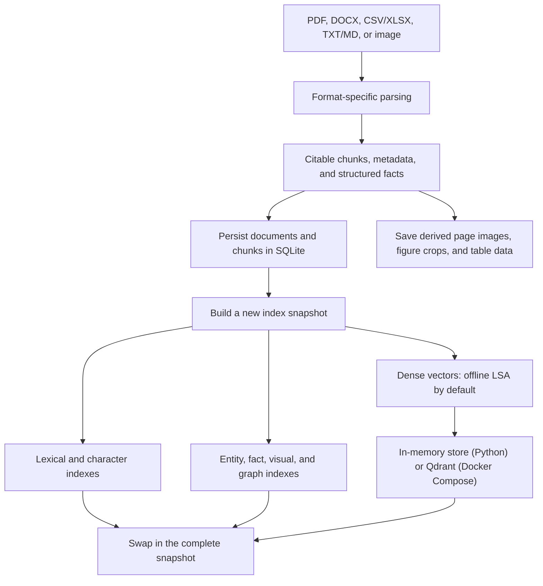
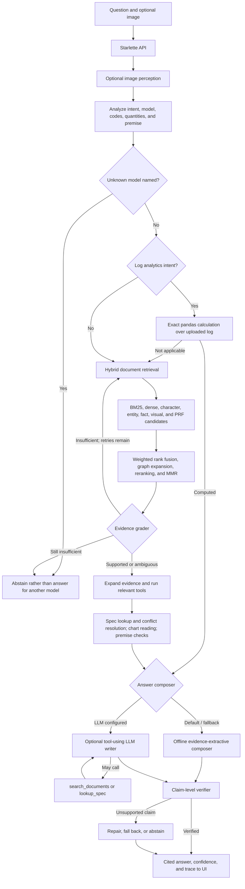

# Meridian — evidence-grounded multimodal RAG

Meridian answers questions about **industrial maintenance documentation**: PDF manuals (text, tables, charts, diagrams, warnings), scanned pages, Word service bulletins, CSV/XLSX maintenance logs and photos of alarm panels or data plates. Every answer is **cited to a page region**, **verified claim by claim**, and **refused when the evidence is not there**.

It runs in **deterministic offline mode by default** (no API key, no GPU, no model download). When configured, an optional tool-using LLM agent (Anthropic or any OpenAI-compatible server, including Ollama) can search documents and look up specifications while composing answers. Its output goes through the same verifier, with the offline composer as fallback.


## Why it is different

| Typical RAG demo | Meridian |
|---|---|
| Chunk text, embed, top-k | Layout-aware parsing: tables → table + per-row chunks + typed numeric facts, warning call-outs, figures, OCR for scans, bounding boxes |
| Charts and images ignored or captioned | A **chart digitiser** reads values off bar/line charts (calibrated axes, OCR-voted tick labels); image → figure retrieval with a visual descriptor |
| One vector search | 8 retrieval channels (BM25, LSA dense, char-n-gram, entity, fact, visual, PRF, graph PageRank) → weighted RRF → late-interaction rerank → learned ranker hook → MMR |
| Always answers | **CRAG-style grader** + corrective retries + abstention (unknown model, out-of-corpus terms) |
| Conflicting sources silently mixed | **Provenance-aware conflict resolution** (bulletin supersedes manual) and false-premise detection |
| "The LLM said so" | **Claim-level hallucination verifier** (units-aware numbers, identifiers, negation, references) with automatic repair |
| Arithmetic by the LLM | **Tools**: exact pandas analytics over logs, unit conversion, chart interpolation |
| Anecdotal quality | **Benchmark harness**: held-out split, ablations, bootstrap CIs, ECE/Brier, hallucination injection |

## Quick start (5 minutes)

Requires Python 3.10+ and the Tesseract OCR program.

```bash
# 1. system OCR engine (once)
#    Ubuntu/Debian: sudo apt install tesseract-ocr     macOS: brew install tesseract
#    Windows: install from https://github.com/UB-Mannheim/tesseract/wiki and add it to PATH

# 2. get the code, then inside the project folder:
python -m venv .venv
source .venv/bin/activate            # Windows: .venv\Scripts\activate
pip install -r requirements.txt

# 3. start (first start ingests the demo corpus, ~30 s)
python -m meridian --load-demo
# open http://127.0.0.1:8000
```

Docker alternative: `docker compose up -d --build` (Tesseract and the free, self-hosted Qdrant vector database are included; open `http://127.0.0.1:8001`). The regular Python quick start remains fully offline and uses the in-memory dense index.

### Docker live demo with 100 additional documents (Windows PowerShell)

The default Docker corpus loads 10 mixed-format demo documents. To add the generated stress notes without deleting them, start the app and upload the 100 `.txt`/`.md` files once; the named Docker volume preserves them across restarts. Re-running the upload is safe because identical files are skipped.

```powershell
# First setup (build the Meridian image):
docker compose up -d --build
```

```powershell
# Normal starts after the image has been built:
docker compose up -d --no-build
docker compose ps
# Run once per fresh Docker volume; safe to repeat.
.\scripts\upload_stress_docs.ps1
Start-Process http://127.0.0.1:8001
```

Check the loaded corpus with `Invoke-RestMethod http://127.0.0.1:8001/api/health`. On a fresh Docker volume, the 10 defaults plus the uploaded stress corpus should total 110 documents.

## Using it

* **Ask** tab: type a question or click an example; attach/paste a photo (e.g. `eval_data/images/photo_alarm_E47_hx500.png`). Watch the agent trace, click `[n]` to jump to evidence, “View source page” to see the highlighted region.
* **Knowledge base** tab: drag in your own PDF/DOCX/CSV/XLSX/TXT/MD/images, delete documents, reload the demo corpus.
* **Evaluation** tab: view or re-run the benchmark.

Good demo questions: *What torque should I use for the HX-200 impeller bolt?* (conflict: manual 45 Nm vs bulletin 52 Nm) · *Is the HX-200 rated for fluid at 150 °C?* (false premise) · *What is the HX-500 specific power at 50% load?* (value read from a chart image) · *Which alarm code occurs most often in the maintenance log?* (exact analytics) · *Who is the CEO of Helix Dynamics?* (abstains).

## Architecture and data flow

Meridian has two connected pipelines: document changes build the knowledge base, and user questions retrieve and verify evidence from it.

### Document ingestion and indexing



Parsers preserve useful structure: table rows become searchable evidence and facts; scanned pages use OCR; figures can be classified and charts digitized when readable; safety callouts remain separate evidence. Adding, replacing, or deleting a document automatically rebuilds the indexes from the stored corpus. The snapshot is swapped only after it is built, so retrieval does not use a partially rebuilt index. In the Docker setup, Qdrant is the dense-vector backend; the other indexes are built by Meridian.

### Question answering



The deterministic controller decides whether the evidence is sufficient. With no LLM configured, Meridian composes an answer directly from evidence; when an LLM is configured, its cited answer goes through the same verifier and falls back to the offline composer if unavailable or not sufficiently supported. If repair cannot produce a verified answer, Meridian abstains. The API can stream trace events to the UI. See [docs/ARCHITECTURE.md](docs/ARCHITECTURE.md) for retrieval and verification details, and [docs/DEPLOYMENT.md](docs/DEPLOYMENT.md) for persistence and deployment limitations.

## Optional: use an LLM

Meridian supports any OpenAI-compatible LLM server, including **Ollama** running locally.

### Using Ollama (local, free, no API key)

```bash
# 1. Install Ollama from https://ollama.com and pull the model
ollama pull llama3.1

# 2. Create a .env file in the project root with these values:
MERIDIAN_LLM_PROVIDER=openai
OPENAI_BASE_URL=http://localhost:11434/v1
MERIDIAN_LLM_MODEL=llama3.1
MERIDIAN_AGENT_MODE=auto

# 3. Start Meridian (it auto-loads .env)
python -m meridian
```

> **Windows note:** Ollama usually starts automatically on install. If you see `address already in use` when running `ollama serve`, it's already running — just pull the model and start Meridian.

> **Docker note:** When Meridian runs in Docker Compose, set `OPENAI_BASE_URL=http://host.docker.internal:11434/v1` instead of `localhost`. Inside a container, `localhost` refers to that container, not the Windows host. Also set `MERIDIAN_AGENT_MODE=auto` to enable LLM writing (`policy` forces offline mode). Recreate Meridian after changing `.env` with `docker compose up -d --no-build --force-recreate meridian`.

### Using Anthropic or OpenAI

```bash
# Anthropic
export MERIDIAN_LLM_PROVIDER=anthropic
export ANTHROPIC_API_KEY=sk-ant-...

# OpenAI
export MERIDIAN_LLM_PROVIDER=openai
export OPENAI_API_KEY=sk-...
```

The deterministic pipeline still decides *whether* an answer is possible; the LLM writes it from numbered evidence and may call `search_documents` / `lookup_spec`. Anything it writes is verified; failures fall back to the offline composer. `MERIDIAN_AGENT_MODE=policy` forces offline mode.

## Vector search

The Docker Compose deployment uses **Qdrant** for dense vector search and persists its data in the `qdrant-data` volume. No Qdrant API key or LLM API key is needed for the local Compose setup. The embedder remains offline LSA by default; Qdrant is the vector database, not the embedding model. Document updates are automatically re-ingested and indexed by the app, but currently rebuild the full vector collection rather than applying incremental vector updates. See [docs/DEPLOYMENT.md](docs/DEPLOYMENT.md) for configuration and current scaling limitations.

## Command line

| Command | What it does |
|---|---|
| `python -m meridian [--load-demo] [--port 8000]` | web app + API |
| `python -m pytest -q` | 42 tests (unit, pipeline, agent, live-server API) |
| `python scripts/run_eval.py [--no-train]` | full benchmark → `reports/eval_report.{md,json}`, charts |
| `python scripts/build_corpus.py` | regenerate the synthetic corpus and golden questions (needs `reportlab`) |
| `python scripts/build_stress_corpus.py [--docs 100]` | generate a separate larger synthetic corpus and held-out QA set |

## API

`POST /api/ask` (JSON or multipart with `image`) · `POST /api/ask/stream` (SSE: `trace`, `result`, `done`) · `GET/POST/DELETE /api/documents` · `POST /api/demo/load` · `GET /api/page/{doc}/{page}.png?chunk=` (highlighted evidence) · `GET /api/graph?chunks=` · `GET /api/eval/report` · `POST /api/eval/run` · `GET /api/health`. Errors are JSON `{ "error": "..." }` with 400/404/413/422/500.

## Measured results (bundled synthetic benchmark, 93 questions, 43 held-out)

| | Result |
|---|---|
| Retrieval, full pipeline, held-out | Hit@1 89.5% · Hit@5 100% · MRR 0.88 (BM25 alone: Hit@1 84.2%, Hit@5 97.4%) |
| Answer correctness (unit-aware) | 93.1% overall, 92.5% held-out |
| Unanswerable questions declined | 100% (false abstention on answerable: 1.1%) |
| Faithfulness of delivered answers | 100% claims supported |
| Confidence calibration (held-out) | ECE 0.027 → 0.008 after Platt scaling |
| Hallucination-injection detection | 91.7% (numeric 87.5, fabricated 94.4, negation 93.8, entity 91.5); 12.3% false-positive on clean answers |

These figures are from the original generated baseline (6 documents, 157 chunks), not a claim about real manuals. The learned ranker was trained but **not adopted** because it did not beat the hand-tuned weights on the held-out split. Known failures (6/93): multi-hop questions that need two documents joined, a data-plate OCR read, and some prose procedure questions. Full report: `reports/eval_report.md`.

### Larger synthetic stress benchmark

To exercise retrieval over a larger corpus, generate a separate, reproducible stress set:

```powershell
python .\scripts\build_stress_corpus.py
$env:MERIDIAN_DEMO_DIR = (Resolve-Path .\demo_corpus_stress).Path
$env:MERIDIAN_EVAL_DIR = (Resolve-Path .\eval_data_stress).Path
$env:MERIDIAN_DATA_DIR = (Resolve-Path .).Path + "\data_stress"
$env:MERIDIAN_REPORTS_DIR = (Resolve-Path .).Path + "\reports_stress"
$env:MERIDIAN_VECTOR_STORE = "memory"
python .\scripts\run_eval.py --no-train --calibration-path .\reports_stress\calibration.json
```

By default this creates **100 generated model-specific notes, 700 chunks, and 700 questions** (600 answerable, 100 unanswerable), with test questions held out by model. The documents include controlled layout, wording, and transcription noise. They are still synthetic text records—not real-world manuals—and do not establish production accuracy. The generator writes only to the separate `demo_corpus_stress` and `eval_data_stress` directories.

The full held-out report is in `reports_stress/eval_report.md` (JSON and charts alongside it). On this synthetic 140-question model-held-out test split, end-to-end answer correctness was 90.0%; unanswerable abstention recall was 100%, with a 10.0% false-abstention rate on answerable questions. The full pipeline had retrieval Hit@1 65.0%, Hit@5 100%, MRR 0.771 (in-memory backend). These are reproducible synthetic stress-test results, not real-world or production-accuracy claims; the benchmark does not exercise Qdrant or messy real manuals.

## Project layout

```
meridian/
  config.py schemas.py kb.py bootstrap.py __main__.py
  ingest/      pdf.py ocr.py figures.py (chart digitiser) office.py images.py common.py pipeline.py
  index/       lexical.py dense.py graph.py facts.py store.py
  retrieval/   analyzer.py perception.py pipeline.py rerank.py grader.py context.py
  verify/      verifier.py
  agent/       agent.py compose.py tools.py llm_agent.py factory.py
  llm/         base.py anthropic_client.py openai_client.py mock.py
  eval/        world.py datagen.py qa.py metrics.py runner.py report.py
  api/         app.py static/{index.html,app.css,app.js}
demo_corpus/ eval_data/ reports/ docs/ scripts/ tests/
```
More: [docs/ARCHITECTURE.md](docs/ARCHITECTURE.md) · [docs/MODULES.md](docs/MODULES.md) · [docs/INTERVIEW_GUIDE.md](docs/INTERVIEW_GUIDE.md) · [docs/DEPLOYMENT.md](docs/DEPLOYMENT.md)

## Troubleshooting

* `TesseractNotFoundError` / scanned pages not read → install Tesseract (step 1). Everything except OCR still works without it.
* Port in use → `python -m meridian --port 8010`.
* Upload says “could not parse” → the file is corrupt or password-protected; the rest of the batch still ingests.
* Reset everything → delete the `data/` folder (or “Clear all” in the UI).
