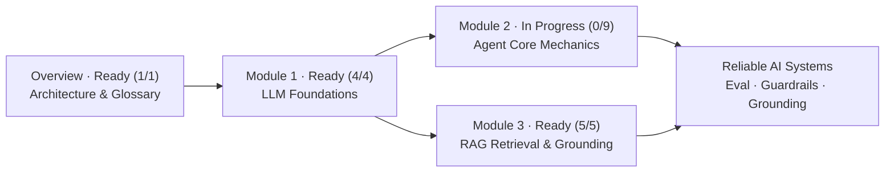

# AI Agent Guide

**English** | [简体中文](README.zh.md)

> **Live Interactive Site**: **https://qufei1993.github.io/ai-agent-guide/**  
> Direct links: [English Edition](https://qufei1993.github.io/ai-agent-guide/en/index.html) · [中文版](https://qufei1993.github.io/ai-agent-guide/zh/index.html)

An open-source, zero-build **interactive engineering guide** to LLMs, Agents, and RAG. Every chapter pairs concise engineering mental models with browser labs where you can tune parameters, inspect live payloads, and test failure boundaries—backed by runnable reference code in the same repository.

- **Language-Agnostic Mechanics**: Reference examples use TypeScript, while all engineering patterns apply directly to Python, Go, Java, or any stack.
- **Focused Scope**: Covers LLM control, Agent execution mechanics, and grounded RAG pipelines—intentionally excluding heavyweight SaaS boilerplate, post-training (SFT/RL), and complex multi-agent orchestration.

## Learning Roadmap



> **Design Principle**: Build a working minimal Agent early—full RAG is not a prerequisite for understanding tool calling, loops, and execution boundaries. Security, evaluation, observability, and cost control run through every module.

## Curriculum (19 Chapters · 10 Bilingual Ready)

Catalog metadata and language availability are maintained in [`docs/chapters.json`](docs/chapters.json).

### Overview · Architecture & Glossary

| # | Chapter | Focus | Edition |
| --- | --- | --- | --- |
| 1 | **AI Agent Engineering Architecture Map** | End-to-end task walkthrough of LLM, context, tools, memory, RAG, and harness collaboration, plus a quick glossary of easily confused concepts. | [EN](https://qufei1993.github.io/ai-agent-guide/en/agent-architecture-map.html) · [中文](https://qufei1993.github.io/ai-agent-guide/zh/agent-architecture-map.html) |

### Module 1 · LLM Engineering Foundations

| # | Chapter | Focus | Edition |
| --- | --- | --- | --- |
| 2 | **Prompt Engineering** | Model calls, sampling parameters, task constraints, few-shot, and prompt boundaries. | [EN](https://qufei1993.github.io/ai-agent-guide/en/prompt-engineering.html) · [中文](https://qufei1993.github.io/ai-agent-guide/zh/prompt-engineering.html) |
| 3 | **Structured Output & Schema Validation** | Output contracts with JSON Schema and Zod, handling format/business errors and bounded retries. | [EN](https://qufei1993.github.io/ai-agent-guide/en/structured-output.html) · [中文](https://qufei1993.github.io/ai-agent-guide/zh/structured-output.html) |
| 4 | **Context Engineering** | Context sources, information placement, token budgets, and Just-In-Time loading. | [EN](https://qufei1993.github.io/ai-agent-guide/en/context-engineering.html) · [中文](https://qufei1993.github.io/ai-agent-guide/zh/context-engineering.html) |
| 5 | **Prompt Regression & Evaluation Gates** | Evaluation suites, assertion rules, and version gates to catch regressions. | [EN](https://qufei1993.github.io/ai-agent-guide/en/prompt-regression.html) · [中文](https://qufei1993.github.io/ai-agent-guide/zh/prompt-regression.html) |

### Module 2 · Agent Core Mechanics

| # | Chapter | Focus | Status |
| --- | --- | --- | --- |
| 6 | Tool Calling & the Mini Agent Loop | Tool declarations, schema validation, dispatch, and stopping conditions for a minimal Agent. | Planned |
| 7 | Workflows vs. Autonomous Agents | Comparing chaining, routing, parallelization, and dynamic loops to decide code vs. model control. | Planned |
| 8 | Task Planning & Feedback Correction | Task decomposition, dynamic replanning, and self-correction using tests and tool feedback. | Planned |
| 9 | Harness & Execution Guardrails | Permission checks, human-in-the-loop approval, isolation, and resource budgets. | Planned |
| 10 | Memory Management & Context Compaction | Working vs. long-term memory, write/retrieve/update/forget flows, and history compaction. | Planned |
| 11 | Task State, Checkpoints & Recovery | Checkpoints, execution logs, and idempotency for timeouts, retries, and crash recovery. | Planned |
| 12 | Streaming Interaction & Execution State UI | Mapping streaming tokens, tool calls, and approval events to UI with cancel and reconnect support. | Planned |
| 13 | MCP & Skills Extension Mechanics | Protocol integration vs. task knowledge packaging, external tool servers, and on-demand Skills. | Planned |
| 14 | Agent Evaluation & Trajectory Diagnosis | Evaluating end-state, execution trajectories, constraint adherence, cost, latency, and root causes. | Planned |

### Module 3 · RAG Retrieval & Grounding

| # | Chapter | Focus | Edition |
| --- | --- | --- | --- |
| 15 | **Document Parsing & Chunking Strategies** | Converting raw documents into structure- and source-preserving chunks and comparing splitting strategies. | [EN](https://qufei1993.github.io/ai-agent-guide/en/document-parsing-chunking.html) · [中文](https://qufei1993.github.io/ai-agent-guide/zh/document-parsing-chunking.html) |
| 16 | **Embeddings & Vector Search** | Semantic vectors, similarity metrics, recall boundaries, metadata filtering, and index updates. | [EN](https://qufei1993.github.io/ai-agent-guide/en/embedding-vector-search.html) · [中文](https://qufei1993.github.io/ai-agent-guide/zh/embedding-vector-search.html) |
| 17 | **Hybrid Search, Query Rewriting & Reranking** | Combining BM25 and dense recall with query rewriting, RRF fusion, and Reranker. | [EN](https://qufei1993.github.io/ai-agent-guide/en/hybrid-search-reranking.html) · [中文](https://qufei1993.github.io/ai-agent-guide/zh/hybrid-search-reranking.html) |
| 18 | **Citations & Evidence Verification** | Grounding claims to sources, detecting unsupported statements, and handling conflicts or abstention. | [EN](https://qufei1993.github.io/ai-agent-guide/en/citation-hallucination.html) · [中文](https://qufei1993.github.io/ai-agent-guide/zh/citation-hallucination.html) |
| 19 | **RAG Evaluation & Agentic RAG** | Evaluating retrieval vs. generation quality and comparing fixed pipelines with Agentic RAG. | [EN](https://qufei1993.github.io/ai-agent-guide/en/rag-evaluation-agentic-rag.html) · [中文](https://qufei1993.github.io/ai-agent-guide/zh/rag-evaluation-agentic-rag.html) |

## Repository Structure

```text
.
├── docs/                           # Zero-build static site (GitHub Pages root)
│   ├── index.html                  # Language auto-router
│   ├── chapters.json               # Single source of truth for catalog & siteUrl
│   ├── sitemap.xml                 # Auto-generated bilingual sitemap
│   ├── robots.txt                  # Auto-generated robots.txt
│   ├── shared/
│   │   ├── tokens.css              # Design tokens, dark mode & shared lab styles
│   │   └── site.js                 # Global nav, floating TOC, bilingual switcher
│   ├── en/                         # English interactive chapters
│   └── zh/                         # Chinese interactive chapters
├── examples/                       # Runnable TypeScript examples for chapters
├── scripts/
│   └── generate-seo.mjs            # Syncs page SEO metadata, sitemap.xml & robots.txt
└── skills/
    └── interactive-book-chapter/   # Reusable Agent Skill for authoring chapters
```

## Local Preview & Running Examples

Preview the interactive guide locally (zero-build, no install required):

```bash
npm run preview
```

Open [English Edition](http://localhost:8766/en/index.html) or [Chinese Edition](http://localhost:8766/zh/index.html) (override port via `PORT=4173 npm run preview`).

Run the companion examples (Node.js `>= 22.0.0`):

```bash
cp .env.example .env
npm install
npx tsx --env-file=.env examples/ai-coding/prompt-engineering/01-temperature.ts
```

Refresh SEO tags, `sitemap.xml`, and `robots.txt` after updating chapters:

```bash
npm run seo:sync
```
