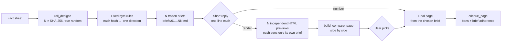

<div align="center">

**English** · [简体中文](README.zh-CN.md) · [日本語](README.ja.md) · [한국어](README.ko.md) · [Español](README.es.md)

# hash-design

<p align="center"><a href="https://qybaihe.github.io/hash-design/causeway-festival/compare.html"><picture><source media="(prefers-reduced-motion: reduce)" srcset="docs/assets/hero.png"></picture></a></p>

<p align="center"><sub>Real output, not a mock-up: <a href="examples/causeway-festival">examples/causeway-festival</a>, each preview built by its own sub-agent from one frozen brief.<br><a href="https://qybaihe.github.io/hash-design/"><b>Browse all 4 live examples →</b></a> · a hash-design/v2 run, seed <code>causeway-festival</code> · <a href="docs/assets/hero.png">still image</a> · <a href="docs/assets/hero.mp4">MP4</a></sub></p>

### One prompt, five design directions, picked by true-random SHA-256 hashes instead of the model.

**Stop your coding agent from shipping the same Inter-and-purple-gradient page every time. hash-design rolls five directions (or any number from 1 to 12), freezes each one as a design brief, lists them one line each, renders them side by side when you ask, and builds the one you pick. Any direction can be rebuilt from its ref.**

[](https://github.com/qybaihe/hash-design/actions/workflows/ci.yml)
[](https://qybaihe.github.io/hash-design/)
[](#quick-start)
[](docs/mcp-tools.md)
[](.nvmrc)
[](https://www.npmjs.com/package/hash-design)
[](LICENSE)

**[Live examples](https://qybaihe.github.io/hash-design/) · [Mapping spec](docs/mapping.md) · [MCP reference](docs/mcp-tools.md) · [Changelog](CHANGELOG.md)**

[Showcase](#showcase) · [Quick start](#quick-start) · [How it works](#how-it-works) · [Reference](#reference) · [FAQ](#faq)

**Tell your agent** (Claude Code, Cursor, Codex, Windsurf, VS Code Copilot…):

```text
Install the hash-design skill for this agent: run `npx -y hash-design skill install --dir .`
and register its MCP server with `npx -y hash-design mcp`, following
https://github.com/qybaihe/hash-design#quick-start.
```

</div>

---

## Showcase

Four full runs, each from its own fact sheet and a fixed seed that only makes it reproducible: the seed is the example's folder name, used once with no re-rolls. All four are **hash-design/v2** runs, so every brief is exactly what its ref reproduces today (`examples.test.ts` checks it byte for byte). Every preview was rendered by its own sub-agent that saw only its brief and the fact sheet; all 20 score 100/100 on `critique_page`, with brief adherence 100. All of them are on the [examples index](https://qybaihe.github.io/hash-design/). Each plate below is one roll: its five directions side by side.

### Fourth Lane Bakery (第四巷面包店) — a neighbourhood bakery · Chinese page

[](examples/fourth-lane-bakery)

Seed `fourth-lane-bakery` · `critique_page` 100 · brief adherence 100 · [example folder](examples/fourth-lane-bakery): facts, briefs, previews and the process

### Sluice — a self-hosted webhook inbox · English page

[](examples/sluice)

Seed `sluice` · `critique_page` 100 · brief adherence 100 · [example folder](examples/sluice): facts, briefs, previews and the process

### Bridge No.2 Cycle Works (二号桥单车铺) — a bicycle repair shop · Chinese page

[](examples/bridge-two-bikes)

Seed `bridge-two-bikes` · `critique_page` 100 · brief adherence 100 · [example folder](examples/bridge-two-bikes): facts, briefs, previews and the process

### Causeway — a one-day music festival on a tidal island · English page

[](examples/causeway-festival)

Seed `causeway-festival` · `critique_page` 100 · brief adherence 100 · [example folder](examples/causeway-festival): facts, briefs, previews and the process

## What hash-design does

Ask an LLM for "a beautiful page" and it almost always collapses into the same modal aesthetic: Inter, a purple-to-blue gradient, a centered headline with two buttons, three identical feature cards, glassmorphism, emoji icons, and copy like _Unlock_, _Seamless_, _Supercharge_. The reason is simple: whenever the model gets to choose, it picks the most common thing in its training data.

hash-design does not ask the model to have better taste. It **takes the choice away**:

| Step       | What happens                                                                                                                                                                                                                                                                                                                                                       |
| ---------- | ------------------------------------------------------------------------------------------------------------------------------------------------------------------------------------------------------------------------------------------------------------------------------------------------------------------------------------------------------------------ |
| **Roll**   | N hashes from system randomness (`crypto.getRandomValues`, 32 bytes → SHA-256): five by default, 1–12 if you say so.                                                                                                                                                                                                                                               |
| **Map**    | Each hash **is** the direction. Fixed, reproducible rules read its bytes straight onto design parameters: hue and a contrast-solved palette, display and body faces from a flat font pool, case, tracking, type-scale ratio, density, grid, first-screen anchor, motif, corners and texture, motion timing, copy voice and one "twist". There is no style library. |
| **Freeze** | Each direction becomes a **brief** with paste-ready tokens (font links, hex values, `tokens.css`, grid numbers, radius / border / shadow values) plus the global bans.                                                                                                                                                                                             |
| **Render** | The agent shows you **one line per direction and stops**. On `render` its only job is to **execute** each brief faithfully: independent HTML previews and a side-by-side compare page, then it **waits for you to pick a number**.                                                                                                                                 |
| **Build**  | Once you pick, the agent builds the final page from that brief and checks it with `critique_page`.                                                                                                                                                                                                                                                                 |

This is an external random constraint that breaks the model's default aesthetic. It has nothing to do with KV caches or sampling temperature. The model's taste is spent on execution quality (alignment, rhythm, detail, legibility), not on choosing a style.

The default output is a web page. Pass a **scenario** and the same rolled directions become a slide deck, mobile app screens, a dashboard, a poster / social card or an HTML email (see [Scenarios](#scenarios)).

It ships as an **Agent Skill** (when and in what order to run the workflow), an **MCP server** (stdio, four tools), a **CLI** and a **TypeScript library**, published together on npm as [`hash-design`](https://www.npmjs.com/package/hash-design).

## Quick start

### Tell your agent

Open your coding agent (Claude Code, Cursor, Codex, Windsurf, VS Code Copilot…) in the project you want to design and paste:

```text
Install the hash-design skill for this agent: run `npx -y hash-design skill install --dir .`
and register its MCP server with `npx -y hash-design mcp`, following
https://github.com/qybaihe/hash-design#quick-start.
```

The agent copies the Skill into your project's `.claude/skills/` and `.agents/skills/` and registers the MCP server (`claude mcp add` in Claude Code, `.cursor/mcp.json` in Cursor, `codex mcp add` in Codex); nothing is cloned or built. Start a new session afterwards so the agent loads both, then [use it](#use-it). To run the commands yourself, follow the steps below.

### Install by hand

Requires Node.js ≥ 20, with npm (for `npx`).

**Skill.** The Skill tells the agent when to use hash-design, in what order to call the MCP tools, how to render previews independently and when it must stop.

```bash
npx -y hash-design skill install --dir .                # this project: .claude/skills and .agents/skills
npx -y hash-design skill install --global               # or your home directory, for every project
npx -y hash-design skill install --to /path/to/skills   # or any other agent's skills folder
```

The default writes `.claude/skills/` (Claude Code) and `.agents/skills/` (Codex, Cursor, VS Code Copilot, Windsurf). `--target` picks folders instead (`claude`, `agents`, `cursor`, comma-separated, or `all`; `both` is `claude,cursor`), and the command prints the CLI and MCP commands that work where it ran. A skill is a folder with a `SKILL.md`, so copying [`skills/hash-design/SKILL.md`](skills/hash-design/SKILL.md) to `<skills folder>/hash-design/SKILL.md` works too. Where each agent looks, per its own docs:

| Agent           | Project skills                                          | Personal skills                                                |
| --------------- | ------------------------------------------------------- | -------------------------------------------------------------- |
| Claude Code     | `.claude/skills/`                                       | `~/.claude/skills/`                                            |
| Codex           | `.agents/skills/`                                       | `~/.agents/skills/`                                            |
| Cursor          | `.agents/skills/`, `.cursor/skills/`, `.claude/skills/` | `~/.agents/skills/`, `~/.cursor/skills/`                       |
| VS Code Copilot | `.github/skills/`, `.claude/skills/`, `.agents/skills/` | `~/.copilot/skills/`, `~/.claude/skills/`, `~/.agents/skills/` |
| Windsurf        | `.agents/skills/`, `.windsurf/skills/`                  | `~/.agents/skills/`                                            |

Agents that read both `.claude/skills/` and `.agents/skills/` (Cursor, VS Code Copilot) see two identical copies after the default install; use `--target agents` there if that bothers you. The Skill body is written in Chinese; its description includes English trigger phrases.

**MCP server.** Register `npx -y hash-design mcp` with your agent; it runs the server on stdio.

#### Claude Code

```bash
claude mcp add hash-design -- npx -y hash-design mcp
```

Or commit a project-level `.mcp.json`:

```json
{
  "mcpServers": {
    "hash-design": {
      "command": "npx",
      "args": ["-y", "hash-design", "mcp"]
    }
  }
}
```

#### Cursor

`.cursor/mcp.json` (project) or `~/.cursor/mcp.json` (global), with the same structure as the `.mcp.json` above.

#### Codex

```bash
codex mcp add hash-design -- npx -y hash-design mcp
```

Or add it to `~/.codex/config.toml` (or a trusted project's `.codex/config.toml`):

```toml
[mcp_servers.hash-design]
command = "npx"
args = ["-y", "hash-design", "mcp"]
```

#### Other agents

Any MCP client that starts stdio servers can run it: command `npx`, arguments `-y hash-design mcp`; put that in the client's own MCP config (Windsurf, VS Code and others each have one). Without MCP, the Skill falls back to the CLI, `npx -y hash-design roll …`, with the same options.

#### Claude Desktop

`~/Library/Application Support/Claude/claude_desktop_config.json` (macOS) or `%APPDATA%\Claude\claude_desktop_config.json` (Windows), same structure. Claude Desktop does not start the server in your project directory, so pass an **absolute path** as `out_dir` when calling `roll_designs`. If it cannot find `npx`, put the path that `which npx` prints in `command`.

### From source

For contributing, or to run a commit that is not released yet (see [CONTRIBUTING.md](CONTRIBUTING.md)):

```bash
git clone https://github.com/qybaihe/hash-design.git ~/hash-design
cd ~/hash-design && npm install && npm run build
node ~/hash-design/packages/core/dist/bin.js skill install --dir /path/to/your/project
claude mcp add hash-design -- node ~/hash-design/packages/core/dist/bin.js mcp
```

In a checkout the CLI is `packages/core/dist/bin.js`. `packages/mcp/dist/bin.js` starts the same MCP server, so existing configs that point at it keep working. The repo ships `.claude/` and `.cursor/` copies of the Skill, which a test keeps identical to the source.

### Use it

With the MCP server and the Skill installed, just ask your agent:

> Use hash-design to build a one-page site for "Fourth Lane Bakery", 3 directions. Facts: open Tue–Sun 7:00–19:00, closed Mondays; country loaf ¥38; …

The agent rolls N directions (5 unless you name a number from 1 to 12, as in `/hash-design 3`), freezes the briefs and answers in a fixed, short shape, then stops. This one is seeded so it can be reproduced; a real roll says `true-random`:

```text
**hash-design** · 3 directions for “Fourth Lane Bakery” · Web page · seed reply-demo

1. **Caveat** / Literata — light paper, hue 330° · 5-column grid · anchor: initial · `ea849a45`
2. **Hanken Grotesk** / Crimson Pro — light paper, hue 344° · 10-column grid · anchor: number · `f458a091`
3. **Overpass** / Barlow Condensed — light paper, hue 234° · 5-column grid · anchor: grid-diagram · `a6b46334`

Reply with a number to build that direction as the final page, **render** to see all 3 as previews side by side first, or **reroll** for a new set.
```

A number builds that direction. `render` gets one independent preview per direction and `design/hash-design/compare.html`, then the same list again and a stop for your number. Every field of the reply is read off the mapped numbers ([reply protocol](docs/mcp-tools.md#reply-protocol)); the CLI prints it with `--format reply`. Clients that support MCP prompts can also start the same workflow with the `hash-design` prompt (arguments: `subject`, `facts`, `count`, `scenario`). Asking for slides, app screens, a dashboard, a poster or an email makes the agent pass the matching `scenario`.

### CLI

```bash
hash-design roll --subject "Fourth Lane Bakery" --facts-file facts.md --out design/hash-design   # 5 true-random directions
hash-design roll --subject "…" --light-only --brand "#c8102e" --format json                     # with constraints
hash-design roll --subject "Q3 review" --facts-file facts.md --scenario deck --out design/deck   # a slide deck instead of a page
hash-design roll --subject "…" --count 3 --out design/hash-design --format reply                 # 3 directions + the short reply
hash-design brief <ref> [constraints]                                                            # reproduce a brief
hash-design critique page.html --roll design/hash-design/roll.json --pick 3 --fail-under 80
hash-design compare --roll design/hash-design/roll.json                                          # write compare.html
hash-design skill install                                                                        # install the Skill
```

Run it with `npx -y hash-design …`, or install it once with `npm install -g hash-design` and type `hash-design …`; in a checkout it is `node packages/core/dist/bin.js …`. `hash-design --help` lists every command, and `hash-design <command> --help` (for example `hash-design roll --help`) prints one command's options, including the constraint flags `--light-only`, `--dark-only`, `--reduced-motion`, `--brand` and `--scenario`. `--count`/`-n` sets N (1–12, default 5); each direction is its own hash, so constraints never lower that.

### Library

```ts
import { roll, renderBrief, critiquePage, reproduce, parseRef } from 'hash-design';

const r = roll({ content: { subject: 'Fourth Lane Bakery', facts: ['Closed Mondays', 'Country loaf ¥38'] } });
for (const [i, d] of r.designs.entries()) console.log(renderBrief(d, r.content, { number: i + 1 }));

const design = reproduce(parseRef(r.designs[0].ref), r.constraints);
const report = critiquePage({ html: '<!doctype html>…', design });
console.log(report.score, report.adherence, report.findings);
```

Install it with `npm install hash-design` (ES module, Node.js ≥ 20; types included).

### Update

```bash
npx -y hash-design@latest skill install --dir .   # refresh the copied SKILL.md
```

npx can keep using a copy it cached earlier; `@latest` makes it fetch the newest release (or pin one, such as `hash-design@0.2.0`). The MCP server is started through npx whenever the agent starts, so restart the agent after a release, and write `hash-design@latest` in its MCP command if an old copy keeps running. Older versions installed into `.claude/` and `.cursor/` by default; refresh an old `.cursor/skills/` copy with `--target all`, or delete it. From a clone: `git pull && npm install && npm run build`. If an update changes the font pool, the primitive lists or the byte rules, refs rolled with the old version need that version to reproduce (see the [FAQ](#faq)).

## How it works



### Bytes → parameters (`hash-design/v2`)

The hash is the direction. Each byte drives one parameter (or two, split into bits), as a continuous value or as an index into a short list of neutral primitives that combine freely. Nothing names a genre or a style.

| Bytes  | Parameters                                                                                                         |
| ------ | ------------------------------------------------------------------------------------------------------------------ |
| 0–5    | Palette: OKLCH hue, light or dark paper and its lightness, paper chroma, accent chroma, second accent's hue offset |
| 6–10   | Type: display face (98), body face (62), case and weight, tracking, type-scale ratio 1.067–1.618                   |
| 11     | Density: one position from airy to packed; base size, line height, spacing unit, section gap and width follow      |
| 12–15  | Layout: 3–12 grid columns and gutter, which columns the text block spans, first-screen height, sections, separator |
| 16–17  | First-screen anchor: subject (8), size, horizontal position, rotation                                              |
| 18–19  | Motif: shape (12), size, placement (4), angle                                                                      |
| 20–21  | Surface: corner radius, border width and style, hard shadow, texture and its opacity                               |
| 22–23  | Motion: what moves, duration 0–600 ms, easing (steps or a cubic-bezier from the bits)                              |
| 24–25  | Voice: grammatical person, headline form, sentence length, register                                                |
| 26–27  | Twist: target (9) × operation (10) × amount, e.g. "Rotate every number on the page by 4.5°"                        |
| 28     | Format, for non-web scenarios                                                                                      |
| 29, 30 | CJK display face (for Chinese pages), mono face                                                                    |
| 31     | Unused, recorded in the brief                                                                                      |

- **Contrast is solved, not hoped for.** Text colours walk in OKLCH lightness until they reach ink ≥ 7.5:1, muted ≥ 4.6:1 and accents ≥ 3:1 on the paper, so every hash gives a legible palette, light or dark (about 30% of hashes are dark).
- **N directions are N hashes.** A roll of 5 is five independent mappings; nothing is shared, walked or de-duplicated between them. A design's `ref` is its 64-hex hash and reproduces on its own.
- **Constraints apply before the bytes are read**, so they are part of a design's identity: `light_only` / `dark_only` (byte 2 then sets only the lightness), `reduced_motion` (no motion), `brand_colors` (the first replaces the accent and sets the hue, the second replaces accent2) and `scenario`.
- **Reproducible.** The same `ref`, the same constraints and the same library fingerprint always produce the same brief. Every brief records the algorithm (`hash-design/v2`) and the library fingerprint (the first 12 hex digits of a SHA-256 over the font pool, the primitive lists and the byte rules).
- **`seed` is only for reproducing examples and tests.** Real use always draws from system randomness.

Every byte's exact formula, the palette solver and a worked example are in [docs/mapping.md](docs/mapping.md).

### Scenarios

`scenario` says what you are designing. The default, `web`, is the page workflow above, unchanged. The other five keep the rolled direction and add a format, a canvas and output rules to every brief.

| Scenario        | Delivers                                                                          | Formats (byte 28)                            | Canvas                                    |
| --------------- | --------------------------------------------------------------------------------- | -------------------------------------------- | ----------------------------------------- |
| `web` (default) | A responsive web page, landing page or one-page site                              | —                                            | responsive                                |
| `deck`          | An HTML slide deck: one fixed canvas per slide, keyboard navigation, print to PDF | full-bleed, index rail, document master      | 1920×1080                                 |
| `app`           | Several phone screens of one user journey, side by side                           | bottom tab bar, top tabs, single flow, sheet | 390×844                                   |
| `dashboard`     | One desktop screen: headline figures, a primary chart, supporting panels          | sidebar, top bar, wall display               | 1440×900                                  |
| `poster`        | One artboard: a poster or social image, screenshot-ready                          | portrait 4:5, square, story 9:16, link card  | 1080×1350, 1080×1080, 1080×1920, 1200×630 |
| `email`         | An HTML email for real mail clients: table layout, inline styles, no JavaScript   | single column, full-width bands, digest      | 600 or 640 px column                      |

- **The direction carries over.** A hash keeps its palette, faces, scale ratio, grid, anchor, motif, surface and voice in every scenario.
- **Some ranges narrow.** Byte 11 is read into the scenario's density range (slides are never fully packed, dashboards never fully airy), and twist targets or operations that make no sense are removed before bytes 26–27 are read (no navigation twist in a deck), so density and twist can differ from the web design. Emails have no motion.
- **Sizes follow the medium.** The base text size scales or clamps the density's (slides ×2, posters ×1.75, apps and emails 16–17 px, dashboards 13–15 px), and `tokens.css` carries the canvas size.
- **Part of the identity.** Like any constraint, pass the same `scenario` to reproduce a ref. `web` is the default, so a web ref gives the same brief with or without it.

`critique_page` checks each scenario's output contract (slide count and canvas, phone frames, tabular figures, artboard size, email tables), and the compare page scales fixed canvases from their real size. The scenario list and rules were informed by the templates of [Open Design](https://github.com/nexu-io/open-design). Details: [docs/mapping.md §7](docs/mapping.md#7-scenarios).

### What a brief contains

Run `hash-design brief 6ebe9acd06cbf4810ad2989965b22bc39bd527084bdda2964f9f0d49eb25562d` to see one (it is the worked example in [docs/mapping.md](docs/mapping.md#9-worked-example)). A brief has:

- the mapping trace, byte by byte, with the hex value, the formula and the result
- the content: the only facts the page may state
- the copy voice (person, headline form, sentence length, register), the layout (columns, gutter, text-block columns, first-screen height, sections, separator) and the first-screen anchor (subject, size, position, rotation)
- type: display, body and mono faces with case, weight and tracking, a Google Fonts `<link>` (including CJK fonts when the page is Chinese) and a type scale computed from the ratio
- seven colours computed in OKLCH and a WCAG contrast table (which colours are only for large text or decoration)
- density, corner radius, border, shadow, texture (with a CSS snippet), motif (shape, size, placement, angle) and motion (property, duration, easing)
- the twist and all 14 global bans
- a paste-ready `tokens.css` and a pre-delivery checklist
- for a non-web scenario, a Scenario section: format, canvas, file structure, slide / screen count, how the layout, anchor and motion translate, and the scenario's rules and must-nots

Briefs are written for agents and are bilingual: headings carry Chinese and English labels, and `language` (`zh` or `en`, auto-detected from the subject and facts) switches the instructions, the scenario text and whether CJK webfonts are loaded. The global ban texts are currently written in Chinese only.

## Reference

The four MCP tools, the parameter space and the 14 bans every brief carries.

### MCP tools

| Tool                 | What it does                                                                                                                                                                                                                                                                      |
| -------------------- | --------------------------------------------------------------------------------------------------------------------------------------------------------------------------------------------------------------------------------------------------------------------------------- |
| `roll_designs`       | Takes `subject`, `facts`, `count` (1–12, default 5), optional `seed`, `language`, `scenario` and constraints. Returns the hashes, the mapping, one brief per direction and the reply to send the user. With `out_dir` it freezes `roll.json`, `ROLL.md` and `briefs/*.md` to disk |
| `get_brief`          | Reproduces a brief from a `ref` (the 64-hex hash) plus the same constraints, as Markdown or JSON                                                                                                                                                                                  |
| `critique_page`      | Scores an HTML string or file against the bans and the AI-template checklist; with `brief_ref` or `roll_path` + `pick` it also scores adherence to the brief and the scenario's output contract                                                                                   |
| `build_compare_page` | Builds the side-by-side `compare.html` from a `roll.json`                                                                                                                                                                                                                         |

Resources: `hash-design://bans`, `hash-design://workflow` (the Skill). Prompt: `hash-design` (`subject`, `facts`, `count`, `scenario`).

Every parameter, return shape and CLI equivalent is documented in [docs/mcp-tools.md](docs/mcp-tools.md).

### Parameter space

There is no catalogue of styles. Besides the byte rules, the mapping reads:

- a flat font pool: 98 display, 62 body and 8 mono Google Fonts faces, 14 CJK display faces and 2 CJK body faces, with no mood or genre tags (`packages/core/src/data/fonts.ts`)
- short lists of neutral primitives: 4 cases, 5 separators, 8 anchor subjects, 12 motif shapes, 4 placements, 4 textures, 4 motion properties, 4 persons, 6 headline forms, 9 twist targets, 10 twist operations (`packages/core/src/data/space.ts`)

The data is enforced by tests and scripts:

- no banned fonts in the pool, not even in fallbacks; no duplicate faces
- palettes meet ink ≥ 7.5:1, muted ≥ 4.6:1, accents ≥ 3:1 on paper, checked over thousands of random hashes
- each byte moves only its own parameters
- the library fingerprint is pinned in a test, so any change to what a hash maps to is deliberate
- every font URL resolves on Google Fonts: `node scripts/verify-fonts.mjs` (174/174 pass)

### Global bans

Every brief carries these 14 bans, and `critique_page` detects each one automatically:

| id                          | Banned                                                                                                           |
| --------------------------- | ---------------------------------------------------------------------------------------------------------------- |
| `generic-sans`              | Inter, Roboto, Poppins, Montserrat, DM Sans, Space Grotesk and 17 more default sans; `system-ui` as "the design" |
| `purple-blue-gradient`      | Purple / indigo / blue gradients, gradient text, coloured blobs                                                  |
| `centered-hero-two-buttons` | Centered headline + subtitle + primary / ghost button pair                                                       |
| `identical-cards`           | 3 / 4 / 6 identical "icon + title + two lines" cards                                                             |
| `glassmorphism`             | `backdrop-filter` frosted glass                                                                                  |
| `emoji-icons`               | Emoji as icons; a generic icon set as decoration                                                                 |
| `buzzword-copy`             | Unlock / Seamless / Supercharge / 赋能 / 一站式 / 极致体验 …                                                     |
| `soft-shadow-rounded`       | 12–24px radius + large soft shadow on everything                                                                 |
| `invented-facts`            | "10K+ users", "Trusted by", fake testimonials with avatars                                                       |
| `tailwind-default-palette`  | Framework defaults such as `#6366f1`, `#8b5cf6`, `#0f172a`                                                       |
| `scroll-fade-everything`    | Every section fading up on scroll                                                                                |
| `pill-badge-sparkle`        | A "New ✨" pill above the headline                                                                               |
| `placeholder-content`       | Lorem ipsum, stock portraits, random Unsplash                                                                    |
| `template-sections`         | The Hero → Features → Testimonials → Pricing → FAQ formula                                                       |

`critique_page` also checks text contrast (< 3:1), `viewport`, `lang`, `img alt`, missing `prefers-reduced-motion` when there is motion, and adherence to the brief: fonts, hex values, corner radius and shadow. It is static analysis. It cannot tell whether the first screen really is the brief's anchor or whether the voice is right; that still needs a human, or an agent re-reading the brief.

## FAQ

<details>
<summary><strong>Which agents can use it?</strong></summary>

Any agent that loads `SKILL.md` folders: `skill install` writes `.claude/skills/` (Claude Code) and `.agents/skills/` (Codex, Cursor, VS Code Copilot, Windsurf), and `--to` covers any other folder. The MCP server speaks stdio, so any MCP client can start it; [Install by hand](#install-by-hand) shows Claude Code, Cursor, Codex and Claude Desktop, and the CLI covers agents without MCP. Checked with Claude Code: it loads the installed skill, rolls the number of directions you ask for and sends the reply as is. The folders for the other agents come from their own documentation, not from a test run. Without the Skill an agent can still call the tools, but nothing tells it to reply briefly, render the previews independently and stop for your pick.

</details>

<details>
<summary><strong>Is it on npm?</strong></summary>

Yes. [`hash-design`](https://www.npmjs.com/package/hash-design) has the library, the CLI, the Skill (`npx -y hash-design skill install`) and the MCP server (`npx -y hash-design mcp`). The earlier, separately published `hash-design-mcp` package gets no new versions; if you registered it, switch to `npx -y hash-design mcp`. Releases are published from GitHub Actions with npm Trusted Publishing ([docs/publishing.md](docs/publishing.md)).

</details>

<details>
<summary><strong>Is it really random? How do I get the same brief again?</strong></summary>

Every roll draws from system randomness (`crypto.getRandomValues`, 32 bytes → SHA-256); `seed` exists only to reproduce the examples and tests. Each brief records its `ref` (the hash itself), its constraints and the library fingerprint, and `get_brief` or `hash-design brief <ref>` rebuilds exactly the same brief from them.

</details>

<details>
<summary><strong>Will old refs still reproduce after an update?</strong></summary>

Within `hash-design/v2`, yes, as long as the library fingerprint is the same: adding a font or a primitive changes the fingerprint and can change what a hash maps to. Every brief records the algorithm and the fingerprint, so a mismatch is detectable, and an old ref needs the matching version to reproduce. Refs from `hash-design/v1` (the 40-branch library, including `<hash>+<probe>` refs) do not reproduce in v2.

</details>

<details>
<summary><strong>Does <code>critique_page</code> guarantee a good page?</strong></summary>

No. It is heuristic static analysis: it reads inline `<style>`, `style=""` and any extra CSS you pass; it does not render the page or fetch linked stylesheets. It catches the banned patterns and checks fonts, hex values, radius and shadow against the brief, but whether the result is _good_ still depends on the model and the people executing the brief. The tool solves "everything looks the same"; it does not replace design judgement.

</details>

<details>
<summary><strong>Does it need a network connection?</strong></summary>

The CLI and the MCP server run locally and make no network requests. The pages they ask for load fonts from Google Fonts, including CJK fonts; offline or restricted networks need self-hosted fonts or the fallbacks listed in each brief.

</details>

<details>
<summary><strong>Why is part of the brief in Chinese?</strong></summary>

Briefs are bilingual: headings carry Chinese and English labels, and `language` (`zh` or `en`) switches the instructions and the scenario text. The global ban texts and the Skill body are still Chinese-only; the Skill's description includes English trigger phrases.

</details>

## Documentation

- [docs/architecture.md](docs/architecture.md): packages, data flow, design decisions, testing
- [docs/mapping.md](docs/mapping.md): the `hash-design/v2` mapping: every byte's rule, the palette solver, constraints, scenarios, reproducibility
- [docs/mcp-tools.md](docs/mcp-tools.md): every MCP tool, resource and prompt, with CLI equivalents
- [docs/deploy-cloudflare-pages.md](docs/deploy-cloudflare-pages.md): the website in `site/` and its Cloudflare Pages settings
- 中文：[架构](docs/architecture.zh-CN.md) · [映射规范](docs/mapping.zh-CN.md) · [MCP 工具](docs/mcp-tools.zh-CN.md)

## Contributing

Contributions are welcome, especially critique rules, fonts for the pool and translations. Read [CONTRIBUTING.md](CONTRIBUTING.md) first: it covers the data rules, `npm run sync` and the pinned library fingerprint. Please follow the [Code of Conduct](CODE_OF_CONDUCT.md) and report vulnerabilities as described in [SECURITY.md](SECURITY.md). Release notes live in [CHANGELOG.md](CHANGELOG.md).

```bash
npm install
npm run build        # tsc -b, both packages
npm test             # vitest: core, CLI, MCP (in-memory transport), Skill/docs consistency
npm run check        # typecheck + lint + prettier + test
npm run sync         # after data changes: regenerate the bans block in skills/hash-design/SKILL.md (CI: npm run sync:check)
node scripts/smoke.mjs        # MCP over real stdio + CLI smoke test (runs in CI)
node scripts/verify-fonts.mjs # check every font URL online (not in CI)
npm run example:critique      # critique every example preview (fails below 90)
npm run screenshots           # Playwright screenshots of every example (needs `npx playwright install chromium`)
npm run hero                  # rebuild docs/assets/hero.png and social-preview.png from an example's screenshots
npm run hero:gif              # rebuild docs/assets/hero.gif and hero.mp4 (needs ffmpeg; uses gifski if installed)
npm run showcase              # rebuild docs/assets/showcase/<example>.png, one plate per example
npm run site:dev              # the website (site/) with live reload; npm run site:build → site/dist/
```

CI runs build, the one-Skill check (`npm run sync:check`), typecheck, lint, format check, tests, the stdio smoke test, the release check (`npm pack` contents) and the website build on Node 20, 22 and 24. The website deploys to Cloudflare Pages: see [docs/deploy-cloudflare-pages.md](docs/deploy-cloudflare-pages.md).

Repository layout:

```
packages/core/           # npm: hash-design — data, mapping, briefs, critique, compare page, CLI
  src/data/bans.ts       #   global bans, banned fonts, buzzword lists
  src/data/fonts.ts      #   the flat font pool
  src/data/space.ts      #   the primitive lists (motif shapes, anchors, twists, …)
  src/mapping.ts         #   hash → design, byte by byte (BYTE_MAP, constraints, fingerprints)
  src/palette.ts         #   OKLCH palette with contrast-solved text colours
  src/brief.ts           #   brief rendering (Markdown / JSON)
  src/critique.ts        #   static AI-template checks
  src/compare.ts         #   side-by-side compare page
  src/cli.ts             #   CLI
  src/mcp.ts             #   MCP server (hash-design mcp)
packages/mcp/            # private wrapper: runs the same MCP server from a clone (not on npm)
skills/hash-design/      # SKILL.md, the only copy of the Skill (skill install copies it; npm pack ships it)
examples/                # 4 full hash-design/v2 runs: facts → roll → 5 briefs → 5 previews → compare page → screenshots
docs/                    # architecture, mapping spec, MCP reference, website deploy
site/                    # the website: Vite, the library bundled for the in-browser demo (npm run site:build)
scripts/                 # sync / smoke / verify-fonts / examples / screenshot / hero / hero-gif / prepack
```

## License

[MIT](LICENSE) © qybaihe
