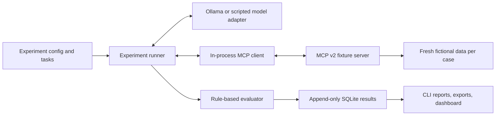

# Agent Tool Selection Tester

[](./LICENSE) [](https://github.com/ranajahanzaib/agent-tool-selection-tester/actions/workflows/ci.yml)

Agent Tool Selection Tester measures how a local language model selects and uses related tools when the exposed names, descriptions, parameter docs, or ordering change. It is a behavioral evaluation companion to MCP contract testing: Agent Tool Selection Tester hosts an MCP client, discovers and calls tools, then bridges those schemas and results to Ollama's structured tool-calling API.

## Features

- Six deterministic fictional customer and order tools exposed through actual MCP `tools/list` and `tools/call` operations.
- Canonical tool identities that remain stable across public names and schema aliases.
- Controlled, seeded, one-dimension-at-a-time interface variants.
- Paired tasks, repetitions, per-case fixture reset, rule-based scoring, and confusion counts.
- Append-only SQLite run and trace storage, JSON/CSV export, Rich CLI, and Streamlit/Plotly analysis dashboard.
- Offline scripted adapter for automated checks without Ollama.

## Requirements and installation

Python 3.12 or newer, [uv](https://docs.astral.sh/uv/), and (for real model runs) [Ollama](https://ollama.com/).

```bash
git clone https://github.com/ranajahanzaib/agent-tool-selection-tester.git
cd agent-tool-selection-tester
uv sync --extra dev
```

Install a local tool-capable model yourself. Agent Tool Selection Tester never downloads models:

```bash
ollama pull qwen3:4b-instruct
agent-tool-selection-tester doctor
```

## Quick start

```bash
agent-tool-selection-tester examples
agent-tool-selection-tester run
agent-tool-selection-tester report <run-id>
agent-tool-selection-tester export <run-id> --format json
agent-tool-selection-tester export <run-id> --format csv
agent-tool-selection-tester ui
agent-tool-selection-tester demo
```

The default suite uses 17 tasks, three repetitions, a baseline, and nine separate interface variants. Each case starts with a fresh copy of the fixture state. Use `agent-tool-selection-tester run examples/customer-tools.yaml --model qwen3:8b --repetitions 1` to override model or repetitions. `agent-tool-selection-tester doctor` checks local prerequisites without pulling anything. `agent-tool-selection-tester demo` creates a clearly labeled synthetic dashboard run without contacting Ollama.

## Experiment configuration

See [`examples/customer-tools.yaml`](examples/customer-tools.yaml) and [`examples/customer-tasks.yaml`](examples/customer-tasks.yaml). YAML defines model settings and the inference seed, repetition count, independent variant seed, round limit, and mutation types. Unknown mutations or invalid values are rejected during parsing.

Implemented semantic-preserving mutations: description paraphrase, shorten, elaborate, similar public names, parameter aliases, parameter description, and seeded tool ordering. Two separately labeled contract-changing conditions are also included: making the customer ID optional and adding a misleading optional search parameter to direct lookup. They retain the original task expectations so schema validity and task behavior can be inspected as distinct outcomes.

## Metrics

- **First selection:** whether the initial canonical tool matches an explicitly accepted first step (or no tool for no-tool/clarification tasks).
- **Schema validity:** whether arguments match the public schema actually supplied to the model.
- **Argument correctness:** whether supplied values match an accepted task plan; aliases are normalized to canonical arguments.
- **Task completion:** whether the observed calls satisfy an accepted plan.
- **Unauthorized mutation:** whether a write tool was attempted on a task that did not authorize any write.
- **Confusion counts:** expected canonical first tool by selected canonical first tool, plus no-tool, unknown-tool, and invalid-call categories.

Infrastructure failures are stored separately and excluded from comprehension denominators. Every percentage should be read with its sample count. These small local experiments are observations, not claims of statistical significance or universal model ability.

## Dashboard

Run `agent-tool-selection-tester ui` after a run. The dashboard provides a confusion matrix, condition comparisons, case traces, raw payloads, and the run manifest. Results default to `~/.agent_tool_selection_tester/results.sqlite3`; set `AGENT_TOOL_SELECTION_TESTER_DB` to use another SQLite path.

## Reproducibility and limits

Run records include configuration, exact tool and task definitions, generated before/after variants, canonical hashes, package versions, prompt/tool ordering, timing, model responses, tool results, and evaluation outcomes. Ollama temperature and seed are requested settings; inference can still vary with model digest, runtime, and hardware. No live Ollama smoke run or model digest is included unless Ollama reports it during your run.

The customer dataset is fictional. Handlers do not access external services. The current evaluator uses explicit first-step/argument plans; complex natural-language outcome judging is out of scope. Clarification tasks currently accept no call as the expected action. The CLI records observable outputs and does not expose private model reasoning.

## Architecture

`core.py` defines Pydantic models, deterministic fixture handlers, variants, tasks, and evaluator rules. `mcp_runtime.py` exposes dynamic schemas via MCP SDK v2's low-level server. `runner.py` uses the SDK's in-process client and bridges discovered tools to Ollama or the scripted adapter. `experiment.py` runs paired cases, `storage.py` stores immutable run/case records, and `dashboard.py` renders stored results.



See [`docs/architecture.md`](docs/architecture.md), [`docs/experiment-format.md`](docs/experiment-format.md), and [`docs/methodology.md`](docs/methodology.md).

## Contributing and license

Read [`CONTRIBUTING.md`](CONTRIBUTING.md) and the [Code of Conduct](CODE_OF_CONDUCT.md). Licensed under MIT; see [`LICENSE`](LICENSE).
