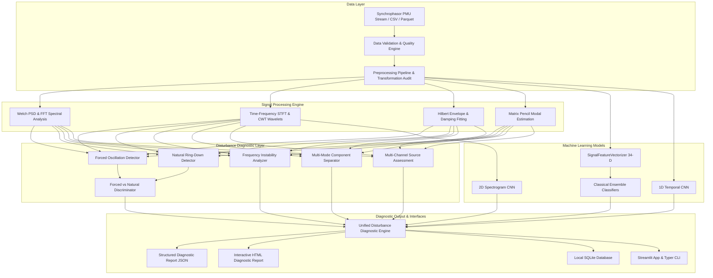

# `grid-disturbance-analysis`

### Power Grid Disturbance Analysis & Source Localization Engine

[](./LICENSE)
[](https://www.python.org/downloads/)
[](./tests)
[](https://github.com/astral-sh/ruff)
[](https://mypy-lang.org/)

`grid-disturbance-analysis` is a scientifically grounded, production-quality open-source engine for identifying, characterizing, classifying, and isolating the origins of oscillatory disturbances and stability events in electric power systems.

---

## 1. The Engineering Challenge

Modern electrical grids are experiencing unprecedented dynamics driven by the retirement of conventional synchronous generators and the widespread integration of inverter-based resources (IBRs) such as wind, solar photovoltaics, and battery energy storage systems (BESS). These changes reduce system inertia and introduce complex control interactions, resulting in persistent and transient oscillatory disturbances:

1. **Forced Oscillations:** Persistent, externally maintained periodic excitations caused by malfunctioning generator governors, cycling industrial loads, boiler controls, or inverter control loop interactions.
2. **Natural Electromechanical Modes:** Transient ring-down responses following short circuits, line tripping, or generator outages.
3. **Poorly Damped Inter-Area Modes:** Low-frequency oscillations (0.1–1.0 Hz) where coherent generator groups across regional transmission interties swing against each other.
4. **Frequency Instabilities:** Severe generation-demand deficits causing steep Rate of Change of Frequency (RoCoF) and deep frequency nadirs.
5. **Overlapping Modes:** Concurrent presence of multiple simultaneous modal oscillations.

Distinguishing between forced oscillations and natural ring-downs is critical: **disconnecting a generator during a natural ring-down can destabilize the grid, whereas isolating a forced oscillation driving source restores normal operation.**

`grid-disturbance-analysis` provides a rigorous signal-processing, machine learning, and diagnostic framework to analyze synchrophasor Phasor Measurement Unit (PMU) data and produce qualified engineering interpretations.

---

## 2. Core Capabilities

- **Digital Signal Processing Engine:**
  - Robust missing sample imputation and statistical outlier handling (MAD/Z-score).
  - Fast Fourier Transform (FFT) with coherent window scaling and peak extraction.
  - Welch Power Spectral Density (PSD) and spectral metrics (centroid, bandwidth, spectral entropy, Wiener flatness, concentration).
  - Continuous Wavelet Transform (CWT) and Discrete Wavelet Transform (DWT) multiresolution decomposition.
  - Analytic Hilbert transform, instantaneous amplitude envelopes, and instantaneous frequency tracking.
  - Matrix Pencil and Prony modal parameter estimation.
  - Nonlinear least-squares exponential envelope fitting with damping ratio (\(\zeta\)) estimation.
- **Disturbance Analysis & Discrimination:**
  - **Forced Oscillation Detection:** Spectral concentration, sliding-window persistence, frequency stability, envelope coefficient of variation, and harmonic detection.
  - **Natural Ring-Down Analysis:** Exponential decay rate (\(\alpha\)), damping classification (well-damped \(\zeta \ge 5\%\), poorly-damped \(0 < \zeta < 5\%\), undamped/growing \(\zeta \le 0\%\)).
  - **Forced vs. Natural Discrimination:** Objective hypothesis comparison with support for an **indeterminate** result when evidence is insufficient.
  - **Frequency Instability Characterization:** RoCoF (\(df/dt\)), nadir, zenith, settling deviation, and monotonic drift.
  - **Multi-Mode Decomposition:** Adaptive bandpass filtering isolating overlapping simultaneous oscillation components.
  - **Multi-Channel Source Assessment:** Cross-spectral density, magnitude-squared coherence, relative phase-lead, and upstream origin assessment.
- **Machine Learning Architecture:**
  - Standardized 34-dimensional feature vectorizer with zero-leakage training-set scaling.
  - Classical ensembles: Random Forest, Extra Trees, Gradient Boosted Trees, Logistic Regression, SVM.
  - 1D Temporal Convolutional Neural Network (Temporal CNN) for raw signal windows.
  - 2D Time-Frequency CNN (Spectrogram CNN) on STFT spectrograms and wavelet scalograms.
  - Unsupervised clustering (K-Means, PCA projections) and anomaly discovery via Isolation Forest.
  - Multi-class calibration (Expected Calibration Error) and explainability.
- **Enterprise & Diagnostic Interfaces:**
  - Full-featured **Typer CLI** (`grid-disturbance`) with Rich formatted tables.
  - Comprehensive **Streamlit Application** with 8 diagnostic sections.
  - Self-contained **SQLite Persistence** and publication-ready **HTML/JSON Report Exports**.
  - Physically grounded **Synthetic Generator** modeling 12 distinct grid disturbance scenarios.

---

## 3. System Architecture



---

## 4. Mathematical Principles

### 4.1 Damped Oscillation Model

Natural electromechanical ring-downs in power systems following a disturbance are modeled as:

\[
x(t) = A e^{-\alpha t} \cos(2\pi f_d t + \phi) + \epsilon(t)
\]

where \(\alpha\) is the decay rate (\(\text{s}^{-1}\)), \(f_d\) is the damped oscillation frequency (Hz), and \(\phi\) is initial phase.

The dimensionless damping ratio \(\zeta\) is computed as:

\[
\zeta = \frac{\alpha}{\sqrt{\alpha^2 + (2\pi f_d)^2}}
\]

- **Well-Damped:** \(\zeta \ge 5.0\%\) (North American NERC / WECC grid standard threshold).
- **Poorly Damped:** \(0.0\% < \zeta < 5.0\%\).
- **Undamped / Growing:** \(\zeta \le 0.0\%\) (dynamic instability).

### 4.2 Magnitude-Squared Coherence

For two synchronized PMU measurement channels \(x(t)\) and \(y(t)\):

\[
\gamma*{xy}^2(f) = \frac{|S*{xy}(f)|^2}{S*{xx}(f) S*{yy}(f)}, \quad 0 \le \gamma\_{xy}^2(f) \le 1
\]

The phase difference between stations at disturbance frequency \(f_0\) is:

\[
\theta*{xy}(f_0) = \arg\left(S*{xy}(f_0)\right)
\]

The station nearest the forced oscillation driving source exhibits the **largest oscillation amplitude** and **leads in phase** relative to downstream buses.

---

## 5. Dataset Integration: GESL

The system integrates with the **Grid Event Signature Library (GESL)**:

- **Hosted by:** U.S. Department of Energy (DOE) / Oak Ridge National Laboratory (ORNL).
- **URL:** [https://openenergyhub.ornl.gov/explore/dataset/gesl/](https://openenergyhub.ornl.gov/explore/dataset/gesl/)
- **Scale:** ~203,400 records (~167,400 forced oscillations, ~36,000 ring-downs).
- **Ingestion Interface:** `GESLDatasetManager` supports local CSV/Parquet registration, schema validation, checksum manifests, and zero-leakage grouped splitting (`event_grouped` on `event_id`).
- **Immediate Usability:** Operates out-of-the-box without credentials by generating reproducible benchmark datasets matching real synchrophasor standards.

---

## 6. Installation

### Requirements

- Python 3.11+
- macOS, Linux, or Windows

```bash
# Clone repository
git clone https://github.com/ranajahanzaib/grid-disturbance-analysis.git
cd grid-disturbance-analysis

# Create virtual environment with uv (recommended) or venv
uv venv --python 3.11 .venv
source .venv/bin/activate

# Install dependencies and editable package
uv pip install -e ".[dev]"
```

---

## 7. Quick-Start Example

Analyze a power grid signal in Python in under 10 lines of code:

```python
from grid_disturbance.analysis.diagnosis import DisturbanceDiagnosticEngine
from grid_disturbance.synthetic.generator import SyntheticSignalGenerator

# 1. Generate or load a synchrophasor signal
gen = SyntheticSignalGenerator(random_seed=42)
sig = gen.generate_forced_oscillation(frequency=0.85, amplitude=1.2, sampling_rate=30.0)

# 2. Run diagnostic engine
engine = DisturbanceDiagnosticEngine()
diag = engine.diagnose_signal(sig.data, sampling_rate=30.0)

# 3. Inspect results
print(f"Disturbance Class: {diag.disturbance_type} (Confidence: {diag.confidence * 100:.1f}%)")
print(f"Dominant Frequency: {diag.spectrum.dominant_frequency:.2f} Hz")
print(f"Damping Ratio: {diag.oscillations.primary_damping_ratio * 100:.1f}%")
print(f"Summary: {diag.summary}")
```

---

## 8. Command Line Interface (CLI)

The `grid-disturbance` CLI supports the end-to-end analytical workflow:

```bash
# 1. Prepare and register a benchmark dataset
grid-disturbance data prepare --samples 30

# 2. Inspect dataset quality, schema, and class balance
grid-disturbance data inspect

# 3. Analyze a synchrophasor signal file
grid-disturbance signal analyze sample.csv --sr 30.0

# 4. Extract 34-dimensional feature vector as JSON
grid-disturbance signal features sample.csv --json

# 5. Train a machine learning model (e.g. Random Forest, Temporal CNN)
grid-disturbance train --model random_forest --samples 25

# 6. Run unsupervised clustering and anomaly discovery
grid-disturbance cluster --samples 15 --k 4

# 7. Generate and export a structured HTML diagnostic report
grid-disturbance report sample.csv --format html --output-dir reports

# 8. Launch the interactive Streamlit diagnostic app
grid-disturbance app --port 8501
```

---

## 9. Interactive Streamlit Application

Launch the engineering diagnostic dashboard:

```bash
grid-disturbance app
```

### Dashboard Sections:

1. **Overview & Statistics:** Dataset distributions, class taxonomy, and provenance tracking.
2. **Signal Explorer:** Upload CSV files, configure sampling frequency, inspect missing samples, preview raw traces.
3. **Signal Analysis:** Interactive waveforms, Hilbert amplitude envelopes, Welch PSD, and 2D STFT spectrogram heatmaps.
4. **Disturbance Diagnosis:** Multi-tab quantitative evidence for forced vs. natural discrimination, frequency instability, overlapping modes, and source origin assessment.
5. **Event Comparison:** Side-by-side comparison of dominant frequencies, envelopes, and spectral signatures across events.
6. **Event Clustering:** 2D PCA latent projections, cluster silhouette scores, and Isolation Forest anomaly detection.
7. **Model Laboratory:** Interactive training and benchmarking of Random Forest, Extra Trees, GBDT, Temporal CNN, and Spectrogram CNN with confusion matrices.
8. **Analysis History:** Local SQLite database review to inspect, compare, and reopen past analyses.

---

## 10. Synthetic Signal Generator

The built-in `SyntheticSignalGenerator` deterministically produces 12 physically grounded power system disturbance scenarios with ground truth:

1. `baseline_noise`: Ambient grid colored noise and random fluctuations.
2. `forced_oscillation`: Sustained external periodic excitation (\(x(t) = A \cos(2\pi f t + \phi)\)).
3. `damped_ringdown`: Natural transient ringdown following a disturbance (\(\zeta \ge 5\%\)).
4. `poorly_damped`: Oscillations with low damping ratio (\(0 < \zeta < 3\%\)).
5. `growing_oscillation`: Dynamic negative damping instability (\(\alpha < 0\)).
6. `frequency_excursion`: Power imbalance trip with steep RoCoF and nadir.
7. `frequency_drift`: Slow continuous frequency ramp.
8. `generator_inter_area`: 0.1–1.0 Hz inter-area electromechanical mode.
9. `generator_local_plant`: 1.0–2.0 Hz local power plant mode.
10. `overlapping_events`: Simultaneous multi-mode concurrent oscillations.
11. `amplitude_modulated`: Amplitude-modulated carrier wave.
12. `frequency_modulated`: Frequency-modulated carrier wave.

---

## 11. Testing & Verification

The suite contains **31 unit and integration tests** validating mathematical and physical properties:

```bash
# Run full test suite
pytest

# Run tests with coverage report
pytest --cov=grid_disturbance --cov-report=term-missing
```

All algorithms recover known ground-truth parameters:

- FFT frequency recovery error: \(< 0.05\text{ Hz}\).
- Damping ratio recovery: \(|\hat{\zeta} - \zeta| < 0.02\).
- Cross-spectral phase delay recovery: \(< 1.0^\circ\).

---

## 12. Engineering Limitations & Physical Boundaries

1. **Single-Channel Localization Boundary:** A single measurement channel observes the local oscillatory response but provides **zero** spatial or directional information. The system strictly refuses physical source localization without minimum 2 synchronized channels.
2. **Generator Attribution as Hypothesis:** Declaring an oscillation to be "generator-related" based on electromechanical frequency bands is an analytical hypothesis. Definitive physical generator attribution requires machine rotor-angle or generator-terminal PMU telemetry.
3. **Harmonic Cross-Checking:** Non-linear periodic forced oscillations produce integer harmonic peaks (\(2f_0, 3f_0\)); the system validates harmonic relationships before asserting multiple independent events.

---

## 13. License & Attribution

This project is licensed under the [MIT License](./LICENSE).

If you use `grid-disturbance-analysis` in academic research or industrial projects, please cite:

```bibtex
@software{grid_disturbance_analysis,
  title = {grid-disturbance-analysis: Power Grid Disturbance Analysis & Source Localization Engine},
  author = {Rana Jahanzaib},
  year = {2026},
  url = {https://github.com/ranajahanzaib/grid-disturbance-analysis}
}
```
