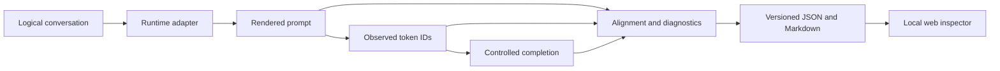

# LLM Chat Template Compatibility

**Find the prompt and token differences behind inconsistent local LLM behavior.**

LLM Chat Template Compatibility is a focused tool for reproducing and investigating inference prompt-path discrepancies across MLX-LM on Apple Silicon and a local llama.cpp server. It shows what was rendered, which token IDs were observed, and what controlled comparisons can and cannot establish.

> Same conversation does not necessarily mean same model input. An output mismatch alone does not prove a chat-template bug.

## Why this exists

Chat models consume token sequences, not abstract role/content objects. Runtimes may render system messages, role boundaries, assistant generation prefixes, BOS/EOS markers, and tool declarations differently. Then each tokenizer can map the rendered text to different IDs. Finally, inference engines can produce different outputs even from the same token IDs because model conversions, numerical precision, kernels, and stopping behavior differ. [Transformers chat template documentation](https://huggingface.co/docs/transformers/chat_templating) explains the conversion from messages to model-specific token sequences.

The tool separates **rendering**, **tokenization**, and **generation**. It uses an explicit controlled completion path: render, capture token IDs, then submit numeric token IDs to generation where the runtime supports it. This avoids a second text tokenization step but cannot reveal hidden internal prompts beyond captured API evidence.

## Features

- Eight readable conversation fixtures, including multi-turn, assistant-prefill, tool-result, and Unicode cases.
- Local `llama-server` adapter using health, props, apply-template, tokenize, and completion APIs.
- Optional MLX-LM adapter using the active tokenizer chat template and direct token generation.
- Sequence alignment with insert/delete/replace spans and first divergence.
- Deterministic findings for prompt, BOS, assistant-prefix, stop, and shared-input output differences.
- Versioned JSON artifacts and standalone Markdown reports, plus a local React inspector.
- Synthetic demo clearly marked as not measured model inference.

## Architecture



## Install

Python 3.11+ and uv are required. Install the locked Python dependencies and CLI:

```bash
uv sync --locked --extra dev
uv run templateparity --help
```

On Apple Silicon, install MLX-LM with `uv sync --locked --extra dev --extra mlx`. For the frontend, install Node.js 20.19+ or 22.12+ and use the committed pnpm lockfile with `cd frontend && pnpm install --frozen-lockfile`.

No model is downloaded automatically. Model acquisition and conversion are explicit operations. `scripts/prepare_models.sh` takes a Hugging Face repository, full commit SHA, output directory, and llama.cpp checkout; it downloads that revision only when invoked, converts the same local source to MLX float16 and GGUF F16, and writes a provenance manifest. Register and inspect it with:

```bash
uv run templateparity models register --manifest /path/to/model-manifest.json
uv run templateparity models inspect
```

The suggested starting checkpoint is `Qwen/Qwen2.5-1.5B-Instruct`. Matching model names do not prove matching weights or tokenizer semantics.

## Quick start without model files

```bash
uv run templateparity --help
uv run templateparity --version
uv run templateparity doctor
uv run templateparity fixtures list
uv run templateparity demo
cd frontend && pnpm install --frozen-lockfile && pnpm build
cd ..
uv run templateparity serve
```

Open `http://127.0.0.1:8000` for the local inspector. The synthetic demo uses the same comparison and reporting code; its token IDs and output strings are illustrative and are not measured inference.

## Capture and compare real runtimes

Start a llama.cpp server separately with your selected GGUF model. For example, using a locally installed `llama-server`:

```bash
llama-server -m /path/to/model.gguf --host 127.0.0.1 --port 8080
```

Prepare or obtain an MLX model explicitly, then:

```bash
uv run templateparity doctor
uv run templateparity compare --fixture system-message --mlx-model /path/to/mlx-model --llama-url http://127.0.0.1:8080 --mode native
uv run templateparity report RUN_ID
```

Artifacts are stored in `.templateparity/runs` by default. `--output-dir` is available on `demo`, `capture`, `compare`, and `batch`; `--max-tokens` defaults to 128. `compare --repeat 3` checks within-runtime output stability. Use `--json` for machine-readable command output. `uv run templateparity batch --suite core --mlx-model /path/to/mlx-model` runs the curated fixture suite.

Native mode executes each runtime with its own rendered token IDs. Shared mode independently tokenizes the canonical prompt with both runtimes before submitting identical IDs. Crossover mode attempts both rendered prompt variants in both engines and skips cells whose tokenization differs. Both modes require matching vocabulary size, BOS/EOS IDs, and representative token vectors. Current llama.cpp `/props` does not expose vocabulary size, so these modes safely save a diagnostic artifact and stop as unverified with current server builds.

Fixture listing validates the bundled inputs without a runtime. Capture-only mode records actual rendering and tokenization without inference:

```bash
uv run templateparity capture --fixture simple-user --runtime mlx --mlx-model /path/to/mlx-model
uv run templateparity capture --fixture simple-user --runtime llama --llama-url http://127.0.0.1:8080
```

`uv run templateparity doctor` probes the local llama.cpp server and checks optional MLX availability. `LLAMA_SERVER_URL` can configure the doctor's server URL.

## Web inspector

In one terminal, start the API:

```bash
uv run templateparity serve
```

In a second terminal, start the development UI:

```bash
cd frontend
pnpm install --frozen-lockfile
pnpm dev
```

The API binds to loopback by default. Vite serves the inspector at `http://127.0.0.1:5173` and proxies `/api` requests to port 8000. For production-style local serving, run `pnpm build` and open `http://127.0.0.1:8000`. The API includes a synthetic demo endpoint at `/api/demo` and a local experiment submission endpoint at `POST /api/experiments`.

## Reports and interpretation

Reports record provenance and confidence boundaries. A matching set of representative token IDs is not proof of complete tokenizer equivalence. Matching token IDs do not guarantee identical inference. Matching seeds do not establish deterministic equivalence across samplers. Different stopping rules can change output even when prompts match. Within-runtime comparisons that hold a model representation and effective settings fixed provide stronger template evidence than cross-runtime output comparisons.

## Tests and development

```bash
pytest
ruff check .
ruff format --check .
cd frontend && pnpm typecheck && pnpm build
```

Unit tests do not download model weights. Live adapter tests require local runtimes and model artifacts and are not run automatically. CI runs Python checks and the TypeScript build.

## Supported runtime matrix

| Runtime   | Prompt rendering          | Tokenization                         | Controlled generation                  | Requirements                                  |
| --------- | ------------------------- | ------------------------------------ | -------------------------------------- | --------------------------------------------- |
| MLX-LM    | Active tokenizer template | Native and text-encoded IDs compared | Stream generation from IDs             | Apple Silicon, optional `mlx-lm`, local model |
| llama.cpp | `/apply-template`         | `/tokenize` with explicit flags      | `/completion` with numeric token array | Running local `llama-server`                  |

llama.cpp endpoint shapes and server capabilities can vary by build. An unsupported API response is reported as a failure; the tool does not silently replace it with an approximate template.

## Security and privacy

Conversation prompts and outputs may be private. Captures and reports are written locally; no data is uploaded. Do not expose the unauthenticated API beyond loopback. Fixtures never execute tool calls or model-generated code. Template overrides are trusted local configuration. Raw prompts are persisted in report artifacts by default; pass `--no-persist-raw` to `compare` or `capture` to redact prompt/output text and token IDs before saving. Protect or remove artifacts when appropriate.

## Limitations

- The current llama.cpp `/props` API does not expose vocabulary size. Token compatibility is therefore marked unverified and shared/crossover generation is safely skipped on these server builds.
- Source model identity is only as strong as the registered conversion manifest; output files are fingerprinted during preparation but are not re-hashed at every run.
- Runtime versions and endpoint fields vary. Real inference requires local models and the corresponding runtime installations.

See [architecture](docs/architecture.md), [experiment design](docs/experiment-design.md), [model preparation](docs/model-preparation.md), [limitations](docs/limitations.md), and [troubleshooting](docs/troubleshooting.md).

## Contributing and license

See [CONTRIBUTING.md](CONTRIBUTING.md). Licensed under MIT; see [LICENSE](LICENSE).
