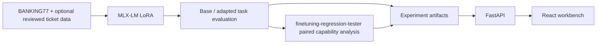

# LLM Fine-tuning and Serving

LLM Fine-tuning and Serving is a local machine-learning workbench for adapting and evaluating a language model on banking-support intent classification. It uses MLX-LM and applies a conservative policy layer to produce advisory ticket defaults.

**Current status:** the source includes the dataset, training, evaluation, API, and web workflows. No model training or real-model evaluation has been run for this release, so no adapter or performance results are included. Real inference and training require macOS on Apple Silicon.



## What is measured

BANKING77 contains text and intent annotations only. LLM Fine-tuning and Serving downloads the official train and test partitions, derives a seeded stratified validation partition from train, and preserves the official test data for final evaluation. Its 77 labels are not used as ground truth for priority, entities, actions, or review decisions. Those ticket fields need a separately authored, provenance-recorded, reviewed annotation set. The repo currently provides the schema and policy layer; it does not claim a reviewed ticket evaluation corpus or metrics.

Intent evaluation writes accuracy, macro and weighted F1, per-intent scores, confusion counts, JSON/schema and invalid-label rates, latency, throughput, and per-example outputs. Base zero-shot, four-example few-shot, and adapted runs can be evaluated separately. Few-shot prompts use the first four distinct labels from the stable training split. Structured ticket fields such as priority and entities do not have a reviewed benchmark in this release; the schema and policy defaults are not ticket-generation evaluation results.

The repository also includes an 18-case synthetic unsupported-input smoke suite. Custom JSONL evaluation reports intent and human-review/abstention metrics when expected review labels are supplied. This small authored fixture has not received independent review and is not representative enough for performance claims.

## Requirements and install

Python 3.11+. Real model work requires macOS and Apple Silicon. The preferred checkpoint is [`mlx-community/Qwen2.5-1.5B-Instruct-4bit`](https://huggingface.co/mlx-community/Qwen2.5-1.5B-Instruct-4bit); check its card/license and MLX-LM compatibility before use. Model weights and datasets are never committed.

```bash
uv sync --locked --extra dev --extra data --extra mlx
uv run llm-finetuning-and-serving doctor
uv run llm-finetuning-and-serving data prepare --output data/banking77 --seed 42
uv run llm-finetuning-and-serving data inspect --dataset data/banking77
```

Dataset access downloads `PolyAI/banking77` from Hugging Face. `manifest.json` records the dataset fingerprint, labels, seed, split counts, hashes, and the protected test-set source. The `mlx/` subdirectory contains MLX-LM chat records using the same intent-only instruction and JSON output as inference.

## Train and evaluate

Two documented starting presets are in `configs/`. The development preset is a short pipeline check, not a convergence claim; the standard preset is configurable and should be measured on target hardware.

```bash
uv run llm-finetuning-and-serving train --dataset data/banking77 --preset development
# or --preset standard; override with --iters and --batch-size
uv run llm-finetuning-and-serving eval --dataset data/banking77 --split validation --model base --output runs/base-validation.json
uv run llm-finetuning-and-serving eval --dataset data/banking77 --split validation --model adapted --output runs/adapted-validation.json
uv run llm-finetuning-and-serving compare --base runs/base-validation.json --adapted runs/adapted-validation.json --output runs/paired-validation.json
uv run llm-finetuning-and-serving eval --dataset data/banking77 --split test --model adapted --output runs/adapted-test.json
# Synthetic unsupported-input guardrail suite (a small smoke suite, not a benchmark):
uv run llm-finetuning-and-serving eval --input datasets/unsupported_inputs.jsonl --model base --output runs/unsupported-base.json
```

Set `LLM_FINETUNING_AND_SERVING_ADAPTER` to a trained adapter directory for adapted inference. Training invokes MLX-LM's `mlx_lm.lora` command and preserves its logs and run metadata. The integration targets the version range declared in `pyproject.toml`.

## finetuning-regression-tester integration

LLM Fine-tuning and Serving integrates with [finetuning-regression-tester](https://github.com/ranajahanzaib/finetuning-regression-tester) (formerly AfterTune) using its CLI and native comparison JSON. It does not reproduce capability graders. `llm-finetuning-and-serving regression-tester check` (or alias `aftertune check`) reports availability. For an experiment with a compatible adapter, supply a compatible held-out suite and config whose model points to the same base checkpoint:

```bash
uv run llm-finetuning-and-serving regression-tester run RUN_ID \
  --cases path/to/retention-cases.jsonl \
  --adapter artifacts/adapters/RUN_ID \
  --config path/to/compatible-config.yaml \
  --output runs/RUN_ID/regression-tester
```

The adapter verifies run association, executes baseline → adapted evaluation → compare → report with a timeout per command, validates comparison schema v1, and preserves the original comparison report plus invocation provenance. Tool failure or absence is visible and does not block task inference. finetuning-regression-tester's existing product-task example is not represented as a banking ticket benchmark.

See [integration details](docs/finetuning-regression-tester-integration.md).

## Serve and use the application

```bash
uv run llm-finetuning-and-serving serve                 # localhost:8000
cd web && pnpm install && pnpm run dev  # localhost:5173
```

FastAPI docs: `http://127.0.0.1:8000/docs`. API routes include health, model status, prediction, sequential comparison, experiment metadata, evaluation artifacts/examples, regression reports, and dataset summary. `LLM_FINETUNING_AND_SERVING_MODEL`, `LLM_FINETUNING_AND_SERVING_ADAPTER`, `LLM_FINETUNING_AND_SERVING_DATA`, and `LLM_FINETUNING_AND_SERVING_CORS_ORIGINS` configure the local service. It binds to loopback by default. Public exposure needs authentication, rate limiting, and suitable customer-data protections. Request text is not written to ordinary application logs.

The workbench shows real API output and reads recorded artifacts. It never supplies fixture metrics. The six playground inputs are examples only, not an evaluation set. Suggested workflow identifiers are advisory; no financial operation is connected.

## Checks

```bash
uv sync --locked --extra dev --extra data
uv run ruff check src tests
uv run pytest
cd web && pnpm install && pnpm test && pnpm run build
```

Tests use controlled predictions and local fixtures; they do not demonstrate real MLX inference. Real model loading and training are opt-in hardware-dependent operations.

## Architecture and reproducibility

- `src/llm_finetuning_and_serving/datasets.py`: dataset download, stratified split, hashes, and chat records.
- `inference.py`, `schemas.py`: lazy MLX model lifecycle, parsing, and conservative ticket policy.
- `evaluation.py`: real per-example inference and classification metrics.
- `integrations/finetuning_regression_tester.py`: isolated CLI invocation and native report import.
- `experiments.py`, `api.py`, `cli.py`: local JSON registry, FastAPI, and CLI.
- `web/`: React/TypeScript research console.

See [architecture](docs/architecture.md), [reproducibility](docs/reproducibility.md), [limitations](docs/limitations.md), and [demo cases](docs/demo-cases.md). Public fixtures contain synthetic examples only. This release includes no trained adapter, hosted deployment, screenshot, or benchmark result.

## Community

See the [contribution guide](CONTRIBUTING.md), [Code of Conduct](CODE_OF_CONDUCT.md), and [security policy](.github/SECURITY.md). Bug reports and feature proposals can be opened through the repository's GitHub issue templates.

## Attribution and license

LLM Fine-tuning and Serving source code is MIT licensed. BANKING77 is attributed to PolyAI via Hugging Face and distributed under CC-BY-4.0; cite the [dataset card](https://huggingface.co/datasets/PolyAI/banking77) and its [2020 paper](https://arxiv.org/abs/2003.04807). Qwen model weights follow the model card's Apache-2.0 license and are not bundled. [finetuning-regression-tester](https://github.com/ranajahanzaib/finetuning-regression-tester) (formerly AfterTune) remains a separate MIT-licensed project; integration is via its CLI and report format, with source provenance retained.
