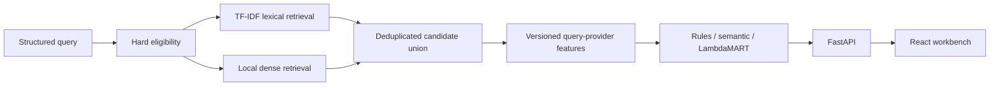

# Marketplace Learning to Rank

**Better matches. Measured, not assumed.**

Marketplace Learning to Rank is a local learning-to-rank lab for professional service marketplaces. It applies marketplace eligibility rules before retrieval, combines lexical and local dense retrieval, and compares a transparent rules baseline, a semantic baseline, and LightGBM LambdaMART over a shared candidate pool.

All provider records, query requests, relevance labels, and experiment traffic are synthetic. The project does not claim actual booking lift.

## Capabilities

- Seeded provider and query generator, complete eligible-universe labels, deterministic query splits grouped by structured category/specialty/skill intent, and an unseen-provider holdout.
- Hard budget, category, location, minimum experience, availability, remote, and on-site requirements.
- TF-IDF retrieval plus locally cached Sentence Transformers `all-MiniLM-L6-v2` dense retrieval.
- Interpretable rules ranker, dense-similarity baseline, and query-grouped LambdaMART training.
- Versioned model features, model manifest and hash validation, LightGBM score contributions, and pairwise feature inspection.
- Held-out NDCG, Recall, Precision, MRR, candidate recall, query-level bootstrap intervals, segments, failure cases, and cold-start / unseen-provider slices.
- FastAPI search, comparison, model, evaluation, diagnostics, and experimentation endpoints.
- Persistent visitor assignment and SQLite event storage, plus a clearly labeled synthetic traffic simulator.
- React search, comparison, evaluation, model, and experiment workspaces connected to the API.

## Quick start

Requirements: Python 3.12–3.14, `uv`, Node 20+, pnpm 9.15.4, and an initial network connection to install dependencies and download the embedding model. No API key, GPU, CUDA, database server, or Docker is required. On macOS, LightGBM may require `brew install libomp`.

```bash
make setup
make bootstrap
```

`make bootstrap` runs the full reproducible local pipeline and saves generated data and artifacts under ignored `data/generated/` and `artifacts/` directories. It builds the local dense embedding matrix and downloads `all-MiniLM-L6-v2` if it is not cached.

Start the application in two terminals:

```bash
uv run --directory apps/api uvicorn marketplace_learning_to_rank.api.app:app --reload --port 8000
cd apps/web && pnpm dev
```

Open http://localhost:5173. FastAPI’s OpenAPI page is at http://localhost:8000/docs.

## Reproducible pipeline

```bash
uv run --directory apps/api marketplace_learning_to_rank data generate --seed 42
uv run --directory apps/api marketplace_learning_to_rank data validate
uv run --directory apps/api marketplace_learning_to_rank embeddings build
uv run --directory apps/api marketplace_learning_to_rank features build
uv run --directory apps/api marketplace_learning_to_rank train
uv run --directory apps/api marketplace_learning_to_rank evaluate
uv run --directory apps/api marketplace_learning_to_rank benchmark
uv run --directory apps/api marketplace_learning_to_rank report
```

The defaults generate 2,400 providers and 2,400 unique requests. Use `--provider-count`, `--query-count`, `--candidate-count`, `--cold-start-fraction`, `--label-noise`, repeated `--category`, and repeated `--region "City, Country"` options to adjust data generation. All eligible providers are labeled for each query; `candidate-count` configures per-retriever top K, not the judgment universe.

The pipeline can also be run as one command:

```bash
uv run --directory apps/api marketplace_learning_to_rank pipeline run --seed 42
```

CI uses a deterministic hashing encoder **only as a small test fixture** to exercise real LightGBM grouped training, save/load, and inference without downloading the production embedding model. That fixture encoder is not a supported semantic ranking mode and is rejected by serving when its provenance does not match the local dense model.

The end-to-end browser test uses the same clearly identified fixture mode to verify API and UI wiring. To run it locally, prepare its artifacts and run the test (which starts the API and Vite server itself):

```bash
uv run --directory apps/api marketplace_learning_to_rank data generate --seed 11 --provider-count 80 --query-count 80
uv run --directory apps/api marketplace_learning_to_rank train --smoke-encoder
uv run --directory apps/api marketplace_learning_to_rank evaluate --smoke-encoder
uv run --directory apps/api marketplace_learning_to_rank benchmark --iterations 100 --smoke-encoder
pnpm --dir apps/web test:e2e
```

Its rankings and metrics are synthetic test evidence, not semantic-model results.

## Ranking flow



Eligibility rules run before retrieval and cannot be overridden by text similarity. The three rankers receive the same deterministic candidate union. Training uses contiguous query groups; train and validation provider rows exclude a deterministic provider-ID holdout, while test query groups remain separate. Evaluation keeps all eligible labels so retrieval recall includes relevant providers missed by retrieval.

LambdaMART uses `objective="lambdarank"`, gain values `[0, 1, 3, 7, 15]`, validation early stopping, and a fixed seed. The same versioned feature function builds training and serving vectors. Native LightGBM artifacts are checked against the manifest hash and feature schema at startup. Ranking scores are relative, uncalibrated scores—not probabilities. Feature contributions explain model scores, not user choice or causality.

## Evaluation evidence

`marketplace_learning_to_rank evaluate` writes computed results to `artifacts/evaluations/evaluation_metrics.json`; `marketplace_learning_to_rank report` renders a Markdown strategy table. The evaluation includes per-query metrics, a graded NDCG gain of `2^label - 1`, a binary relevance threshold of label ≥ 3, candidate recall by retriever, zero-result rate, paired query bootstrap intervals, regression/improvement counts, query segments, review-free providers, and providers excluded from training.

This source distribution does not include generated evaluation reports or a trained model. Run the evaluation pipeline to produce local measurements. All labels are synthetic targets, not human relevance judgments, customer behavior, or booking outcomes. Correlated query segments are not independent samples.

## API

- `POST /api/v1/search?strategy=rules|semantic|lambdamart`
- `POST /api/v1/search/compare`
- `GET /api/v1/providers/{id}` and `POST /api/v1/providers/compare`
- `GET /api/v1/evaluation/summary`, `/segments`, `/failures`, `/cold-start`, `/deltas`, `/queries`, and `/queries/{id}`
- `GET /api/v1/models/current`, `/features`, `/importance`
- `GET /api/v1/pipeline/status`, `/health`, `/ready`
- `/api/v1/experiments` for persistent assignments, idempotent events, simulation, reset, and summaries

Public search schemas bound text length, rate, experience, and result count. CORS allows only `localhost:5173` and `127.0.0.1:5173` by default. A public deployment needs access controls, rate limits, and abuse protection for experiment and administrative routes.

## Experiments

Experiment assignment is a stable SHA-256 bucket of experiment salt, ID, and visitor ID. The SQLite store makes event IDs idempotent. Exposure is recorded only by a `results_exposed` event. The simulator uses relevance and position-dependent behavior with per-visitor preference variation; it has no ranking-strategy bonus. Outcomes and confidence intervals are labeled synthetic and kept apart from `source=real` events. Real-event analysis is not currently exposed as a product claim.

## Project structure

- `apps/api/src/marketplace_learning_to_rank/data`: generation, validation, embeddings, feature building.
- `retrieval`, `ranking`, `training`, `evaluation`: independent ML pipeline stages.
- `experiments`: persistent assignment, event store, simulator, and analysis.
- `api`: FastAPI lifespan resources and public endpoints.
- `apps/web`: React/TypeScript product workbench.
- `docs`: assumptions, metric definitions, architecture, limitations, and usage.

## Limitations

This is a local synthetic laboratory, not a production marketplace or hiring decision system. Labels encode a simulated preference model and can reward its own assumptions. There is no real-world lift evidence, human-judgment dataset, position-bias correction, propensity-weighted evaluation, or production experiment governance. Sparse profile history is evaluated, and provider IDs are held out from model fitting, but the synthetic provider population does not establish generalization to a real marketplace. A hiring use case would additionally need legal review, fairness analysis, and domain-specific validation.

Generated datasets, embedding indexes, trained models, evaluation reports, and benchmark output are local artifacts and are not included in the repository. CI uses a deterministic hashing encoder for compact integration checks; those results are software smoke evidence, not semantic-model or marketplace evidence. The project is released under the MIT License; see [LICENSE](LICENSE).
