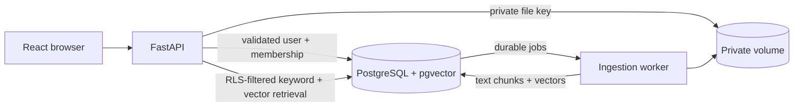

# Multi-Tenant RAG

**Secure, tenant-aware AI knowledge retrieval for SaaS applications.**

Multi-Tenant RAG is a reference application for combining structured property-management records with private documents. It focuses on a boundary that ordinary RAG examples leave out: every structured record, document, retrieval result, and source citation must remain inside the authenticated user's active organization and document permissions.

## What is implemented

- FastAPI API with Argon2 password hashing, signed short-lived JWTs in HTTP-only cookies, and current membership checks.
- PostgreSQL schema and Alembic migration for users, tenants, properties, units, leases, documents, grants, chunks, ingestion jobs, chat, and audit events.
- Separate runtime, worker, and migration roles; tenant-owned tables use forced RLS with transaction-local context.
- Tenant-aware foreign keys prevent properties, units, leases, and source documents from crossing tenant boundaries.
- Local private file storage and a PostgreSQL `SKIP LOCKED` ingestion queue for PDFs, Markdown, and text.
- PostgreSQL full-text and pgvector retrieval with reciprocal-rank fusion when the local embedding model is available; lexical retrieval remains available without the model.
- Evidence-only lease answers by default, with an optional local Ollama provider, and a React dashboard for leases, documents, and the assistant.
- Property and unit creation, lease creation and updates, current notice-requirement states, and database-enforced tenant-consistent links.
- Persistent chat history with current source reauthorization and a citation preview.
- Administrator member-role and access-revocation controls, audit history, and a limited live Security Lab runner.
- Synthetic seed data with 12 leases, 13 document fixtures, a revoked grant, a soft-deleted document, an intentional notice-term conflict, and a shared user with different organization roles.

## Scope

Multi-Tenant RAG is a local reference application for permission-aware retrieval in a fictional property-management service. It includes role and user document grants, a six-check Security Lab smoke suite, an API evaluation smoke set, and browser workflows. It does not include a broad adversarial test suite, a full evaluation dashboard, automated retention purging, or all controls required for production deployment. User-specific grants are entered by organization member UUID.

## Architecture



PostgreSQL is authoritative. The API validates membership on each request, then opens a separate transaction with transaction-local tenant, user, and role settings. Forced RLS covers tenant rows. Document reads, indexed chunks, versions, and worker jobs are rechecked against document access rules. The runtime database role is neither a superuser nor an RLS bypass role and does not own the protected tables.

## Run locally

Requirements: Docker Compose, `uv`, Node.js 20+, pnpm. Local credentials are generated for each checkout and are not included in the repository.

```bash
make init-env
make up
make seed
```

Open [http://localhost:5173](http://localhost:5173). The API docs are at [http://localhost:8000/docs](http://localhost:8000/docs).

Demo sign-in. Use the generated value of `DEMO_PASSWORD` from `.env` for each account:

```text
Email:    admin@northstar.example
```

A second fictional organization is seeded for isolation checks:

```text
Email:    admin@summit.example
```

The shared regional account belongs to both organizations with different roles, so it can demonstrate tenant switching and role-specific access:

```text
Email:    regional@tenantground.example
Harbor Property Group: manager
Cedar Estates:         viewer
```

`make init-env` creates `.env` with fresh random database, JWT, and demo passwords and sets owner-only file permissions. Keep it private. Demo seeding refuses to run in production or with `DEMO_MODE=false`. `make reset-demo` removes Docker volumes and all local data; the database role initialization script runs only when the PostgreSQL volume is first created.

The ingestion worker downloads `BAAI/bge-small-en-v1.5` on its first embedding run. If model loading is unavailable, it still indexes extracted text for PostgreSQL full-text retrieval. Evidence-only generation is the default. For optional local generation, set `LLM_PROVIDER=ollama`, then start `docker compose --profile local-ai up -d` and run `docker compose exec ollama ollama pull llama3.2`. If Ollama is unavailable or returns malformed/unapproved citations, the API falls back to its evidence-only answer.

## Useful commands

```bash
make init-env       # Generate private local credentials from .env.example
make up             # Build and start PostgreSQL, API, worker, and web app
make migrate        # Apply Alembic migrations
make seed           # Insert deterministic fictional organizations and records
make logs           # Follow container logs
make down           # Stop containers; retain volumes
make lint           # Ruff checks
make typecheck      # mypy and TypeScript checks
make test           # unit and configured integration tests
make test-security  # runtime-role RLS integration smoke check
make test-e2e       # Playwright flow against a running, seeded local stack
make eval           # deterministic API smoke evaluation; writes reports/evaluations/latest.json
```

If the PostgreSQL volume was initialized with an earlier checkout, run `make reset-demo` once to recreate the roles with the newly generated credentials. This deletes all local database and uploaded-file data.

Set `TEST_DATABASE_URL` to a migrated database using the restricted runtime role to run the PostgreSQL RLS integration test. Tests skip that test when no database is configured. Install the Playwright browser once with `cd apps/web && pnpm exec playwright install chromium`; start and seed the Compose stack before `make test-e2e` or `make eval`.

## Security model and limits

Read [the security model](docs/security-model.md), [threat model](docs/threat-model.md), and [deployment notes](docs/deployment.md). In particular, the database GUC context is trusted because it is set by the API after authentication and membership lookup. A compromised API process can forge that context. A database administrator can read all data. This reference does not claim to defend against either fully compromised trust boundary.

The demo supports document deletion, version replacement, and grant management. It does not provide malware scanning, automatic retention purging, or distributed login throttling, and should be run only in a trusted local environment.

## Development

Python requirements are pinned through `uv.lock`; install development tools with `uv sync --extra dev`, add `--extra documents` for PDF extraction, and add `--extra local-ai` for local embedding generation. Frontend dependencies are pinned in `apps/web/pnpm-lock.yaml`.

See [contributing](CONTRIBUTING.md). The project is licensed under MIT.
