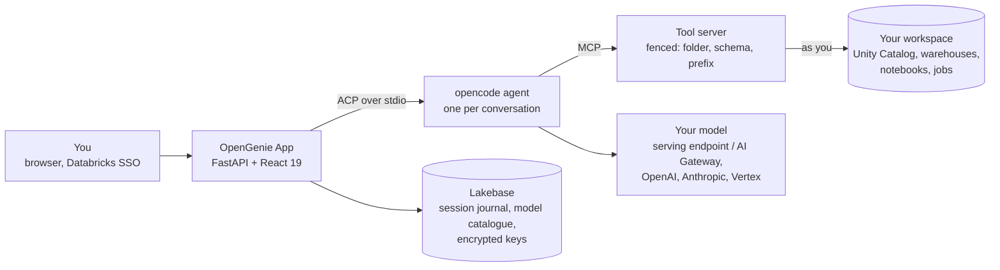

# OpenGenie

**The Databricks coding agent, on the model you choose.**

**Website and documentation: <https://raphaelmansuy.github.io/opengenie/>** — the tour, the install
guide, the evidence page and the design notes. The source is on
[GitHub](https://github.com/raphaelmansuy/opengenie); the current release is
[v1.1.0](https://github.com/raphaelmansuy/opengenie/releases/tag/v1.1.0).

Genie Code is the best coding agent for data engineering because it can see your workspace: Unity
Catalog, SQL warehouses, notebooks, jobs. What it does not let you do is choose the model, or control
what the work costs. OpenGenie is an open-source Databricks App that gives a coding agent the same kind
of workspace context and hands those two decisions back to you.

[](https://raphaelmansuy.github.io/opengenie/)
[](https://raphaelmansuy.github.io/opengenie/install/)
[](https://github.com/raphaelmansuy/opengenie/releases)
[](LICENSE)
[](exams/results)
[](apps/coding-agent/tests)


*The app deployed in a Databricks workspace. The notebook is the centre of the screen; the assistant
sits beside it and knows which notebook the conversation is about.*

---

## Why it exists

Genie Code got the important part right: the agent works *inside* Databricks, so its answers come from
your data instead of from a guess. Two things come with it that a team cannot change: the model is
chosen for you, and the bill is metered by a product you do not configure.

[Raphael Mansuy](https://www.linkedin.com/in/raphaelmansuy/) built OpenGenie to keep the context and
return those decisions to the team. Before building it, he measured whether the model matters. Same
agent, same tools, same rules, on eight development tasks scored in a live workspace. The score is
the scoring points earned out of the points available across those tasks:

| Model | Points earned |
|---|---|
| gpt-oss-120b | **39%** (60 of 152) |
| Gemini 3.8 Flash | **86%** (130 of 152) |

One run each. The caveats and the command that regenerates these numbers are on the
[evidence page](https://raphaelmansuy.github.io/opengenie/evidence/). The model was the largest lever
we could measure, and it is the one a Genie Code user cannot pull.

## What the agent can reach

Each conversation gets its own [MCP](https://modelcontextprotocol.io) tool server. In a deployment it calls
Databricks **as the signed-in user**, so Unity Catalog permissions still decide what the agent sees. Run
locally, it acts as the owner of the token you give it.

| Area | What it does | Tools |
|---|---|---|
| Unity Catalog | lists tables, reads columns, types and comments, searches table and column names | `dbx_list_tables`, `dbx_describe_table`, `dbx_search_tables` |
| SQL warehouses | runs the query, reads the result or the engine's error, corrects itself | `dbx_run_sql` |
| Notebooks | reads, searches, writes and runs notebooks; reports the first failing cell | `dbx_read_notebook`, `dbx_grep_notebook`, `dbx_write_notebook`, `dbx_run_notebook` |
| Jobs | creates and runs jobs under the session prefix, checks the latest run succeeded | `dbx_create_job`, `dbx_run_job`, `dbx_job_run_status` |
| Lakebase and Apps | creates a Lakebase instance, runs SQL on it, scaffolds a Databricks App | `dbx_lakebase_*`, `dbx_create_app` |
| SQL editor | reads, updates and runs the attached query draft; retrieves the same execution in the editor | `dbx_read_query`, `dbx_update_query`, `dbx_run_query`, `dbx_query_run_status` |
| Skills | five playbooks: SQL queries, notebook authoring, ETL pipelines, Lakebase, Databricks Apps | `dbx_skill` |

That is the 32-tool `core` profile the app starts. The server
([`tools/databricks_notebook_mcp.py`](apps/coding-agent/tools/databricks_notebook_mcp.py)) has 45;
the `full` profile adds catalogue and schema listings, lineage, grants, pipelines and warehouses.

## Three rules the server enforces

| | Rule | Where |
|---|---|---|
| **1** | **The model is a setting.** 13 models from 4 providers ship in the catalogue (Databricks serving endpoints, OpenAI, Anthropic, Google Vertex), and the serving endpoints your workspace exposes are discovered at run time. Personal provider keys are envelope-encrypted with a key held in a Databricks secret. | [`seed/llm_models.yaml`](apps/coding-agent/seed/llm_models.yaml), [`api/adapters/llm/`](apps/coding-agent/api/adapters/llm) |
| **2** | **Writes stay inside the fence.** The tool server is started with one folder, one schema and one job-name prefix. A write anywhere else is refused by that server with the reason; a write made from the app outside the folder waits for your approval. | [`api/adapters/mcp/registry.py`](apps/coding-agent/api/adapters/mcp/registry.py), [`api/domain/scope.py`](apps/coding-agent/api/domain/scope.py) |
| **3** | **Done means proven.** When the agent says a requirement is met, the claim is matched against the tool calls it actually made. A citation to a call that never happened is reported as such. | [`api/domain/evidence.py`](apps/coding-agent/api/domain/evidence.py) |

## How it works



- **One process.** Uvicorn serves the API and the built front end, and spawns
  [`opencode acp`](https://opencode.ai) per conversation ([`app.yaml`](apps/coding-agent/app.yaml)).
- **Durable work.** Turns run on the server and are journalled in Lakebase, Postgres or SQLite. Close the
  tab and come back; after a restart the app states what was interrupted rather than replaying it
  ([spec 010](specs/010-long-running/README.md)).
- **A mission view.** Each request shows its objective, plan, outputs and the proof for each requirement
  ([spec 011](specs/011-ux-coding-mission/README.md)).
- **A notebook, not a chat log.** Cells with their own Ask and Run, Run all that stops at the first
  failure, a run map, *Fix with agent* that sends the engine's own error, attachments and pasted images
  ([009](specs/009-attach-file-clipboard-support/README.md), [010](specs/010-notebook/README.md)).

## Genie Code or OpenGenie?

**Stay on Genie Code if** you want nothing to deploy or operate; one model and the metered cost are
fine; your hardest problem is finding the right table among thousands, where Genie's business semantics
help most; or you need inline completion and Python running as you on your own clusters.

**Use OpenGenie if** you want to choose the model per task or use one you already pay for; writes must
stay inside a named folder and schema, enforced by the server; you want "done" checked against what the
agent ran; or you want to read, change and self-host the code.

## Get started

| If you want to | Go to |
|---|---|
| See it | [**The tour**](https://raphaelmansuy.github.io/opengenie/tour/): real screenshots of every screen |
| Deploy it | [**Install**](https://raphaelmansuy.github.io/opengenie/install/): what to change, Lakebase, then `make deploy` |
| Try it without deploying | [**The tutorial**](docs/tutorial.md): about 30 minutes, from a notebook, no local shell |
| Check the numbers | [**The evidence**](https://raphaelmansuy.github.io/opengenie/evidence/): every score with its fraction and caveat |
| Track changes | [**Releases**](https://github.com/raphaelmansuy/opengenie/releases): what v1.1.0 contains, and what comes next |
| Read the design | [001](specs/001-databricks-coding-agents/README.md) app · [005](specs/005-llm-models/README.md) models · [006](specs/006-databricks/README.md) Genie Code parity · [010](specs/010-long-running/README.md) durable sessions · [011](specs/011-ux-coding-mission/README.md) missions |
| Read the architecture | [**Architecture**](docs/08-architecture.md) context, containers, deployment · [**Security**](docs/09-security.md) authn, authz, the fence · [**Data model**](docs/10-data-model.md) what is stored |

### Prerequisites

- A Databricks workspace, and the [Databricks CLI](https://docs.databricks.com/dev-tools/cli/index.html)
  signed in with `databricks auth login`.
- Python 3.12 and Node.js 20 or later, to run or build the app locally.
- For a deployment: app compute, a Lakebase project, and a Databricks secret scope for the encryption key.

### Deploy

The [install page](https://raphaelmansuy.github.io/opengenie/install/) lists the values in `app.yaml` and
the `Makefile` that name the author's workspace; change those first. Then:

```bash
git clone https://github.com/raphaelmansuy/opengenie.git && cd opengenie
databricks bundle deploy -t dev            # the app, its user scopes and secret resources
make -C apps/coding-agent deploy           # sync -> deploy -> verify the live URL serves this checkout
```

### Run locally

```bash
cd apps/coding-agent
make setup && make dev                     # scripted agent on http://127.0.0.1:8062
make dev-real                              # the real opencode agent and model on http://127.0.0.1:8071
make check                                 # TypeScript types, 2061 Python tests and 1233 front-end tests; no network
```

`make dev` replaces the model with a deterministic agent that plays scripted scenarios, which is how the
interface is developed and tested. Both use your `databricks auth login` session, so the workspace browser
shows your real files.

### Which version is running

The version lives in one file, [`apps/coding-agent/VERSION`](apps/coding-agent/VERSION), and every surface
reads it from there: the top bar prints it beside the product name, the account menu names the commit the
platform resolved, and `GET /api/version` answers the same facts over HTTP. A deployed app therefore
states its own build, which is what `make -C apps/coding-agent verify` checks against this checkout.
Releases are tagged from that file — see [Releases](https://github.com/raphaelmansuy/opengenie/releases).

The site has its own gate. `python3 site/build.py && python3 site/check.py` builds and verifies every
link, claim and image; `node tests/sites/e2e/site.e2e.mjs` drives every published page at six viewports
in both themes and saves each screenshot to `tests/sites/e2e/screenshots/`. CI runs both before it
publishes.

## The study behind it

The app is the second half of this repository. The first half is the measurement that justified it:
eleven graded tasks (eight to develop with, three held out), seeded in a live workspace and scored
against it. The repository keeps 174 run files; 123 are counted in the claims, and the other batches are
named as exclusions on the [evidence page](https://raphaelmansuy.github.io/opengenie/evidence/). Each task seeds real state
(tables with traps, a broken job, a support ticket carrying an injected instruction), hands the agent a
plain-language request, then grades the **workspace** afterwards. A grader is trusted only once the
reference solution scores 100% and a do-nothing agent fails.

1. **The model matters more than the tooling.** The same tools and rules scored 39% with one model and
   86% with another. → [Results](docs/06-results-and-lessons.md)
2. **Engineering rescues a weak model.** Scoped tools, a supervisor loop and written rules took that
   model from 19% to 94% of the points on the development tasks (29 of 152 to 143 of 152).
3. **A strong model needs far less machinery.** On the three held-out tasks, the very first setup scored
   every point with Gemini (37 of 37, over three runs). Choose how much to build from the model you can afford.
   → [Decision guide](docs/07-decision-guide.md)
4. **The official Databricks skills are not neutral.** One routes data questions to Genie, and the plain
   CLI path has no write fence. → [Toolbox](docs/03-toolbox-cli-skills-mcp.md#the-genie-trap)
5. **Never trust a self-reported "done".** The most dangerous failures were confident and wrong.
   → [Exam suite](docs/05-exam-suite.md)

```bash
python3 exams/make_tables.py               # print every table from exams/results
python3 site/build.py && python3 site/check.py   # rebuild the site; fails if a number and its source disagree
```

## Repository map

```
apps/coding-agent/   the application: FastAPI, React 19 + CodeMirror 6, opencode over ACP
  api/               domain (pure rules), ports, adapters, routers, services
  web/src/           the front end and its tests
  tools/             the MCP tool server (45 tools, 32 in the core profile) and its skills
  seed/              the model catalogue the app ships with
exams/               the exam harness: 11 graded missions and every saved run
docs/                tutorial, big picture, setup, safety, results, decision guide
specs/               one folder per feature: why, design, plan, and browser evidence
site/                the GitHub Pages site: build.py, claims.py, check.py, content/
tests/sites/         end-to-end tests and screenshots of the site
notebooks/           the tutorial as one notebook, for a workspace with no shell
templates/           the original shell-only kit
```

## What this is not

- **Not a replacement for Genie's business-term understanding.** The exams named their tables; finding
  the right one in a catalogue of ten thousand is untested here.
- **Not a cost comparison.** We measured tokens, not money, and hold no Genie Code usage history.
- **Not a hosted demo.** The app needs your workspace.
- **Not a guarantee.** One run per setup on most configurations, small clean data, well-specified tasks.
  Only one configuration was repeated (spread about 2.6 points), so a gap of a point or two is noise.
- **Not a verified deployment.** This README describes the code. To check that a live app serves this
  checkout, run `make -C apps/coding-agent verify`.

## Safety

- **The identity is the boundary.** Deployed, the app acts as the signed-in user; locally, as the owner
  of the token. The fence limits what the agent *asks for*; the identity limits what it *may do*.
- **Agents can be prompt-injected by data.** Exam M8 plants an instruction in a support ticket. Read the
  "anything odd or suspicious" section of every report.
- **Never run an agent with auto-approve against production.**

Read [Safety and governance](docs/04-safety-and-governance.md) before running anything that can write.

## Licence

[Apache-2.0](LICENSE). Use it, fork it, run it inside a company; keep the attribution.

## Author

**Raphael Mansuy**: data engineering and AI strategist, twenty years of global technology leadership, a
startup studio in Hong Kong, co-author of *The Definitive Guide to Data Integration* (Packt, 2024).

[LinkedIn](https://www.linkedin.com/in/raphaelmansuy/) · [GitHub](https://github.com/raphaelmansuy) ·
[The book](https://www.oreilly.com/library/view/the-definitive-guide/9781837631919/) ·
[About](https://raphaelmansuy.github.io/opengenie/about/)

---

**Site:** <https://raphaelmansuy.github.io/opengenie/> ·
**Source:** <https://github.com/raphaelmansuy/opengenie> ·
**Releases:** <https://github.com/raphaelmansuy/opengenie/releases> ·
**Issues:** <https://github.com/raphaelmansuy/opengenie/issues>
