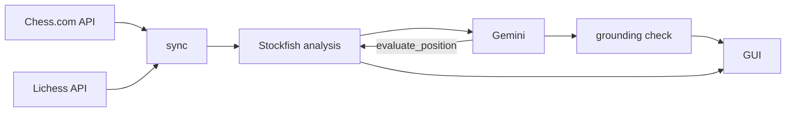

# AI Chess Coach

Desktop chess coach that reviews your Chess.com and Lichess games with Stockfish and explains them with Gemini.


AI Chess Coach downloads your games, rates every move with Stockfish and has Gemini write a comment for each one. You can then ask questions about any position. For every "what if" move, the prompt tells Gemini to call Stockfish as a tool rather than work out the line itself. The app checks every move Gemini names against the game, the engine lines and the positions the tool evaluated, and sends a chat answer that fails the check back once for correction. Game sync is incremental: a second sync asks only for the current month on Chess.com and for games played since the last sync on Lichess.

I wanted feedback on my moves in plain language, with the option to ask why a move was a mistake or why it was good. I also wanted to review a lot of games quickly in one window, without switching between Chess.com and Lichess. And I was curious whether an LLM would give good advice once it had a chess engine to consult and Python code checking every move it names.

## Quick start

Tested on Windows 11 with Python 3.13 and Stockfish 19. You need:

- [Python 3.13](https://www.python.org/downloads/)
- [Stockfish](https://stockfishchess.org/download/) (not a pip package: download the executable)
- A [Gemini API key](https://aistudio.google.com/app/apikey) (the free tier works, see [Limitations](#limitations))
- The [GTK3 runtime](https://github.com/tschoonj/GTK-for-Windows-Runtime-Environment-Installer) with its `bin` folder on `PATH`. CairoSVG draws the board and needs its `libcairo-2.dll`.

Install (Command Prompt or PowerShell):

```
git clone https://github.com/rayanrejeb/ai-chess-coach.git
cd ai-chess-coach
python -m venv .venv
.venv\Scripts\python -m pip install -r requirements.txt
copy .env.example .env
```

Open `.env` and set:

| Variable | Required | Value |
| --- | --- | --- |
| `GEMINI_API_KEY` | yes, here or in Settings | your Gemini API key |
| `STOCKFISH_PATH` | yes, here or in Settings | full path to the Stockfish `.exe` |
| `DEFAULT_USERNAME` | no | your Chess.com or Lichess username, pre-filled on first launch |
| `GEMINI_MODEL` | no | default `gemini-3.5-flash` |
| `LICHESS_TOKEN` | no | sent with Lichess requests when set |
| `CHESSCOM_USERNAME`, `LICHESS_USERNAME` | no | for the sync command, when they differ from `DEFAULT_USERNAME` |

`GEMINI_API_KEY`, `GEMINI_MODEL`, `LICHESS_TOKEN` and `STOCKFISH_PATH` in `.env` override the Settings window.

Run:

```
.venv\Scripts\python main.py
```

Pick Chess.com or Lichess, enter a username, click **Fetch Games**, choose a game and click **Analyze Selected Game**. Use **< Prev** and **Next >** to step through the moves, and the box at the bottom to ask questions.

To sync both sites without the window and count the saved games:

```
.venv\Scripts\python -m ai_chess_coach.sync run
.venv\Scripts\python -m ai_chess_coach.sync count
```

## How it works



### Sync

Chess.com serves one archive per month. Each month is fetched again on every sync until one day after it ends, then never again. Lichess sends every game created since the last sync in one streamed request. Games are saved after every batch, so a network error keeps what was already downloaded.

### Analysis

Two Stockfish processes analyze the positions in parallel. Results are cached by position, depth and number of lines. Each move is rated by the win probability it loses (thresholds in [`engine/classify.py`](ai_chess_coach/engine/classify.py)). The tactics module marks forks, pins, skewers and other motifs in the engine lines.

### Commentary

The moves go to Gemini in parts of at most 24 plies and 40,000 characters of data, with their rating, engine lines and tactics. Gemini writes one comment per move. The app fills the "missed opportunities" and "best replies" lists from the engine lines.

### Chat

The question goes to Gemini with the current position, the app's rating of the move and of any game move the question names. Gemini can call `evaluate_position`, which runs Stockfish on the current position or on an earlier game position (by move number) and returns the evaluation and the line. Each successful call adds a small grey line under the answer, such as "Checked with Stockfish: 15.Qd2, +0.54", with the move and the evaluation written by the tool from the engine's result.


### Grounding check

The app checks every move an answer names. A move is illegal if it is not legal in any position under discussion, and unverified if it is legal but not backed by the game, an engine line or a tool call. Flagged chat answers go back to Gemini once with the list of flagged moves; if the second answer still fails, it appears with a "Not verified by the engine" note. Commentary goes through the same check, but its result is only recorded with the comment and never retried.

## Results

Measured on one Windows 11 machine (16 logical cores) with Stockfish 19 and `gemini-3.5-flash`, between 2026-11-08 and 2026-11-09.

| What was measured | Result |
| --- | --- |
| Games synced from the author's two accounts, first run | 408: 124 Chess.com + 284 Lichess |
| First sync: requests and time | Chess.com 8 requests, 3.90 s; Lichess 1 request, 11.83 s |
| Second sync, no new games: requests and time | Chess.com 1 request, 0.59 s; Lichess 1 request, 1.37 s |
| Preparing the commentary data for 15 plies of the Opera Game (Morphy, 1858), 2 runs each | 34.68-35.12 s before, 5.23-5.32 s after: 6.6x faster |
| Engine pass over 25 plies of the Opera Game, 2 runs each | 87.87-88.14 s before, 39.09-39.20 s after: 2.2x faster |
| Chat grounding: 6 live answers about one real 46-ply game | 0 illegal moves, 0 unverified moves, no correction needed |
| Commentary grounding: 15 live comments on the same game | 0 illegal moves; 5 flagged unverified, 4 of them square names; after the fix, 1 ("an immediate e4") |

"Before" is the code before the engine rewrite. The speed-ups come from a faster material count in the tactics module, caching, and parallel work: two engine processes, and worker processes for the line descriptions. In the engine pass, the "before" code ran Stockfish at depth 12 and the "after" code at depth 16.

## Limitations

- The Gemini free tier allows about 20 requests per model per day (HTTP 429 with a limit of 20, seen on 2026-11-08). In the live tests a chat question cost 1 to 3 requests: 1, plus 1 for each tool call. An answer that needs a correction costs the same again. Commentary costs 1 request per part (15 plies took 2 parts). Retries after HTTP 429 or 503 errors count too.
- The sync skips a Lichess correspondence game that is still in progress and moves past it, so if the game finishes later it is never saved.
- The first engine pass computes one line per position, so "missed opportunities" and "best replies" hold at most one move each.
- The app has only been tested on Windows 11, not on Linux or macOS.

## Running the tests

```
.venv\Scripts\python -m pip install pytest
.venv\Scripts\python -m pytest
```

The suite has 160 tests, and none of them calls Gemini. The 8 tests that run Stockfish skip when `STOCKFISH_PATH` does not point to an existing file (152 passed, 8 skipped with the `.env.example` values).

## Credits and license

Built on [Chess Analyzer](https://github.com/yusufelgen07/chess-analyzer-vibe-coding-) by yusufelgen07 (MIT License). See [THIRD_PARTY_NOTICES.md](THIRD_PARTY_NOTICES.md).

Licensed under [GPL-3.0](LICENSE).

Bugs and questions: [GitHub issues](https://github.com/rayanrejeb/ai-chess-coach/issues).
