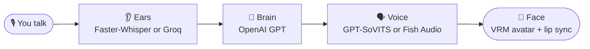

<picture>
  <source width="100%" srcset="./docs/banner-dark.png" media="(prefers-color-scheme: dark)" />
  <source width="100%" srcset="./docs/banner-light.png" media="(prefers-color-scheme: light), (prefers-color-scheme: no-preference)" />
  
</picture>

<h1 align="center">Project Riko</h1>

<p align="center">
  <b>Talk to her out loud. She talks back.</b><br />
  An anime AI companion that runs on your own PC, with her own voice and a 3D avatar that lip-syncs every word.
</p>

<p align="center">
  <a href="https://www.youtube.com/@JustRayen"></a>
  <a href="https://patreon.com/RayenAI"></a>
  <a href="https://discord.gg/rayenai"></a>
</p>
<p align="center">
  
  
  
  
  <a href="LICENSE"></a>
</p>

> [!IMPORTANT]
> **This is the 50K snapshot: a complete Riko, open source and yours to keep.** It's frozen at this release, so it stays a stable base to build on.
>
> Riko keeps growing on **[Patreon](https://patreon.com/RayenAI)**, home of the Full Source and the Desktop App. [See how they compare.](#three-ways)
>
> GitHub issues aren't monitored, so there's no support here.

## 🦊 Meet Riko

Riko is a voice companion you set up yourself. Press Enter and talk. She hears you, comes up with a reply (usually a snarky one), and says it out loud while her lips move along on screen.

This repo is the open-source core of Project Riko: the whole loop from your voice to hers, written to be read. It's under 500 lines in total, and every part sits in its own small file, so when you want to change how she thinks, sounds or looks, you know exactly where to go.

Her personality, her avatar and her voice all live in one config file. Making her yours takes a few minutes.

## ✨ What she can do

| | |
|---|---|
| 🎙️ **Listens** | Push-to-talk. Press Enter, speak, press Enter. |
| 👂 **Understands** | Speech to text with [Faster-Whisper](https://github.com/SYSTRAN/faster-whisper) on your own PC, or [Groq](https://console.groq.com)'s fast online Whisper. |
| 🧠 **Thinks** | Replies come from OpenAI GPT, in whatever personality you write for her. |
| 📝 **Keeps the conversation** | The chat is saved to `chat_history.json`, so she picks up where you left off. |
| 🗣️ **Speaks** | Clones a voice from a short clip with [GPT-SoVITS](https://github.com/RVC-Boss/GPT-SoVITS), or uses any voice on [Fish Audio](https://fish.audio/?fpr=rayen10). |
| 💃 **Shows up** | A VRM avatar in your browser that lip-syncs to her voice. Drag to spin her around, right-drag to move her, scroll to zoom. |
| 🎭 **Becomes anyone** | Personality, avatar and voice are all set in one file. |
| ✅ **Tells you what's missing** | Before she starts, a quick check catches a missing key, server or file and tells you how to fix it. |

## ⚙️ How it works



Each step is one file, and `main.py` runs them in a loop:

| Step | File | What it does |
|---|---|---|
| 👂 Ears | `riko/asr.py` | Records you between the two Enters, turns it into text |
| 🧠 Brain | `riko/llm.py` | Sends the chat to OpenAI, saves her answer to the history |
| 🗣️ Voice | `riko/tts.py` | Turns her answer into a voice clip |
| 💃 Face | `riko/viewer.py` + `client/index.html` | Plays the clip on the avatar page and moves her mouth with it |

## 🚀 Quick start

The easiest way in uses Fish Audio for her voice: no GPU and nothing extra to install. If you'd rather generate her voice on your own PC, do this first and then see [Local voice](#local-voice).

**You need:** a Windows or Linux PC with a microphone, an [OpenAI API key](https://platform.openai.com/api-keys), and a [Fish Audio API key](https://fish.audio/?fpr=rayen10) (sign up, then create one under *API keys*).

**1. Install uv.** It sets up Python for you.

```powershell
# Windows (PowerShell)
powershell -ExecutionPolicy ByPass -c "irm https://astral.sh/uv/install.ps1 | iex"
```

```bash
# Linux
curl -LsSf https://astral.sh/uv/install.sh | sh
sudo apt install libportaudio2    # lets Python use your microphone
```

Close and reopen your terminal afterwards so it can find `uv`.

**2. Get the code.**

```bash
git clone https://github.com/rayenfeng/riko_project.git
cd riko_project
```

No git? Click the green **Code** button at the top of this page → **Download ZIP**, unzip it, then open a terminal in that folder. On Windows 11: right-click inside the folder → **Open in Terminal**.

**3. Install everything.**

```bash
uv sync
```

**4. Add your API keys.**

```bash
copy .env.example .env    # Linux: cp .env.example .env
notepad .env              # Linux: nano .env
```

Paste your keys after the `=` signs and save. `.env` is git-ignored, so your keys stay out of any commit.

**5. Start her.**

```bash
uv run main.py --tts fish
```

The first launch takes a minute while it downloads the speech recognition model.

**6. Say hi.**

1. Open **http://127.0.0.1:8080** and click once. Browsers only play sound after a click.
2. Back in the terminal, press **Enter**, say something, press **Enter**.
3. She answers on the page. **Ctrl+C** quits.

> [!TIP]
> Set `tts: fish` in `character_config.yaml` and a plain `uv run main.py` does the same thing.

## 🎨 Make her yours

Everything about her lives in `character_config.yaml`. Put her files (avatar, voice clip) in `character_files/`.

```yaml
system_prompt: |
  You are a helpful assistant named Riko.
  You speak like a snarky anime girl.
  Always refer to the user as "senpai".
```

| To change her... | Edit |
|---|---|
| **Personality** | `system_prompt`. Describe her the way you'd brief an actor: who she is, how she talks, what she calls you. |
| **Look** | `vrm_model`. Any `.vrm` file works. You can make your own for free in [VRoid Studio](https://vroid.com/en/studio). |
| **Fish voice** | `fish.voice_id`. Open any voice on [fish.audio](https://fish.audio/?fpr=rayen10) and copy the ID from the page address: `fish.audio/m/<voice id>`. |
| **GPT-SoVITS voice** | `ref_audio_path`: a 3–10 second clip with no long silences. `prompt_text`: exactly what the clip says. |
| **Brain** | `model`. Any OpenAI model. Default: `gpt-4.1-mini`. |
| **Ears** | `asr: local` (Faster-Whisper, free, on your PC) or `asr: groq` (needs a free [Groq key](https://console.groq.com/keys)). |
| **Speech model size or GPU** | `WHISPER_MODEL` / `WHISPER_DEVICE` at the top of `riko/asr.py`. |
| **A fresh start** | Delete `chat_history.json`. |

You can also switch voice or ears for one run without touching the config:

```bash
uv run main.py --tts sovits    # or fish
uv run main.py --asr groq      # or local
```

<a id="local-voice"></a>
## 🎤 Local voice with GPT-SoVITS

Want her voice generated on your own machine, cloned from any clip you like? That's what GPT-SoVITS does. It runs best on an NVIDIA GPU and is installed separately.

1. Install [GPT-SoVITS](https://github.com/RVC-Boss/GPT-SoVITS) by following its guide.
2. In the GPT-SoVITS folder, start its API server and leave it running:
   ```bash
   python api_v2.py -a 127.0.0.1 -p 9880
   ```
3. Start Riko with `uv run main.py --tts sovits`.

She starts with the sample voice in `character_files/main_sample.wav`. Swap in your own clip (see the table above) to change it.

<a id="three-ways"></a>
## 💎 Three ways to have Riko

Same Riko, three ways to have her. Each one is made for a different kind of person, so pick the one that matches how you like to work.

| | 🛠️ Open Source<br /><sub>this repo</sub> | 🧪 [Full Source](https://patreon.com/RayenAI)<br /><sub>on Patreon</sub> | 🖥️ [Desktop App](https://patreon.com/RayenAI)<br /><sub>on Patreon</sub> |
|---|---|---|---|
| **Made for** | Builders who want a clean base to make their own | Tinkerers who want every new feature and the code behind it | Anyone who wants her up and running, no code involved |
| **What you get** | This repo: open source, under 500 lines | The full source of the newest build | A Windows app with an installer and a desktop icon |
| Talks with a lip-synced VRM avatar | ✅ | ✅ | ✅ |
| Hears you | Faster-Whisper on your PC, or Groq | Groq Whisper | Groq Whisper |
| Her voice | GPT-SoVITS voice clone or Fish Audio | GPT-SoVITS voice clone or Fish Audio | Both, switched in Settings, with automatic fallback |
| Conversation | Push-to-talk, easy to rewire | Hands-free: she can tell when you've finished | Hands-free, or type to her |
| Face and body | Lip sync, ready for your own animation system | Expressions and animations she picks herself | Expressions and animations she picks herself |
| Memory | Chat history in a file you control | Long-term memory across sessions | Long-term memory you can browse, edit and reset |
| Doing things | Plug in your own tools | Tool calling with tools you write | Looks things up online when you ask |
| Backgrounds and anime scenes | A clean stage for your own | Drop in any 3D room, with lighting presets and a light editor | A clean stage, all eyes on her |
| Your own character | Edit one config file: avatar, voice, personality | Edit the config files: avatar, voice, personality, room | Guided in the app: drop in a VRM, pick a voice, write her personality |
| VR and desktop window | Yours to add | Quest VR and a transparent floating window | Transparent floating window |
| Setup | `uv` and a terminal, with a setup checker | `setup.bat`, with a setup checker | One installer; keys tested on screen as you paste them |
| Runs on | Windows and Linux | Windows | Windows 10 / 11 |
| License | [MIT](LICENSE): fork it, change it, ship what you build | Personal use, full source included | Personal use; your videos and streams are yours |
| Updates | Stays at the 50K snapshot | New features as they land | Supported updates and bug fixes for version 1 |

<p align="center"><a href="https://patreon.com/RayenAI"><b>Get the Full Source or the Desktop App on Patreon →</b></a></p>

## 📋 Requirements

| | With Fish Audio (easiest) | With GPT-SoVITS (local voice) |
|---|---|---|
| **System** | Windows 10/11 or Linux | Windows 10/11 or Linux |
| **GPU** | Not needed | NVIDIA recommended |
| **Python** | 3.11+, installed by uv | 3.11+, installed by uv |
| **API keys** | OpenAI + Fish Audio | OpenAI |
| **Also** | Microphone, speakers or headphones, a browser with WebGL, an internet connection | Same, plus a working GPT-SoVITS install |

Tested on Windows 11 and Ubuntu 22.04 (WSL2) with an RTX 3060 12 GB. Faster-Whisper runs on the CPU, so any modern processor handles the ears.

**Where the keys come from**

| Key | When | Get it |
|---|---|---|
| `OPENAI_API_KEY` | Always | [platform.openai.com](https://platform.openai.com/api-keys) |
| `FISH_API_KEY` | `tts: fish` | [fish.audio](https://fish.audio/?fpr=rayen10) |
| `GROQ_API_KEY` | `asr: groq` | [console.groq.com](https://console.groq.com/keys) (free tier) |

## 🩹 Troubleshooting

| You see | Try this |
|---|---|
| `[setup] OPENAI_API_KEY is missing` (or another key) | Add it to `.env`. Check the file is called exactly `.env`, not `.env.txt`. |
| `GPT-SoVITS is not running` | Start its API server first (see [Local voice](#local-voice)), or run with `--tts fish`. |
| `Port 8080 is busy` | Riko is probably already running in another terminal. Close that one. |
| `Avatar not found` | Check the `vrm_model` path in `character_config.yaml`. |
| She replies in the terminal, but there's no sound | Click the avatar page once. Browsers block sound until you do. |
| `no avatar page open, playing on speakers` | That's normal: with no page open she talks through your speakers. Open the page to see her. |
| `(heard nothing, try again)` | Make sure your mic is the default recording device, and talk a little longer. |

## 🔧 Under the hood

```
main.py                the loop: record → transcribe → reply → speak → play
riko/
  config.py            loads character_config.yaml and .env
  asr.py               push-to-talk recording + speech to text
  llm.py               OpenAI reply + chat_history.json
  tts.py               GPT-SoVITS or Fish Audio → client/audio/riko.wav
  viewer.py            serves the avatar page and hands it each voice clip
client/
  index.html           three.js + three-vrm: the avatar, lip sync, rotate and zoom
character_files/       her avatar (sample_avatar.vrm) and sample voice (main_sample.wav)
character_config.yaml  her personality, avatar and voice
```

Every part also runs on its own, which helps when something isn't working:

```bash
uv run python -m riko.llm      # one reply from OpenAI
uv run python -m riko.tts      # one voice line (add --fish for Fish Audio)
uv run python -m riko.asr      # record, then print what she heard
```

**Ideas if you want to build on it**

- **Hands-free listening.** Replace `record()` in `riko/asr.py` with something that notices when you stop talking.
- **Emotions.** `client/index.html` already opens her mouth with `vrm.expressionManager.setValue('aa', ...)`. Expressions like `happy` and `angry` work the same way.

## 🙏 Credits

- Voice by [GPT-SoVITS](https://github.com/RVC-Boss/GPT-SoVITS) and [Fish Audio](https://fish.audio/?fpr=rayen10)
- Speech recognition by [Faster-Whisper](https://github.com/SYSTRAN/faster-whisper) and [Groq](https://groq.com)
- Language model by [OpenAI](https://platform.openai.com)
- Avatar rendering by [three.js](https://threejs.org) and [three-vrm](https://github.com/pixiv/three-vrm)
- Sample avatar by [pixiv Inc.](https://github.com/pixiv/three-vrm) (VRM1_Constraint_Twist_Sample)

## 📄 License

[MIT](LICENSE). Feel free to clone, modify, and build your own waifu voice companion.
