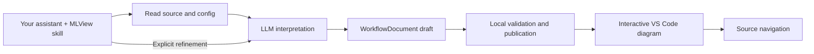

# MLView

[](https://github.com/realmyang/MLView/actions/workflows/ci.yml)
[](LICENSE)

**Ask the assistant in your editor to explain an ML workflow, then explore its
answer as an interactive diagram linked to the source.** MLView is a skill for
GitHub Copilot, Codex and Claude Code, a document format, and a VS Code
viewer. The assistant reads the code and configuration and writes the diagram:
steps, connections and findings, with quotes from the files it read.

**Preview.** The format and the viewer can still change between releases,
and fixes go into the next release.


The diagram of `samples/configured_training`, with a step selected.

## How it works



- MLView needs no model API key of its own. Your assistant supplies the model,
  its tools and its permissions.
- The skill's helper checks a draft's structure, cited paths and exact quotes,
  records file hashes, and publishes a `*.mlview.json` file.
- Neither the helper nor the viewer imports or runs your code.
- Opening, filtering and navigating a diagram never call a model.

## Install

Each release attaches the extension (a `.vsix` file) and the two skill ZIPs
to its page under Releases.

- Download the `.vsix` file. Install it with VS Code's
  **Extensions: Install from VSIX...** command.
- Download the skill ZIP for your assistant and extract it at the root of
  your project.
  [The skill, per assistant](docs/user-guide.md#the-skill-per-assistant)
  says which ZIP is for which assistant.
- For Claude Code, the skill is also packaged as a
  [plugin](claude-plugin/README.md).

To work from a clone of this repository instead, build the extension as
[docs/development.md](docs/development.md#prerequisites) describes. You need
Python 3.10 or newer with the packages of `requirements-dev.txt` in a
virtual environment, and Node 20.18.1 or newer. Then copy the skill into
your project with the installer:

```sh
python3 tools/install_skill.py /path/to/your/project
```

The installer copies the skill into the project's `.agents/skills/mlview/`
folder. For Claude Code, add `--destination .claude/skills/mlview`.

Use one skill location in a project, not both.
[The user guide](docs/user-guide.md) has the details.

## A first diagram

1. Open your project in VS Code and start the `mlview` skill in your
   assistant. The [user guide](docs/user-guide.md#start-the-skill) says how.
   Ask, for example: "Explain training with train.py and configs/distill.json.
   Show where data enters, which model is updated, how the losses combine, how
   validation works, and what source inspection cannot establish. Tell me what
   looks wrong."
2. The assistant publishes a `*.mlview.json` file. Click it in the Explorer
   and it opens as the diagram. Select a step, connection or finding to read
   its claim and quotes. Press Enter to open the cited lines beside the
   diagram.
3. Ask the same assistant to refine the diagram. A valid new revision replaces
   the one on screen.

## Example

[`samples/configured_training.mlview.json`](samples/configured_training.mlview.json)
is a diagram of the small project in
[`samples/configured_training/`](samples/configured_training/README.md). Open
this repository in VS Code with the extension installed and click the file.
The file records which assistant and model wrote it.

## What MLView checks, and what it does not

- The helper and the extension check a document's structure, that every cited
  path is inside the workspace, the file hashes and the exact quotes.
- A matching quote shows that the cited lines exist and have not changed. It
  does not show that they support the claim.
- No automated check calls a model or opens VS Code.
  [What is checked, and what is not](docs/validation.md) says what the checks
  cover.
- Treat a diagram as the assistant's reading of the code, and check it against
  the cited lines.

## In this repository

| Path | What it holds |
|---|---|
| `skills/mlview/` | The skill: its instructions, reference files and helper, with the helper's tests |
| `contracts/` | The JSON Schema of the format, and the cases the schema, the helper and the extension must agree on |
| `vscode-extension/` | The VS Code extension |
| `webview/` | The diagram viewer the extension shows |
| `claude-plugin/` | The Claude Code plugin, with a generated copy of the skill |
| `samples/` | Small example projects and example diagrams |
| `tools/`, `scripts/` | Install, package, build and check tools, with their tests |
| `docs/` | The user guide, the format reference, and pages on the architecture, development, releasing and what is checked |

## Develop

Use a Python 3.10+ virtual environment and Node 20.18.1 or newer.

```sh
python -m pip install -r requirements-dev.txt
sh scripts/e2e.sh
```

On Windows run `pwsh -File scripts/e2e.ps1`. The full check builds the
viewer and the extension, type-checks and tests them, runs the Python tests
and the documentation link check, and packages the two skill ZIPs and the
VSIX. [CONTRIBUTING.md](CONTRIBUTING.md) has the steps for a change, and
[docs/development.md](docs/development.md) has the commands for each part.

## More

- The [user guide](docs/user-guide.md)
- [The format and the helper's commands](docs/format.md), and the format's
  [JSON Schema](contracts/workflow.schema.json)
- The [architecture](docs/architecture.md), [development](docs/development.md)
  and [what is checked, and what is not](docs/validation.md)
- The skill: [skills/mlview/SKILL.md](skills/mlview/SKILL.md)
- [Contributing](CONTRIBUTING.md), the [security policy](SECURITY.md) and the
  [code of conduct](CODE_OF_CONDUCT.md)
- The [changelog](CHANGELOG.md), the [license](LICENSE) and the
  [third-party notices](THIRD_PARTY_NOTICES.md)
