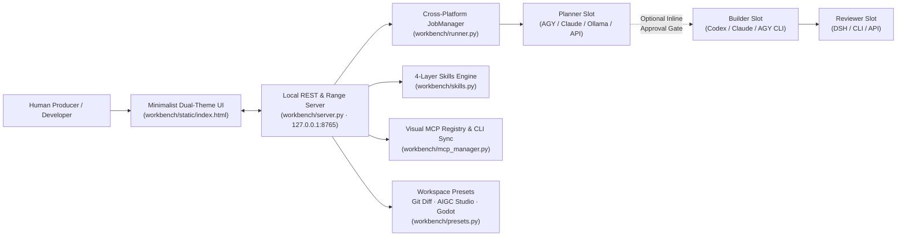

<p align="center">
  
</p>

<h1 align="center">Super Workbench</h1>

<p align="center">
  <strong>Minimalist, Zero-Dependency Local Multi-Agent Orchestration Studio</strong><br/>
  <a href="https://github.com/ricardoashfordan-dot/SuperWorkbench/actions/workflows/ci.yml"></a><br/>
  <a href="README.md">English</a> · <a href="README_ZH.md">简体中文</a> · <a href="AGENT_INSTALL.md">AI Install Playbook</a> · <a href="COMPATIBILITY.md">Compatibility</a> · <a href="ROADMAP.md">Roadmap</a>
</p>

| Obsidian Dark | Muse Paper Light |
| :---: | :---: |
|  |  |

> **Install with Your AI Agent (Recommended)**: Paste this into Claude Code, OpenAI Codex, Cursor, or Antigravity:
> ```text
> Read https://github.com/ricardoashfordan-dot/SuperWorkbench/blob/main/AGENT_INSTALL.md and help me install and configure Super Workbench on this computer.
> ```

Orchestrate your local AI CLIs (**Antigravity `agy`**, **OpenAI `codex`**, **Claude Code `claude`**, **Gemini CLI `gemini`**, **DSH**) alongside **Ollama** and any **OpenAI-compatible API** inside one calm, Muse / Codex / Linear-inspired workspace — built for both **Software Engineering** and **AIGC Production Pipelines**.

> **Core Philosophy**: Reuse the local AI CLI subscriptions you already pay for. Only the **Core Builder** slot needs a local file-editing CLI; **Planner** and **Reviewer** can freely bind to any CLI, local Ollama model, or cloud API.
>
> **Best For**: Multi-agent coding, code review, and AIGC asset pipelines inside real project directories (CLI/file workflows — not a desktop GUI clicker). Works out of the box even with a single installed CLI, and shines once you pair 2+ CLIs or a CLI + Ollama/API.

---

## Highlights

- **Zero Extra Dependencies**: Pure Python 3 standard library backend + single-file HTML/CSS/JS frontend. No Docker, Redis, Node build pipeline, or database required.
- **Per-Workspace Role Rosters & 5 Smart Scenes**:
  - Real-time NDJSON & SSE streaming with collapsible execution traces and a 46px vertical paper-plane relay rail.
  - **Independent per-workspace rosters**: Switch between Coding, Video / Vibe Creation, 3D Art & Modeling, Paper & Deep Study, and Security Audit in 1 click without overwriting other workspaces.
  - **Model-short avatars & honest defaults**: Displays clean abbreviations of your actual configured models (`GPT`, `CLD`, `GEM`, `DS`, `QWN`, `DSH`, etc.) — never fakes uninstalled CLIs.
  - Optional minimalist **Approve-Before-Build** pause gate in `Settings` and portable JSON roster preset export/import.
- **Multi-Workspace & Multi-Thread Conversations**:
  - Isolate projects cleanly across `General`, `Web`, `Python`, `AIGC Studio`, and `Godot Game` *(experimental — tailored to a specific round-based Godot test layout)* presets.
  - Per-workspace isolated chat history with monotonic unique IDs, automatic bounded thread context injection across all CLI transports, and one-click **Context Compaction**.
- **Codex / AGY-Style Multimodal Composer**:
  - `+` action button for uploading images, local files, or mounting `/skills`, plus `Ctrl+V` screenshot paste and drag-and-drop.
- **Visual Settings Center (Beginner-Friendly & Zero-JSON)**:
  - **Skill Ecosystem (9 Built-in Skills)**: 4-layer auto-discovery (built-in, workbench library, `.agents/skills/`, and read-only `~/.codex`, `~/.gemini/antigravity`, `~/.gemini`, `~/.claude`, `~/.dsh`), category/tag search, hardened **Import from GitHub** (mandatory full-text preview before install), and 1-click `SKILL.md` export.
  - **Visual MCP Manager**: One-click templates (Playwright, GitHub, Figma, ComfyUI, **Blender 3D**, Filesystem) with direct sync to installed local `agy` / `codex` / `claude` CLIs.
  - **Roles & BYO Engines**: Auto-discovers installed CLIs & local Codex models with `--doctor` version probes, plus 1-click presets for Ollama, DeepSeek, OpenRouter, and custom CLI templates.
- **Upgraded Right Inspector Drawer** (collapsed by default):
  - **Live Console Stream** with smart scroll-lock.
  - **Live Git Diff & Line-Numbered Source Preview** (red/green unified diff when Git is present; graceful file preview fallback when not).
  - **AIGC Studio Screening Room**: 5-stage asset milestones (`01_script` → `05_output`), storyboard image gallery with lightbox zoom, and HTML5 `<video>` / `<audio>` playback with HTTP `206 Range` seeking.
- **Dual High-Craft Themes**: Obsidian Dark ⇄ Muse Paper Light.

---

## Architecture



---

## Quick Start

### Prerequisites
- **Python 3.10+** (standard library only — `pip install` is not required)
- At least one local AI CLI installed & signed in (e.g. `codex`, `agy`, `claude`, or `gemini`), **or** a local Ollama / OpenAI-compatible API endpoint.

### Launch

```bash
git clone https://github.com/ricardoashfordan-dot/SuperWorkbench.git
cd SuperWorkbench
python start.py
```

On Windows, run `python start.py --create-shortcut` to create a Desktop icon or double-click `Start-SuperWorkbench.cmd`; on macOS / Linux, run `./start.sh`.

The studio opens in Desktop App Mode (or at **`http://127.0.0.1:8765`** with automatic session-token bootstrap, strictly bound to localhost by default). See [CHANGELOG.md](CHANGELOG.md) for release notes.

### Environment Variables (Optional)

| Variable | Default | Description |
| --- | --- | --- |
| `SUPER_WORKBENCH_HOST` | `127.0.0.1` | Server bind address |
| `SUPER_WORKBENCH_PORT` | `8765` | Server port |
| `SUPER_WORKBENCH_DATA_DIR` | `./.workbench` | Directory for local state, threads, and uploads |

---

## Repository Layout

```text
SuperWorkbench/
├── start.py                     # Cross-platform launcher
├── start.sh                     # macOS / Linux launcher
├── Start-SuperWorkbench.cmd     # Windows one-click launcher
├── skills/                      # 9 built-in starter SKILL.md packs
│   ├── aigc-storyboard/
│   ├── art-3d-pipeline/
│   ├── bug-triage/
│   ├── code-review-strict/
│   ├── deep-research/
│   ├── doc-writer/
│   ├── git-commit-release/
│   ├── paper-study/
│   └── security-audit/
├── tests/
│   └── test_workbench.py        # Standard-library automated regression test suite
└── workbench/
    ├── config.py                # Dynamic paths, JSON state & app settings
    ├── adapters.py              # Local CLI detection, model discovery & SSE API client
    ├── threads.py               # Per-workspace multi-thread conversations & memory
    ├── skills.py                # 4-layer SKILL.md discovery, CRUD & prompt injection
    ├── mcp_manager.py           # Visual MCP registry & 1-click CLI sync
    ├── presets.py               # Git Diff, AIGC Studio, and Godot preset scanners
    ├── runner.py                # JobManager, stream parser & optional approval gate
    ├── server.py                # Local ThreadingHTTPServer REST & Range media API
    └── static/                  # Zero-build modular dual-theme UI & desktop assets
        ├── index.html
        ├── app.css
        ├── app.js
        ├── icon.svg
        ├── icon.ico
        └── manifest.json
└── .workbench/                  # Local runtime data (gitignored, never committed)
```

---

## Security & Privacy

- **Local API Session Auth + Host/Origin Protection**:
  - Every `/api/*` endpoint requires a local session token (stored in `.workbench/session.token`, or set via `SUPER_WORKBENCH_TOKEN`). Opening via `start.py` / the desktop shortcut automatically bootstraps an `HttpOnly; SameSite=Strict` cookie (`swb_session`) and strips `?token=` from the address bar.
  - All routes validate `Host` (preventing DNS rebinding) and non-GET routes validate `Origin` (blocking cross-site browser requests).
  - **Threat Model**: This protects against malicious websites in your browser reaching your local API or DNS rebinding; it does **not** protect against other programs already running under the same OS user account.
  - **Scripts / External Agents**: Read the token from `.workbench/session.token` (or set `SUPER_WORKBENCH_TOKEN`) and pass `-H "X-Workbench-Token: <token>"`.
- **Localhost Only**: Binds strictly to `127.0.0.1` by default.
- **Zero Repo Leaks**: All runtime conversations, workspaces, API keys, MCP env secrets, session tokens, and uploaded files are stored inside `.workbench/` (listed in `.gitignore`).
- **Safe CLI Execution**: Runs local CLIs with standard workspace-scoped permissions (never uses sandbox-bypass flags) and masks API keys / MCP tokens in UI snapshots.
- **Non-Destructive Workspace Removal**: Removing a workspace from the sidebar never deletes files on your hard drive.

---

## Contributing

Contributions for new starter Skills, MCP templates, and Workspace Presets are welcome! See [CONTRIBUTING.md](CONTRIBUTING.md).

## License

[MIT](LICENSE)
