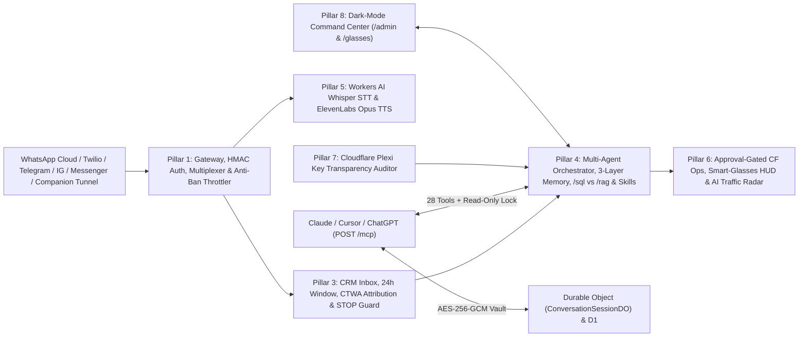

# Waflare — Unified Cloudflare × WhatsApp Operating System

[](https://github.com/ridloabelian/waflare/actions/workflows/ci.yml)
[](./LICENSE)
[](https://workers.cloudflare.com/)
[](#quickstart)
[](https://ridlo.id/waflare)

> **27 open-source Cloudflare & WhatsApp repositories curated, de-duplicated, and synthesized into one clean-room, MIT-licensed, zero-dependency Cloudflare Worker + Durable Object + D1 + MCP + Web Command Center.**
>
> **Interactive Architecture Hub & 28-Tool MCP Studio:** [https://ridlo.id/waflare](https://ridlo.id/waflare) · **AI / LLM Raw Spec:** [https://ridlo.id/waflare.md](https://ridlo.id/waflare.md)

Instead of gluing together separate bots for WhatsApp webhooks, MCP servers, CRM inboxes, Whisper voice transcription, AI failover, Cloudflare ChatOps, and E2EE Key Transparency auditing, **`waflare`** runs every capability inside **one unified edge worker** that deploys to Cloudflare Workers **and** runs natively on local Node.js 22+ (`--experimental-strip-types`) with zero build steps.

---

## Architecture Overview



---

## 8 Unified Architectural Pillars

| Pillar | Modules | Synthesized Capabilities |
|---|---|---|
| **1. Gateway, Multiplexer & SDK** | [`src/channels/metaWebhook.ts`](./src/channels/metaWebhook.ts), [`src/gateway/multiplexer.ts`](./src/gateway/multiplexer.ts), [`src/gateway/throttler.ts`](./src/gateway/throttler.ts), [`src/channels/sentlySdk.ts`](./src/channels/sentlySdk.ts), [`src/channels/companionBridge.ts`](./src/channels/companionBridge.ts) | Meta `GET /webhook` verify & HMAC-SHA256 verification, HMAC-signed webhook multiplexer with `message_id` dedup, HSM templates & Flows router, anti-ban token-bucket throttler, `SentlyDispatcher` (WhatsApp/Telegram/Email/SMS/ntfy/Discord/Webhook) with fallback chain, and Android/Baileys Cloudflare Tunnel companion queue |
| **2. Dual-Mode MCP & Vault** | [`src/mcp/server.ts`](./src/mcp/server.ts), [`src/mcp/tools.ts`](./src/mcp/tools.ts), [`src/security/vault.ts`](./src/security/vault.ts), [`src/durable/sessionDO.ts`](./src/durable/sessionDO.ts) | Streamable HTTP JSON-RPC 2.0 MCP server exposing **28 tools across 8 modules**, toggleable `MCP_READ_ONLY=true` safety lock, PBKDF2 + AES-256-GCM encrypted message vault, and per-account `ConversationSessionDO` Durable Object isolation |
| **3. Self-Hosted CRM & Omnichannel** | [`src/crm/inbox.ts`](./src/crm/inbox.ts), [`src/channels/omnichannel.ts`](./src/channels/omnichannel.ts) | Shared team inbox, **24-hour Meta reply window calculator**, **CTWA ad attribution** capture, **STOP/opt-out** broadcast compliance, deal pipeline stages, and automation rules supporting `live`, `dry_run`, and `shadow` modes |
| **4. Autonomous AI, `/sql` vs `/rag` & Vertical Skills** | [`src/agents/orchestrator.ts`](./src/agents/orchestrator.ts), [`src/agents/memory.ts`](./src/agents/memory.ts), [`src/retrieval/dualRetrieval.ts`](./src/retrieval/dualRetrieval.ts), [`src/ai/providerRouter.ts`](./src/ai/providerRouter.ts), [`src/ai/usageLedger.ts`](./src/ai/usageLedger.ts), [`src/skills/`](./src/skills) | 3-layer user memory, multi-LLM automatic failover (`Workers AI -> OpenAI -> OpenRouter -> Groq -> Edge`), micro-USD pay-per-use ledger (`$0` idle), guardrailed `/sql` vs hybrid BM25+Cosine `/rag`, BANT sales lead scoring + handoff, natural-language fitness logger (`/fitness`), `/verify` fact-checker, and `/fx` currency converter |
| **5. Multimodal Voice & Audio** | [`src/voice/audioPipeline.ts`](./src/voice/audioPipeline.ts), [`src/channels/twilioAdapter.ts`](./src/channels/twilioAdapter.ts) | Workers AI `@cf/openai/whisper-large-v3-turbo` voice-note transcription + summary, Twilio `X-Twilio-Signature` HMAC-SHA1 validation & TwiML replies, and ElevenLabs `opus_48000_64` async TTS synthesis |
| **6. Approval-Gated ChatOps, Glasses & AI Radar** | [`src/ops/approvalGate.ts`](./src/ops/approvalGate.ts), [`src/channels/glassesHud.ts`](./src/channels/glassesHud.ts), [`src/ops/aiTrafficMonitor.ts`](./src/ops/aiTrafficMonitor.ts) | Approval-gated Cloudflare ops (`cache.purge`, `dns.upsert`, `worker.kv_put`) executed only after WhatsApp button tap or MCP approval, glanceable Smart-Glasses WebKit HUD (`/glasses`), and AI referral (`chatgpt.com`, `perplexity.ai`, `claude.ai`) vs crawler (`GPTBot`, `ClaudeBot`) alerts |
| **7. Official Key Transparency Auditor** | [`src/security/plexiAuditor.ts`](./src/security/plexiAuditor.ts) | Queries Cloudflare Plexi (`whatsapp.key-transparency.v1`), verifies `<epoch>/<64-hex>` SHA-256 root integrity, and falls back gracefully when offline |
| **8. Interactive Web Command Center** | [`src/ui/dashboardHtml.ts`](./src/ui/dashboardHtml.ts), [`public/index.html`](./public/index.html) | Zero-build dark-mode web console (`/admin`) with 6 tabs: 27-Repo Matrix, CRM & 24h Inbox, Agent/Slash Playground, Live 28-Tool MCP Studio, CF Ops Queue & AI Traffic Radar, and Plexi Auditor |

---

## Complete 27-Project Curation Summary

See [`docs/CURATION_MATRIX.md`](./docs/CURATION_MATRIX.md) for the full technical matrix and architectural synthesis notes covering all 27 curated repositories:

1. `finereli/whatsapp-mcp` (421★) · 2. `santmun/forja` (138★) · 3. `felipeadeildo/whatsapp-mcp` (100★) · 4. `WhaBuzz/whaleads` (43★) · 5. `cloudflare/plexi` (41★) · 6. `fkrein1/whatsapp-fitness-agent` (30★) · 7. `thorwebdev/twilio-whatsapp-voice-agent` (30★) · 8. `marceloeatworld/clopinette-ai` (28★) · 9. `ashokvarmamatta/ZeroClawAndroid` (17★) · 10. `thareekanvar/replyloom` (14★) · 11. `coldfrey/whatsapp-cloudflare-agent` (14★) · 12. `pain2hustle/AMH-Cloudflare-Ops-MCP-by-WT` (10★) · 13. `AlwaysHungrie/salts-agent` (9★) · 14. `omqkhafi/sently` (9★) · 15. `stivenrosales/kapso-agente-yt` (8★) · 16. `depombo/whatsapp-api-cf-worker` (7★) · 17. `jkpe/workers-whatsapp-transcription` (7★) · 18. `Tienduyvo/meta-glass-display-webkit-harness` (7★) · 19. `usepulso/pulso` (6★) · 20. `Hub-Ventures/watahub` (5★) · 21. `itsgoharrehman/whatsapp-ai-gateway` (5★) · 22. `vibegui/awesome-ai-native-cloudflare-app` (5★) · 23. `surfacedby/ai-traffic-alerts-for-cloudflare` (4★) · 24. `spirit122/whatsapp-mcp-server` (3★) · 25. `ukimsanov/sagent` (3★) · 26. `es-cierto/es-cierto` (3★) · 27. `the-dream-machine/chatbot-whatsapp-workers` (3★).

---

## Quickstart

### 1. Run Locally on Node.js 22+ (Zero Installs Needed)

```bash
# Run full automated test suite
npm test

# Start the local edge server + Command Center UI
npm start
# Open http://127.0.0.1:8787/admin
# Open Smart-Glasses HUD: http://127.0.0.1:8787/glasses
```

### 2. Deploy to Cloudflare Workers

```bash
cp .env.example .dev.vars
# Optional: create D1 / KV / R2 bindings and uncomment in wrangler.jsonc
npx wrangler d1 create waflare-db
npx wrangler d1 migrations apply waflare-db --remote
npx wrangler deploy
```

### 3. Connect Your MCP Client (Claude Desktop / Cursor / Claude Code)

```json
{
  "mcpServers": {
    "waflare": {
      "url": "https://<your-worker>.workers.dev/mcp",
      "headers": {
        "Authorization": "Bearer <YOUR_MCP_AUTH_TOKEN>"
      }
    }
  }
}
```

> Set `MCP_READ_ONLY=true` in `wrangler.jsonc` or pass `?readonly=true` to lock `/mcp` strictly to search/read/audit operations while blocking outbound sends and infrastructure mutations.

---

## HTTP & Webhook Endpoints

| Method & Path | Purpose |
|---|---|
| `GET /` or `GET /admin` | Interactive 6-tab Dark-Mode Command Center + passive AI Traffic Radar |
| `GET /glasses` | Glanceable monochrome Smart-Glasses WebKit HUD |
| `GET /health` | Worker status, active counts, and MCP read-only lock status |
| `GET /api/curation` | JSON inventory of all 27 curated GitHub projects (`?pillar=...` filter) |
| `POST /mcp` | JSON-RPC 2.0 Streamable HTTP MCP endpoint (`28` tools across `8` modules) |
| `GET /webhook` / `POST /webhook` | Meta WhatsApp Cloud API verification challenge & HMAC-SHA256 webhook pipeline |
| `POST /webhook/twilio` | Twilio WhatsApp form webhook with `X-Twilio-Signature` HMAC-SHA1 verification |
| `POST /webhook/omnichannel/:channel` | Unified webhook for `whatsapp`, `telegram`, `instagram`, and `messenger` |
| `POST /v1/chat/completions` | OpenAI-compatible edge chat completions bridge |
| `GET /api/security/key-transparency` | Live Cloudflare Plexi `whatsapp.key-transparency.v1` E2EE audit |
| `POST /api/ops/request` & `POST /api/ops/resolve` | Approval-gated Cloudflare ChatOps queue |
| `POST /api/traffic/inspect` | Test AI referral vs AI crawler classification & alert dispatch |
| `POST /api/companion/*` | Mobile/Android/Baileys Cloudflare Tunnel companion heartbeat & relay |

---

## License

MIT License — see [`LICENSE`](./LICENSE).
