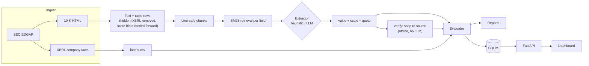

# finextract

A benchmark and pipeline for extracting financial figures from SEC 10-K filings with LLMs, and for
measuring exactly how the extraction fails.

**Key finding.** When gpt-oss-120b gets a figure wrong, it usually quotes a real line from the filing
and then *miscopies the number*: one digit changed, or the decimals dropped. That covers 11 of its 15
wrong answers across dev and test. Of 90 answers, only 1 quote matched no filing line: a figure the
model computed from two real lines, which verify rejected. Snap-to-source verification is deterministic, offline and makes no extra LLM call: it re-reads
the number from the real filing line. That fixes these copying errors, taking held-out exact accuracy
from 75.0% to 84.1% with 0 correct answers broken.

## Results

Exact match after scale against XBRL labels. n = 44 labeled fields per set, so one field is about
2.3 points and the 95% interval is roughly ±11 points.

| Extractor | Dev exact | Dev coverage | Dev confident-wrong | **Test exact** | Test coverage | Test confident-wrong |
|---|---|---|---|---|---|---|
| Heuristic (table-row regex) | 68.2% | 77.3% | 11.8% | 59.1% | 84.1% | 29.7% |
| gpt-oss-120b | 81.8% | 95.5% | 14.3% | 75.0% | 95.5% | 21.4% |
| gpt-oss-120b + verify | 93.2% | 95.5% | 2.4% | **84.1%** | 95.5% | 11.9% |

- **Dev** is AAPL MSFT KO NKE CAT, used for all tuning. **Test** is JNJ WMT HD MCD ORCL, held out
  until the method was frozen.
- *Confident-wrong* is the share of answers given that are not an exact match.
- *Ungrounded* (the answer's quote isn't in the filing, or doesn't contain the number) was 14.3% for
  raw gpt-oss on both sets, and 0% after verify.
- Test errors were inspected only after the test set was final.

**What's left on test after verify:**
- 5 grounded-but-wrong answers:
  - 3 wrong line items: consolidated versus attributable to the parent (ORCL equity, WMT net income,
    WMT equity);
  - 1 verify tie-break that picked the prior-year column (WMT EPS, where the model dropped its
    decimals);
  - 1 label whose XBRL tag fallback doesn't match the field definition (HD long-term debt).
- 2 missing answers.

The full breakdown is in [docs/DEVLOG.md](docs/DEVLOG.md), and a plain-language write-up is in
[docs/WRITEUP.md](docs/WRITEUP.md).

## Architecture



1. **Retrieve.** Filings are flattened to text, with each table row on one line. A table's
   "(In millions)" header is carried into every chunk that needs it. BM25 picks the top-k chunks for
   each field.
2. **Extract.** The extractor returns `{value, scale, quote}`, where the quote must be the exact
   filing line the number came from. Prompts are versioned and hashed, and `--resume` refuses to mix
   them.
3. **Ground and verify.** The evaluator checks the quote against the filing. `verify` fuzzy-matches
   the quote to the real line (ratio of at least 0.85 and the same row label), then takes the column
   whose digits are closest to the model's number. If it can't find a match, it returns no answer
   rather than a guess.
4. **Score.** Every answer gets an error class: `correct`, `near_miss`, `scale_error`, `sign_error`,
   `wrong_period`, `wrong_other` or `missing`.

## Limitations

- **This benchmarks a method, not a product.** XBRL already tags these 10 fields, which is exactly
  why XBRL can serve as ground truth. The method is aimed at documents *without* tags.
- **The sample is small.** 5 + 5 filings and 44 labeled fields per set, with roughly ±11 points of
  noise. The dev rules were tuned on dev, so dev's numbers are optimistic; test's 84.1% is the honest
  figure.
- **0% ungrounded after verify holds by construction.** Every verified value is read from a real
  filing line. It shows the numbers are traceable, not that they are correct.
- **Confident-wrong is the remaining risk.** Verify cannot fix a real but wrong line, such as
  consolidated net income where the attributable figure was wanted.
- **Labels are only partly hand-checked.** 15 labels were checked against the filings, with 0
  mismatches, and one more label problem turned up during error analysis (HD). XBRL is the filer's own
  tagging, not an audit.
- **One model was tested at length.** gpt-oss-120b ran via a free hosted tier. Local Ollama models
  were too slow on CPU for the full benchmark.

## Quick start

```bash
pip install -e ".[dev]"
pytest                      # offline test suite
finextract demo             # whole pipeline on a bundled synthetic filing, no keys or network
```

**Benchmark** on real filings:

```bash
export SEC_USER_AGENT="Your Name you@example.com"   # SEC requires a contact; requests are rate-limited
finextract download --tickers AAPL MSFT KO NKE CAT
finextract label                                     # data/labels.csv from XBRL
finextract extract --provider heuristic --run dev_heuristic
finextract evaluate --run dev_heuristic              # reports/dev_heuristic.md + _items.csv

# any OpenAI-compatible endpoint (local Ollama, Groq, ...); or --provider anthropic
export OPENAI_BASE_URL=https://api.groq.com/openai/v1 OPENAI_API_KEY=...
export FINEXTRACT_MIN_INTERVAL=25 FINEXTRACT_REASONING_EFFORT=low
finextract extract --provider openai --model openai/gpt-oss-120b --k 4 --workers 1 --resume --run dev_gptoss
finextract verify --run dev_gptoss                   # writes dev_gptoss_verified, offline
finextract evaluate --run dev_gptoss_verified
```

On Windows PowerShell, use `$env:NAME="value"` instead of `export`.

Useful settings:
- `--resume` continues a run after a crash or a rate-limit stop.
- `FINEXTRACT_PROMPT_VERSION` selects the prompt wording (v1 or v2).
- `FINEXTRACT_TIMEOUT` sets the request timeout.
- `FINEXTRACT_MAX_WAIT` caps the wait after a 429 before the run stops.

**Service and dashboard:**

```bash
pip install -e ".[api]"
finextract import --run dev_gptoss_verified          # load a run + labels into data/finextract.db
finextract serve                                     # http://127.0.0.1:8000/  (docs at /docs)
```

The dashboard lets you pick a run and a filing. Each field then shows the extracted value, the
label, a correct/wrong badge, and the filing line the value came from.

| Endpoint | Purpose |
|---|---|
| `GET /runs`, `GET /runs/{run}/summary` | Runs and their metrics |
| `GET /runs/{run}/filings[/{id}]` | Per-filing fields: value, label, error class, quote, source line |
| `POST /extract` + `GET /jobs/{id}` | Re-run one downloaded filing as a background job |

Service behaviour:
- `POST /extract` uses the heuristic unless an LLM provider's environment variables are already set.
- `serve` binds 127.0.0.1 by default, because the API has no authentication.
- Docker: `docker build -t finextract .`, then
  `docker run -p 127.0.0.1:8000:8000 -v "$PWD/data:/app/data" finextract`.

## Project layout

```
src/finextract/
  edgar.py      SEC client (rate-limited, cached)        labels.py    XBRL ground truth
  textproc.py   HTML -> text, tables, chunking           retrieve.py  BM25 (no dependencies)
  llm.py        heuristic / Anthropic / OpenAI-compatible extractors, prompt versions
  extract.py    pipeline, grounding, resume              verify.py    snap-to-source
  evaluate.py   metrics + error classes                  store.py     SQLite store
  api.py        FastAPI service + static/index.html dashboard
tests/          offline tests (pipeline, verify, rate limits, resume, API)
docs/           DEVLOG.md (stage-by-stage results), WRITEUP.md
```

## Contributing

See [CONTRIBUTING.md](CONTRIBUTING.md). In short: `pip install -e ".[dev,api]"`, keep `pytest`
green, and don't run SEC downloads or LLM calls in tests.

## Future work

- **An open benchmark and leaderboard.** Publish the labeled set and a scoring harness so other
  extractors can be compared on exact match, coverage and confident-wrong.
- **Untagged documents.** Apply the method to earnings press releases and other filings without XBRL,
  where it is actually needed.
- **Concept checks.** Reject lines whose label doesn't fit the field definition, such as consolidated
  versus attributable figures, which are the main errors left.
- **Retrieval.** The 2 misses on each set never reach the extractor.

The technical roadmap is in [ROADMAP.md](ROADMAP.md), and release history in
[CHANGELOG.md](CHANGELOG.md).

## License

MIT, see [LICENSE](LICENSE). Filing data comes from SEC EDGAR, which is public. The bundled sample
company is fictional.
