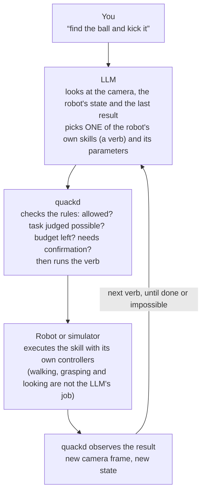
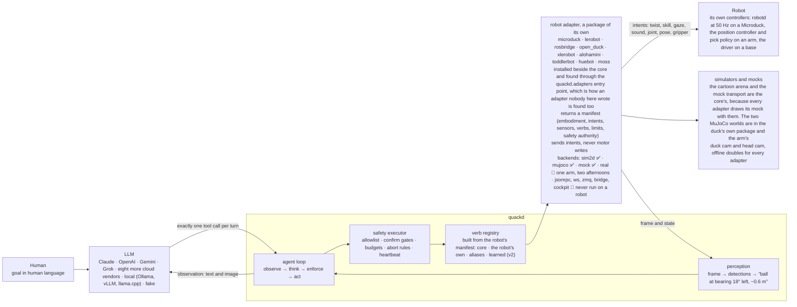

<h1 align="center">quackd</h1>

<p align="center"><strong>One CLI for all your robots. Connect them, command them, and let them work together, each with an LLM for a brain.</strong><br>
<sub>quackd, pronounced “quacked”, began as the brain daemon the Microduck was missing, named like that robot's own <code>robotd</code>, <code>mediad</code>, <code>padd</code> and <code>tofd</code>. That is where the ducks come from: a task is a <code>.duck</code> file and a group of robots is a flock. Nine robots today, one of them driven on real hardware and the other eight still in a simulator or a mock, and one of them a duck you can print and build yourself.</sub></p>

<p align="center">Register each robot once, by name. Then state a goal from a terminal or from a chat with Claude, to one robot or to a flock of them, and the same contract decides which of each robot's skills its model may use, how many steps it gets, and when it has to ask you first.</p>

<p align="center">
  <a href="https://github.com/rokbenko/quackd/actions/workflows/ci.yml"></a>
  <a href="https://pypi.org/project/quackd/"></a>
  <a href="https://pypi.org/project/quackd/"></a>
  <a href="LICENSE"></a>
  <a href="docs/guides/mcp.md"></a>
  <a href="docs/adapters/status.md"></a>
</p>

<details>
<summary>Hey, my name is Rok and this is why I built quackd 👋</summary>

> I see quackd as a ChatGPT like moment for robotics. Let me explain what I mean.
>
> LLMs existed long before ChatGPT. What ChatGPT actually did was take LLMs and hand them to ordinary people in a chat interface everyone already knew, like Facebook Messenger or Instagram. That was the real unlock.
>
> Right now, in 2026, most people still think robots belong in science fiction movies or in a lab at Tesla. That is not true anymore. There are already open source robots you can build yourself for under $1000. And they actually work. They can go to your fridge, open it, grab a can of Coke, close the fridge and bring it to you.
>
> The problem is they have a huge limitation. You can teach them dozens of moves, like "get a coke". But the robot itself is still dumb. It knows the moves, it just cannot connect them on its own. For robots to become truly useful, they need to become AI first and agentic. You give them a goal and they figure out the steps themselves.
>
> To get there, robots need a brain. And here is the catch. Today's robots simply do not have enough hardware on board to think, reason and plan. Their skull is too small for the brain this kind of intelligence needs. So the brain has to live outside the robot, in the cloud or on your own computer, where it can grow as big as you need. The robot itself stays small and light while all the heavy thinking happens somewhere else. That is what quackd started as. A brain for one robot.
>
> But here is what I think comes next. In the future everyone will have a flock of robots. At home, in the office, wherever. And they will not all be the same robot. Different types, different capabilities, even different companies. The first challenge is having all of them in ONE place to command. That is what quackd is now. You connect every robot you own to one CLI, and you command all of them from there, with an LLM as the brain of each one.
>
> But even when you have them all in one place, that is still not enough. What you ask for will be complex, and robots will probably be very specialized. One can walk, one can grab, one can carry. For a bunch of different robots to be useful with as little of your involvement as possible, they need to start working together towards the goals you give them. Which means they need to communicate between each other. So that is the other half of quackd. You give the flock a goal, each robot's brain reads what the others can do, and they divide the work between themselves.
>
> Imagine telling your robots "I want to eat and drink something". The one with wheels goes to the fridge, checks what is inside and tells the others what it found. The one with arms grabs a plate and some cutlery. One of them brings it all to you and asks what you would like, you choose, and they go back for the food and wish you a good meal. Sounds like science fiction, right? We are closer than you think!
>
> That is basically what ChatGPT did for LLMs. It took something powerful and put it in one place everyone could reach. And that is why I see quackd as a ChatGPT like moment for robotics.
>
> — Rok Benko, September 2026

</details>

<p align="center">
  
  <br>
  <sub><strong>A real arm, a real model, one sentence.</strong> An SO-101 follower arm on 2026-09-15, piloted by OpenAI's <code>gpt-6-astra</code> through <code>quackd run --goal "Wave to the camera with an extended arm"</code>. The model was handed the arm's five verbs and its datasheet and chose one call at a time: raise the shoulder and elbow, roll the wrist four times, return, stop. Nobody wrote a wave. The whole run at ten times speed, filmed on a phone: it opens on the command going into a terminal, watches the run scroll, then pans to the bench, and the wave itself is the part where the wrist rocks. What the model was told, all ten of its calls and what went wrong are in <a href="#what-happened-in-that-run">What happened in that run</a>, and how every recording here was made is in <a href="docs/assets/README.md">docs/assets</a>.</sub>
</p>

**quackd** is a command line for the robots you own. Each one joins through an adapter that declares, as a manifest, what the body is and what it can do, and you register it once by name with how to reach it. Give a robot a goal like *"find the ball and kick it"* and a large language model picks one skill at a time from the list that manifest declares, quackd runs it, looks at the camera, and asks again until the job is done or clearly impossible. Give the same goal to a flock and every robot in it gets a model of its own, and they divide the work by telling each other what they are going to do. A goal can arrive from a chat, a command line or a `.duck` task file, and whichever way it comes, quackd enforces a contract the model cannot talk its way out of: which skills are allowed, how many steps, when a human must say yes, when to abort. Claude, OpenAI, Gemini, Grok, Mistral, DeepSeek, Cohere, Qwen, Kimi, GLM and Meta work over their APIs, and so do the models OpenRouter routes to, behind one key of its own. Open source models work on your own machine through Ollama, vLLM, llama.cpp or LM Studio, with no key. A model is the pilot on every run. `--decision-llm` optionally puts something in front of it that is **not** a language model and cannot be used as one: a decision LLM generates no text at all, it scores a fixed set of options against a state and returns which one with a probability for each, so it answers the turns that are a choice among calls the robot already has and can no more write a joint angle than a thermometer can. TypeSafe's Jev was the first of them and is hosted, OpenAI's Decisions API is the other hosted one, and the rest quackd names are open servers you run yourself or a checkpoint loaded into this process, each with a page of its own. Off unless you name one, and `--decision-mode shadow` records what one would have chosen without letting it change a thing ([docs/guides/decision-llms/README.md](docs/guides/decision-llms/README.md)).

The first robot is the [Microduck](https://pollen-robotics.com/microduck/) from Pollen Robotics: a 25 cm, 800 g biped with fifteen small servos, a camera in its head, a depth sensor, a speaker and an onboard computer, open source and about $399, which already knows how to walk, turn, kick, scoop something off the floor, look around and quack at 50 Hz on its own hardware. It is the robot quackd started on, independently and unofficially. Eight more bodies follow it through adapters that declare what each can do: an [Open Duck Mini v2](https://github.com/apirrone/Open_Duck_Mini) you can print and build yourself, an SO-101 class arm through LeRobot, any wheeled base over rosbridge, an XLeRobot dual-arm cart, an AlohaMini with two arms on a lift, a ToddlerBot humanoid, a [Huebot](https://ce-net.com/huebot), a 25 cm biped with behaviour code of its own, whose maker is writing a shim for it that is to answer the Microduck's calls the same way, and [MOSS](https://github.com/metrox-eth/moss), a small tracked rover that picks up litter, reached through its own cockpit and a bridge quackd ships for it.

**One of the nine bodies runs on real hardware, and the recording above is it.** On 2026-09-15 an SO-101 follower arm ran quackd over `lerobot:real` through twelve `--goal` runs in one afternoon, piloted by OpenAI's `gpt-6-astra` from a Windows laptop with a USB webcam: it waved with its wrist, reached out with its shoulder and elbow, opened and closed its gripper, and once mimed a duck quacking with it. The GIF is the last of the twelve, and [What happened in that run](#what-happened-in-that-run) reads its transcript call by call. The honest half is there too. The arm fell at the end of every one of those runs, because LeRobot drops torque when it disconnects, which is what [the rest pose](#your-robots-by-name) was written afterwards to stop, and the camera framed the gripper and cropped the raised arm, so the model checked its own waves against joint readings rather than against the picture. On 2026-09-23 the same arm ran again, registered as `arm-01` with a rest pose, through 26 runs on quackd 0.12.0, and 23 of them came from ten task files written for that afternoon, which now sit among the 223 in [docs/examples/lerobot/](docs/examples/lerobot/README.md). Its rest pose could not reach a fold that lay past the travel its calibration recorded, 19 of the 26 runs never moved the arm at a pilot's request, and what quackd changed in answer has not run on an arm yet. The other eight bodies have not met hardware. Their real backends speak names read from upstream source at a pinned commit and have only ever talked to fakes, and for the Open Duck Mini and the ToddlerBot those fakes are the daemons quackd itself ships for the robot, exercised over loopback, so there only the body is untested. MOSS's bridge is quackd's own too, exercised the same way beside a fake of MOSS's cockpit. No flock has yet crossed from one machine to a second. Goals like *"find my keys"*, handed to a flock that sorts out who does what, are where this is going, not what it does yet. The honest label for today is *LLM driven, goal directed control of one real arm and eight simulated or mocked bodies, alone or in flocks*, and [Which robots work](#which-robots-work) says exactly how far each one has got.

**No robot yet? You do not need one to try it.** Two simulators for the duck, and they come from different places. The **cartoon** is the core's own arena, which is why the three other bodies that have a simulator use it too, along with every seeded sweep in CI: it starts in a second and downloads nothing, and `quackd[microduck]` is what gives it a duck to put in it. The **physics** one is `quackd[mujoco]`, which puts the real Microduck in [MuJoCo](https://github.com/google-deepmind/mujoco) and runs `alpha_walking.onnx`, a walking policy Pollen trained for it before the `velstand.onnx` a robot on a current release walks on, so the duck walks instead of sliding and a command below its gait floor produces nothing at all. These goals succeed on 10 of 10 seeds with the scripted pilot and a ground truth check:

> **"Find the ball and kick it."** · **"Find the ball, walk up to it and say where it is."** *(an Open Duck Mini v2, which cannot kick)* · **"Split the search, the closest duck kicks."** *(a flock)*

The first of those has passed 10 of 10 on the physics simulator too, with the duck on its own gait rather than a sprite on rails, though not on every run: that is `test_find_and_kick_on_the_real_duck`, which needs upstream's model in the cache, so a nightly job fetches it the way your first run would and CI's own gating job runs the stand-in. The Status section below says what that sweep actually returns. The rest are cartoon only. Of the other eight bodies only the arm has a physics model here, and [its simulator](docs/adapters/lerobot/README.md#the-simulator-lerobotmujoco) is for rehearsing an arm's own task files before they meet the arm.

<br>

## Table of Contents

- [Quickstart: a LeRobot SO-101 arm](#quickstart-a-lerobot-so-101-arm)
  * [From the terminal](#from-the-terminal)
  * [From Claude, over MCP](#from-claude-over-mcp)
  * [What happened in that run](#what-happened-in-that-run)
- [No robot yet? Try it in 60 seconds](#no-robot-yet-try-it-in-60-seconds)
- [Why?](#why)
- [How it works (the simple version)](#how-it-works-the-simple-version)
- [Example](#example)
- [Status](#status)
- [Which robots work](#which-robots-work)
- [Architecture](#architecture)
- [Installation](#installation)
- [Usage](#usage)
  * [Your robots, by name](#your-robots-by-name)
  * [The `.duck` file](#the-duck-file)
  * [Pilot it from Claude (MCP)](#pilot-it-from-claude-mcp)
  * [What it remembers](#what-it-remembers)
- [Connect any robot](#connect-any-robot)
- [Flock mode](#flock-mode)
- [Robot Passport](#robot-passport)
  * [Why it exists](#why-it-exists)
  * [How a meeting works](#how-a-meeting-works)
  * [What a passport says](#what-a-passport-says)
  * [How robots find each other](#how-robots-find-each-other)
  * [Who vouches for whom](#who-vouches-for-whom)
  * [Talking, once they have met](#talking-once-they-have-met)
  * [What a stranger can make your robot do](#what-a-stranger-can-make-your-robot-do)
  * [Privacy](#privacy)
  * [Any robot can carry one](#any-robot-can-carry-one)
  * [Robot Passport in quackd](#robot-passport-in-quackd)
  * [The specification and its tests](#the-specification-and-its-tests)
  * [Why a new protocol, and why this name](#why-a-new-protocol-and-why-this-name)
- [The browser demo](#the-browser-demo)
- [Configuration](#configuration)
- [Performance](#performance)
- [Limitations](#limitations)
- [Roadmap](#roadmap)
- [Contributing](#contributing)
- [Safety](#safety)
- [Acknowledgements](#acknowledgements)
- [Star history](#star-history)
- [License](#license)

The rest of the documentation is in [docs/](docs/), and [docs/README.md](docs/README.md) is its map.

<br>

## Quickstart: a LeRobot SO-101 arm

Two ways to drive the same arm, and the steps that set the arm up are shared between them. **[From the terminal](#from-the-terminal)** is the path the recording at the top of this page took, in ten steps, with the arm calibrated, named and parked before anything you type can move it. **[From Claude, over MCP](#from-claude-over-mcp)** is the same arm reached from a chat instead, where the model you are already talking to is the pilot. Either way you need the arm and its serial port, a USB webcam, and Python 3.12 or newer, because LeRobot itself needs it. Only the terminal path needs a key for one cloud vendor, because only that one brings a model of its own.

### From the terminal

1. **Install the arm and a pilot into one environment.** Below Python 3.12 the `lerobot` extra resolves to nothing while the install still reports success, so pin the interpreter.

    ```bash
    uv venv --python 3.12
    uv pip install "quackd[lerobot,openai]"     # or anthropic, gemini, grok, and so on
    ```

2. **Put the key where quackd reads it.** One line in a `.env` file, in the folder you run from or in the venv root: `OPENAI_API_KEY=sk-...`. `quackd doctor` prints the key it found for each provider, masked to its ends, which is the quickest way to see that the file was read at all.

3. **Find the port, then calibrate under the name you will register.** Calibration is LeRobot's own tool and it asks you to move each joint through its range by hand. Take each one all the way into the fold you will rest the arm in, because the travel it records is written into the servos as limits they are never driven past, and a fold outside it is a pose the arm cannot be driven back to. quackd reads every joint limit out of the file it writes, and refuses an arm that has none.

    ```bash
    lerobot-find-port
    lerobot-calibrate --robot.type=so101_follower --robot.port=COM3 --robot.id=arm-01
    ```

4. **First contact, which moves nothing.** Connect, read the joints, temperatures and torque back, disconnect. Support the arm while it starts, because connecting releases torque for a moment. A spec on its own carries no name, so it reads the calibration saved as `arm-01` whatever name you calibrated under. If you chose another, do step 5 first and run `quackd doctor --robot` with that name instead, which reads the calibration kept under it.

    ```bash
    quackd doctor --robot lerobot:real --address COM3
    ```

5. **Name it.** The registry keeps the port, the camera and the pilot under one name, so every command after this is `--robot arm-01`. Register it under the id you calibrated as.

    ```bash
    quackd robot add arm-01 lerobot:real --address COM3 --llm openai:gpt-6-astra
    ```

6. **Fold the arm by hand, then record where it rests.** An SO-101 has no brake and LeRobot releases torque when it disconnects, so without this the arm would drop from wherever a run left it, and quackd refuses to run it at all. With it, every run starts at this pose and returns to it before quackd lets go. This pose is where every run starts and ends unless the run itself says otherwise, and the one flag that says otherwise is just below step 10, where it changes the start and leaves the end alone. If it warns that a joint is recorded past what this calibration lets its servo be driven to, your fold lies outside the travel step 3 recorded: a run parks that joint at the edge of its travel and lets it settle from there, and calibrating again with the joint taken all the way into the fold, then recording the pose again, makes the fold itself reachable. Record the pose again after any new calibration too, because a calibration can move a joint's zero and the pose is kept as angles.

    ```bash
    quackd robot rest-pose arm-01
    ```

7. **The first task moves nothing either.** `lerobot-lookout` allows `report_state` and `stop` and nothing else: it reads the arm and says what it found. There is nothing to improvise, so the scripted pilot is enough and this costs no tokens.

    ```bash
    quackd run lerobot-lookout --robot arm-01 --llm fake
    ```

8. **Add the webcam.** `lerobot-find-cameras opencv` prints the indices and saves a frame from each, so you can see which is which. Point it at the space the arm moves through rather than at the gripper, which is the mistake the run above made.

    ```bash
    quackd robot edit arm-01 --camera-url "opencv://2"
    ```

9. **Rehearse it.** With `--dry-run` the arm is connected and read, and not one command reaches it, so you see which verbs the model reaches for and with what numbers before a joint moves.

    ```bash
    quackd run --goal "Wave to the camera with an extended arm" --robot arm-01 --max-steps 10 --dry-run
    ```

10. **Then let it move.** A hand near the power switch, the arm's whole sweep clear, and the same sentence without the flag. This run starts at the rest pose you recorded in step 6 and folds back to it when it is over, which is the default and the first of the two choices below rather than the only way a run can begin. If the arm cannot get back to its rest pose at the end, the run says it is holding itself up and asks you to clear whatever is in its way and press Enter, and it tries the fold once more. Only if that fold misses too does it ask again, and Enter at that second question takes torque off where the arm stands, so the arm drops: hold it first. Leave either question for 60 seconds and torque stays on. After that, `quackd robot release arm-01` folds the arm to its rest pose and lets go of it there, asking the same two questions if its fold misses: support the arm while it connects, because connecting takes torque off for a moment, then take your hands away when it says so, in the 3 seconds it waits before it folds. None of this has run on a real arm yet.

    ```bash
    quackd run --goal "Wave to the camera with an extended arm" --robot arm-01 --max-steps 10
    ```

**Or start from a pose you set by hand.** `--by-hand` gives you the arm before the pilot gets it. The arm is driven to the rest pose from step 6 first, torque comes off there, and quackd waits: lift the arm, put whatever the task needs into the gripper, close the gripper on it, hold the arm where the run should begin, and press Enter. Lift it out of its fold before you press Enter, even where the run should begin next to it, because a fold that lies past the travel step 3 recorded is let go of at the edge of that travel and is free to settle back past it. quackd writes the pose you left as the goal, puts torque back on, reads the joints again to check nothing sagged, and prints the angles it is now holding so you know you can let go. The pilot works from there. A joint outside its calibrated travel when you press Enter is the exception, whether you placed it there or never lifted it out of the fold: nothing can hold it where it is, so torque stays off, quackd names the joint and its travel, and the run ends with the arm limp, in your hands or still lying at its rest pose. Nothing moves the arm or puts torque on it after that, so the gripper does not open and the arm is not folded: take out whatever is in the gripper yourself. At the other end the arm is still holding whatever it ended on, so it is handed back to you before anything opens: take hold of what is in the gripper and press Enter, the gripper opens, and only then does the arm fold back to the rest pose. Leave it alone and it folds up with the gripper still shut. This needs the rest pose from step 6, because the rest pose is the one place quackd will drop torque and an arm released anywhere else falls, and it needs a terminal, because somebody has to press Enter.

```bash
quackd run --goal "draw a circle on the paper in front of you" --robot arm-01 --by-hand
```

**Give it a picture.** `--image` hands a file to the task itself, which is not the same thing as what the robot can see. The pilot gets each picture on its first turn, labelled with the file's own name, and keeps it in front of it for the whole run. That is what makes it different from a camera frame: a frame is perception, it arrives again every step and it shows the room as it is now, while a task picture never changes and is what the task is about. The flag repeats, so a run can carry several. It needs a pilot that takes images, `quackd list-models` marks the models that take no frames, and a local model needs `--vision`.

```bash
quackd run --goal "draw what is in the picture" --robot arm-01 --image sketch.png
```

**Or put a stepper in front of the model.** `--decision-llm` is optional, off unless you name one, and needs no change to any of the ten steps above. With `--decision-mode shadow` a run is exactly the run it would have been, and the transcript also records what the decision LLM would have chosen on each turn, which is how you find out whether it is worth switching on for your bench. With `--decision-mode on` it answers the turns whose answer is a choice among calls the arm already has, and every joint angle is still the model's. `jev` is TypeSafe's hosted one and wants `quackd[decision]` and `TYPESAFE_API_KEY` ([docs/guides/decision-llms/jev.md](docs/guides/decision-llms/jev.md)), `openai` is OpenAI's Decisions API and wants the `quackd[openai]` and `OPENAI_API_KEY` a pilot through OpenAI already has ([docs/guides/decision-llms/openai.md](docs/guides/decision-llms/openai.md)), and every other name quackd knows, what it wants and where it runs, is one table in [docs/guides/decision-llms/README.md](docs/guides/decision-llms/README.md), a page each.

```bash
quackd run arm-grip-check --robot arm-01 --by-hand --decision-llm jev --decision-mode shadow
```

Put the two together and you have the drawing case: you set the arm down holding a pen where the paper is, and the model is looking at the sketch it has to copy.

```bash
quackd run --goal "draw what is in the picture" --robot arm-01 --image sketch.png --by-hand
```

**Or rehearse a task at home first.** `quackd[lerobot-sim]` is the arm's simulator, `lerobot:mujoco`: the real backend's own code over the maker's model of the SO-101 in MuJoCo, and it installs on Python 3.11 with no LeRobot and no torch. `quackd robot twin arm-01` registers `arm-01-sim` on the calibration file step 3 wrote, with the rest pose from step 6, the pilot and the cameras. `quackd preflight` then runs a task file on it seed after seed and says whether every run ended at its rest pose and did what the task's `<task>.sim.yaml` asks, and it refuses `arm-01` itself before connecting to anything. It rehearses the code and the task, not the arm, and [the arm's simulator](docs/adapters/lerobot/README.md#the-simulator-lerobotmujoco) says what it proves and what it does not.

```bash
uv pip install "quackd[lerobot-sim]"
quackd robot twin arm-01
quackd preflight lerobot-lookout --robot arm-01-sim --llm fake
```

<p align="center">
  
  <br>
  <sub>The hero's sentence on <code>lerobot:mujoco</code>, piloted by OpenAI's <code>gpt-6-sol</code> on 2026-09-28 in 7 steps, 9 model calls, 69 seconds and $0.05, and shown at twice the simulator's speed (<a href="docs/assets/README.md">how it was made</a>).</sub>
</p>

**Two of those steps were not taken in the recording at the top of this page.** The run in that GIF was reached as `--robot lerobot:real --address COM3`, with no registered name and no rest pose. Step 5 existed that day and simply was not used. Step 6 did not exist at all: the rest pose was written after that afternoon, in answer to it. Both were taken on the same arm on 2026-09-23, and the rest pose could not be reached there, because the arm's calibration had never seen the shoulder folded all the way back and the fold lay past its travel. What quackd does with a fold like that now, and why step 3 asks you to calibrate folded, is [A pose past the travel](docs/adapters/lerobot/README.md#a-pose-past-the-travel). That has been exercised against `lerobot:mock` and in the test suite, and not yet on the arm. The arm in the recording is held up by torque alone, which is why it fell when the run ended. The two options after step 10 postdate that afternoon as well, and `--by-hand` and `--image` have both been exercised against `lerobot:mock` and in the test suite, and not yet on a real arm. Walk all ten and you are the second person down this path, so what differs on your bench is the part worth writing down.

[docs/adapters/lerobot/first-run.md](docs/adapters/lerobot/first-run.md) is the long way round the same path: every refusal you can hit and what it means, the safety checks worth running before a wave, what the camera can and cannot see with each kind of pilot, and [what to report](docs/adapters/lerobot/first-run.md#14-what-to-report) afterwards. Nothing moves until step 10 of [the hardware checklist](docs/adapters/lerobot/hardware-checklist.md).

### From Claude, over MCP

Steps 3 to 8 above are the same whichever way you drive the arm, because they are about the body rather than about the pilot: find the port and calibrate, connect once, name it, record a rest pose, add the webcam. Two of the others change. Step 1 needs no pilot extra, so it is `uv pip install "quackd[lerobot]"` on its own, and step 2 goes away, because quackd picks no model in this mode and reads no key. The model you are already chatting with is the pilot, so there is no `--llm` here at all.

Steps 9 and 10 become one thing: point your client at the arm, then ask it in the chat. In Claude Code that is one command, and what it names is the `quackd` inside the venv from step 1, by its absolute path.

```bash
claude mcp add arm -- D:\Development\lerobot-test\.venv\Scripts\quackd.exe serve-mcp --robot arm-01
```

That path is a Windows one, and elsewhere it is the same venv's `bin/quackd`. Use the venv rather than `uvx`, which builds a second environment on whichever interpreter it picks: on a machine whose default Python is 3.11 the LeRobot half of that extra resolves to nothing, silently, and you get a server with no arm backend in it. Claude Desktop takes the same command and arguments in `claude_desktop_config.json`, under Settings, then Developer, then Edit Config, and wants a full restart of the app afterwards.

Either way nine `robot_*` tools appear, and behind them is the executor the rest of this page describes: the same allowlist, the same budgets, the same feasibility verdict before anything moves, and the same refusal for a joint goal outside the range your calibration recorded. What you gain over a `--goal` run is that you choose each verb and each number yourself, which is the only way to ask for one verb and stop, and the only way to ask a real arm for a camera frame on purpose.

Two things are worth knowing before the first session. Starting the server moves the arm, because connecting drives it to the rest pose from step 6 and refuses to start at all if it cannot get there, so nobody should be in reach when a client spawns it. And there is no Ctrl-C: between verbs the brake is asking for `stop`, and during one it is the power switch.

[Part 2 of docs/adapters/lerobot/first-run.md](docs/adapters/lerobot/first-run.md#part-2-from-claude-over-mcp) is that path in fifteen steps, with both clients configured, what each tool answers, what every refusal means, and which moments move the arm without anybody asking. No MCP session has yet driven a real arm, so that half of the page is the half with the least behind it.

### What happened in that run

The command, as it was typed on the laptop in the recording:

```bash
quackd run --goal "Wave to the camera with an extended arm" --robot lerobot:real --address COM3 --camera-url "opencv://2" --llm openai:gpt-6-astra --max-steps 10
```

No task file, no registered name, no rest pose, which is why quackd refuses that command today: a real arm with no rest pose has nothing to fold to when its run ends, and this one fell where its run ended. `--goal` writes a contract on the spot: the arm's own five verbs allowed, `gripper`, `move_joints`, `place`, `report_state` and `stop`, plus the four the loop always offers, `assess_task`, `declare_success`, `declare_failure` and `remember`. Exactly one of them per turn, and anything else refused. It was the last of twelve runs that afternoon, so the memory quackd keeps per robot handed it five notes and how the last five of the eleven before it had ended, which is the whole of what it carries.

**What the model was told.** About a third of the system prompt as it read that day, cut where marked, with the two lines that were wrong left in:

```text
You are the brain of a six-joint desktop robot arm with a parallel gripper (an SO-101 class
arm driven by LeRobot), bolted to a table. You are a high-level pilot: you choose ONE verb per
turn; the robot's own controllers handle the motion. Do not micro-manage.

## Rules (enforced by the executor — not optional)
- Call exactly one tool per turn. Never zero, never two.
- Only these verbs are allowed: gripper, move_joints, place, report_state, stop. Anything else is refused.
- Budgets: 40 steps, 5 minutes, 40 LLM calls. The run stops when any is hit.
- Before the first verb that moves the body, call `assess_task` with your verdict on whether
  this body can do this task at all, judged against its datasheet below: `feasible`,
  `infeasible` (the run ends, nothing moves) or `uncertain` (a human is asked). [...]

## Your body: what it can and cannot do
- Height: 0.53 m (estimate: one vendor's listing; reaching straight up)
- Actuated joints: 6 (official: the LeRobot SO-101 docs; five joints and a gripper)
- Payload: 0.5 kg (estimate: one vendor's listing)
- Not published: mass, reach. Decline any task that hinges on any of them.
- Each joint's travel in degrees, read from its own calibration, and the only goals quackd
  will send: shoulder_pan -120 to 120, shoulder_lift -84.2 to 84.2, elbow_flex -96.5 to 96.5,
  wrist_flex -103.2 to 103.2, wrist_roll -180 to 180, gripper 0 to 100.
Whatever the task says, this body cannot:
- go anywhere: it is bolted to a table and has no base
- feel what it holds: nothing reports grip force, so holding is inferred from the gripper
  stopping short of shut, which an empty hand that binds also does
[...]

## What you remember from earlier runs on this robot
- [2026-09-15] An extended-pose gesture reached shoulder_lift −40°, elbow_flex 24°, and
  wrist_flex 1° before wrist-roll waving; the available camera view did not show the whole
  arm to verify extension visually.
- [2026-09-15] A wrist-roll wave commanded alternately at +30° and −30° reached reported
  angles of +26–27° and −26–27°.
[... three more notes, and how the last five runs ended ...]

## Task file: goal — Wave to the camera with an extended arm

# Task
Wave to the camera with an extended arm

## Strategy
Use the available verbs. Look before you act (`observe` or `search_scan`), prefer composite
verbs like `go_to`, verify with a fresh frame, then `remember` one fact and declare success.
```

**The ten calls.** Model seconds is how long the model took to answer. Arm seconds is how long the verb then took on the arm.

| Call | Tool | What it asked for | What the arm reached | Model s | Arm s |
|---|---|---|---|---|---|
| 1 | `report_state` | a reading before anything moves | folded: `shoulder_lift` -38.2°, `elbow_flex` 85.1°, torque on, hottest servo 37 °C | 8.2 | 0.0 |
| 2 | `assess_task` | `feasible`, for the reason below | nothing moves on this call | 7.0 | |
| 3 | `move_joints` | `shoulder_lift` -40°, `elbow_flex` 25°, `wrist_flex` 0° | -38.6°, 30.0°, 0.4°, in 32 commands over 4.1 s | 8.0 | 4.1 |
| 4 | `move_joints` | `wrist_roll` +30° | 28.0° | 6.9 | 1.2 |
| 5 | `move_joints` | `wrist_roll` -30° | -25.4° | 5.7 | 2.1 |
| 6 | `move_joints` | `wrist_roll` +30° | 25.4° | 5.1 | 2.0 |
| 7 | `move_joints` | `wrist_roll` -30° | -25.3° | 3.3 | 1.9 |
| 8 | `move_joints` | `wrist_roll` 0° | -4.2° | 5.1 | 0.9 |
| 9 | `stop` | hold it where it is | held | 5.8 | 0.0 |
| 10 | `declare_success` | the reason below | | 7.0 | |

**The numbers.**

- 78.8 seconds of run, after 10.3 seconds to open the serial port.
- Ten model calls, 3.3 to 8.2 seconds each, 62.1 seconds in all, which is 79% of the run. The arm moved for 12.2 seconds, which is 15%.
- 49,096 tokens in, 491 out, 22 of them reasoning, and not one word of prose: the model's only sentences in the whole run are the two below.
- Eight verbs, 97 commands to the arm, every one accepted. No gate fired, nothing was clipped to a joint limit, and no servo read above 37 °C.
- No `remember`, and rightly. Two of the five notes already in its prompt described this manoeuvre from earlier runs that afternoon, one giving the extended pose and one the wrist angles it would reach, and its last sentence says so.

**In its own words.** Both reasons, verbatim from the transcript:

```text
assess_task, feasible: An unloaded extended-arm gesture and wrist wave need no target reach
or lifting. The visible arm is empty, and the planned shoulder_lift -40°, elbow_flex 25°,
wrist_flex 0° and wrist_roll ±30° are inside the calibrated travel limits.

declare_success: Completed the extended-pose wrist wave: shoulder_lift reached -39°,
elbow_flex 30°, wrist_flex 0°, and wrist_roll alternated +28°, -25°, +25°, -25°. Returned
wrist_roll to -4° and stopped. The fresh camera shows the raised arm, but crops its upper end,
so full extension is supported by joint state rather than fully verified visually. This
strategy is already recorded in memory.
```

<p align="center">
  
  <br>
  <sub><strong>What the pilot saw.</strong> Three of the ten frames the model was sent, 640x480 from one USB webcam at table height behind a calibration mat. From the third frame on, the arm it had just raised runs off the top of the picture, which is exactly what it reported. The hand in the last frame reached the model as pixels and never as a word: the detector that turns a frame into text called a blue figurine on a shelf a person on eight of the ten steps, and never saw anybody actually in the room.</sub>
</p>

**The honest half.** Each frame was between 5.6 and 12.5 seconds old at the moment the model was handed it, about eight on average, and older still by the time the move it prompted had finished, so the model was always looking at where the arm had been. The colour detector that turns a frame into a line of text reported a ball that was not there on every step, called a small blue figurine on a shelf a person about 8.5 metres away on eight of the ten, and never once saw the actual people in the room. The model ignored all of it, and used the picture for exactly one thing: noticing that the raised arm ran off the top of the frame, and saying so rather than claiming a wave it could not see. It asked for `elbow_flex` 25° and the arm settled at 30°, and it reported the 30. The arm fell when the run ended, because this was before the rest pose existed. And reading this transcript to write this section turned up two bugs, both fixed alongside it: the prompt said `Budgets: 40 steps` while the command and every observation said ten, because it was built from the task file's own contract rather than from the one the run was enforcing, and the strategy paragraph told this arm to look with `observe` or `search_scan` and to prefer `go_to`, three verbs it does not have and the allowlist at the top of the same prompt did not list. The model worked around the second one by looking with `report_state`, which is not a thing to rely on.

Two more lines of that prompt read differently now, for reasons a later day on the bench found. `Not published: mass, reach. Decline any task that hinges on any of them.` forbids an arm whose reach nobody published to reach for anything, and on 2026-09-23 it was one of the lines a run with a pen ended on. The line now tells the pilot to answer uncertain and name the figure rather than decline, and the arm's sheet publishes a reach of 0.4 m, an estimate summed from the link lengths in the maker's URDF ([docs/adapters/lerobot/README.md](docs/adapters/lerobot/README.md)). And the travel line has a second sentence the model above never saw: a joint can read past its travel when it was folded or placed there with torque off, which is where a rest pose usually is, and goals are still limited to the travel. On 2026-09-23 the arm's recorded fold lay past the travel of its shoulder, and three pilots gave a reading there, against a travel that left it out, as a reason not to move the arm at all ([A pose past the travel](docs/adapters/lerobot/README.md#a-pose-past-the-travel)).

<br>

## No robot yet? Try it in 60 seconds

```bash
uvx --from "quackd[mujoco]" quackd run --goal "walk in a square" --robot microduck:mujoco --llm fake   # the duck below: real physics, its own trained gait (first run fetches about 10 MB)
uvx --from "quackd[microduck]" quackd run find-and-kick --llm fake             # the cartoon: no download, done in a second
claude mcp add quackd -- uvx --from "quackd[microduck]" quackd serve-mcp --robot microduck:sim2d   # or just chat with it: "find the ball and kick it"
uvx --from "quackd[open_duck]" quackd run open-duck-scout --llm fake           # a duck you can build: it finds the ball and walks up, no kick
uvx --from "quackd[mujoco,anthropic]" quackd run find-and-kick --llm anthropic --robot microduck:mujoco   # a real model on the real gait, needs ANTHROPIC_API_KEY
uvx --from "quackd[microduck,openai]" quackd run find-and-kick --llm ollama:qwen3:8b   # local model, no key
open runs/*/run.gif                                                                 # a GIF in either simulator, a transcript every time
```

Every quackd line there names a body with `--from`, because quackd itself ships none: the core is the loop, the executor and the contract, and each robot is a package the extra of the same name pulls in ([Installation](#installation)).

<p align="center">
  
  <br>
  <sub><strong>The first line above, with and without quackd.</strong> <b>Left:</b> you type <em>walk in a square</em> and a pilot picks the robot's own verbs one at a time, correcting as it reads the pose it actually reached. Nobody wrote a square. <b>Right:</b> the identical world, robot and walking policy, minus quackd. A Microduck takes a twist, which is three numbers, so an English sentence has nowhere to go and it stands there. The pilot here is <em>scripted</em>, so this needs no API key, and the duck is a render of Pollen's model under its CC BY-NC-SA terms. <a href="docs/assets/README.md">How it was made</a>.</sub>
</p>

**Or open the browser demo and install no quackd at all.** It is live at
<https://www.quackd.org/simulator>, with the same physics, the same two upstream policies, seven
of the same verbs and a contract of its own, in a page. Type a sentence, paste your own API key or
point it at Ollama, and watch what the model chose. The keyboard beside the box is live at the
same time, so a key can take the duck off the model mid-run. [The browser demo](#the-browser-demo)
says what it does and how to run it from a checkout.

Put keys in the environment or in a `.env` file (copy [`.env.example`](.env.example)), either in the folder you run the command in or in the venv root quackd is installed into. `quackd doctor` tells you what is missing. Needs Python 3.11 or newer and [`uv`](https://docs.astral.sh/uv/), nothing else.

<br>

## Why?

A modern robot is not short of skills. The Microduck's onboard controllers already balance it, walk, kick, sit and scoop with its beak, and Pollen says its newest walking policy gets the duck back up after a fall. An arm picks with its own learned policy, a wheeled base drives. Each is the robot's own skill, trained, written or recorded, and each works without any help from an AI model. What the robot lacks is any idea of **what those skills are for**.

```
Traditional control:   walk forward, turn left, walk, look down, scoop, ...   (you plan every step)
One robot:             "Pick up the ball."                                    (you state the goal)
A flock of them:       "Pick up the ball."                                    (they also settle who does it)
```

Low level skills and high level goals are different layers. The robot knows the words, but it cannot hold a conversation. quackd is an open source attempt to connect the two layers, with an LLM doing the planning and the robot's own controllers doing the moving.

**The second gap opens with the second robot.** Every body speaks its own protocol, the arm's SDK, the cart's ZeroMQ host, the base's ROS topics, and every body has a different set of skills, so the robots you own end up commanded from as many terminals as there are robots and none of them knows the others exist. quackd puts them behind one command line, under names you choose, and lets one goal go to several of them at once. Each robot's pilot is told what the others are and what they can do, so the work gets divided on data rather than on guesses.

<br>

## How it works (the simple version)



The verbs the model can pick from are the robot's real, existing capabilities and nothing more. They come from its manifest, and a verb that is not in the manifest does not exist:

| Kind | Verbs | What they are |
|---|---|---|
| Core | `observe` `report_state` `stop` `say` `move` `go_to` `search_scan` `approach_and` | on any robot whose manifest satisfies their requirements (a camera, a twist intent, a sound intent) |
| Microduck | `sit` `stand` `stand_up` `kick` `grab` `gaze` `quack` `watch` | one each per behaviour the robot ships with, each an *intent* the robot's own controllers execute. `watch` is quackd's own reflex and moves the head alone: it keeps something you describe in view for up to 30 seconds by asking a decision LLM that can see where it is in each camera frame, and it is there only on a run started with `--decision-llm openai --decision-frames`, and on a real duck only through mediad's `/frame` ([docs/adapters/microduck/README.md](docs/adapters/microduck/README.md#watch-a-head-that-keeps-something-in-view)) |
| LeRobot arm | `move_joints` `gripper` `place` `pick` `manipulate` | an SO-101 class arm. `pick` and `manipulate` are each one skill intent the arm's own learned policy executes, confirm gated and present when a run names a policy server with `--policy-url`, and always on the mock, which scripts its own. `manipulate` hands it one short subtask and never says the task is done |
| rosbridge base | `introspect` | a wheeled base over ROS 2. It gets `move`, `stop` and `report_state`, plus `observe`, `go_to`, `search_scan` and `approach_and` once an image topic is configured. `introspect` asks the bridge what the body is: the topic list and the robot's own description, which is where its weight and its joint count come from |
| Open Duck Mini v2 | `gaze` `express` `quack` | a 42 cm biped. No `sit`, no `kick`, no `stand_up`: its runtime has no such skill, so the verb does not exist rather than being refused |
| XLeRobot | `move_joints` `gripper` | a dual-arm cart. The arm joints are a normalised -100..100 range, not degrees, and `gripper` takes a `side` because there are two of them |
| AlohaMini | `lift` `move_joints` `gripper` `home_arms` | two arms on a motorised lift. The arm verbs refuse until quackd's own host wrapper is running on the robot, because upstream's leaves the arms limp |
| ToddlerBot | `look` `stand` `perform` `grip` | a humanoid. `look` turns a two joint neck, `stand` slews to the safe pose and is not a way up from a fall, and `perform` plays only the keyframe motions the daemon actually loaded. `grip` appears on the gripper builds, which carry two more motors |
| Huebot | `sit` `stand` `stand_up` `kick` `quack` | a 25 cm biped whose maker is writing a shim for it that is to answer the Microduck's protocol, so these are the Microduck's verbs without `gaze` and `watch`, since the shim does not answer `robot.look` yet, and without `grab`, which waits for its maker to say what `ground_pick` does on Huebot. `sit`, `stand` and `kick` are there only when the shim lists the skill each one sends ([docs/adapters/huebot/README.md](docs/adapters/huebot/README.md)) |
| MOSS | `drive_to` `explore` `pick_and_drop` `stow_arm` `collect_litter` | a small tracked rover that picks up litter, reached through its own cockpit and a bridge quackd ships for the rover. `drive_to` and `explore` hand a goal or a few minutes to MOSS's own planner and explorer, `pick_and_drop` and `stow_arm` play the maker's fixed arm cycle, which reaches for nothing, and `collect_litter` gives the rover to MOSS's own litter mission. It is the one `dangerous` verb, and it runs once per stack start ([docs/adapters/moss/README.md](docs/adapters/moss/README.md)) |
| Aliases | `get_frame` `walk_to` `walk` | the 0.3 names of `observe`, `go_to` and `move`. They keep working in every `.duck` file |
| Learned | *(none yet)* | v2: policies trained from LLM written rewards, registered like any other verb. The arm's `pick` and `manipulate` do run a learned policy, and they are the arm's own verbs rather than these ([docs/guides/policies.md](docs/guides/policies.md)) |

`go_to` (still spelled `walk_to` in the older starter files) is a small closed loop in plain Python that steers toward whatever the camera sees, ten times a second, without asking the model. The LLM says *"go to the ball"* and never *"turn 4° left"*. The same code steers a duck, a cart and a wheeled base, clamped to each manifest's speed limits. On a body with no locomotion, such as the arm, `go_to` does not exist at all. On the ToddlerBot, which looks with a two joint neck, `search_scan` sweeps the head instead of turning the body.

A flock is that same loop once per robot, all at once, with a bus between the pilots so one can tell another what it is about to do ([Flock mode](#flock-mode)).

<br>

## Example

A `find-and-kick` run in the cartoon simulator, from its transcript (`runs/<timestamp>-find-and-kick/transcript.jsonl`). Every run opens the same way, with the pilot judging whether this body can do this task at all, because nothing that moves the duck runs until it has. This one is the scripted pilot, so `model` says so, the verdict says a rule has no judgement of a body, and `usage` is an estimate from character counts (no tokenizer). A real provider records the API's own counts and weighs the task against the datasheet in its prompt.

```jsonc
{"kind": "llm",  "step": 0, "tool_calls": [{"name": "assess_task", "arguments": {"verdict": "feasible", "reason": "scripted pilot: a rule has no judgement of the body, so it assumes the task fits"}}], "usage": {"input_tokens": 1602, "output_tokens": 16}}
{"kind": "assess", "step": 0, "verdict": "feasible", "reason": "scripted pilot: a rule has no judgement of the body, so it assumes the task fits"}
{"kind": "llm",  "step": 0, "tool_calls": [{"name": "search_scan", "arguments": {"target": "ball"}}]}
{"kind": "verb", "step": 1, "name": "search_scan", "ok": true, "summary": "ball found: ball at bearing 18° left ~0.58 m (after 4 turn steps)"}
{"kind": "llm",  "step": 1, "tool_calls": [{"name": "walk_to", "arguments": {"target": "ball", "stop_distance": 0.22}}]}
{"kind": "verb", "step": 2, "name": "walk_to", "canonical": "go_to", "ok": true, "summary": "reached the ball: ~0.22 m away, bearing +0°", "data": {"distance_m": 0.217, "ticks": 27}}
{"kind": "llm",  "step": 2, "tool_calls": [{"name": "kick", "arguments": {"leg": "right"}}]}
{"kind": "verb", "step": 3, "name": "kick", "ok": true, "summary": "kicked with right leg, ball moved 0.53 m"}
{"kind": "llm",  "step": 3, "tool_calls": [{"name": "quack", "arguments": {"text": "yay, got it!"}}]}
{"kind": "llm",  "step": 4, "tool_calls": [{"name": "declare_success", "arguments": {"reason": "ball displaced by the kick"}}]}
```

The same thing as a conversation, through MCP in Claude Code or Claude Desktop:

> **You:** List the duck's verbs, then find the ball and kick it.
> **Claude:** *(calls `robot_list_verbs`, `robot_observe`, `robot_assess_task("feasible")`, `robot_run_verb("search_scan")`, `robot_run_verb("go_to")`, `robot_run_verb("kick")`, `robot_say`)* Done. The ball moved about half a metre.

And the same shape with two robots instead of one, from the `flock.jsonl` of a `flock-hello` run: a simulated duck and a mock arm, one pilot each, on wall clock. Nothing here moves a joint on purpose, because this is the smallest honest test that two pilots in two different bodies can find each other and exchange a fact.

```jsonc
{"t": 0.102, "kind": "bus", "msg": {"src": "duck", "kind": "TALK", "to": null, "text": "duck here and ready; say hello back"}}
{"t": 0.106, "kind": "bus", "msg": {"src": "arm", "kind": "TALK", "to": null, "text": "arm here and ready; say hello back"}}
{"t": 0.123, "kind": "member_end", "duck": "duck", "outcome": "success", "reason": "said hello and heard back from arm", "llm_calls": 3}
{"t": 0.128, "kind": "member_end", "duck": "arm", "outcome": "success", "reason": "said hello and heard back from duck", "llm_calls": 3}
{"t": 0.128, "kind": "flock_end", "outcome": "success", "reason": "every member declared success: duck, arm", "messages": 2, "llm_calls": 6}
```

`tell` is what put those two lines on the bus. It moves nothing, costs no step, and arrives in the addressee's next observation. Each member then declared for itself, and the flock succeeds only when all of them did. This one is the scripted pilot again, so the sentences are a rule's and not a model's.

<br>

## Status

Version 0.24, one real arm, three simulators and mocks for the rest. What has been built, and how far each piece has actually been exercised:

| Piece | Status |
|---|---|
| `sim2d` cartoon simulator (the core's own arena) | ✅ 10 of 10 seeds on `find-and-kick`, GIF and transcript per run |
| `microduck:mujoco` physics simulator (`quackd[mujoco]`) | ✅ 10 of 10 seeds on `find-and-kick` on the kinematic stand-in, which is what the gating job runs on every push. 🧪 On **upstream's own trained policy** the same sweep is not reliably 10 of 10. The nightly job had all ten on each of its first five runs and 9 of 10 on 2026-09-14, and by hand on the machine that cut 0.9.0 it is 9 of 10, seed 4 going in both. It clears the 8 the shipped test asks for every time and the 10 that `QUACKD_STRICT_SEEDS=1` asks for only sometimes. Both sweeps are ground truth checked and both are named tests rather than remembered numbers. The model and the policy are fetched from upstream at a pinned commit and hash checked, never shipped |
| `lerobot:mujoco`, the arm's simulator (`quackd[lerobot-sim]`), with `quackd robot twin` and `quackd preflight` | ✅ the arm's real backend, its own code, over the maker's model of the SO-101, fetched at a pinned commit and hash checked, never shipped. On that model a grasp driven through the real backend's own verbs lifts a cube on 10 of 10 seeds by the world's own truth, and `quackd preflight` passes the bundled `lerobot-lookout` on the generic arm, which has no rest pose to return to, and a grasp task whose close has to reach one, each on 10 of 10, by hand on 2026-09-27 and again on GitHub on 2026-09-29, when the nightly job that fetches the model for those sweeps was dispatched on `main` at the commit tagged `v0.16.0` ([run 36523568197](https://github.com/rokbenko/quackd/actions/runs/36523568197)). CI runs the rest of its tests on a stand-in arm on every push. 🧪 Nothing has compared it against the arm, so its dynamics, its joint signs and zeros and where its cameras stand are the model's and quackd's, not an SO-101's ([docs/adapters/lerobot/README.md](docs/adapters/lerobot/README.md#the-simulator-lerobotmujoco)) |
| Browser demo ([`web/`](web/)) | 🧪 the same physics, the same two upstream policies, seven of the same verbs and the same allowlist-and-budget machinery in a static page, with the sentence box and the keyboard live on one duck at the same time. Bring your own key, or point it at Ollama. CI checks everything that can be checked without a browser, which `tests/test_web.py` lists. The page has been booted in a browser twice and a held `W` walks the duck, but a full model-driven run, a barge-in out of one and the recording have never been watched. Live at <https://www.quackd.org/simulator> |
| Manifests and core verbs (`quackd list-adapters`, `quackd list-verbs --robot`) | ✅ nine adapters, eight core verbs that appear only where the manifest meets their requirements, speed limits from the manifest, `manifest.schema.json` generated and drift tested |
| MCP server (`quackd serve-mcp`) | ✅ Claude Code and Claude Desktop, one robot or a flock with `--robots` or `--flock NAME` (nine `robot_*` tools, tested in process against the simulator and the mocks), no Claude Desktop session on record |
| Memory between runs (`quackd memory`, `remember`) | ✅ one JSONL file per `adapter:backend`, or per registered robot name, notes and run outcomes into the next prompt, tested end to end offline, 🧪 the `remember` tool itself exercised by two local models on two machines, and by one cloud model on a real robot, `gpt-6-astra` calling it in seven of its twelve runs on the arm on 2026-09-15 for the five distinct notes that survive deduplication, with one published pair showing a note written by one run and read by the next ([docs/guides/memory.md](docs/guides/memory.md)) |
| Providers: twelve cloud vendors, fake | ✅ implemented, tested offline against stubbed SDK clients, with one hand curated catalogue of 123 model ids that the half of `--llm` after the colon is checked against before any call (`quackd list-models`), and on OpenRouter an id the catalogue does not carry can be named too, checked against OpenRouter's public model list before the first paid call unless quackd refuses its spelling first, 🧪 two cloud models have driven a real robot, both OpenAI's and both on the SO-101 arm: `gpt-6-astra` on 2026-09-15, which is the recording at the top of this page, and both it and `gpt-6-sol` on 2026-09-23. `gpt-6-sol` has also been filmed flying the arm's simulator, on 2026-09-28, which is the simulator recording in the Quickstart, and no real model has yet been filmed in the duck's simulators. No OpenRouter model has answered a real quackd request: its chat requests have only reached a stand-in on 127.0.0.1, through the real `openai` SDK |
| Local models (Ollama, vLLM, llama.cpp, LM Studio, any OpenAI compatible server) | ✅ implemented and tested against the OpenAI wire format, 🧪 four live runs by contributors (Qwen 2.5 Coder 14B on LM Studio, seeds 5 and 6, and Qwen3-32B-AWQ on vLLM on an `aarch64` NVIDIA GB10, seed 1, with and without thinking), never on this machine, transcripts in [`docs/assets/transcripts/`](docs/assets/transcripts/), more welcome |
| Registered robots and flocks (`quackd robot`, `quackd flock`) | ✅ both command groups over `~/.quackd/robots.json` and `~/.quackd/flocks.json`, so `--robot NAME` means the same thing in every command that takes a robot and `--flock NAME` in `run` and `serve-mcp`, tested offline, `robot list --probe` answered by the mocks, and pointed at hardware on 2026-09-23, when the SO-101 was registered as `arm-01` with a rest pose and every run of the day named it ([docs/guides/registry.md](docs/guides/registry.md)) |
| Pilot flocks, several robots on one task (`--flock NAME`) | ✅ one whole pilot per body, any backend, same or different bodies, 2 to 8, each with its own executor, allowlist, budget, heartbeat, memory and verdict, dividing the work with `tell` over the bus, 🧪 experimental, exercised on mock and sim2d bodies with the scripted pilot, by no real model and on no hardware |
| Coordinator flock, one referee instead (`--flock N`) | ✅ deterministic auction and bus, one planner LLM call at most, ground truth checked in tests, 🧪 experimental and sim2d Microducks only. Its capability aware role auction (spotter/kicker) is unit tested but has no bundled two-robot demo today |
| LAN discovery (`quackd discover`, `quackd announce`, `quackd[lan]`) | ✅ record format and both commands on fakes in the suite, 🧪 real zeroconf exercised once on one machine, never between two ([docs/guides/lan.md](docs/guides/lan.md)) |
| MQTT flock bus (`MqttBus`, library only) | ✅ every message kind and a full flock run on a fake broker, 🧪 exercised once between two nodes through a local broker on one machine, never a flock across machines (no distributed clock yet) ([docs/guides/lan.md](docs/guides/lan.md)) |
| Discrete stepper (`--decision-llm`, `quackd[decision]`, `quackd[laya]`) | ✅ implemented and tested offline against a stub SDK, with the classification of every verb of every shipped body frozen in a test, and eight decision LLMs quackd can name, each with a page of its own linked from [its table](docs/guides/decision-llms/README.md#the-ones-quackd-names), and `--decision-frames`, which shows one of them, `openai`, the robot's primary camera on a run that asks, at OpenAI's own hosts alone, tested against a stand-in for OpenAI's API, 🧪 the client has never been run against any decision LLM's real API, hosted or self-hosted, and never on hardware, so the speed and cost figures in its page are an estimate rather than a measurement, and of the four confidence floors two are numbers TypeSafe publish and two are quackd's own, all four shaped around Jev and inherited unmeasured by every other one. Off unless you name one. `--decision-mode shadow` exists to measure one before anybody switches it on ([docs/guides/decision-llms/README.md](docs/guides/decision-llms/README.md)) |
| A learned policy as the arm's executor (`manipulate`, `quackd policy serve`, `quackd[lerobot-vla]`) | ✅ the policy loop, the server and its protocol, the checks the arm makes before any torque and `--controller vla`, tested against a fake arm and on the arm's simulator with scripted policies and a tiny random ACT served through the real server to the real client by a CI job on Python 3.12. A trained ACT from the Hub, served on a laptop's CPU, drove a twin of the lab's arm through two `manipulate` segments on the simulator over `serve-mcp`, and on 2026-09-29 through two more when OpenAI's `gpt-6-sol` flew the twin with `quackd run --goal` and declared failure on seeing no blue cap, which proves the plumbing and nothing about the task. 🧪 `--controller vla` and its judge prompt have never run with a trained checkpoint, `--decision-mode shadow` has run beside that ACT only with a stub decision LLM, by hand on 2026-09-28 and on the released code on 2026-09-29, so no real decision LLM has run beside a policy, SmolVLA loaded on that laptop and took minutes a chunk on its CPU, so it wants a GPU, pi05 has not run in the server, FLUX 3 Action is not served at all, and no policy has driven the arm, so how fast the loop runs on the real bus while the laptop infers is unmeasured ([docs/guides/policies.md](docs/guides/policies.md)) |
| Playing a part (`--play`, `play: true` at `duck: 4`) | ✅ one section in the system prompt, built from the body, the run's verbs and its memory and never from the task's words, held to the plain prompt plus that section on every shipped body, with the record, the header and the refusals tested offline, 🧪 118 of the arm's example files play it, and no played run has run on the arm or asked a paid model yet ([docs/guides/play.md](docs/guides/play.md)) |
| Head reflex (`watch`, on a Microduck) | ✅ implemented and tested offline: the head closes on the ball on both simulators with a fake that finds it in each JPEG it is handed, through quackd's own client for OpenAI's Decisions API on a fake of its SDK, and every way a call can end has a test. 🧪 never run against OpenAI, so how long a look takes and what it costs are unmeasured, and never on a duck, whose head numbers are starting values until one is measured ([docs/adapters/microduck/README.md](docs/adapters/microduck/README.md#watch-a-head-that-keeps-something-in-view)) |
| Learned verbs | 🗺️ v2, interface and docs only ([docs/concepts/learned-verbs.md](docs/concepts/learned-verbs.md)) |

Everything quackd assumes about each robot's API, and how sure we are: [docs/adapters/status.md](docs/adapters/status.md). `quackd doctor` prints the unverified ones for your machine.

<br>

## Which robots work

Nine robots, and one table for how far each one has actually got. Each name links to that robot's own page. The distinction that matters is between code we have run and hardware we have not: **exactly one of the nine has driven the real robot, an SO-101 arm on 2026-09-15 and again on 2026-09-23, and the other eight have not**, so for those eight the honest question is still how much of the path to a first run is tested.

Each of the nine is its own package, pulled in by the extra that carries its name (`quackd[microduck]`, `quackd[lerobot]` and so on, or `quackd[robots]` for all of them), so a build knows only the bodies you asked for. `quackd list-adapters` prints the whole table either way and marks the ones this machine cannot run, whether that is the adapter missing or the library its real backend needs.

| How far it has got | What that means |
|---|---|
| 🤖 **hardware** | The real robot has moved under quackd at least once, on a day and a build this table names, with what went wrong written down beside what worked. One body carries this mark |
| ✅ **simulator** | Runs a whole task in the bundled 2D simulator, with a seeded acceptance sweep in CI that checks the simulator's ground truth, not the model's claim |
| ✅ **physics** | Runs a whole task in MuJoCo on the body's own controller, checked against the physics world's ground truth rather than the model's claim. On the duck that is its trained gait, and on the arm, which has no gait, it is the real backend's own code over the maker's model. Needs `quackd[mujoco]` for the duck or `quackd[lerobot-sim]` for the arm: CI runs each on a stand-in body on every push, and a nightly job fetches upstream's model for the real one |
| ✅ **mock** | Every verb runs offline against a scripted double, in the test suite |
| 🧪 **daemon** | The wire protocol runs end to end against the real on-robot daemon over loopback in CI. Everything except the robot is exercised |
| 🧪 **names** | Every upstream name read from upstream source at a pinned commit, exercised against fakes. Never connected to anything real |

| Robot | `--robot` | The body | How far it has got |
|---|---|---|---|
| **[Microduck](docs/adapters/microduck/README.md)** | `microduck:sim2d`, `mock` | a 25 cm biped from Pollen Robotics | ✅ simulator, ✅ mock |
| | `microduck:mujoco` | the same robot in MuJoCo, on `alpha_walking.onnx`, which Pollen trained before the `velstand.onnx` a stock robot walks on | ✅ physics. `find-and-kick` 9 or 10 of 10 seeds while it really walks (`test_find_and_kick_on_the_real_duck`), run nightly because the model is fetched rather than shipped, with seed 4 the marginal one ([ADR-0030](docs/adr/0030-mujoco-physics-backend.md)) |
| | `microduck:jsonrpc` | the real one, over `robotd` | 🧪 names. Early pre-orders arrive around Christmas 2026, later orders in four to six months ([checklist](docs/adapters/microduck/hardware-checklist.md)) |
| **[Open Duck Mini v2](docs/adapters/open_duck/README.md)** | `open_duck:sim2d`, `mock` | a 42 cm 3D printed biped you can build yourself | ✅ simulator, ✅ mock |
| | `open_duck:bridge` | the real one, through a daemon quackd ships for its Raspberry Pi | 🧪 daemon. **The nearest of the eight untouched bodies to a first run of its own**, because the hardware is buildable today ([checklist](docs/adapters/open_duck/hardware-checklist.md)) |
| **[LeRobot arm](docs/adapters/lerobot/README.md)** | `lerobot:mock` | an SO-101 class desktop arm | ✅ mock |
| | `lerobot:real` | the real one, through LeRobot | 🤖 hardware, on 2026-09-15 and again on 2026-09-23. The first time it was an SO-101 follower arm on Windows 11, Python 3.12.12, lerobot 0.6.1 and quackd 0.9.0, reached as `--robot lerobot:real --address COM3` with no registered name, and piloted by OpenAI `gpt-6-astra`. `lerobot-lookout` ran, and twelve free-form `--goal` runs waved the wrist about ±27°, held extended poses at `shoulder_lift` -39 and `elbow_flex` 24 to 30, and opened and closed the gripper, once miming a duck quacking with it. The last of the twelve is the recording at the top of this page, and [What happened in that run](#what-happened-in-that-run) reads its transcript: ten model calls, eight verbs, 97 commands to the arm, every one accepted. The camera was a USB webcam at `opencv://2`, 640x480. The honest half: the arm fell at the end of every run that day, which is what the rest pose was written to stop (it first met that arm on 2026-09-23, and could not reach a fold that lay past the calibrated travel), one dry run aborted on a single heartbeat `TimeoutError` that never came back, another aborted because the pilot answered `uncertain` and the human said no, and the camera framed the gripper and cropped the raised arm, so the model checked its own waves against joint readings rather than against the picture. Nobody has yet measured whether the band that infers `holding` from a gripper stopping short is right, what a joint reads after ten minutes of work, whether a stall is caught on purpose, or whether 5° an action felt right in the room. On 2026-09-23 the same arm, registered as `arm-01` with a rest pose recorded under it, took 26 runs on quackd 0.12.0, piloted by OpenAI `gpt-6-sol` and `gpt-6-astra`. Twenty-three of them ran ten of the task files now in [docs/examples/lerobot/](docs/examples/lerobot/README.md) and three were goals typed on the line, and 19 of the 26 never moved the arm at a pilot's request. None of what quackd changed in answer has run on the arm yet. Behind `quackd[lerobot]`, Python 3.12 or newer ([Quickstart](#quickstart-a-lerobot-so-101-arm), [first run](docs/adapters/lerobot/first-run.md), [checklist](docs/adapters/lerobot/hardware-checklist.md)) |
| | `lerobot:mujoco` | the same arm in MuJoCo, under the real backend's own code | ✅ physics. A grasp driven through the real backend's own verbs lifts a cube on 10 of 10 seeds on the maker's model, judged by the world's truth, and `quackd preflight` rehearses task files on it. Nothing has compared it against the arm, and it never raises the row above. Behind `quackd[lerobot-sim]`, Python 3.11 or newer ([the arm's simulator](docs/adapters/lerobot/README.md#the-simulator-lerobotmujoco)) |
| **[Any ROS base](docs/adapters/rosbridge/README.md)** | `rosbridge:mock` | any wheeled base that takes a Twist | ✅ mock |
| | `rosbridge:ws` | the real one, over `rosbridge_server` | 🧪 names, behind `quackd[rosbridge]` |
| **[XLeRobot](docs/adapters/xlerobot/README.md)** | `xlerobot:mock` | a dual-arm mobile manipulator on an IKEA cart, about $660 to build | ✅ mock |
| | `xlerobot:zmq` | the real one, over the ZeroMQ host it already ships | 🧪 names, behind `quackd[xlerobot]`. The whole wire format is exercised against a fake host over loopback ([checklist](docs/adapters/xlerobot/hardware-checklist.md)) |
| **[AlohaMini](docs/adapters/alohamini/README.md)** | `alohamini:mock`, `sim2d` | two arms on a lift, on a wheeled base | ✅ mock, ✅ simulator, `alohamini-lookout` 10 of 10 seeds |
| | `alohamini:zmq` | the real one, over the ZeroMQ host it already ships | 🧪 names, behind `quackd[alohamini]`. The wire is exercised against a fake host over loopback. Its arms need quackd's own host on the robot, because upstream's leaves them limp ([checklist](docs/adapters/alohamini/hardware-checklist.md)) |
| **[ToddlerBot](docs/adapters/toddlerbot/README.md)** | `toddlerbot:mock`, `sim2d` | a small open source humanoid you can build | ✅ mock, ✅ simulator, `toddlerbot-lookout` 10 of 10 seeds |
| | `toddlerbot:bridge` | the real one, through a daemon quackd ships for it | 🧪 daemon: the protocol and the daemon's own safety machinery exercised against a fake body over loopback. It has no walk policy unless you stage one, and it cannot get up if it falls ([checklist](docs/adapters/toddlerbot/hardware-checklist.md)) |
| **[Huebot](docs/adapters/huebot/README.md)** | `huebot:mock` | a 25 cm biped from Leif Rydenfalk, with a camera, a distance sensor and an LED face | ✅ mock |
| | `huebot:jsonrpc` | the real one, over a shim its maker is writing for it, which is to answer the Microduck's protocol | 🧪 names, behind `quackd[huebot]`. Exercised against a fake shim over loopback, and nobody has seen the real one: [what it must answer](docs/adapters/huebot/README.md#what-huebots-shim-must-answer) is on its page. Its maker's page says every kit order ships before Christmas ([checklist](docs/adapters/huebot/hardware-checklist.md)) |
| **[MOSS](docs/adapters/moss/README.md)** | `moss:mock` | a small tracked rover that picks up litter, with an arm that drops what it picks into a bin on top | ✅ mock |
| | `moss:cockpit` | the real one, over its own cockpit and a bridge quackd ships for the rover | 🧪 names, behind `quackd[moss]`. The client is exercised against a fake of the cockpit and against quackd's own bridge in its fake mode over loopback, and against MOSS's own cockpit in its demo mode, on Windows and on Linux. Nothing has run on a rover ([checklist](docs/adapters/moss/hardware-checklist.md)) |

<p align="center">
  
  <br>
  <sub><code>open-duck-scout</code> on <code>open_duck:sim2d</code>, seed 3, driven by the <em>scripted</em> pilot. It finds the ball and walks up to it, because this duck has no kick.</sub>
</p>

**If you own one of these, the Open Duck Mini is where help is worth the most.** It is a body a stranger can build from scratch, the daemon and the protocol are already exercised against each other, and the only untested part left is the duck. [docs/adapters/open_duck/hardware-checklist.md](docs/adapters/open_duck/hardware-checklist.md) is the order to try it in, feet off the ground until step 10.

**If you own an SO-101, the [Quickstart](#quickstart-a-lerobot-so-101-arm) at the top of this page is the path**, ten steps from an empty laptop to the arm waving, because LeRobot is a `pip install` and quackd ships no daemon for the arm. [docs/adapters/lerobot/README.md](docs/adapters/lerobot/README.md) is written for someone who already drives this arm and wants to know what quackd adds to it, what it deliberately does not touch, and what to do when it refuses. [docs/adapters/lerobot/first-run.md](docs/adapters/lerobot/first-run.md) is the long way round the same ten steps, with every refusal you can hit and what to report afterwards. Nothing moves until step 10 of [its checklist](docs/adapters/lerobot/hardware-checklist.md). It is the one path here somebody has walked to the end: the run in the table above followed it, on the machine that wrote it, before the registered name and the rest pose existed.

<br>

## Architecture

Three loops, three rates, three owners. The LLM decides **what**, at 0.2 to 1 Hz. The steering loop decides **how to get there**, at 10 Hz, and never waits for the model. The robot's own controllers do the **moving**, at their own rate: balance on a biped, a pick policy on an arm, a gait policy on a humanoid, the driver on a wheeled base. The table with the rates and the owners is in [docs/concepts/architecture.md](docs/concepts/architecture.md).

The robot is an *adapter* that declares a *manifest*: what body it has, which intents and sensors, which verbs, what stops it. The registry, the tool list, the verbs a `.duck` may allow and the system prompt are built from that manifest when the robot connects. A verb that is not in it does not exist. All nine bodies go through the same loop, executor and contract ([ADR-0017](docs/adr/0017-robot-adapters-and-manifest.md)). Each adapter is also a distribution of its own, written in [`adapters/`](adapters/) here and installed beside the core as `quackd_<name>`, so the only robot code on your machine is the robot you own. A flock of pilots is that whole stack once per robot, side by side, with one bus between the pilots and one kill switch that reaches every executor.



**Why predefined skills matter.** The LLM never generates motor commands. Every verb is an *intent* the robot already understands: a velocity, a named skill (`kick_left` or `ground_pick` on the Microduck, `pick` as a LeRobot policy on the arm), a gaze target, a sound, a joint goal, a gripper command. The robot's own controllers do the physical part, on the Microduck policies trained in [microduck_rl](https://github.com/pollen-robotics/microduck_rl) and exported to ONNX at 50 Hz, so a slow or confused model degrades the *task*, never the *balance*. Where a body has a deadman it stops itself when commands stall. The Microduck's `robotd` has one, Huebot's shim is asked to keep the same, which nobody has seen it do, on the Open Duck and the ToddlerBot the daemon quackd ships is the deadman, the XLeRobot's and the AlohaMini's hosts stop the wheels but not the arms, and on the arm and a rosbridge base quackd's heartbeat and `stop` are the only stop authority. The LLM names the skill, the body performs it.

**Enforcement order.** Every verb call passes `Executor.run_verb`, which applies the contract in a fixed order: abort flag, allowlist, the pilot's feasibility verdict, parameter validation, confirm gate, budgets, `abort_when`, preconditions, dry run, then execution with a timeout that races the abort, so a kill switch cancels the verb that is running. The preconditions are named by the manifest and supplied by the adapter, so a body's own rules are its own: not fallen on a duck, torque on and a cool servo for an arm, calibrated and not fallen on the humanoid. The full order and what each step means: [docs/concepts/safety.md](docs/concepts/safety.md).

**Prompts.** The system prompt opens with the robot's own one line introduction from its manifest, then the contract in prose, what the robot remembers from earlier runs, and the `.duck` body verbatim. Tools are JSON schemas generated from each verb's parameter model, plus `assess_task`, `declare_success` and `declare_failure`, plus `remember` when memory is on and `tell` when the run is a flock of pilots, and the model must return exactly one tool call. Only the last two observations keep their images, and up to the last nine on Claude Opus 5.5 and Fable 5.1 on `--llm anthropic`, whose old frames are trimmed every eight exchanges rather than on every one. Local models get one extra line describing the JSON shape to answer with when native tool calling is unavailable. The system prompt and the tools that are not verbs are in [`quackd/agent/prompts.py`](quackd/agent/prompts.py).

**An optional stepper in front of the model.** `--decision-llm` lets a decision LLM take the turns whose answer is a choice among calls this body already has. It is a different kind of model rather than a cheaper one of the same kind: it emits no tokens, so where an LLM writes you a verb and quackd parses it, a decision LLM scores the verbs you gave it and hands back which one with a probability for each, and there is nowhere in that answer for a number to come from. [TypeSafe's Jev](https://docs.typesafe.ai/introduction) was the first and gave the wire format its name ([docs/guides/decision-llms/jev.md](docs/guides/decision-llms/jev.md)), and what most of the others share with it is that format rather than a vendor, so each is a row of data with a page of its own, and `--decision-llm local --decision-url` reaches anything else that answers `POST /v1/systemone`. OpenAI's Decisions API asks the same kind of question in a format of its own, `POST /v1/decisions`, so `--decision-llm openai` has a client of its own that translates it ([docs/guides/decision-llms/openai.md](docs/guides/decision-llms/openai.md)). The stepper sits inside *think* and nowhere else: no adapter knows about it, the executor is unchanged, and which verbs it may answer is computed from each tool's own JSON schema, so a verb with a number in it is never one of them. It is off unless a run names one, and a turn it answers never enters the model's history, because none of it is anything the model said. [docs/guides/decision-llms/README.md](docs/guides/decision-llms/README.md) and [ADR-0040](docs/adr/0040-a-discrete-stepper-in-front-of-the-model.md). A decision LLM that can see has one more place, inside one verb rather than in front of the model: on a Microduck, `--decision-frames` gives the pilot `watch`, which asks it where a thing the pilot described is in each camera frame, and turns the head by quackd's own arithmetic, so the decision LLM says where the thing is and never how far to turn ([ADR-0054](docs/adr/0054-a-reflex-may-look-through-a-decision-llm.md)).

**Perception: features, not frames.** The default detector is an HSV colour threshold, about 1 ms per frame, no model download. Bearing comes from horizontal position through the camera's focal length. Distance comes from apparent size, so `--fov-deg` matters on a real camera. The simulator draws the ball in a known orange, so it works out of the box. For a real ball you tune one HSV range ([FAQ](docs/faq.md)). A YOLO detector is an optional extra, in this process with `--detector yolo` or on a Jetson's GPU with `--detector host`, and a real body run with `--host` uses the board's by default when that board can detect.

**Talking to the robots.** Each adapter speaks its body's own protocol and spells every upstream name in one `upstream_api.py`, tagged VERIFIED (read from upstream source at a pinned commit) or UNVERIFIED, and a test proves the unverified ones are only reachable from the experimental backends. Two bodies are reached through an installed SDK (the arm through LeRobot, the base through roslibpy), two by speaking the ZeroMQ host they already ship because neither is an installable package (the XLeRobot and the AlohaMini), and two through a daemon quackd ships for the robot because neither runtime has a network API at all (the Open Duck Mini and the ToddlerBot). The Microduck's `robotd` speaks JSON RPC 2.0 over a unix socket, and quackd re-sends `robot.move` every 100 ms while walking on purpose, because the robot zeroes its velocity when those stop. Huebot's own API is closed, so its maker is writing a shim for it that is to answer that same protocol. Each body's page under [docs/adapters/](docs/adapters/) carries its VERIFIED and UNVERIFIED tables, and the traps that recur when you read a robot you cannot run are collected in [docs/adapters/reading-robots.md](docs/adapters/reading-robots.md).

**Safety layer.** Heartbeat failure, Ctrl+C and `q` all mean the same thing: `stop`, then abort. A verb that times out or raises stops the robot and comes back as a failed result, not an abort. `--dry-run` sends nothing. And `stop` always means stop, never collapse, on every body: quackd sends no robot's go limp call, ever. Session end is different on the arm, where LeRobot's own `disconnect()` releases torque by its default, which is what dropped the arm at the end of every run on the bench. So an arm with a [rest pose](#your-robots-by-name) recorded is driven back to it between the stop and the disconnect, on every exit path there is, and when it cannot get there quackd leaves torque on and says so rather than letting the arm fall. What actually stops each body when quackd goes quiet differs enough to be worth a table of its own, and each manifest declares its own answer in `safety_authority`: [docs/concepts/safety.md](docs/concepts/safety.md).

The full map, with a "why it exists" line per module: [docs/concepts/architecture.md](docs/concepts/architecture.md). Decisions and their reasons: [docs/adr/](docs/adr/).

<br>

## Installation

Requirements: Python 3.11 or newer and [`uv`](https://docs.astral.sh/uv/). Windows, macOS and Linux. No GPU needed: quackd's core touches none, and quackd never runs on an NVIDIA Jetson. It stays on your laptop and reaches the board's model server, camera and detector over the network with `--host` ([docs/guides/jetson.md](docs/guides/jetson.md)). The core is about 250 MB (OpenCV is most of it) and it is the loop, the executor, the contract and the cartoon arena, with no robot in it.

**`uv pip install quackd` installs no robot.** You choose the body next, and each of the nine is its own package on PyPI (`quackd-microduck`, `quackd-lerobot` and seven more) that the extra of the same name pulls in. Until one of them is installed, every command that needs a body refuses and says what to install.

```bash
uvx quackd --version                                   # the core on its own: the loop, the executor, the contract
uv pip install "quackd[microduck]"                     # then a body: or lerobot, rosbridge, open_duck, xlerobot, alohamini, toddlerbot, huebot, moss
uv pip install "quackd[robots]"                        # or all nine at once, each with the SDK its real backend needs
uv pip install "quackd[mujoco]"                        # the duck plus its physics simulator, and quackd[microduck-camera] is the duck plus its WebRTC camera
uv pip install "quackd[lerobot-sim]"                   # the arm's simulator: MuJoCo and no LeRobot, so Python 3.11 is enough
uv pip install "quackd[lerobot-vla]"                   # the arm's policy server: LeRobot, torch and transformers, Python 3.12
uv pip install "quackd[anthropic]"                     # the brain: or openai, gemini, grok, mistral, deepseek, cohere, qwen, kimi, glm, meta, openrouter, all
git clone https://github.com/rokbenko/quackd && cd quackd && uv sync --extra dev   # contributors: the core and all nine adapters, editable
```

The extras are independent and they compose, so a body and a brain are one install (`uv pip install "quackd[microduck,anthropic]"`) or none at all (`uvx --from "quackd[microduck,anthropic]" quackd run ...`). `quackd[lerobot]` installs anywhere and reaches a real arm only on Python 3.12 or newer, because LeRobot itself does: below that floor the marker resolves to no SDK and you are left with `lerobot:mock`, which is why `quackd doctor` is where you check rather than the install output. `quackd[lerobot-sim]` is the arm's simulator, `lerobot:mujoco`, which needs neither LeRobot nor 3.12, and `quackd[lerobot-vla]` is the arm's policy server, `quackd policy serve`, which needs both and belongs wherever the policy runs rather than in the process that drives the arm ([docs/guides/policies.md](docs/guides/policies.md)). And `quackd[yolo]`, `quackd[live]` and `quackd[lan]` are the other detector, the live window and LAN discovery. `quackd[decision]` is the System One client for the optional discrete stepper and `quackd[laya]` is the one that runs in this process instead of behind a server. Both are off unless a run names a decision LLM, and neither is part of `quackd[all]`, deliberately, because a stepper nobody asked for should never be installed by asking for everything. `--decision-llm openai` needs neither, because its client is the `openai` SDK the pilot already uses ([docs/guides/decision-llms/README.md](docs/guides/decision-llms/README.md)). Which body a command means when you do not name one is in [Configuration](#configuration), and `quackd doctor` says what this machine has.

**What a version promises.** The ten packages always ship together, with one version. While quackd is 0.x, a patch, the third number, fixes what quackd did not do the way its docs or its own output said, and asks nothing of a setup that worked, except where a safety fix refuses something the docs never promised, which its note then says. A minor, the second number, may add, change or remove a command, a flag, a default or a file format, and its note says what to do. So a requirement that allows one minor takes every fix to it and nothing new. [RELEASING.md](RELEASING.md) has the whole rule.

<br>

## Usage

```bash
# a goal in human language (the duck's cartoon simulator, scripted pilot, no key needed)
uvx --from "quackd[microduck]" quackd run --goal "find the ball and kick it" --llm fake

# the same goal with Claude
uvx --from "quackd[microduck,anthropic]" quackd run --goal "find the ball and kick it" --llm anthropic

# a task file (eighteen ship with the core, the starter table below lists them)
uvx --from "quackd[microduck]" quackd run find-and-kick --llm fake --seed 3
```

Every run writes `runs/<timestamp>-<name>/` (`--runs-dir` replaces `runs/`, and `--run-name "Example 1"` adds your own label to the end of that directory, `runs/20260921-155518-find-and-kick-example-1/`) with `transcript.jsonl` (every prompt, tool call, gate, intent, result and token count, what each model call cost and what the run has cost so far, when the run started and when it ended, plus the robot's manifest in `run_start`), every frame quackd captured, `summary.json`, `terminal.txt` (everything that was on the terminal during the run, as plain text, opening with the command that started it and the version that ran it), and `run.gif` on a simulator, though the arm's simulator, `lerobot:mujoco`, writes none. `quackd log` replays any of it afterwards.

Cloud or local, same command.

| Provider | Extra | Key | Run |
|---|---|---|---|
| Claude | `quackd[anthropic]` | `ANTHROPIC_API_KEY` | `uvx --from "quackd[microduck,anthropic]" quackd run find-and-kick --llm anthropic` |
| OpenAI | `quackd[openai]` | `OPENAI_API_KEY` | `uvx --from "quackd[microduck,openai]" quackd run find-and-kick --llm openai` |
| Gemini | `quackd[gemini]` | `GEMINI_API_KEY` | `uvx --from "quackd[microduck,gemini]" quackd run find-and-kick --llm gemini` |
| Grok | `quackd[grok]` | `XAI_API_KEY` | `uvx --from "quackd[microduck,grok]" quackd run find-and-kick --llm grok` |
| Mistral | `quackd[mistral]` | `MISTRAL_API_KEY` | `uvx --from "quackd[microduck,mistral]" quackd run find-and-kick --llm mistral` |
| DeepSeek | `quackd[deepseek]` | `DEEPSEEK_API_KEY` | `uvx --from "quackd[microduck,deepseek]" quackd run find-and-kick --llm deepseek` |
| Cohere | `quackd[cohere]` | `COHERE_API_KEY` | `uvx --from "quackd[microduck,cohere]" quackd run find-and-kick --llm cohere` |
| Qwen | `quackd[qwen]` | `DASHSCOPE_API_KEY` | `uvx --from "quackd[microduck,qwen]" quackd run find-and-kick --llm qwen` |
| Kimi | `quackd[kimi]` | `MOONSHOT_API_KEY` | `uvx --from "quackd[microduck,kimi]" quackd run find-and-kick --llm kimi` |
| GLM | `quackd[glm]` | `ZAI_API_KEY` | `uvx --from "quackd[microduck,glm]" quackd run find-and-kick --llm glm` |
| Meta | `quackd[meta]` | `META_API_KEY` | `uvx --from "quackd[microduck,meta]" quackd run find-and-kick --llm meta` |
| OpenRouter | `quackd[openrouter]` | `OPENROUTER_API_KEY` | `uvx --from "quackd[microduck,openrouter]" quackd run find-and-kick --llm openrouter` |
| fake (scripted) | none | none | `uvx --from "quackd[microduck]" quackd run find-and-kick --llm fake` |
| Ollama (local) | `quackd[openai]` | none | `uvx --from "quackd[microduck,openai]" quackd run find-and-kick --llm ollama:qwen3:8b` |
| vLLM (local) | `quackd[openai]` | none | `uvx --from "quackd[microduck,openai]" quackd run find-and-kick --llm vllm:Qwen/Qwen3-8B` |
| llama.cpp (local) | `quackd[openai]` | none | `uvx --from "quackd[microduck,openai]" quackd run find-and-kick --llm llamacpp` |
| LM Studio (local) | `quackd[openai]` | none | `uvx --from "quackd[microduck,openai]" quackd run find-and-kick --llm lmstudio` |
| any OpenAI compatible server | `quackd[openai]` | optional | `uvx --from "quackd[microduck,openai]" quackd run find-and-kick --llm local --base-url http://host:8000/v1` |

Every row above runs the cartoon, because `quackd[microduck]` is the body those lines ask for and `find-and-kick` names no robot of its own. To put the same model on the physics simulator instead, swap that extra for `quackd[mujoco]`, which is the same duck with MuJoCo behind it, and name the backend: `uvx --from "quackd[mujoco,anthropic]" quackd run find-and-kick --llm anthropic --robot microduck:mujoco`. The extras are independent, so `quackd[anthropic]` alone gives you a brain and no body at all. Nobody stands in the physics arena, so `follow-me`, whose whole task is to follow somebody, cannot succeed there and nothing stops you pointing it at that backend anyway.

A cloud model that takes an image sees the camera frame. Where a vendor does not document image input, `quackd list-models` marks that model `no frames` and quackd sends it the detections as text instead. An OpenRouter id quackd does not carry gets the frame when OpenRouter's model list says it takes images, and the detections as text when it does not. Local models get the text detections by default and the frame too with `--vision`, which also overrides a `no frames` mark. `--no-vision` is the other direction, for a vision model you would rather send text to. The scripted pilot only reads the detection summary. A body that reads several cameras sends every frame each step, each one labelled with the camera's own name, on Claude, both OpenAI APIs, Gemini and any OpenAI compatible local server with `--vision` on. That costs what it sounds like, because the last two exchanges keep their images: two cameras is four pictures in every request rather than two, and up to eighteen on Claude Opus 5.5 and Fable 5.1 on `--llm anthropic`, whose old frames are trimmed every eight exchanges rather than on every one. A local server or a model that takes one image per message needs a single `--camera-url`. Local setup, tool calling flags per server and what to expect from small models: [docs/guides/local-llms.md](docs/guides/local-llms.md).

**Decision LLMs are not in that table on purpose.** A decision LLM is not a provider and `--llm` does not take one: it answers typed questions about a state and writes nothing, so it cannot pilot a robot on its own. It sits in front of whichever provider you did pick, for the turns whose answer is a choice, it is named with `--decision-llm` instead, and it is off unless you name one ([docs/guides/decision-llms/README.md](docs/guides/decision-llms/README.md)).

| Command | What it does |
|---|---|
| `quackd run <duck>` or `quackd run --goal "..."` | Run a task. `--llm` picks the pilot as `VENDOR[:MODEL]`, `--robot` the body (a spec or a registered name), `--flock` runs several at once, `--dry-run` sends nothing, `--image` hands the task a picture and repeats, `--by-hand` lets you place the arm where the run starts, `--play` lets the pilot act out a part the task gives it with the body it has (and `--no-play` turns that off for a task file that asks for it), `--policy-url` hands a LeRobot arm's `pick` and `manipulate` to a policy server (with `--policy-token`, and `--accept-other-frame` for a policy learned on an arm calibrated another way, whose goals are still clipped to this arm's travel), `--controller vla` flies that arm with a scripted pilot that tells its policy each instruction the task lists and then asks you whether the arm did it, `--decision-llm` puts an optional discrete stepper in front of the model (with `--decision-url`, `--decision-mode` and `--decision-frames`), `--run-name` labels the run directory and is what `quackd log` finds it by afterwards, `--price` says what the model costs in USD per million tokens (`in=3,out=15[,cache_read=0.3,cache_write=3.75]`) when quackd has no published rate for it or yours is negotiated, `--live` opens a window, `--no-log` stops it narrating on stderr, and the run directory gets its log either way. `--talk` serves the robot's passport with a talk inbox while it runs, `--meet HOST` says hello to another robot as it starts, and the pilot sees the robots it met under Robots nearby and can tell them things. `quackd run --help` has the rest, grouped. It exits 1 when a run does not succeed, and 3 when the pilot judged the task beyond this body and nothing moved |
| `quackd validate ducks/*.duck` | Check task files against the spec and a robot's manifest (`--robot`, a registered name or a spec, repeatable, `--robots` for a flock, or the file's own `robots:` if it has one). Exits 1 with field level errors such as `requires kick, but arm-01 (lerobot-so101) does not provide it`. `--json` prints one object per file and keeps the same exit code |
| `quackd preflight <duck>... --robot NAME --llm VENDOR[:MODEL]` | Rehearse task files on the arm's simulator before they meet the arm. Each file is checked against the robot as `validate` checks it, the simulator is connected and closed `--connect-cycles` times (3 unless you say, meeting the bus faults a `--faults` spec asks for, and a connect that retries and then gives up on them is noted rather than failed), and the task is run `--seeds` times (3 unless you say) with memory off. A `<task>.sim.yaml` beside the file lays out the table and says what has to be true when a run ends: `at_rest`, `joint_moved`, `lifted` and `moved`, read from the transcript and from the simulator's own truth, which the pilot never sees. A run passes when nothing escaped it, its close reached the rest pose where the robot has one and every check held. `--policy-url`, `--policy-token` and `--accept-other-frame` rehearse against a policy server as a run would. `--play` rehearses every file with a part for its pilot to play, and `--no-play` without the one a file gives it, as a run would. A robot that is not a simulator is refused before it is built, which is what `quackd robot twin` is for, and so is a pilot nobody named, since the scripted one runs only when typed as `--llm fake`. It prints a row per file and seed, the model's cost and the simulator's time step, `--json` prints the same, and it exits 1 unless every run passed |
| `quackd serve-mcp` | Expose a robot (`--robot <adapter>:<backend>` or a registered name), or a flock of them with `--robots name=<adapter>:<backend>,...` or `--flock NAME` for a stored one, as MCP tools over stdio. `--duckfile` starts with a contract loaded on the default robot, `--yes` allows confirm gated verbs but never a `dangerous` one, `--policy-url` and `--policy-token` hand one arm's `pick` and `manipulate` to a policy server, with `--accept-other-frame` as on `run`, which both need `--yes` (it refuses `--controller`, since over MCP the client is the pilot), `--seed`, `--address`, `--dry-run`, `--no-memory`, `--memory-dir` and `--no-log`, which drops the `log` block the four tools that reach the robot come back with as well as the same lines on stderr. `--talk` serves each robot's passport with a talk inbox and adds `robot_nearby`, the robots that met them as a pilot would see t