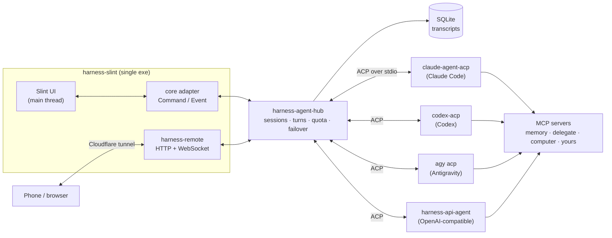

<p align="center">
  
</p>

<p align="center">
  <a href="LICENSE"></a>
  
  
  <a href="https://github.com/rraahh133/Worse/releases/latest"></a>
  <a href="https://github.com/rraahh133/Worse/releases"></a>
</p>

# Worse Harness: a desktop GUI for Claude Code, Codex and other AI coding agents

**Run Claude Code, Codex, Antigravity and any OpenAI-compatible coding agent side by side in one native
desktop app.** Worse Harness (Harness for short) runs the coding agents you already use (Claude Code,
Codex, Antigravity, Command Code, a Hermes gateway, or any OpenAI-compatible model such as DeepSeek) in
one fast Rust app, keeps every conversation in one place, and moves work to another agent when one of
them hits its usage limit.

<p align="center">
  <a href="https://github.com/rraahh133/Worse/releases/latest/download/Worse-Harness-windows-x64-setup.exe"></a>
  <a href="https://github.com/rraahh133/Worse/releases/latest/download/Worse-Harness-macos-universal.dmg"></a>
  <a href="https://github.com/rraahh133/Worse/releases/latest/download/Worse-Harness-linux-x64.tar.gz"></a>
  <br><sub><a href="https://rraahh133.github.io/Worse/">Website</a> · <a href="#why-not-just-use-the-cli">Why not just use the CLI?</a> · <a href="https://github.com/rraahh133/Worse/discussions">Discussions</a></sub>
</p>

<p align="center">
  
</p>

<a href="https://slint.dev"></a>

> Worse Harness is an independent project. It started as a Rust remake of
> [ZCode](https://github.com/zai-org/ZCode) and builds on many open-source projects; see
> [Credits](#credits).

---

## Contents

- [Screenshots](#screenshots)
- [Concept](#concept)
- [Why not just use the CLI?](#why-not-just-use-the-cli)
- [Features](#features)
- [How it works](#how-it-works)
- [Supported agents](#supported-agents)
- [Platforms](#platforms)
- [Getting started](#getting-started)
- [Remote access from your phone](#remote-access-from-your-phone)
- [Configuration and data](#configuration-and-data)
- [Project layout](#project-layout)
- [Development](#development)
- [Design principles](#design-principles)
- [Credits](#credits)
- [License](#license)

---

## Screenshots

<p align="center">
  <br>
  <sub>In motion: the lit letter walks through the wordmark, the dither field shimmers, the bunny flicks an ear.</sub>
</p>

<table>
  <tr>
    <td width="50%"><br><sub>A session: tool calls as flat rows, replies as plain text, the composer on glass.</sub></td>
    <td width="50%"><br><sub>Side panel open: overview, git, terminal and files beside the chat.</sub></td>
  </tr>
  <tr>
    <td width="50%"><br><sub>Light theme: paper instead of near-black, ink instead of white.</sub></td>
    <td width="50%"><br><sub>Settings open as a dialog over the session.</sub></td>
  </tr>
</table>

**Watching the agents work**

<table>
  <tr>
    <td width="50%"><br><sub>Live code: the side pane follows the file the agent reads or edits and marks the lines; each edit shows its first changed lines in the chat.</sub></td>
    <td width="50%"><br><sub>Computer use: the screen the agent sees, its pointer with its name on it, and what it clicked, typed and pressed.</sub></td>
  </tr>
  <tr>
    <td width="50%"><br><sub>Team: one lane per subagent with the step in progress, the steps before it, and who waits for an approval.</sub></td>
    <td width="50%"><br><sub>Your own background: a picture or an animated GIF, blurred and dimmed to taste; the panes turn into frosted glass.</sub></td>
  </tr>
  <tr>
    <td width="50%"><br><sub>Appearance: ten "thinking" animations and five unicode fields, each previewed in motion.</sub></td>
    <td width="50%"><br><sub>Several Command Code API keys: sessions take them in turn, and a key at its limit is skipped.</sub></td>
  </tr>
</table>

<p align="center">
  <br>
  <sub>The phone client served by Harness: pair once, then follow and steer sessions from your phone.</sub>
</p>

The look is monochrome on purpose: near-black, white primary actions, grey hairlines, glass panes with a
light rim, and one small accent. The texture is type: a dither field of `# % * :` behind the chat, a block
wordmark whose lit letter walks through the name, and glyph spinners (`░▒▓█`) instead of rotating icons.
With reduced motion on, the art stays and the animation stops.

<p align="center">
  <br>
  <sub>The mascot: a deadpan bunny in a hi-vis harness. In the app it lives as <code>( -.-)</code> and naps in empty lists.</sub>
</p>

## Concept

Modern coding agents are powerful but scattered: each one has its own CLI, its own login, its own
history and its own usage limits. Harness puts a single desktop app in front of all of them.

- **One workspace, many agents.** Every chat session has a *sticky* agent. You pick the agent in
  the composer; Harness remembers it for that session.
- **Failover instead of waiting.** When an agent hits its usage limit, Harness can continue the same
  session on the next agent in your fallback order (another Claude account, Codex, Antigravity, an
  API model), with the transcript intact.
- **Harness owns the transcript.** Conversations are stored in a local SQLite database, not inside
  one vendor's CLI, so you can search, resume, fork and import them regardless of which agent wrote
  them.
- **Agents talk a standard protocol.** Harness does not embed an LLM runtime. It drives external
  agent CLIs over the [Agent Client Protocol (ACP)](https://github.com/agentclientprotocol/agent-client-protocol)
  on stdio, and ships its own small ACP agent for OpenAI-compatible APIs.
- **Agents can delegate to agents.** Through a built-in MCP server, an agent can spawn subagents
  (for example, a cheap API model for routine edits), receive their results automatically and
  coordinate who edits which files.
- **Native and fast.** The product is a single Rust executable with a [Slint](https://slint.dev)
  UI: no Electron, no webview for the main window, low memory and instant start.

## Why not just use the CLI?

Harness does not replace the Claude Code, Codex or Antigravity CLIs: it runs them. What it adds is
what one CLI per terminal cannot do on its own.

| | Agent CLIs in terminals | Worse Harness |
| --- | --- | --- |
| Several agents on one project | one terminal each, separate histories | one window, one session list, agent picker per session |
| Usage limit reached | stop and wait for the reset, or start over elsewhere | the session continues on the next agent or account, transcript intact |
| History | stored by each CLI in its own format | one local SQLite store: search, resume, fork, import |
| Agents helping each other | copy and paste between terminals | subagents through MCP, results pushed back to the parent |
| Several accounts or API keys | swap logins by hand | Claude accounts, Antigravity accounts and key pools in turn |
| Seeing what the agent does | scrolling text | live code view, diff, git, terminal and the agent's screen beside the chat |
| Away from the desk | SSH into the machine | pair your phone and steer sessions from it |
| Cheaper models (DeepSeek, OpenRouter, Ollama, …) | a separate tool per provider | any OpenAI-compatible endpoint as a full agent with tools |

If you only ever use one agent with one account, the CLI is enough. Harness is for when you switch
between agents, hit limits, or want them to work as a team.

## Features

**Chat and sessions**
- Multiple sessions per project, grouped by workspace folder in the Projects tree.
- Composer with agent picker, model and mode selection, `@` file mentions, image and file
  attachments, slash commands and a command palette.
- Steer a running turn, queue follow-ups, find in transcript, pin, archive, fork sessions.
- "Open folder…" starts a new session whose workspace is that folder.
- Git worktree sessions for isolated changes.
- Import history from ZCode and Claude Code, with native resume where the agent supports it.

**Watch the work**
- **Live code**: tool rows show the lines they covered (`L40–96`) and, for edits, the first changed
  lines; the **Live** tab of the side pane follows the file the agent reads or edits, marks the
  lines (read, about to change, written) and keeps a trail of the files of the turn.
- **Live screen**: in Machine mode the Live tab also shows the agent's last screenshot with its
  pointer, named after the agent, a ripple where it clicked and what it typed or pressed; the real
  pointer glides to its target instead of jumping.
- **Team strip**: a session that delegated work shows one lane per subagent with its current
  step, the steps before it and the time it has been at it.
- **Generation speed**: tokens per second beside the working line (an estimate while the agent
  writes) and under each answer (exact for agents that report token counts); switchable.

**Agents and accounts**
- Built-in adapters for Claude Code, Codex, Antigravity (`agy`) and Command Code, plus custom API
  providers and Hermes gateways.
- Provider presets: pick Command Code API, OpenRouter, OpenAI, DeepSeek, Gemini, xAI, Mistral, Groq,
  Kimi, Z.ai GLM, Qwen, MiniMax, Together, Fireworks, Cerebras, NVIDIA NIM, Hugging Face, Vercel AI
  Gateway, OpenCode Zen, Ollama or LM Studio, and paste the key: the endpoint and a model are filled in,
  and "List models" shows the endpoint's own models to pick from.
- Local memory shared by every agent and session: saved facts, preferences and decisions, plus an
  automatic digest of each session. A new session, or another agent, starts with what is pinned, what
  relates to the request and what the project's latest sessions did. One local file, word search, no
  embedding model ([docs](docs/specs/harness/local-memory.md)).
- Decision model: a small, cheap model (any API provider, for example OpenRouter or Command Code API)
  picks the agent and model of a delegated task that names none, instead of "the first available"
  ([docs](docs/specs/harness/decision-model.md)).
- [Graphify](https://github.com/Graphify-Labs/graphify) support: build the project's knowledge graph
  from Settings (code only, no model; one button installs the tool first when it is missing), and every
  agent gets the graph's query tools and a note on how to use them. The graph is drawn in the app in two
  styles: a simple solar system, and a galaxy of stars around a black hole with a camera you can turn
  ([docs](docs/specs/harness/graphify.md)).
- Several API keys for one service (all Command Code keys; providers with the same endpoint and
  model) form a pool: new sessions and subagents take the keys in turn (round robin), and a key at
  its usage limit is skipped until it resets.
- Multiple Claude Code accounts (separate `CLAUDE_CONFIG_DIR` profiles) and multiple Antigravity
  accounts (credential swap through the OS credential store).
- Quota detection per agent dialect and automatic failover in a configurable order.
- Login detection without ever reading credential files.
- First-run setup that finds installed CLIs and installs missing ACP adapters.

**Orchestration**
- **Orchestra**: route work between agents, background tasks, live subagent panel.
- **Subagents** (`harness-delegate` MCP): up to four concurrent children per session, results
  pushed back to the parent, path claims to avoid edit conflicts.
- **Board**: kanban cards linked to sessions, optional GitHub Project sync.
- **Inbox**: turn incoming items (for example GitHub issues) into agent tasks.
- **Scheduled prompts**: run a prompt on a schedule.

**Tools for agents**
- **Harness MCP registry**: one MCP server list for every agent, with import from Claude Code,
  Codex and Antigravity configs, plus built-in servers:
  - `harness-memory` (project and global `MEMORY.md`),
  - `harness-delegate` (subagents),
  - `harness-computer` (screenshots, mouse and keyboard for computer use).
- Shared skills and instructions (`CLAUDE.md`, `AGENTS.md`, `GEMINI.md`) editable in Settings.
- The built-in API agent loads `AGENTS.md`/`CLAUDE.md` from the project automatically and keeps
  its system prompt stable for prompt caching.

**Workspace panels**
- Diff ("turn changes"), Git, file tree with fast search, integrated terminal (PTY), plan usage.
- Codex plan usage from the signed-in local Codex account; percentages show quota used.

**Look**
- Ten unicode "thinking" animations (Scan, Bars, Pulse, Quads, Charge, Moon, Cipher, Chevrons,
  Bunny, or a different one every turn) and plain or playful status words.
- Unicode field at the window edges: Dither, Rain, Stars, Circuit or none; moving on the home
  screen only, always, or never.
- Wallpaper: a picture or an animated GIF / WebP behind the window with blur and dim sliders. The
  panes show a frosted copy of it, so they read as glass. An animated wallpaper repaints the whole
  window for every frame; it rests while the window is not focused, and **GPU rendering**
  (Settings → General) makes it cheap.

**App**
- Live update on Windows: the app runs from a shadow copy, so a new build can be installed while
  it runs; a "New build ready · Restart" pill appears.
- Native Windows title bar option, dark "Midnight Glass" theme, keyboard shortcuts editor.
- Remote access from a phone (see below).

## How it works



1. A Slint callback sends a `Command` to the core thread.
2. The adapter turns it into a call on the `HarnessCore` API (`crates/harness-core-api`).
3. `harness-agent-hub` runs one actor per session, spawns agent processes on demand, streams ACP
   updates and writes the transcript (it is the only SQLite writer).
4. Hub events flow back to the UI and to connected phones.

The same executable also serves helper modes selected by a leading flag (`--api-agent`,
`--memory-mcp`, `--delegate`, `--computer-mcp`), so Harness ships as one file.

## Supported agents

| Agent | How Harness runs it | Requirements |
| --- | --- | --- |
| Claude Code | [`claude-agent-acp`](https://github.com/agentclientprotocol/claude-agent-acp) | `npm i -g @agentclientprotocol/claude-agent-acp`, signed-in `claude` |
| Codex | [`codex-acp`](https://github.com/agentclientprotocol/codex-acp) | `npm i -g @agentclientprotocol/codex-acp`, signed-in `codex` |
| Antigravity | `agy acp` | Antigravity CLI 1.5+, signed in by running `agy` |
| Command Code | `command-code acp` | `npm i -g command-code`, then `command-code login`, or API keys with the "Command Code CLI" preset (Settings → Agents → API providers → Add provider) |
| Command Code API | built-in `harness-api-agent` against `https://api.commandcode.ai/provider/v1` | a Command Code key with the "Command Code API" preset; no CLI needed (Claude models are not served on this endpoint) |
| Hermes Agent | built-in `harness-api-agent` against the gateway's API server | `hermes gateway` with `API_SERVER_KEY`; add it with the "Hermes gateway" preset |
| Any OpenAI-compatible API (OpenRouter, DeepSeek, Ollama, …) | built-in `harness-api-agent` | a preset and its key in Settings → Agents → API providers → Add provider, or "Other endpoint" with a URL |

A Hermes gateway is a whole agent, not a model: it runs its own tools on its host. Harness sends the
message, shows Hermes's replies, tool progress and approval requests, and lets other agents delegate to
it; nothing is installed on the Hermes side.

Harness never reads or logs credential files; API keys are kept in `providers.json` and only sent
in the `Authorization` header.

## Platforms

| Platform | Status |
| --- | --- |
| Windows 10/11 | Primary target (live update, Credential Manager accounts, native title bar) |
| macOS 11+ | Universal build (arm64 + x86_64) from CI, ad-hoc signed |
| Linux | Builds; GTK3 needed for the file dialog |
| Android | Remote client only (WebView app in `apps/harness-mobile`) |

## Getting started

### Download

Prebuilt binaries are on the [latest release](https://github.com/rraahh133/Worse/releases/latest):

| Platform | File | Run |
| --- | --- | --- |
| Windows 10/11 x64 | [`Worse-Harness-windows-x64-setup.exe`](https://github.com/rraahh133/Worse/releases/latest/download/Worse-Harness-windows-x64-setup.exe) | run the installer (no admin needed); start **Worse Harness** from the Start menu |
| macOS 11+ (Apple silicon and Intel) | [`Worse-Harness-macos-universal.dmg`](https://github.com/rraahh133/Worse/releases/latest/download/Worse-Harness-macos-universal.dmg) | drag **Worse Harness** onto Applications; right-click → **Open** the first time |
| Linux x64 | [`Worse-Harness-linux-x64.tar.gz`](https://github.com/rraahh133/Worse/releases/latest/download/Worse-Harness-linux-x64.tar.gz) | extract, run `./install.sh` (app menu entry + `~/.local/bin/worse-harness`; needs GTK3) |

Like other desktop apps, Harness installs per user: `%LOCALAPPDATA%\Programs\Worse Harness` on
Windows, `/Applications` (or `~/Applications`) on macOS, `~/.local/share/worse-harness` on Linux, so
system search and the app menu find it. Your data stays in `~/.harness` and survives uninstalling.
A portable copy (the Windows `.zip`, or an unpacked app) shows **Install Harness** under Settings ›
General. The app checks for new releases and updates itself. You still need at least one agent from
[Supported agents](#supported-agents); the first-run setup finds installed CLIs and installs missing
ACP adapters.

### Build from source

#### Prerequisites

- Rust stable (pinned by `rust-toolchain.toml`).
- At least one agent from [Supported agents](#supported-agents).
- Linux: GTK3 development packages.

#### Build and run

```powershell
git clone https://github.com/rraahh133/Worse.git
cd Worse
cargo build --release -p harness-slint --bins
./target/release/harness-slint          # harness-slint.exe on Windows
```

Faster local iteration (unoptimized app, optimized dependencies):

```powershell
cargo build -p harness-slint --profile quick   # target/quick/harness-slint
```

Harness opens the current directory (or the last workspace) as the project. Use
**New session ▾ → Open folder…** to work in another folder.

#### macOS (from CI artifacts)

Download `Harness-macos-universal.zip` from the
[macos-release workflow](.github/workflows/macos.yml) artifacts, unzip, then right-click
`Harness.app` → **Open** the first time (the build is ad-hoc signed, not notarized). If macOS still
blocks it: `xattr -dr com.apple.quarantine Harness.app`.

## Remote access from your phone

Harness can serve a small mobile web client from inside the app:

1. **Settings → Remote**: enable the server (loopback `127.0.0.1:7878` by default).
2. Optionally point it at a tunnel helper (for example a wrapper around
   [cloudflared](https://github.com/cloudflare/cloudflared)) to get a public `https://` URL.
3. Pair a device by scanning the QR code or entering the 8-character code.

Security model: per-device tokens (constant-time comparison), rate-limited pairing, Host/Origin
checks, an RPC allowlist and body size caps. The Android app in `apps/harness-mobile` is a thin
WebView around the same client. Details: [docs/plans/remote-contract.md](docs/plans/remote-contract.md).

## Configuration and data

All state lives under `HARNESS_HOME` (default `~/.harness`):

| Path | Contents |
| --- | --- |
| `settings.json` | app settings |
| `providers.json` | custom API providers and Command Code keys (contains API keys); `"rotation": "off"` stops the round robin |
| `accounts.json`, `agy_accounts.json` | Claude / Antigravity account lists (no secrets) |
| `mcp.json` | Harness MCP registry |
| `remote.json` | paired device tokens |
| `harness.sqlite` | sessions, turns, board, inbox, schedules |
| `bin/` | live-update shadow copies |
| `machine-live/` | what an agent using this computer last saw and did (for the Live › Screen view); removed at startup |
| `MEMORY.md` | global memory (projects use `<project>/.harness/MEMORY.md`) |

Useful environment switches:

| Variable | Effect |
| --- | --- |
| `HARNESS_HOME` | data directory root |
| `HARNESS_WORKSPACE` | force the workspace folder |
| `HARNESS_UI_CORE=fake` | scripted in-process core, no agent CLIs (demos, UI tests) |
| `HARNESS_NO_SHADOW=1` | disable the live-update shadow copy |
| `HARNESS_RENDERER=cpu\|gpu\|femtovg\|software` | renderer, overriding Settings → General → GPU rendering (`cpu` = Skia on the CPU, the default; `gpu` = GPU Skia) |
| `HARNESS_KEY_ROTATION=off` | do not rotate over several API keys of one service (failover still walks them) |
| `HARNESS_MACHINE_GLIDE=0` | in computer use, jump the pointer to its target instead of gliding |
| `HARNESS_PROVIDER_KIND=hermes\|openai` | for one provider process: skip the question whether its endpoint is a Hermes gateway |

## Project layout

```text
apps/
  harness-slint/        The product: Slint UI + every helper mode, one executable
  harness-mobile/       Android WebView remote client
  harness-app/          Legacy Tauri v2 + React prototype (reference only)
crates/
  harness-core-api/     HarnessCore trait and wire types (the contract)
  harness-agent-hub/    Sessions, turns, quota, failover, accounts, subagents, MCP servers
  harness-api-agent/    ACP agent for OpenAI-compatible APIs
  harness-agent-config/ Agent CLI config, login detection, MCP registry and import
  harness-settings/     Settings model and single writer
  harness-remote/       Phone HTTP/WebSocket server and pairing
  harness-workspace/    PTY, file watch, search (harness-pty, -watch, -search, -fs, -git)
  harness-import/       Read-only import of ZCode and Claude Code history
  harness-store/ …      Storage and platform helpers
  harness-fake-agent/   Scripted ACP agent for tests
  harness-core-gate/    End-to-end gate driver
docs/
  specs/harness/        Design specs (phase 8+ describe the current product)
  plans/                Remote access and APK plans
scripts/e2e/            End-to-end gates (Node)
```


## Development

```powershell
cargo fmt --all -- --check
cargo clippy --workspace --all-targets -- -D warnings
cargo test -p harness-agent-hub            # per crate; cargo test --workspace for all
node scripts/e2e/phase9-chat.mjs           # example end-to-end gate
```

Android client: JDK 17+, then `cd apps/harness-mobile && ./gradlew assembleDebug`.

## Design principles

- **One owner per piece of state.** Transcript: the hub store. Settings: `SettingsStore`. Subagent
  status: the delegate registry. No second writers.
- **Contracts are additive.** `harness-core-api` changes bump `API_VERSION`.
- **No secrets in logs.** Credentials are checked for presence only; keys travel only in headers.
- **Typed errors, no panics.** `unwrap`/`expect` are denied outside tests; `unsafe` is forbidden
  except in the one Win32 credential module.
- **Small modules.** Files stay roughly under 300 lines, split by responsibility.

## Credits

Worse Harness stands on the shoulders of these projects. Thank you to their authors and contributors.

**Origin and concepts**
- [ZCode](https://github.com/zai-org/ZCode) by Z.ai (Apache-2.0): Harness began as a Rust remake of
  ZCode. Its product behaviour served as the parity reference for sessions, settings, remote
  control, history import and UI flows, and its file-type icons are reused (see below).
- [Agent Client Protocol](https://github.com/agentclientprotocol/agent-client-protocol)
  (Apache-2.0): the protocol Harness speaks to every agent.
- [claude-agent-acp](https://github.com/agentclientprotocol/claude-agent-acp) and
  [codex-acp](https://github.com/agentclientprotocol/codex-acp): ACP adapters for Claude Code and
  Codex.
- [Model Context Protocol](https://github.com/modelcontextprotocol/modelcontextprotocol): the tool
  protocol behind the Harness MCP registry and built-in servers.
- [Zed](https://github.com/zed-industries/zed): the editor that introduced ACP and the original ACP
  adapters.
- [billion-context](https://github.com/ranxianglei/billion-context) by ranxianglei (MIT): the
  reversible, model-driven context folding (compress, decompress, search, status) that the Harness
  API agent's context compaction is modelled on.

**Agents Harness integrates with** (used as external tools, not bundled)
- [Claude Code](https://github.com/anthropics/claude-code) by Anthropic
- [Codex CLI](https://github.com/openai/codex) by OpenAI
- [Antigravity](https://antigravity.google) by Google
- Any OpenAI-compatible API, for example [DeepSeek](https://github.com/deepseek-ai)

**Frameworks and libraries**
- [Slint](https://github.com/slint-ui/slint): the native UI toolkit (royalty-free license with
  attribution).
- [Tauri](https://github.com/tauri-apps/tauri): used by the legacy `apps/harness-app` prototype.
- [Tokio](https://github.com/tokio-rs/tokio), [rusqlite](https://github.com/rusqlite/rusqlite),
  [portable-pty](https://github.com/wezterm/wezterm) (WezTerm),
  [ignore / grep](https://github.com/BurntSushi/ripgrep) (ripgrep),
  [notify](https://github.com/notify-rs/notify), [rfd](https://github.com/PolyMeilex/rfd),
  [xcap](https://github.com/nashaofu/xcap), [enigo](https://github.com/enigo-rs/enigo),
  [qrcode](https://github.com/kennytm/qrcode-rust), [toml_edit](https://github.com/toml-rs/toml),
  [image](https://github.com/image-rs/image), [chrono](https://github.com/chronotope/chrono),
  [uuid](https://github.com/uuid-rs/uuid), [serde](https://github.com/serde-rs/serde) and the rest
  of the crates listed in `Cargo.lock`.
- [cloudflared](https://github.com/cloudflare/cloudflared): Cloudflare Tunnel, used through a
  user-provided helper for phone access.

**Icons** (details and license texts in
[`apps/harness-slint/ui/icons/LICENSES.md`](apps/harness-slint/ui/icons/LICENSES.md))
- [Hugeicons](https://github.com/hugeicons/hugeicons) (MIT)
- [Phosphor Icons](https://github.com/phosphor-icons/core) (MIT)
- [Solar icon set](https://www.figma.com/community/file/1166831539721848736) by 480 Design (CC BY 4.0)
- [Material Icon Theme](https://github.com/material-extensions/vscode-material-icon-theme) by
  Philipp Kief (MIT), via ZCode
- Icon data packaged by [Iconify](https://github.com/iconify/icon-sets)

**Fonts** (SIL Open Font License 1.1, license texts in `apps/harness-slint/ui/fonts`)
- [Plus Jakarta Sans](https://github.com/tokotype/PlusJakartaSans) by Tokotype and
  [Inter](https://github.com/rsms/inter) by Rasmus Andersson: interface text
- [Syne](https://gitlab.com/bonjour-monde/fonderie/syne-typeface) by Bonjour Monde: display headings
- [Instrument Serif](https://github.com/Instrument/instrument-serif): italic taglines
- [JetBrains Mono](https://github.com/JetBrains/JetBrainsMono): glyph art and mono labels

**Mascot**: the deadpan bunny in the hi-vis harness (`docs/brand`, `apps/harness-slint/ui/brand`) is
original artwork for this project, as is its ASCII form `( -.-)` that naps in empty lists. The glyph
art frames are generated by `scripts/ui/gen-ascii-art.mjs`.

Product names and trademarks belong to their owners. Worse Harness is not affiliated with or endorsed by
Anthropic, OpenAI, Google, Z.ai, DeepSeek, Cloudflare or Zed Industries.

## License

Worse Harness is licensed under the [Apache License 2.0](LICENSE). See [NOTICE](NOTICE) for attribution:
portions are derived from [ZCode](https://github.com/zai-org/ZCode) (Apache-2.0), and third-party
components keep their own licenses as listed above.
