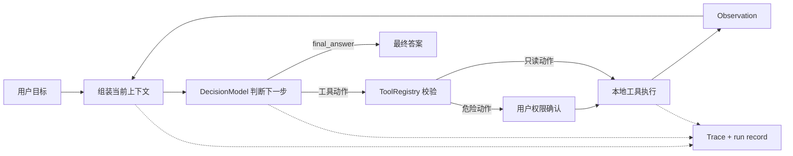

# Min Agent

一个可观察、可本地运行的最小 Agent 机制演示器。

它不是生产级 Agent，也不是迷你版 Claude Code。这个项目只做一件事：让你从页面上看清楚 Agent 如何围绕目标持续判断、调用受控工具、吸收执行结果，最后完成任务。


## 你能从中看到什么

- 一条真实运行的 Agentic Loop，而不是前端预设动画。
- 模型如何基于当前上下文提出下一步结构化动作。
- 工具结果如何以 Observation 回到下一轮判断。
- 多步骤目标如何被拆成顺序任务，并通过结构化产物传递信息。
- `write_file`、`run_command` 为什么必须先得到使用者批准。
- 同一份结构化 Trace 如何支撑实时观察、错误定位和历史回放。

## 快速开始

运行环境：Python 3.10 或更高版本；支持 macOS 和 Linux。当前稳定源码版本为 V1.1，以克隆仓库直接运行的方式发布，不承诺 PyPI 安装入口。

```bash
git clone https://github.com/JinweiX/min-agent.git
cd min-agent
PYTHONPATH=src python3 -m min_agent.web_app \
  --workspace examples/workspace \
  --runs-dir runs \
  --port 8765
```

打开终端输出的本机网址。服务只监听 `127.0.0.1`，默认使用不访问外部模型的 Fake 模式。

第一次运行建议直接点击页面上的预置任务：

1. `请阅读这个工作区里的资料，并总结这个 demo 是怎么工作的`
2. `请阅读 project.md 并生成 summary.md`
3. `阅读 workspace 中的项目资料，获取当前时间，并生成一份带时间的 summary.md。`

第一个任务演示只读循环；第二个任务会等待写文件批准；第三个任务会展示任务分解、命令权限和跨任务产物。

## Agent 如何运行



模型不能直接读写文件或执行命令。它只能返回受支持的 `AgentAction`；路径校验、命令白名单、权限确认和实际执行都由本地运行时负责。

更完整的组件职责和数据流见 [架构说明](docs/architecture.md)。

## Fake 与 DeepSeek

| 模式 | 适合场景 | 是否访问外部服务 | 说明 |
| --- | --- | --- | --- |
| Fake | 第一次体验、教学、自动测试 | 否 | 确定性的有限决策器，根据目标和 Observation 选择演示动作 |
| DeepSeek | 观察真实模型参与下一步判断 | 是 | 页面输入 Key 后，真实模型返回本地 `AgentAction`，工具仍只在本机执行 |

Web 模式的 DeepSeek Key 只保存在当前服务进程内存中，不写入 `.env`、Trace、运行记录或浏览器持久化存储。页面刷新不能取回 Key，服务停止后 Key 失效。

## 数据与安全边界

在把服务指向自己的工作区之前，请先理解这些边界：

- workspace 在服务启动时固定，页面不能传入或切换其他目录。
- 文件工具拒绝 `..` 逃逸、工作区外绝对路径和指向外部的 symlink。
- `write_file` 只创建新文本文件，不能覆盖已有文件，并且每次都需要批准。
- `run_command` 只接受本地注册的固定命令，不接受任意命令字符串、参数、shell、管道或重定向。
- DeepSeek 模式会把任务目标、模型上下文和被选中的相关文件内容发送给配置的模型服务。
- `runs/*.json` 可能保存任务目标、文件内容、模型输入输出、工具结果和完整 Trace。不要用敏感工作区做首次体验，也不要公开提交运行记录。
- 同一时间只允许一个活动运行；历史记录仅供只读回放，不能再次执行工具。

## V1.1 的边界

V1.1 已包含：网页发起 Fake/DeepSeek 任务、实时过程观察、网页权限确认、任务计划与产物展示、只读历史回放，以及兼容的单次 CLI 入口。在 V1.0 能力基础上，V1.1 统一了页面视觉语言，强化 `Goal -> Decide -> Tool -> Observe` 阅读路径，并补齐表单、权限抽屉、异步反馈、历史分页和 390px 窄屏体验。

V1.1 不增加新的 Agent 能力，也不包含：远程访问、登录、多用户、多 workspace、并发队列、停止/恢复/重试、动态改计划、任意命令、覆盖文件、长期记忆、多 Agent、MCP、Hook 或插件系统。

当前项目以 V1.1 作为稳定公开版本，短期内进入维护冻结期。发现运行问题或边界描述不一致时，请通过 [GitHub Issues](https://github.com/JinweiX/min-agent/issues) 反馈。

## CLI 入口

原有单次 CLI 仍可用于脚本和机制测试：

```bash
PYTHONPATH=src python3 -m min_agent.cli \
  "请阅读这个工作区里的资料，并总结这个 demo 是怎么工作的" \
  --workspace examples/workspace
```

CLI 的 DeepSeek 模式从环境变量读取 `DEEPSEEK_API_KEY`；Web 模式不读取这个环境变量。

## 测试

```bash
python3 -m unittest discover -s tests
```

测试覆盖机制边界、Agent 场景、Web API 和前端结构。页面相关改动还必须完成真实浏览器验收，源码检查不能替代浏览器运行。

## 继续阅读

- [架构说明](docs/architecture.md)
- [运行与排查手册](docs/runbook.md)
- [V1.1 产品设计](docs/superpowers/v1.1/product-design.md)
- [V1.1 验收记录](docs/superpowers/v1.1/acceptance.md)
- [版本记录](CHANGELOG.md)

## License

[MIT](LICENSE)
