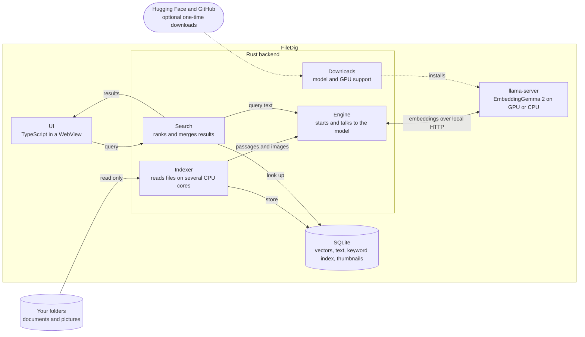

<div align="center">


# FileDig

**Find your files by what they contain, not what they are called.**

Local semantic search for documents and pictures on Windows. Nothing leaves your computer.


[Download](../../releases/latest) · [Features](#features) · [Getting started](#getting-started) · [Build from source](#build-from-source)


</div>

## About

Type what you are looking for in plain language, such as *"how much is the rent"* or
*"photo of a sunset"*, and FileDig finds the matching text files, PDFs and images by meaning.

It runs [EmbeddingGemma 2](https://huggingface.co/google/embeddinggemma-2) on your own machine
through [llama.cpp](https://github.com/ggml-org/llama.cpp), using an NVIDIA GPU when one is
available and the CPU otherwise. Inspired by [DigUp](https://github.com/ARahim3/DigUp) for macOS.

## Features

- 🔎 **Search by meaning** across text and images in one index
- 🎯 **Exact-match search** for names, codes and numbers, merged with the semantic results
- 📄 **PDF results open at the page** that matched
- 🖼️ **Image search** by what a picture shows, with a thumbnail grid
- ⚡ **GPU acceleration** on NVIDIA cards, with automatic CPU fallback
- 🔄 **Incremental indexing** that only processes new or changed files
- ⏸️ **Stop and resume** indexing at any time, with a warning while a folder is incomplete
- ⌨️ **Global hotkey** (`Ctrl+Shift+Space`) and a tray icon
- 🔒 **Private and read-only**: files are never changed, moved or uploaded
- 📦 **Portable**: runs from a folder with no installation

### Supported files

| Kind | Extensions |
|---|---|
| Text | `txt` `md` `markdown` `rst` `log` `csv` `html` `htm` `docx` |
| PDF | `pdf` (text layer, indexed per page) |
| Images | `jpg` `jpeg` `png` `webp` `bmp` `gif` |

## Getting started

### Requirements

- 64-bit Windows 10 or 11 (the WebView2 runtime is part of Windows 11 and up-to-date Windows 10)
- About 1 GB of free disk space for the model
- Optional: an NVIDIA graphics card with a recent driver and about 4 GB of free VRAM

### Install

1. Download `FileDig-lite.zip` from the [latest release](../../releases/latest).
2. Unzip it anywhere and run `FileDig.exe`.
3. Click **Download model** on the start screen. This is a one-time download of about 825 MB.
4. Click **Folders**, then **Add folder**, or drag a folder into the window.

Indexing starts straight away, and you can search while it runs.

### Turn on GPU acceleration

On a PC with an NVIDIA card, open **Settings** (the gear next to **Folders**) and choose
**Download GPU support** (about 626 MB). Indexing becomes several times faster, and the existing
index keeps working.

Only an up-to-date NVIDIA driver is needed. The CUDA toolkit is not.

## Usage

| Key | Action |
|---|---|
| `Ctrl+Shift+Space` | Show or hide the window from anywhere |
| `↑` `↓` | Move the selection |
| `Enter` | Open the selected file |
| `Ctrl+Enter` | Show the file in Explorer |
| `Esc` | Hide the window |

- **Tabs** switch between All, Documents and Images.
- **Exact match** marks results that contain every word you typed.
- **Rescan**, in the Folders panel, picks up files added, changed or deleted since the last pass.
  A rescan also runs each time the app starts.
- Closing the window keeps FileDig in the tray. To quit, right-click the tray icon and choose **Quit**.

## Privacy

Searching and indexing never leave your computer. The only network requests FileDig makes are the
two optional downloads you start yourself: the model from Hugging Face and GPU support from the
llama.cpp releases on GitHub. Both are pinned to exact versions and verified by SHA-256 before use.

There is no account, no telemetry and no update check.

## Performance

Measured on an RTX 3060 12 GB with a Core i7-12700:

| | GPU (CUDA) | CPU |
|---|---|---|
| Search | 50–80 ms | not measured |
| Indexing photos (about 3.5 MB each) | about 7 per second | about 1 per second |

The model unloads after 5 minutes without use to free VRAM, and reloads in a few seconds on the
next search.

<details>
<summary><b>Installing the model and GPU support by hand</b></summary>

<br>

The in-app downloads are a convenience, not a requirement. If the files are already in place,
FileDig uses them and never offers the download. This suits offline PCs and slow connections:
download once on another machine and copy the `runtime` folder across.

FileDig looks in two `runtime` folders, in this order:

1. Inside the data folder: `%APPDATA%\com.rupesh.filedig\runtime` for an installed copy, or
   `data\runtime` in a portable copy. The in-app downloads go here.
2. Beside the executable: the `runtime` folder next to `FileDig.exe`, or the folder named by
   `FILEDIG_RUNTIME`.

Either location works, and the parts can be split between them.

```
runtime\
  llama-cuda\   llama-server.exe + all DLLs from the CUDA zip and the cudart zip
  llama-cpu\    llama-server.exe + all DLLs from the CPU zip
  models\
    embeddinggemma-2-Q8_0.gguf
    mmproj-embeddinggemma-2-Q8_0.gguf
```

Where to get the files:

- **Model**: both `.gguf` files from
  [ggml-org/embeddinggemma-2-GGUF](https://huggingface.co/ggml-org/embeddinggemma-2-GGUF).
- **GPU support** (NVIDIA only): `llama-<build>-bin-win-cuda-12.4-x64.zip` and
  `cudart-llama-bin-win-cuda-12.4-x64.zip` from the
  [llama.cpp releases](https://github.com/ggml-org/llama.cpp/releases), both extracted into
  `llama-cuda`.
- **CPU backend**: `llama-<build>-bin-win-cpu-x64.zip` from the same page, extracted into
  `llama-cpu`. The release packages already include it.

Things to get right:

- File and folder names must match exactly.
- Files go directly in the folder, not in a subfolder created by the unzip tool.
- Use llama.cpp build `b11552` or later; earlier builds do not support this model. Pair the
  CUDA 12.4 zip with the 12.4 cudart zip.
- Restart FileDig afterwards so it picks up the new files.
- Files placed by hand are not checksum-verified. A truncated download shows up as the model
  failing to start; the reason is in `llama-cuda.log` or `llama-cpu.log` in the data folder.

</details>

## Build from source

You need [Rust](https://rustup.rs), [Node.js](https://nodejs.org) and [pnpm](https://pnpm.io).

```sh
git clone <this repository>
cd filedig
pnpm install
pnpm tauri dev
```

The app offers to download the model on first run. To use files you already have, place a
`runtime` folder in the project root, laid out as described in
*Installing the model and GPU support by hand* above.

### Portable packages

```powershell
pwsh scripts\package-portable.ps1 -Lite -Zip   # about 25 MB; model downloaded on first run
pwsh scripts\package-portable.ps1 -CpuOnly     # model included, CPU backend
pwsh scripts\package-portable.ps1              # model, CPU and GPU backends (about 2 GB)
```

Packages are written to `dist-portable\`. A copy is portable whenever a `data` folder sits beside
the executable: the index, logs and downloads then go there instead of `%APPDATA%`.

### Configuration

| Environment variable | Purpose |
|---|---|
| `FILEDIG_RUNTIME` | Folder holding the model and llama.cpp builds |
| `FILEDIG_DATA` | Folder for the index, instead of the per-user data folder |
| `FILEDIG_INDEX_THREADS` | Files read at once while indexing (default: half the logical cores, at most 8) |
| `FILEDIG_MULTI_INSTANCE` | Set to any value to allow more than one copy to run at once, for testing |

## How it works



- **Indexer** (`src-tauri/src/indexer.rs`): walks the folders, splits text into overlapping
  passages of about 1,200 characters, extracts PDF text page by page, and downsizes images before
  embedding. Files are read on several CPU cores while the model works on the GPU.
- **Engine** (`src-tauri/src/engine.rs`): runs `llama-server` as a hidden helper on a free local
  port. Text and images are embedded into the same 768-dimensional space, so a text query can
  match either.
- **Storage** (`src-tauri/src/db.rs`): one SQLite file holds the files, passages, vectors,
  thumbnails and an FTS5 keyword index. Vectors are compared by brute force in memory.
- **Search** (`src-tauri/src/lib.rs`): the semantic and keyword rankings are merged with
  reciprocal rank fusion, and the best passage per file is shown.
- **Downloads** (`src-tauri/src/setup.rs`): fetches the model and GPU backend with resume and
  checksum verification.
- **UI** (`src/`): plain TypeScript and CSS, built with Vite.

The index is stored at `%APPDATA%\com.rupesh.filedig\index.db`. Deleting that file resets it.

## Limitations

- Windows only for now.
- No live file watching: changes are picked up on startup or with **Rescan**.
- Scanned PDFs without a text layer are skipped, and there is no OCR for screenshots.
- Audio, video and source code are not indexed.
- Results are limited to the top 48 matches.
- Text files over 5 MB, images over 50 MB and PDFs over 100 MB are skipped.
- Tested with libraries of a few hundred files. Very large libraries (hundreds of thousands of
  items) will use a lot of memory, because every vector is held in RAM.

## Acknowledgements

- [DigUp](https://github.com/ARahim3/DigUp), the macOS app that inspired this one
- [EmbeddingGemma 2](https://huggingface.co/google/embeddinggemma-2) by Google DeepMind (Apache 2.0)
- [llama.cpp](https://github.com/ggml-org/llama.cpp) (MIT)
- [Tauri](https://tauri.app) (MIT / Apache 2.0)

## License

[MIT](LICENSE) © 2026 Rupesh Sreeraman
