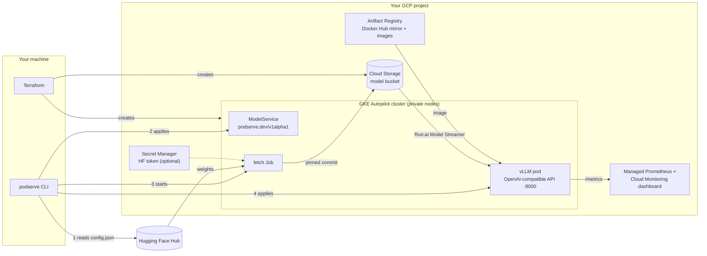

# podserve: Serve Hugging Face Models on GKE with vLLM

**podserve** is an open-source stack for deploying and serving Hugging Face models on Google Kubernetes Engine (GKE) behind an OpenAI-compatible API, installed directly into your own GCP project.

Point podserve at a model on the Hugging Face Hub and it computes the hardware sizing and engine settings before any GPU is scheduled, caches weights once in your Cloud Storage bucket, provisions GKE Autopilot GPU capacity on demand, and exposes an OpenAI-compatible `/v1` API with Cloud Monitoring observability out of the box. **NVIDIA GPUs today; Cloud TPUs and multi-model enterprise operations on the roadmap.**

```console
$ podserve plan hf://Qwen/Qwen3-14B
Model:        Qwen/Qwen3-14B @ 40c069824f42 (text-generation, apache-2.0)
Architecture: Qwen3ForCausalLM (supported by vLLM v0.32.0)
Weights:      27.5 GiB, served as bfloat16
GPU:          2x nvidia-l4 on g2-standard-24 (20 CPU, 80Gi)
Parallelism:  tensor-parallel 2
Context:      40960 tokens (model maximum 40960)
KV cache:     8.0 GiB, 52298 tokens, 1 sequence(s) at full context
Deployable:   yes

$ podserve deploy hf://Qwen/Qwen3-14B
Planned: 2x nvidia-l4, tensor-parallel 2, context 40960 (Qwen/Qwen3-14B @ 40c069824f42)
[0:00] record    applied podserve/qwen3-14b
[0:01] fetch     caching Qwen/Qwen3-14B@40c069824f42 into gs://podserve-models-1c7cd944c28c/models/hf/Qwen/Qwen3-14B/40c069824f4251a91eefaf281ebe4c544efd3e18...
[8:37] fetch     done
[8:38] node      waiting for a GPU node (2x nvidia-l4, spot)
[10:31] image     pulling the vLLM image
[10:36] loading   loading weights and warming up
[20:22] ready     qwen3-14b is ready
Endpoint (in cluster): http://qwen3-14b.podserve.svc:8000/v1
```

## What is included in v0.1.1

v0.1 delivered the single-model, one-command end-to-end foundation on GKE Autopilot; v0.1.1 hardens
it (see [CHANGELOG.md](CHANGELOG.md)):

- **Terraform platform ([`deploy/terraform`](deploy/terraform)):** provisions a VPC and private subnet with Cloud NAT, a private regional GKE Autopilot cluster, a Cloud Storage model-cache bucket, an Artifact Registry Docker Hub mirror + custom image repository, a Secret Manager slot for optional Hugging Face tokens, Workload Identity Federation bindings (no service-account keys), and a Cloud Monitoring dashboard.
- **Zero-GPU planner (`podserve plan`):** fetches `config.json` from Hugging Face, validates vLLM `v0.32.0` architecture support, and calculates GPU count, tensor parallelism, maximum context length, and KV cache capacity against [`catalog/gpus.yaml`](catalog/gpus.yaml)—or explains clearly why a model cannot be served.
- **CLI lifecycle (`podserve init`, `deploy`, `list`, `status`, `delete`, `port-forward`):** records a `ModelService` custom resource (`podserve.dev/v1alpha1`), runs an isolated CPU fetch Job (`images/fetch/`) to cache `.safetensors` weights into GCS pinned by commit SHA, launches a spot or on-demand NVIDIA L4 vLLM Deployment streaming directly from GCS (`runai_streamer`, `HF_HUB_OFFLINE=1`), and tears down GPU nodes cleanly on `delete`.
- **Fail fast, say why (v0.1.1):** when a model can't start (a crash loop, an image that can't be pulled), `deploy` stops at once, prints Kubernetes' reason and the last lines of vLLM's log, exits 7, and scales the model to zero so the GPU node is released. While it waits it prints Autopilot's reasons (a node being added, a spot stockout, a reclaimed spot node). `podserve status NAME` shows a model's phase, stage and reason at any time.
- **Observability ([`dashboards/model-service.json`](dashboards/model-service.json)):** Managed Prometheus `PodMonitoring` and a pre-built Cloud Monitoring dashboard filtered by `model_name` (TTFT, inter-token latency, end-to-end latency, request/token throughput, running vs. waiting queue, KV cache usage, prefix-cache hits, and preemptions).

### Not yet in v0.1.1

- **Endpoint exposure & auth:** services are ClusterIP-only inside the cluster (reached locally via `podserve port-forward`); GKE Inference Gateway routing, API keys, and external ingress arrive in later releases.
- **Single replica, CLI-driven reconciliation:** no autoscaling, scale-to-zero, or in-cluster operator yet (the v0.2 operator adopts the v0.1 `ModelService` CRD unchanged).
- **Models & accelerators:** `text-generation` models with `.safetensors` weights deployed on `nvidia-l4` GPUs (`podserve plan` also models A100 and H100).

See [Vision and roadmap](#vision-and-roadmap) for what comes next.

## Quickstart

**Prerequisites:**
- A GCP project with billing linked.
- Spot NVIDIA L4 GPU quota in your target region (at least `1` for Qwen3-8B, `2` for Qwen3-14B).
- Local tools: [gcloud](https://cloud.google.com/sdk/docs/install), Terraform `>= 1.14`, Go `>= 1.26`, and `kubectl` with `gke-gcloud-auth-plugin`.

See [docs/quickstart.md](docs/quickstart.md) for a step-by-step walkthrough, what each command creates, and troubleshooting tips.

```bash
# Sign in (gcloud for the CLI, application-default credentials for Terraform)
gcloud auth login
gcloud auth application-default login

# Get podserve and build the CLI
git clone https://github.com/ryanymt/podserve.git
cd podserve
go build -o podserve ./cmd/podserve

# Your project and region
export PROJECT=my-gcp-project REGION=us-central1

# A bucket for Terraform's state (kept after destroy)
gcloud storage buckets create gs://$PROJECT-podserve-tfstate --project $PROJECT --location $REGION --uniform-bucket-level-access --public-access-prevention
gcloud storage buckets update gs://$PROJECT-podserve-tfstate --versioning

# The platform: network, private GKE Autopilot cluster, model bucket, registries (~10 min)
printf 'project_id = "%s"\nregion     = "%s"\n' $PROJECT $REGION > deploy/terraform/terraform.tfvars
terraform -chdir=deploy/terraform init -backend-config="bucket=$PROJECT-podserve-tfstate"
terraform -chdir=deploy/terraform apply
terraform -chdir=deploy/terraform output -json > platform.json

# Connect, and prepare the cluster (~1 min; builds the fetch image with Cloud Build)
gcloud container clusters get-credentials podserve --region $REGION --project $PROJECT --dns-endpoint
./podserve init --config platform.json
```

> **Gated models (e.g., Llama, Gemma):** if your model requires a Hugging Face license agreement, export `HF_TOKEN` locally and store it in the `podserve-hf-token` Secret Manager secret before running `plan` and `deploy` — see [Hugging Face token in Secret Manager](#hugging-face-token-in-secret-manager).

```bash
# Serve a model (~16 min the first time, mostly copying 16 GB from the Hub)
./podserve plan hf://Qwen/Qwen3-8B
./podserve deploy hf://Qwen/Qwen3-8B
```

Forward the port in a second terminal and test the OpenAI-compatible API:

```bash
./podserve port-forward qwen3-8b
```

```bash
curl localhost:8000/v1/models
curl localhost:8000/v1/chat/completions -H 'Content-Type: application/json' -d '{"model":"Qwen/Qwen3-8B","messages":[{"role":"user","content":"In one sentence: what is Kubernetes? /no_think"}],"max_tokens":80,"temperature":0}'
```

Clean up when finished (Autopilot releases the GPU node shortly after `podserve delete`; `destroy` removes everything except the Terraform state bucket):

```bash
./podserve delete qwen3-8b
terraform -chdir=deploy/terraform destroy
```

## Hugging Face token in Secret Manager

Open models (such as `Qwen/Qwen3-8B`) work with no token. For **gated models** (such as Llama or Gemma):

1. Accept the model's license on huggingface.co.
2. Make your Hugging Face token available in two places — locally via `HF_TOKEN` (used by `podserve plan` to inspect `config.json`) and in Google Cloud Secret Manager (used by the cluster's fetch Job when copying weights into GCS):

```bash
export HF_TOKEN=hf_...   # a token from huggingface.co/settings/tokens
printf %s "$HF_TOKEN" | gcloud secrets versions add podserve-hf-token --project $PROJECT --data-file=-
```

`terraform apply` creates the `podserve-hf-token` Secret Manager secret empty so no token ever enters Terraform state. Only the fetch Job's Workload Identity principal (`podserve-fetch`) is granted `roles/secretmanager.secretAccessor`; serving vLLM pods have no access to the secret.

## How it works



`podserve deploy hf://ORG/MODEL` runs five steps:

1. **Plans:** reads `config.json` from Hugging Face, validates architecture support for vLLM `v0.32.0`, and computes GPU shape, tensor parallelism, and context length ([`docs/design/profile.md`](docs/design/profile.md)).
2. **Records:** applies a `ModelService` custom resource (`podserve.dev/v1alpha1`) as the source of truth ([`docs/design/modelservice.md`](docs/design/modelservice.md)).
3. **Caches:** runs an isolated CPU Kubernetes Job (`images/fetch/`) that copies `.safetensors` weights into your GCS bucket pinned to the commit SHA, skipping the copy on subsequent deploys.
4. **Serves:** applies a Deployment, ClusterIP Service, and `PodMonitoring` resource. GKE Autopilot provisions a spot L4 node when scheduled and releases it after deletion; vLLM runs offline (`HF_HUB_OFFLINE=1`) streaming weights directly from GCS.
5. **Waits:** streams stage progress (`record` -> `fetch` -> `node` -> `image` -> `loading` -> `ready`) and Autopilot's waiting reasons until `/v1/models` is healthy. A model that can't start is stopped at once with Kubernetes' reason and scaled to zero, so no GPU keeps running.

**Platform design defaults** ([`docs/design/platform.md`](docs/design/platform.md)):
- **Workload Identity Federation:** workloads authenticate directly as Kubernetes service accounts with zero exported service-account keys.
- **Private nodes:** GKE Autopilot nodes have no external IP addresses and reach the internet via Cloud NAT.
- **Supply chain:** upstream vLLM container images are pulled through an Artifact Registry Docker Hub mirror pinned by SHA-256 digest.

## Baseline performance (v0.1)

Measured on GKE Autopilot in `us-central1` on spot `nvidia-l4` nodes with vLLM `v0.32.0`:

| | Qwen3-8B (1x L4) | Qwen3-14B (2x L4, TP 2) |
|---|---|---|
| First deploy to Ready (incl. Hub -> GCS copy) | 15:48 | 20:22 |
| Redeploy with weights cached in GCS | 7:12 | — |
| Context length selected | 17,408 | 40,960 |
| KV cache: estimated vs vLLM actual | 18,114 vs 19,760 tokens | 52,298 vs 66,496 tokens |
| GPU node released after `podserve delete` | 148 s | 117 s |

Load test (`deploy/examples/loadtest-job.yaml`, Qwen3-8B on 1x L4, 200 prompts of 512 input / 128 output tokens, concurrency 8):
- **TTFT:** p50 `796 ms`, p99 `1,488 ms`
- **Inter-token latency:** p50 `66 ms`
- **Throughput:** `105` output tok/s

v0.1.1's live run measured Qwen3-8B again: first deploy `16:16`, a cached redeploy `3:40`, and the same load test at `105` output tok/s with a median TTFT of `988 ms`.

## Supported models and GPUs

In v0.1.1, `podserve deploy` accepts a Hugging Face model when:
- Its Hub pipeline tag is `text-generation`.
- Its architecture is natively supported by vLLM `v0.32.0` ([`catalog/vllm-v0.32.0-architectures.txt`](catalog/vllm-v0.32.0-architectures.txt)).
- It ships `.safetensors` weights (pickle `.bin` checkpoints are refused).
- It fits on 1, 2, 4, or 8 `nvidia-l4` GPUs (`podserve plan` also evaluates `nvidia-tesla-a100`, `nvidia-a100-80gb`, and `nvidia-h100-80gb`).

Gated models (such as Llama or Gemma) require a Hugging Face token stored both locally (`HF_TOKEN` for `podserve plan`) and in Secret Manager (`podserve-hf-token` for the fetch Job) — see [Hugging Face token in Secret Manager](#hugging-face-token-in-secret-manager) and [docs/quickstart.md#gated-models](docs/quickstart.md#gated-models).

## Vision and roadmap

The long-term goal is a complete, self-hosted GCP model-serving platform from single-model prototyping to multi-tenant GPU/TPU production:

| Release | Scope |
|---|---|
| v0.1 | One model, one command: Terraform platform, CLI planner & deployer, text models on spot L4, Cloud Monitoring dashboard |
| **v0.1.1** | Hardening: `deploy` fails fast and says why, `podserve status`, `go install` from the tag |
| **v0.2** | Kubernetes operator (`ModelCache` / `ModelService`), GKE Inference Gateway for multi-model routing, autoscaling & scale-to-zero, faster cold starts |
| **v0.3** | Multimodal vision, embeddings, rerankers, quantized weights, tool calling, LoRA adapters, and compatibility support matrix |
| **v0.4** | Multi-tenancy & GPU quotas, API keys & rate limits, weight supply-chain security, Model Armor integration |
| **v0.5** | Web console: model catalogue, deploy wizard, and interactive playground |
| **v0.6** | Canary rollouts, automated benchmarking, latency SLOs, alerts, and cost attribution |
| **v1.0** | General availability: upgrade path, end-to-end CI, signed releases, security hardening |
| **v1.1** | Cloud TPU serving, unified GPU and TPU fleet behind one endpoint |
| **v1.2** | Multi-cluster & multi-region routing, multi-host models, disaggregated prefill/decode |

## Repository layout

| Path | Contents |
|---|---|
| [`cmd/podserve`](cmd/podserve), [`pkg/`](pkg), [`internal/`](internal) | Go CLI, `ModelService` API types/validation, HF Hub client, GPU memory profiler, K8s renderer & client, offline test fakes |
| [`catalog/`](catalog) | GPU specs (`gpus.yaml`) and supported vLLM architectures |
| [`config/crd/`](config/crd) | Generated `ModelService` CustomResourceDefinition |
| [`deploy/terraform`](deploy/terraform) | GCP platform Terraform modules and offline `terraform test` suite |
| [`deploy/examples`](deploy/examples) | Example vLLM `vllm bench serve` Kubernetes Job |
| [`images/fetch`](images/fetch) | Python fetch Job image (`fetch.py`) and unit tests |
| [`dashboards/`](dashboards) | Cloud Monitoring dashboard JSON |
| [`docs/`](docs) | [Quickstart guide](docs/quickstart.md) and component design contracts ([`docs/design/`](docs/design)) |
| [`hack/`](hack) | Contributor utilities (CRD field extractor, quickstart runner, cleanup checker, vLLM metadata extractors) |
| [`tests/`](tests), [`testdata/`](testdata) | Offline test & lint suites, recorded HF fixtures, and golden files |

## Development and testing

Everything builds and runs offline once Go modules, PyYAML, and Terraform providers are cached locally:

```bash
# One-time Terraform provider mirror for offline tests/lint
terraform -chdir=deploy/terraform providers mirror "$HOME/.cache/podserve/tf-mirror"

# Build, test, and lint offline
go build ./...
bash tests/run.sh
bash tests/lint.sh
```

## Contributing, contact, and security

- **Contributing:** See [CONTRIBUTING.md](CONTRIBUTING.md) for workflow, code generation, and testing expectations.
- **Maintainer contact:** [dev@podserve.dev](mailto:dev@podserve.dev) or open a GitHub issue.
- **Security:** Please report vulnerabilities privately to [dev@podserve.dev](mailto:dev@podserve.dev) rather than opening a public issue—see [SECURITY.md](SECURITY.md).

## License

Licensed under the [Apache License, Version 2.0](LICENSE).
